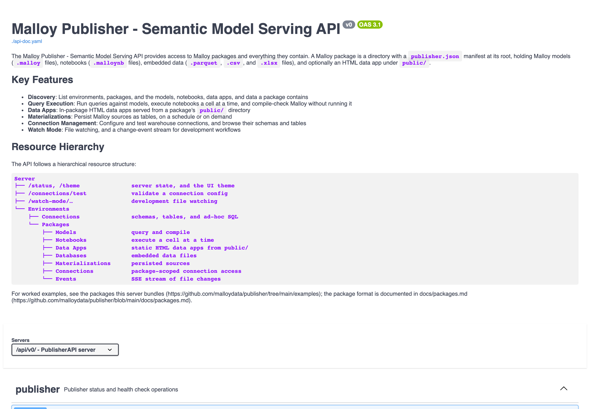

<!--
Copyright (c) Credible Data Inc.
SPDX-License-Identifier: MIT
-->

# API overview

> What this is: the shape of Publisher's programmatic surfaces — the resource hierarchy, the REST and
> MCP APIs, and where to find the live, interactive API explorer. For connecting an AI agent, see
> [ai-agents.md](ai-agents.md); for the Console, see [console.md](console.md).

## Two surfaces

| Surface      | Port                         | For                                                                                                                                                                                               |
| ------------ | ---------------------------- | ------------------------------------------------------------------------------------------------------------------------------------------------------------------------------------------------- |
| **REST API** | `4000` (base path `/api/v0`) | Applications, reports, scripts, and unattended agents: list content, compile models, run queries. See the [REST loop](ai-agents.md#unattended-and-one-shot-agents-the-rest-loop).                 |
| **MCP API**  | `4040` (`/mcp`)              | AI agents in interactive sessions: discovery, query, and authoring over the [Model Context Protocol](https://modelcontextprotocol.io), via the eight MCP tools. See [ai-agents.md](ai-agents.md). |

Both are read-through onto the same resource hierarchy. Neither surface authenticates callers —
put the server behind your own gateway before exposing it beyond localhost.

## Resource hierarchy

```
/api/v0
└── /environments/{env}
    ├── /packages/{pkg}
    │   ├── /models/{path}              a .malloy model
    │   │   ├── /query                  POST — run a Malloy query
    │   │   └── /compile                POST — compile to SQL / metadata
    │   ├── /reports                    GET, every report in the package (an `## artifact` .malloy, anywhere)
    │   │   └── /{path}                 GET, one report's manifest
    │   ├── /data-apps                  in-package HTML data apps
    │   ├── /events                     GET, the live-reload SSE stream (held open)
    │   ├── /databases                  the package's embedded data files (e.g. parquet)
    │   └── /materializations           persisted-source builds
    └── /connections/{name}             database connections
```

(`/projects/{env}/…` is accepted as an alias for `/environments/{env}/…`.)

## Key endpoints

| Method & path                                                                                                                      | Does                                                                                                                                                                                                                                                                                                                                                                                                                                                                                                                                                                                                                                                                                                                                                  |
| ---------------------------------------------------------------------------------------------------------------------------------- | ----------------------------------------------------------------------------------------------------------------------------------------------------------------------------------------------------------------------------------------------------------------------------------------------------------------------------------------------------------------------------------------------------------------------------------------------------------------------------------------------------------------------------------------------------------------------------------------------------------------------------------------------------------------------------------------------------------------------------------------------------- |
| `GET /api/v0/status`                                                                                                               | Server lifecycle (`operationalState`) and release `version`, plus `loadErrors` for anything configured that did not load, or that is still serving an older model because its most recent reload failed to compile (`stale: true`), and `emptyReason` when no config was found. Each listed package carries `status: { serving, loading }`: `serving` while a compiled copy answers queries here, `loading` while a load, reinstall or recompile is in progress (both during a reload). Add `?includeLoading=true` to also list packages loading for the first time, which cannot serve yet.                                                                                                                                                          |
| `GET /api/v0/environments`                                                                                                         | List environments, each with its packages.                                                                                                                                                                                                                                                                                                                                                                                                                                                                                                                                                                                                                                                                                                            |
| `GET /api/v0/environments/{env}/packages/{pkg}`                                                                                    | Package metadata (models, `explores`, `buildPlan`, …). Add `?reload=true` to recompile the package from disk first, the REST form of `reload_package`.                                                                                                                                                                                                                                                                                                                                                                                                                                                                                                                                                                                                |
| `POST /api/v0/environments/{env}/packages`                                                                                         | Register a package at runtime; body `{ "name": "…", "location": "…" }` ([packages.md](packages.md)).                                                                                                                                                                                                                                                                                                                                                                                                                                                                                                                                                                                                                                                  |
| `GET  …/packages/{pkg}/models/{path}`                                                                                              | A model's compiled metadata (sources, views, givens), limited to the names the file publishes, plus `sourceText`, the file's Malloy verbatim. `404` for a file off the package's surface. `sourceText` is left out when the text names a source the file does not publish, unless `?includeHiddenFilesAndSources=true`; a report's text is always returned.                                                                                                                                                                                                                                                                                                                                                                                           |
| `POST …/packages/{pkg}/models/{path}/query`                                                                                        | Run a Malloy query; see [request shapes](#query-request-shapes) below.                                                                                                                                                                                                                                                                                                                                                                                                                                                                                                                                                                                                                                                                                |
| `POST …/packages/{pkg}/models/{path}/compile`                                                                                      | Compile Malloy to SQL / metadata.                                                                                                                                                                                                                                                                                                                                                                                                                                                                                                                                                                                                                                                                                                                     |
| `PUT …/packages/{pkg}/models/{path}`                                                                                               | Write a report into the package and reload it, the builder's save. **Create** (no `expectedHash`) at any `.malloy` path that does not exist yet, outside `public/` and never at the root `index.malloy`, with text that carries an artifact tag; missing directories are created. **Replace** (with `expectedHash`, the sha256 of the text you read) only a file the package serves as an editable report, so it never overwrites a model, an untagged file, a `.malloynb` or `index.malloy`. Compile-first, atomic, restored on a failed reload; `409` when the file changed since it was read, or when a create finds a file already there. Two reports may share a basename. Gated by `frozenConfig`. See [reports.md](reports.md#the-write-path). |
| `GET  …/packages/{pkg}/reports`                                                                                                    | List every report in the package, wherever it lives: `path`, `name` (a display label), `layout` (`grid` or `linear`), `title`, `description`, `editable` (false for `.malloynb` and `run:`-cell reports), and the load `error` for one that does not compile. The `path` is the report's identity.                                                                                                                                                                                                                                                                                                                                                                                                                                                    |
| `GET  …/packages/{pkg}/reports/{path}`                                                                                             | One report's manifest: its `layout`, tiles, and the control row derived from the givens its tiles reference (widened to the file's surfaced set when a tile cannot be resolved); for a `run:`-cell or `.malloynb` report, its cells. There is no run endpoint; run tiles, and a `.malloy` report's `run:` cells (each cell's `text` as the query), through `…/models/{path}/query` with `givens`. A tile's `query` is an expression: send it as `query`, prefixed `run:`. Every tile has a `kind`: skip the `kind=text` tiles when running queries, they carry `markdown` and no `query`.                                                                                                                                                             |
| `GET  …/packages/{pkg}/dashboards`, `…/dashboards/{name}`, `…/notebooks`, `…/notebooks/{path}`, `…/notebooks/{path}/cells/{index}` | **Deprecated aliases** for `…/reports`, removed in a later release. The dashboard routes answer for grid reports, resolving `{name}` as a unique basename (`409` naming every match when it is ambiguous); the notebook routes answer for linear reports.                                                                                                                                                                                                                                                                                                                                                                                                                                                                                             |
| `GET  …/packages/{pkg}/data-apps`                                                                                                  | List a package's HTML data apps.                                                                                                                                                                                                                                                                                                                                                                                                                                                                                                                                                                                                                                                                                                                      |
| `GET  …/packages/{pkg}/events`                                                                                                     | Live-reload SSE stream ([html-data-apps.md](html-data-apps.md#live-reload)). Held open by design.                                                                                                                                                                                                                                                                                                                                                                                                                                                                                                                                                                                                                                                     |
| `GET  …/environments/{env}/connections`                                                                                            | List database connections.                                                                                                                                                                                                                                                                                                                                                                                                                                                                                                                                                                                                                                                                                                                            |

Example — run a query against the bundled `storefront` package:

```bash
curl -s -X POST \
  http://localhost:4000/api/v0/environments/examples/packages/storefront/models/storefront.malloy/query \
  -H 'content-type: application/json' \
  -d '{"query":"run: order_items -> by_category"}'
```

### Query request shapes

The query body takes one of two shapes: `query` alone (ad-hoc Malloy, compiled in the model's
context), or `queryName` without `query` (a named view when `sourceName` is set; a model-level
named query when it is not). Any other combination returns a 400. On the named shape, `sourceName`
and `queryName` are names and not Malloy code: send one name per field, bare, exactly as the model
response's `sources` listing returns it — the server quotes it, so a name needing quotes works and
backticks of your own do not. Anything richer than a name goes in `query`.

The response's `result` field is a JSON string, so parse it; with `"compactJson": true` it holds
plain row objects, without it the full Malloy result envelope with type metadata. `givens` rides on
either shape to supply model-declared [runtime parameters](givens.md).

A query that fails tells you whose problem it is. Branch on `reason`, not on the message:

- **400:** the request or the query was rejected. When Malloy rejected the query, `problems` lists
  its diagnostics; when the database ran it and rejected it (a type mismatch, a division by zero),
  the message carries the database's text. Fix what the message names.
- **424 with a connection `reason`:** the connection is misconfigured, so the query never ran. The
  query is fine; do not rewrite it, and do not retry until the connection is fixed.
  - `CONNECTION_AUTH_FAILED`: the database rejected the connection's user, password, key or token.
  - `CONNECTION_NOT_FOUND`: the model names a connection the environment does not have, usually
    one deleted after the package was loaded.
- **502 with `reason: CONNECTION_FAILED`:** the database connection is down: the database could not
  be reached, so the query never ran. The query is fine; retry once, then report it. Without that reason, a 502 is some other
  failure in the database behind the connection.

For `CONNECTION_FAILED` and `CONNECTION_AUTH_FAILED` the body carries a fixed message, because the
driver's text can name a host or a user; it is in the server log.

## Live API explorer

The running server hosts the full, interactive **Swagger UI** and the OpenAPI 3.1 spec:

| URL                                    | What                                                                       |
| -------------------------------------- | -------------------------------------------------------------------------- |
| **http://localhost:4000/api-doc.html** | Interactive Swagger UI — browse every endpoint, see schemas, try requests. |
| **http://localhost:4000/api-doc.yaml** | The raw OpenAPI 3.1 spec (feed it to codegen or Postman).                  |

The Console's footer **Publisher API** link opens the same explorer.

The spec file ships inside the npm package, so every running server serves `/api-doc.yaml` even
with no internet access. `/api-doc.html` loads the Swagger UI assets from a CDN, so in a sandbox
that blocks CDNs the page can come up blank; the YAML is the dependable artifact. Without a
running server, the same spec is at
`https://raw.githubusercontent.com/malloydata/publisher/main/api-doc.yaml`.



> **Why isn't the explorer embedded directly in this page?** GitHub-rendered Markdown strips the
> JavaScript that Swagger UI needs, so an interactive explorer can't live inside a `.md` file on
> GitHub. Open the hosted URL above instead. (A docs site that permits inline HTML — e.g.
> docs.malloydata.dev — can embed Swagger/Redoc against `/api-doc.yaml`.)

## Generated clients

The spec drives a generated **Python client** ([`packages/python-client`](../packages/python-client))
and the TypeScript client the SDK uses. Regenerate them from `api-doc.yaml` after any spec change —
see [CONTRIBUTING.md](../CONTRIBUTING.md).
