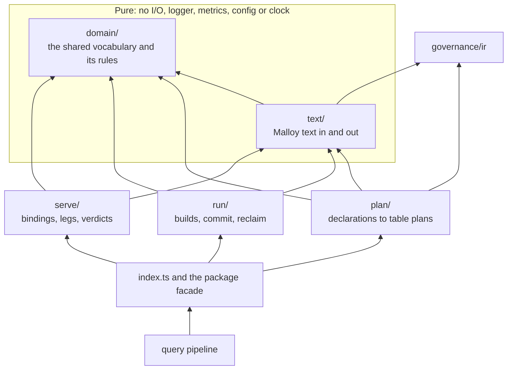

<!--
Copyright (c) Credible Data Inc.
SPDX-License-Identifier: MIT
-->

# Architecture — how the pieces fit together

> What this is: the mental model for Publisher and the Malloy stack it sits on. Read it when you
> want to know which repo owns what, or how a query flows from a `.malloy` file to a rendered chart.

> **Operating model.** Publisher is a microservice that runs locally with your own permissions or
> inside your cloud behind your gateway; it does not authenticate anyone, and its access controls
> rely on that gateway. See [the operating model](security-posture.md#operating-model-a-microservice-behind-your-gateway).

Publisher is one component of the Malloy stack. From the bottom up:

## Malloy

The core compiler and query execution engine. Malloy compiles `.malloy` files into SQL, executes
queries against databases, and returns structured `Result` objects. Malloy is a pure
JavaScript/TypeScript library with no UI or serving capabilities — it's the foundation everything
else builds on.

**Repository:** [github.com/malloydata/malloy](https://github.com/malloydata/malloy)

## Malloy Render

A visualization library that transforms Malloy `Result` objects into interactive tables, charts, and
dashboards. When Malloy executes a query, the result includes both **data** and **rendering
hints** — tags like `# bar_chart` or `# line_chart` that indicate how the data should be displayed.
Malloy Render interprets these tags and produces the appropriate visualization.

**Built with:** SolidJS and Vega/Vega-Lite. Available as both a JavaScript API (`MalloyRenderer`) and
a `<malloy-render>` web component.

**Repository:** [github.com/malloydata/malloy/packages/malloy-render](https://github.com/malloydata/malloy/tree/main/packages/malloy-render)

## Publisher

The analytics engine for Malloy. Publisher serves Malloy models over the network — to
agents, applications, and BI tools — and provides a professional UI for data exploration.

- **Server:** REST API for listing content, managing database connections, compiling models, and
  executing queries. Also provides an MCP API for AI-agent integration, including the
  [agent retrieval tools](ai-agents.md) and the agent skills as MCP prompts. Supports runtime
  [givens](givens.md) for model-driven, server-side query parameters.
- **Console:** Web interface for browsing Malloy content, exploring models with a no-code query
  builder, and viewing results.

## Publisher SDK (internal)

A React component library — API communication, query execution, Malloy Render integration, and
pre-built pages for browsing environments, packages, models, and notebooks. The **Console is built
entirely from it**, so it's best understood as the Console's internal toolkit rather than a supported
external integration path. See [embedded-data-apps.md](embedded-data-apps.md) for the advanced/internal
notes. To surface analytics, prefer the [Publisher Console](console.md), an
[HTML data app](html-data-apps.md), or the [REST/MCP APIs](api-overview.md).

## Credible (hosted)

[Credible](https://www.credibledata.com) creates and maintains Publisher, and runs it as the core of
the **AI Analytics Engine** — the hosted, governed service built around Publisher. Everything
described above is the same there: the same Malloy, the same package format, the same REST and MCP
surfaces. What Credible adds is the engine around them: managed materialization and indexing in
storage it brings along, one gateway that enforces access on every query, a concept index that gives
an agent just the slice of a model its question needs, and every surface — agents, dashboards and
workspaces, data apps and APIs — served from one model. A package published to a local Publisher and
one published to Credible are the same artifact; the [`publisher` connection type](connections.md#publisher-proxy-connections-type-publisher)
is how a local authoring loop talks to a hosted environment.

**Read more:** [credibledata.com/malloy](https://www.credibledata.com/malloy) ·
[Inside the AI Analytics Engine](https://www.credibledata.com/blog/posts/inside-the-ai-analytics-engine)

## Packages in this repo

| Package | Description |
| --- | --- |
| **[packages/server](../packages/server/)** | Express.js backend providing REST API (port 4000) and MCP API (port 4040). Loads Malloy packages, compiles queries, executes against databases. |
| **[packages/sdk](../packages/sdk/)** | React component library the Console is built from (internal — see above). |
| **[packages/app](../packages/app/)** | Reference implementation and production-ready data exploration tool built with the SDK. |
| **[packages/python-client](../packages/python-client/)** | Auto-generated Python SDK for the REST API. |

## Materialization inside the server

Materialization (`packages/server/src/service/materialization/`) builds stored tables from a
package's declarations and answers a query from them only when the answer equals live. It is five
layers with one direction of import, checked by the server's lint:

`plan/`, `run/` and `serve/` never import one another, and the rest of the server imports only the
module's `index.ts` and `domain/`. One stored table has three lifecycle values: what should exist
(planned), what a run built (a manifest entry, the wire type), and what a query may read (a binding).
A run commits one manifest; serving reads it through three legs (a persisted view called exactly, a
rollup, and the served copy, the author's source re-rooted on its stored table) and answers live
whenever none of them can prove the same answer.

The module's [README](../packages/server/src/service/materialization/README.md) has the glossary, and
each layer's README lists its modules and what reads them.
