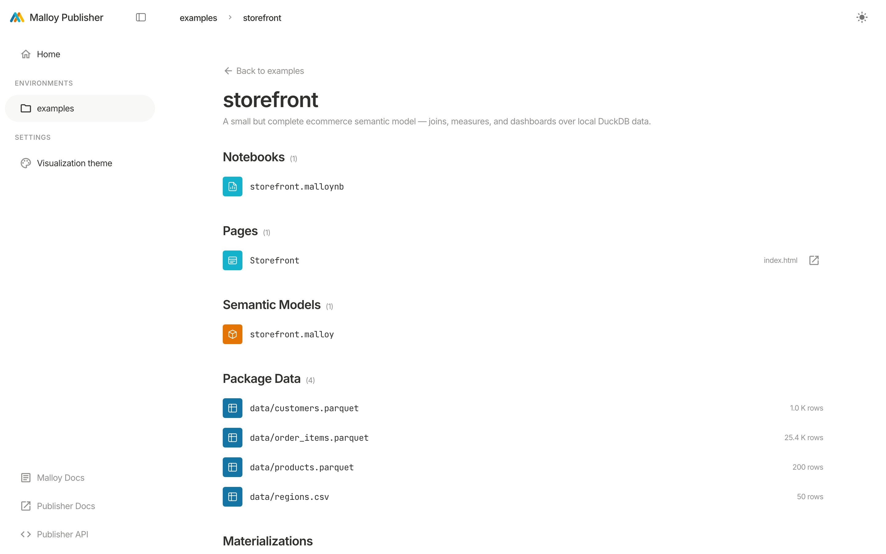
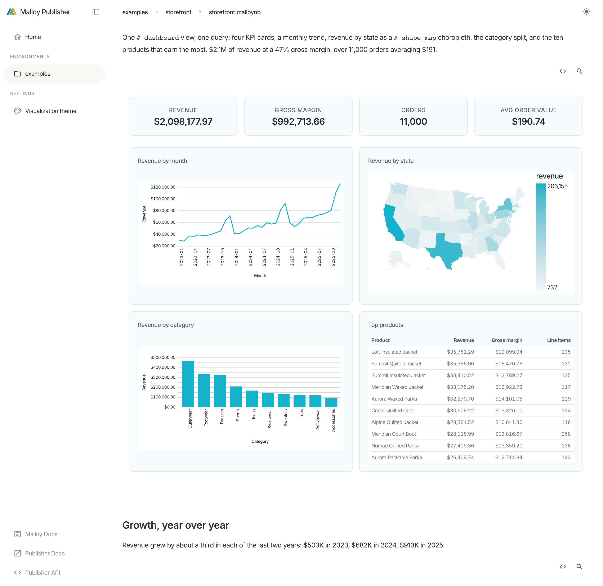
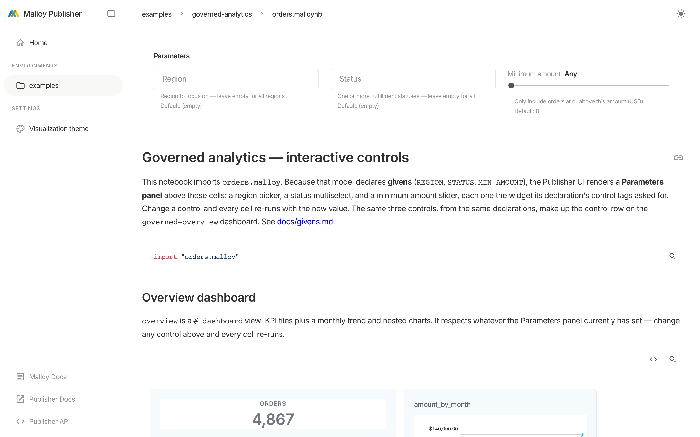

<!--
Copyright (c) Credible Data Inc.
SPDX-License-Identifier: MIT
-->

# The Publisher Console

> What this is: a tour of the **Publisher Console**, the server's built-in web UI — how the core
> constructs (environments, packages, models, sources, views, reports, data apps) surface in it,
> and how to navigate them. Zero code required. It's served at **http://localhost:4000** whenever
> the server is running.

The Console is the default, no-code way to explore what a Publisher deployment serves. It's built
from the [SDK](embedded-data-apps.md) but you don't need to know that — just open it and browse.
(The Console is Publisher's own UI. It is not an [HTML data app](html-data-apps.md), which is a
custom page _you_ author inside a package; see [choosing-a-surface.md](choosing-a-surface.md) for
how the in-package surfaces relate.)

## The resource hierarchy

Everything in Publisher nests the same way, and the Console mirrors it:

```
Environment            e.g. "examples"
└── Package            e.g. "storefront"  (a versioned bundle of models + data)
    ├── Model          a .malloy file: sources, views, measures, dimensions
    │   ├── Source     a queryable entity (a table or a join graph)
    │   └── View       a saved, reusable query on a source
    ├── Report         a .malloy file with an ## artifact tag, anywhere in the package: text and query
    │                  tiles behind filter controls, in a linear or a grid layout
    └── Apps           an in-package HTML data app (the package's public/ dir)
```

The [REST and MCP APIs](api-overview.md) expose this exact hierarchy; the Console is a view onto it.

## Navigating

- **Left sidebar** — **Home**, then an **Environments** list. Pick an environment to see its
  packages; pick a package to see its reports, data apps, and models.
- **Breadcrumbs** across the top track where you are: `environment › package › file`. They are the
  way back up; pages carry no separate "Back to" link.
- **Sidebar footer** holds the things about the Console rather than the data in it: **Theme** (the
  visualization theme editor), the light/dark **mode toggle** when the deployment allows it (see
  [theming.md](theming.md)), and links to the Malloy docs, these Publisher docs, and the live
  **Publisher API** explorer (see [api-overview.md](api-overview.md)).



## Two URL shapes

You'll see two path styles, and they're not interchangeable:

- **Console routes** are short — `/{environment}/{package}/{file}`, e.g.
  `http://localhost:4000/examples/storefront/storefront.malloy`. Use these to link to something
  inside the Console (a model, a report, a package). A report's route is its package path without
  `.malloy`: `sales/q3.malloy` opens at `/{environment}/{package}/sales/q3`, and in the builder at
  `/{environment}/{package}/sales/q3?edit`. Edit is a query parameter, not a path segment, so a report
  whose own path ends in `edit` (`sales/edit.malloy`, at `/{environment}/{package}/sales/edit`) opens as
  itself. An older `…/sales/q3/edit` link still opens the builder, by redirecting to `?edit`, unless a
  report is at `sales/q3/edit.malloy`. A report under `data-apps/` opens as a report; any other path
  there opens the package's data app of that name.
- **Resource paths** are fully qualified — `/environments/{environment}/packages/{package}/...`.
  This is the canonical form the [REST and MCP APIs](api-overview.md) use, and it's also how an
  in-package HTML data app is served, e.g.
  `http://localhost:4000/environments/examples/packages/html-data-app/`.

When in doubt, the fully-qualified `/environments/.../packages/...` form always works; the short form
is a Console convenience.

## What you can do in the Console

- **Browse a package** — one section each for **Reports**, **Apps**, **Models**,
  **Data** and **Materializations**, in that order, plus the package's README rendered
  underneath (a report at the package root whose basename is `README`). Reports lists every report in
  the package, whatever directory it sits in, each row marked with its layout (linear or grid) and
  opened by its path, and carries the **+ Report** button on its heading row. Apps is hidden
  when the package has none. Reports is hidden when empty too, unless creating is offered: then it
  shows a "No reports yet" row with an **Add report** button.
  The Materializations section lists the package's build runs and carries the three controls that
  change them: **Scope**, **Schedule** and **Add materialization**.
  A report is listed by its title, or by its file name without directory or extension when it has
  none; the path appears beside it only to tell apart two reports with the same name, and a
  `.malloynb` keeps its path. Without a `title=` in the artifact tag, a report's title comes from its
  `"` description or its opening markdown heading.
- **Build a report by dragging** — every report page has an **Edit** button in the header, beside the
  breadcrumbs, that opens it in the builder. In the builder that spot holds the builder's bar: the save
  status, undo and redo, an **Add** menu (a tile, text or a filter), and
  **Done**, which returns to the report. The page under it stays the report as it reads. On a grid
  report, drag a tile by its heading or its padding to move it, drag the grip on its right edge to set
  its width (a label says the width it will snap to), and set its chart and clickable cells, or duplicate it,
  from its **⋯** menu; on a linear report, drag tiles into a new order and use the **+** on a tile to
  insert one between two. **Add → Tile** lists every view in the package, grouped by source and
  searchable, and runs the picked one as a preview beside its title and chart choices (**Add text
  instead** puts a text tile there). Add filters from **Add** or with **+ Filter** on the filter row:
  pick the field (its type is shown), the control from five pictured kinds (a kind the field cannot
  take is greyed, with why), and, under **Choose tiles**, which tiles it applies to; a preview shows
  its button. **Clickable cells** is a switch per dimension, with where a click opens and which filter
  it sets. It applies to table cells: a chart's bars, lines and points do not respond to a click, and
  the menu says so on a chart tile. Clicks work in the report, not in the builder, where a click
  selects the tile. Titles,
  descriptions and text tiles are edited where they are shown: under the pointer they take a faint
  wash; click one and type. In a one-line field Enter keeps the edit and Escape puts the old text
  back; in a text tile, leaving it or Cmd/Ctrl+Enter keeps it, Escape drops it, and Cmd/Ctrl+S saves
  from inside the field. A **text tile** holds markdown (a heading, a paragraph, a list). A query
  tile's **Chart** choices are From the view, Table, Line, Bar, Big value, Scatter, Shape map,
  Segment map and Bar and line; a choice the view cannot render stays in the list, greyed, with its reason under it.
  **Color** sets a chart's color from the theme's series, or any other, as a `# theme.palette.series` line.
  The layout is the file's: the builder draws the report as its `layout=` says and never rewrites
  it. Adding a tile
  offers every source the package publishes; when the file cannot already see the chosen source,
  the builder adds a named import for it. The classic dashboard-building feel, over a file you can
  still read and review ([reports.md](reports.md#editing-in-the-console)).
  A file written as `run:` cells, the retired linear form, is not a report and does not open; the
  package page names it and says how to rewrite it as tiles. A legacy `.malloynb` is read-only.
  Edits are kept in this browser as they are made, and the status reads **Draft saved**: leaving the
  builder any other way loses nothing and asks nothing, and opening the report for editing again puts
  them back, with a note saying so. **Done** writes them into the package at once, with no review step,
  and shows the report; a write that is refused keeps the builder open with the reason. Cmd/Ctrl+S
  writes without leaving. **Discard edits**, from the status, puts the saved report back (Undo brings
  the edits back). Only text still being typed into an open field asks before you leave. On a server
  that does not take writes there is nothing to write to. A save whose text declares a real `#(authorize)` or `#(access_filter)` gate
  outside prose is refused with a 400, so the builder opens such a file but cannot save it from the
  Console; gates live in the model file.
- **Create a report** — the package page's **+ Report** button takes a model, a source and its
  view (one select), a title and a layout (linear unless you pick grid), writes `<slug>.malloy` at the
  **package root** (or at another path you type; it never overwrites an existing file) and opens it in
  the builder. No directory is created for you. A host with its own record creates it there instead.
  It is offered when the server takes writes (the file goes into the package) or when a host keeps
  the record and can store; a workspace that keeps drafts in the browser beside a writable server
  still gets it, and writes to the package. It is not offered when neither route exists, on a record
  that cannot store, or on a pinned version of a package. Below 600px wide the Console hides **Edit**
  and **+ Report**, and an editor opened by URL asks for **Edit anyway** first.
- **Explore, no code** — open a source in the [Explorer](explorer.md), the visual query builder;
  every action generates valid Malloy, and you can view the Malloy and SQL behind any result.
- **Read a legacy notebook** — a `.malloynb` in a package renders as a linear report: its markdown,
  and its query cells run inline, including `# dashboard` views (KPI tiles + nested charts). The
  format is deprecated and the bundled examples no longer ship one, but the viewer stays for packages
  that have them.



- **Tune parameters live** — when a report's tiles read [givens](givens.md), the report shows a
  control row above its tiles; change a control and every tile or cell that reads it re-runs.
  Try `http://localhost:4000/examples/governed-analytics`.



- **Open a data app** — a package's [HTML data apps](html-data-apps.md) render inside the Console
  (and can be opened standalone). Try
  `http://localhost:4000/environments/examples/packages/html-data-app/`.
- **Edit the theme** — operators can iterate colors/fonts live at `/settings/theme` (see
  [theming.md](theming.md)).

## Where to go next

- Discover data with an AI agent instead of clicking: [ai-agents.md](ai-agents.md).
- Build a custom UI: [html-data-apps.md](html-data-apps.md).
- Drive it programmatically: [api-overview.md](api-overview.md).
