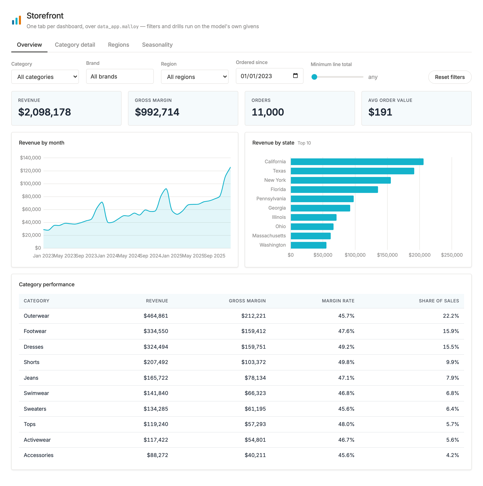
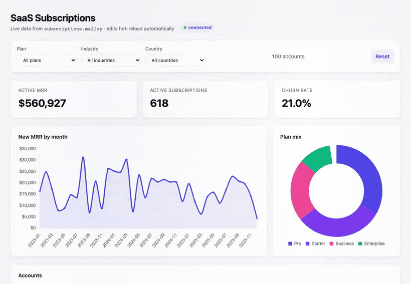

<!--
Copyright (c) Credible Data Inc.
SPDX-License-Identifier: MIT
-->

# In-package HTML data apps

A package can ship a `public/` directory of plain web files next to its `.malloy`
files. Publisher serves that directory and exposes a small JavaScript runtime at
`/sdk/publisher.js` so the page can run Malloy queries against the package's
models and render whatever you like with the front-end tools you already know
(Chart.js, D3, plain DOM, or `<malloy-render>`). There is no build step, no npm
install, and no framework requirement. You write HTML, CSS, and JavaScript, and
Publisher serves it and answers its queries.

Ship any library you use inside the package's `public/` directory and load it
with a relative path, rather than from a CDN. The bundled examples put theirs in
`public/vendor/`. Two reasons: agent sandboxes and many corporate networks block
CDNs, and the failure is easy to miss, because the script never runs, so the page
comes up with empty charts and whatever renders after them; and a page's JavaScript runs with the viewing
user's data authority, so it is worth knowing exactly what you are loading.

> **What this is:** a self-contained dashboard written in plain HTML/CSS/JS, shipped *inside* a
> package and **served by Publisher** — no build step, no framework, no npm. It's the supported way to
> ship a custom UI. (For zero-code exploration, use the [Publisher Console](./console.md); to build
> against the data programmatically, see the [REST/MCP APIs](./api-overview.md).)

Reach for an HTML data app when you want a self-contained, custom dashboard that ships with the model
and needs no toolchain. A page can also be *embedded* into another site as an auto-resizing iframe
with `Publisher.embed` (see [Embedding](#embedding)).

The bundled `storefront` package ships one, a four-tab Chart.js dashboard in
[`examples/storefront/public/index.html`](../examples/storefront/public/index.html) with its modules
in [`public/app/`](../examples/storefront/public/app/), backed by `Publisher.query` /
`Publisher.queryFull` calls against the model's views and filtered by the model's own
[givens](givens.md):



Filters run new Malloy queries and repaint the KPIs, charts, and table in place — here in the bundled [`html-data-app`](../examples/html-data-app/) SaaS-subscriptions example:



## How it fits together

```
my-package/
  publisher.json        # package manifest (name, version, description)
  subscriptions.malloy  # one or more models
  subscriptions.parquet # data the models read
  public/               # everything in here is web-served
    index.html          # can be one self-contained file, or split out css/js
    embed-test.html
    vendor/             # chart library, vendored rather than loaded from a CDN
      chart.umd.js
```

Publisher serves the contents of `public/` at:

```
/environments/<env>/packages/<pkg>/<file>
```

so `public/index.html` is the package's landing page and any other file under
`public/` loads at its relative path. That is the *latest* form; each published
version also has its own (see [URLs and versions](#urls-and-versions)). Only
`public/` is reachable over the web. The models, the data
files, and `publisher.json` live outside it and are never served; the page
reaches model data only through the query API, which goes through the same
governance (filters, `private:` fields, authorize annotations) as any other
Publisher client.

Note the `/environments/.../packages/...` prefix. The web UI opens a model at the
shorter `/<env>/<pkg>/<file>.malloy`, so that form is an easy guess for a page
too, and it is a different route. A server running the built app redirects the
guess to the URL above rather than leaving you on an app page that cannot find
the file, once that environment and package are loaded; before that, and during a
cold start, you get a 404 page naming the URL, and following it loads them.
Running the Vite dev server instead, every unmatched path is handed to Vite, so
there you get the app shell and a page naming the URL to use.

A package becomes a data app simply by having a `public/` directory. There is no
flag to set in `publisher.json`.

## Quick start

Copy the worked example and run it with live reload:

```bash
mkdir -p /tmp/publisher-demo
cp -R examples/html-data-app /tmp/publisher-demo/
cat > /tmp/publisher-demo/publisher.config.json <<'JSON'
{
  "frozenConfig": false,
  "environments": [
    {
      "name": "demo",
      "packages": [{ "name": "html-data-app", "location": "./html-data-app" }],
      "connections": []
    }
  ]
}
JSON

SERVER_ROOT=/tmp/publisher-demo \
  bun run packages/server/src/server.ts --watch-env demo
```

Open `http://localhost:4000/environments/demo/packages/html-data-app/`. Edit a
file under `public/` and the open page reloads on its own; edit the `.malloy`
model and the package recompiles. The `--watch-env` part is what enables that
loop (see [Live reload](#live-reload) below).

The smallest page that talks to a model is:

```html
<!doctype html>
<title>Subscriptions</title>
<pre id="out"></pre>
<script src="/sdk/publisher.js"></script>
<script>
  Publisher.query("subscriptions.malloy", "run: subscriptions -> plan_mix").then((rows) => {
    document.getElementById("out").textContent = JSON.stringify(rows, null, 2);
  });
</script>
```

## The runtime

Load the runtime once per page with a root-relative script tag, so it resolves
through Publisher no matter which environment or package the page is served
under:

```html
<script src="/sdk/publisher.js"></script>
```

It attaches a single global, `window.Publisher`. The script has no dependencies
and adds nothing to the page's markup.

| Member | Signature | Returns |
|---|---|---|
| `Publisher.query` | `(modelPath, malloy?, opts?)` | `Promise<Array>` of row objects |
| `Publisher.queryFull` | `(modelPath, malloy?, opts?)` | `Promise<MalloyResult>` (full envelope) |
| `Publisher.embed` | `(selector, options)` | `{ iframe, destroy(), send(type, payload), on(type, fn) }` |
| `Publisher.context` | property | `{ environment, package }` from the injected [page context](#page-context), else inferred from the URL |
| `Publisher.setToken` | `(token \| null)` | `undefined`; the token then applies to all later queries on the page |
| `Publisher.on` | `(type, fn)` | an unsubscribe function; `fn(payload, meta)` handles a message from the host, and what it returns answers a request |
| `Publisher.emit` | `(type, payload?)` | `true` if the event was posted, `false` if there is no host to hear it |
| `Publisher.givens` | property | a copy of the page's givens store |
| `Publisher.setGivens` | `(givens)` | `undefined`; merges `givens` into the store, notifies `onGivensChange` listeners, emits `givens.changed` |
| `Publisher.onGivensChange` | `(fn)` | an unsubscribe function; `fn(givens)` runs after every `setGivens` |

`on`, `emit` and the givens members are the page's side of the [host
bus](#talking-to-the-host); they do nothing visible on a page that nobody embeds.

### Querying

`Publisher.query(modelPath, malloy, opts)` runs a Malloy query against one model
in the current package and resolves to an array of plain row objects, ready to
feed a chart or a table.

```js
// Run a named view defined in the model.
const rows = await Publisher.query("subscriptions.malloy", "run: subscriptions -> plan_mix");
// rows -> [{ plan: "Pro", account_count: 272 }, { plan: "Starter", account_count: 255 }, ...]
```

`modelPath` is the model file's path within the package, with `/` separators
(here `"subscriptions.malloy"`; a nested model would be `"models/events.malloy"`). The
second argument is any Malloy query string. Build the model's queries the way you
would anywhere else: run a pre-built view, refine it, or write an ad-hoc query.

```js
// Refine a view with a filter at call time.
await Publisher.query("subscriptions.malloy", "run: subscriptions -> plan_mix + { where: plan = 'Pro' }");

// A single-row KPI view: read element [0].
const [kpis] = await Publisher.query("subscriptions.malloy", "run: subscriptions -> kpis");
document.getElementById("mrr").textContent = kpis.active_mrr;
```

Defining frontend-friendly views in the model (pre-aggregated, pre-sorted, one
per tile) keeps the page's query strings short and the work on the server. The
example's `subscriptions.malloy` does exactly this with `kpis`, `mrr_by_month`,
`plan_mix`, and `accounts`.

A dashboard usually issues several queries at once and renders them together:

```js
const [kpisRows, byMonth, planMix, accounts] = await Promise.all([
  Publisher.query("subscriptions.malloy", "run: subscriptions -> kpis"),
  Publisher.query("subscriptions.malloy", "run: subscriptions -> mrr_by_month"),
  Publisher.query("subscriptions.malloy", "run: subscriptions -> plan_mix"),
  Publisher.query("subscriptions.malloy", "run: subscriptions -> accounts"),
]);
```

> **See it working.** The example's
> [`public/index.html`](../examples/html-data-app/public/index.html) does exactly this in its
> `refresh()` — four `Publisher.query` calls fanned out with `Promise.all`, driving two Chart.js
> charts, a KPI row, and a filterable table, all from the views in
> [`subscriptions.malloy`](../examples/html-data-app/subscriptions.malloy).

The third argument, `opts`, is optional:

| Option | Type | Effect |
|---|---|---|
| `sourceName` | string | The source a `queryName` view hangs off. Not valid alone: `sourceName` without `queryName` is a 400 |
| `queryName` | string | Run a saved query or view by name. Pair with `sourceName` for a view on a source; alone it runs a model-level query |
| `environment`, `package` | string | Override the environment or package the query targets, for pages not served under `/environments/<env>/packages/<pkg>/` or `/apps/<env>/<pkg>/` |
| `givens` | object | A name→value map bound as Malloy [`given:`](./givens.md) runtime parameters for this query. Merged over the page's givens store (`Publisher.setGivens`), so a key set here wins |
| `versionId` | string | Query this published version of the package instead of its `latest` (with [package versioning](./package-versions.md) on). A page served at a version already queries that version of its own package |

**Versions.** With [package versioning](./package-versions.md) on, a page is
served at a version's own URL and pins every query it makes to its own package
to that version (see [URLs and versions](#urls-and-versions)). A query that
sets `opts.package` to another package gets that package's `latest`, and
`opts.versionId` pins a single query. A page whose HTML predates the injected
context (a cached copy, or one served through a proxy that rewrites it away)
falls back to `?versionId=` in its URL: the runtime reads the package at that
version once, and pins only if the package has it.

**Givens and the page's store.** A page that holds filter state can keep it in
the runtime: `Publisher.setGivens({ region: "EMEA" })` merges into a store that
every later `query` and `queryFull` reads, under whatever `opts.givens` carries.
It re-runs nothing itself: the page subscribes with
`Publisher.onGivensChange(fn)` and re-queries there, so a click on the page and
a command from the host (`givens.set`, below) take one path. The store rides
along only once it is non-empty, so a page that never calls `setGivens` sends
exactly the request it always did.

`queryName` (with `sourceName` for a view on a source) is the alternative to
passing a `run:` string as the second argument; use one path or the other, and
note `sourceName` on its own is a 400. For parameterized results, pass `givens`
alongside a model-defined view or query rather than assembling a `run:` string
on the page: Publisher binds those values as typed parameters server-side, so
they are never concatenated into query text.

**Do not interpolate free-text or otherwise untrusted input into the query
string.** Route it through `givens` instead. Two limits on that, both of which
matter:

- A `filter<T>`-typed given takes Malloy filter syntax _as its value_, so
  validate it against a known set like any other input. Scalar givens carry no
  syntax at all.
- `givens` is safe **parameterization**, not an authorization boundary. A
  client-supplied given is client-trusted unless a trusted tier upstream sets it
  from verified identity. Publisher has no per-package control that strips or
  finalizes one: identity-bound givens are a planned milestone, not a shipped
  feature. See [row-level-access.md](./row-level-access.md) and
  [authorize.md](./authorize.md).

Where you must build query text from input, constrain it to a known set and
escape it, or keep the filtering in model-defined views. The
`malloy-html-data-apps` skill (its `reference/runtime.md`) covers the same ground for an agent
writing the page.

`Publisher.queryFull(...)` takes the same arguments but resolves to the full
Malloy result envelope rather than just the rows. Use it when you want to hand
the result to `<malloy-render>` and let Malloy draw the chart; use `query` when
you want the raw rows to drive your own rendering.

On a failed query the returned promise rejects with an `Error` whose message is
prefixed `Publisher.query:`. The error carries `error.status` (the HTTP status)
and `error.response` (the parsed JSON body), so you can branch on a missing
filter, a compile error, or a permission failure.

### URLs and versions

A package with [published versions](./package-versions.md) serves each one's
`public/` at its own URL:

```
/environments/<env>/packages/<pkg>/versions/<version>/public/<file>
```

The page and every relative URL in it (`./app.js`, a stylesheet's `url()`, an
image) resolve under that path, so a page opened at a version loads that
version's assets too, not `latest`'s. The rules:

- **A page load at the latest URL redirects.** A GET to
  `/environments/<env>/packages/<pkg>/<file>` that resolves to an `.html` or
  `.htm` file (or a directory's `index.html`) answers `302` to the versioned URL
  of the package's current version, with `Cache-Control: no-store`. The query
  string is kept, minus `versionId`. Assets (`.js`, `.css`, images) at the short
  URL are served directly as before, and so is every file of a package that has
  no version records (watch mode, or versioning off).
- **`?versionId=` on the short URL still pins.** A page opened at
  `…/index.html?versionId=1.2.0` redirects to version 1.2.0's URL when the
  package has that version, and to the current version's otherwise.
- **`latest` in the path** (`…/versions/latest/public/…`) answers `302` to the
  resolved version, `no-store`.
- **The path wins.** On a versioned URL `?versionId=` is ignored, because a
  proxy that resolves a version appends its own to every request and the path is
  what names it.
- **Unknown or archived.** A version the package does not have gets the static
  404 page, which names both URL forms; an archived version answers `410`.
  `…/versions/<v>/public` without the trailing slash redirects (`308`) to the
  slash form.

A page can be opened at a versioned URL directly. The Console's data-app listing
links the short form, and the redirect covers it.

### Page context

Every HTML file Publisher serves from `public/` (`.html` and `.htm`, including a
directory's index) has a JSON block spliced into it, so the runtime reads where
it is instead of guessing from the URL:

```html
<script type="application/json" id="publisher-context">
{"v":1,"environment":"demo","package":"html-data-app","versionId":"1.2.0","apiBase":"/api/v0","hostOrigins":["'self'"]}
</script>
```

| Field | Meaning |
|---|---|
| `v` | Context format, `1` |
| `environment`, `package` | The names the page was served under; `Publisher.context` and every default query target come from here |
| `versionId` | The version the page was served from, or `null` for a package with no version records. When set, every query to the page's own package is pinned to it, the `?versionId=` probe is skipped, and [live reload](#live-reload) is off: a version never changes |
| `apiBase` | The path the runtime calls the API under, `/api/v0` by default. Only a path on the page's own origin is honored; anything else is ignored |
| `hostOrigins` | Who may embed the page and talk to it over the [bus](#talking-to-the-host): the usable sources of `frameAncestors` (below) |

`hostOrigins` is built from the same `frameAncestors` setting that sets the CSP,
so there is one list. `'self'` (the default) stays as `'self'` and the runtime
reads it as the page's own origin. An exact origin (`https://app.example.com`)
and a wildcard host (`https://*.example.com`: that scheme, that port, any host
ending in `.example.com`) are kept. `*`, a scheme alone (`https:`), a wildcard
anywhere but the leading label and a source with a path are dropped, because
none can name a window to post to. If nothing usable is left the bus is off and
the page keeps only the legacy size message.

The block is ASCII only (`<`, `>`, `&`, U+2028/9 and every non-ASCII character
are written as `\uXXXX`), so no name can close the element and the page's charset
does not matter. It goes after the first `<meta charset>` within the first 1024
bytes, else after `<head>`, else after the doctype, else at the start (past a
UTF-8 byte-order mark); a tag inside an HTML comment does not count, and a UTF-16
page or one over 2 MiB is sent unchanged. An HTML response carries a weak `ETag`
(a hash of the page as sent), `Cache-Control: no-cache` so every load
revalidates, and answers `If-None-Match` with `304`; a `Range` request gets the
whole page, since byte offsets into a rewritten body mean nothing. Other files
are sent as they are.

**Serving Publisher behind a gateway.** A gateway that exposes Publisher under
other names or another path can set the context itself. With the
`trustPageContextHeader` setting on (`PUBLISHER_TRUST_PAGE_CONTEXT_HEADER=true`
or `--trust-page-context-header`; default off), the request header
`x-publisher-page-context`, a JSON object with any of `environment`, `package`,
`apiBase` and `hostOrigins`, overrides those fields in the injected block.
Each value is validated: names are non-empty strings of at most 256 characters
without control characters, `apiBase` is a path starting with a single `/`
(no scheme, `//`, backslash or control character), and `hostOrigins` is a short
list of sources that pass the same rule as `frameAncestors`. One bad field makes
the whole header invalid: it is ignored and a warning is logged. Every HTML
response served with the setting on carries `Vary: x-publisher-page-context`,
so a shared cache keeps the variants apart.

**The gateway must strip `x-publisher-page-context` from client requests**
before adding its own. With the setting on, whoever can set the header chooses
the names, API base and embedding hosts of the page they are sent, which is a
gateway's decision and not a client's. Leave the setting off unless a trusted
tier sits in front of Publisher; with it off the header is never read.

When a page has no context (a copy cached before the server injected it, or one
served through something that rewrites it away), `Publisher.context` falls back
to the URL. Two shapes are recognized: the in-app viewer's
`/environments/<env>/packages/<pkg>/...` (also at `/versions/<v>/public/`), and
`/apps/<env>/<pkg>/...`, which a host that embeds the app on a third-party site
may serve it from. Under either, `query` and `queryFull` use the context
automatically, so a page served from inside its package does not need to name
its environment or package anywhere. If you serve the page from somewhere else
(for example a host page on another path that calls the API directly), pass
`environment` and `package` in `opts`.

### Auth

By default the runtime sends the browser's cookies with every request
(`credentials: "include"`) and adds no `Authorization` header, so a page served
to a logged-in user authenticates as that user with no extra code.

To authenticate with a bearer token instead, a host hands the page one over the
[bus](#talking-to-the-host): `Publisher.embed(..., { getToken })` sends
`auth.token` once the page is ready and again whenever the page asks. When a
query gets a `401` and the host is bound, the runtime emits `auth.token.request`,
waits up to 10 seconds for an `auth.token`, and retries the query once; several
queries that fail together share one request, and a retry is never retried. A
page with no host to ask (cookie auth, nothing embedding it) fails at once.
`Publisher.setToken(token)` still works for a page that has a token from
elsewhere; pass `null` to clear it and fall back to cookies.

The older route, the `token` option of `Publisher.embed`, appends the token to
the iframe URL as `embed_token` for the page to read and hand to `setToken`. It
is **deprecated**: a token in a URL lands in browser history, `Referer` headers
and server logs, where one delivered over the bus does not. It keeps working.
Either way the token is held in the page's JavaScript, so any script the page
loads can read it (see [Security model](#security-model)).

What the Publisher server enforces on these routes is the package's own model
governance: filter and runtime-parameter (given) rules, `private:` fields, and
`#(access_filter)` annotations are applied when the query compiles and runs. The static file, data-app-listing, and
events routes themselves are open; treat anything you put under `public/` as
world-readable to anyone who can reach the server, and keep secrets in the models
and the database, behind the query API, not in the page.

## Embedding

A page can be embedded in another page as an auto-resizing iframe with
`Publisher.embed`:

```html
<script src="https://your-publisher/sdk/publisher.js"></script>
<div id="dashboard"></div>
<script>
  Publisher.embed("#dashboard", {
    src: "https://your-publisher/environments/demo/packages/html-data-app/index.html",
  });
</script>
```

`embed(selector, options)` mounts an iframe into the element matched by
`selector` (a CSS string or an element) and returns
`{ iframe, destroy(), send(type, payload), on(type, fn) }`. Call `destroy()` to
remove it and detach its listeners; calling `embed` again lets you remount,
which is handy when the host swaps dashboards. `send` and `on` are the host's
half of the [bus](#talking-to-the-host).

Options:

| Option | Type | Effect |
|---|---|---|
| `src` | string (required) | URL of the page to embed |
| `getToken` | `() => string \| Promise<string>` | The page's bearer token, sent over the bus after the page is ready and again when it asks. Preferred over `token` |
| `isolate` | boolean | Sandbox the frame without `allow-same-origin`: its origin is opaque (see [Security model](#security-model) for what that breaks) |
| `token` | string | **Deprecated.** Appended to `src` as an `embed_token` query parameter for the embedded page to read |
| `height` | number or string | Fixed height (`number` is treated as pixels). Omit it to auto-size. |
| `allow` | string | Value for the iframe's `allow` attribute (permissions policy) |

The iframe is sandboxed with `allow-scripts allow-same-origin allow-forms` (with
`isolate`, `allow-scripts allow-forms`). Every embed also adds a random
`#publisher-nonce=<n>` fragment to `src`, which the bus uses to tell the page you
embedded from anything that navigates into the frame later. When
you omit `height`, the embedded page measures its own content and posts its
height to the host, which resizes the iframe to match; the host only accepts
those messages from the iframe it created. You do not write any of that wiring,
it ships in the runtime. If your embedded page sets `body { min-height: 100vh }`
or similar, the runtime still measures the real content height rather than the
viewport, so the frame does not grow without bound.

For a same-origin or same-tenant embed, the browser's cookies authenticate the
iframe and you pass no token. For a cross-origin embed (your customer's app on a
different domain), mint a short-lived signed token on your server and return it from `getToken`; the
runtime attaches it to the page's queries. Mint the token server-side with
the same signing key the server verifies; never put a long-lived or admin token in client HTML.
A React host that owns its own `<iframe>` uses `createDataAppBridge` from
`@malloy-publisher/sdk` for the same exchange (see [Talking to the
host](#talking-to-the-host)).

**A cross-origin embed also needs the server to permit the framing itself**, which
is separate from authenticating it. Publisher sends `frame-ancestors 'self'` by
default, so the browser refuses a frame from another origin before any token is
read: the iframe renders blank, and nothing is logged server-side, which makes it
look like a broken page rather than a policy. Set `PUBLISHER_FRAME_ANCESTORS` to
the host page's origin on the deployment being embedded. If an embed is blank,
check the browser console first -- it names `frame-ancestors`.

## Talking to the host

An embedded page and the page that embeds it can exchange messages: the page
reports what it did (a query ran, a filter changed), and the host drives it (set
a filter, hand over a token). This is the **host bus**, a `postMessage` protocol
the runtime speaks for you. A page that nobody embeds never sends anything.

**Envelope.** Every message, in both directions, is

```json
{ "protocol": "publisher", "v": 1, "type": "givens.set", "id": "h1", "nonce": "…", "payload": { } }
```

An `id` makes it a request. The answer repeats the `type` and `id` and adds
`"reply": true` with either a `payload` or `"error": { "code", "message" }`. A
request nobody handles is answered with error code `unhandled` (a handler that
throws gives `handler_error`); an event nobody handles is dropped. A message
with another `protocol`, a `v` other than `1`, or a missing `type` is ignored.

**Handshake.** The host sends `hello` (a request). The page checks that the
message came from `window.parent` at one of its `hostOrigins`, binds to that
origin, and replies with `{ handles, runtime }`, the event types it handles and
the runtime's revision. From then on it posts only to that origin, never to
`*`, and ignores any other. A page that loads before the host's `hello` also
offers a `ready` event (same payload) to each *exact* origin in `hostOrigins`;
a post with the wrong target origin is silently dropped, so this reaches only
the right one. `Publisher.embed` retries `hello` every 500 ms, five times, and
`send` waits for the page's reply and rejects after 5 seconds, which is also
what an older runtime that never replies looks like.

**The nonce.** The host puts a random `#publisher-nonce=<n>` in the iframe's
URL fragment (a fragment, so it never reaches a log or a `Referer`; `embed` does it
for you; with `createDataAppBridge` you load the frame from `srcWithNonce(src)`). The page reads it once at load and echoes
it as `nonce` in every message it sends. The host drops any message without the
right one, along with any whose `source` is not the iframe's window or whose
origin is not the page's. **The host never sends the nonce**, so a document that
navigates into the frame after the page loaded cannot learn it by listening and
cannot speak for the page.

**Events and requests.**

| Type | Direction | Payload | Notes |
|---|---|---|---|
| `hello` | host → page | none | Request; the reply is `{ handles: string[], runtime: string }` |
| `ready` | page → host | `{ handles, runtime }` | Sent unsolicited, and again whenever the set of handlers changes (once per task however many change) |
| `auth.token` | host → page | `{ token: string }` | Built in; the page uses it as its bearer token. Reply `{ applied: true }` |
| `auth.token.request` | page → host | none | A query got `401`; the host should answer with `auth.token`. The runtime waits 10 seconds |
| `givens.set` | host → page | `{ givens: { name: value } }` | Merges into the givens store and notifies `onGivensChange` listeners. Reply `{ applied: true, givens }` (the whole store) |
| `givens.changed` | page → host | `{ givens }` | The whole store, after every `setGivens` |
| `query.ran` | page → host | `{ model, sourceName?, queryName?, query?, givens, versionId, rowCount, ms }` | After every successful query. `query` is the first 2000 characters of the Malloy text; `rowCount` is `null` when the result shape is unknown; `versionId` is `null` when unpinned |
| `version.unavailable` | page → host | `{ versionId, reason }` | Once, when a query at the page's own version answers `VERSION_NOT_FOUND` or `VERSION_ARCHIVED`. The query still rejects as usual |
| `context.update` | page → host | any object | Not sent by the runtime; a name for pages that tell the host what they are showing, with `Publisher.emit` |
| `chat.prefill` | page → host | `{ text }` | Not sent by the runtime; a name for pages that ask the host to prefill a chat box, with `Publisher.emit` |

Any other `type` is open: a page and its host may agree on their own.

**`query.ran` sends the text of the page's queries, and the givens they ran
with, to the bound host.** That is the point (a host can show or log what the
viewer is looking at), and it is why the host must be one the deployment
trusts: `hostOrigins` is the list of who that is.

**Capabilities are the handlers a page registers.** `ready.handles` lists the
types the page has a handler for, so a host, or an agent acting through it,
offers only what the page will act on. A page adds one with
`Publisher.on(type, fn)`: `fn(payload, meta)` may return a value (or a promise),
which becomes the reply to a request. The built-in `givens.set` handler is
advertised only once the page has called `Publisher.onGivensChange`, so a host
is never offered a filter command the page would ignore. This is how a host
drives a page's filters:

```js
// in the page: apply filters, whether the viewer clicked or the host asked
Publisher.onGivensChange((givens) => refresh(givens));
filterSelect.onchange = () => Publisher.setGivens({ region: filterSelect.value });

// in the host
const app = Publisher.embed("#dashboard", { src, getToken });
await app.send("givens.set", { givens: { region: "EMEA" } });
app.on("query.ran", (ran) => console.log(ran.model, ran.rowCount, ran.ms));
```

`embed`'s `on(type, fn)` handles the page's events and requests and returns an
unsubscribe; `send(type, payload)` resolves with the reply's payload and rejects
with an `Error` (carrying `.code`) for an error reply or a timeout.

**React hosts.** `createDataAppBridge` in `@malloy-publisher/sdk` is the same
host side for an `<iframe>` you render yourself:
`createDataAppBridge(iframe, { src, getToken, isolate? })` (`origin` may replace
`src`) returns `{ nonce, srcWithNonce(src), send, on, ready, handles(),
destroy() }`; load the iframe from `srcWithNonce(src)`. It also exports the types of the envelope and of each event
payload above (`PublisherEnvelope`, `PublisherPayloads`, `PublisherQueryRan`).
It and `Publisher.embed` implement one protocol and are tested against one
shared fixture of envelopes.

**Resize is separate.** The size message (`{ type: "publisher:resize", height }`)
predates the bus, is not an envelope, and works with or without it, including
when `hostOrigins` is empty. Once a host has said `hello`, the page posts it to
that host's origin rather than to `*`.

## Live reload

When the server runs with `--watch-env <env>` (or `PUBLISHER_WATCH=<env>`),
Publisher mounts that environment's local-directory packages in place and watches
them. Editing a `.malloy` file recompiles the package; editing a file under
`public/` refreshes any open page. The runtime subscribes to a server-sent-events
stream and reloads the page when the package changes; this is automatic for any
page that loads `publisher.js` from inside its package at the in-app URL
(`/environments/<env>/packages/<pkg>/...`). A page served at `/apps/<env>/<pkg>/...`
infers the same context but never subscribes: that URL is for embedding on
someone else's site, where a reload on publish would discard the visitor's state.
A page served at a versioned URL (`…/versions/<v>/public/…`, or whose context
names a `versionId`) never subscribes either: a published version does not
change, so there is nothing to reload.

The stream is `GET /api/v0/environments/<env>/packages/<pkg>/events`. It emits a
`hello` event on connection, a `mode` event reporting whether watch mode is on, a
`changed` event on each package change, and a periodic heartbeat. Without `--watch-env`, the stream
connects and reports `mode: disabled`, and no reloads fire, which is the expected
production posture.

One consequence for headless verification: because the runtime holds that stream open, a served
page never reaches network idle, so a Playwright or Puppeteer check that waits for `networkidle`
hangs. Wait on `load` plus a content selector instead. This holds with watch mode off too, since
the stream still connects to hear `mode: disabled`.

## Full-screen apps in the data app viewer

When you open a data app from inside the Publisher Console (the package's Data
Apps list), it is shown in an iframe wrapped in light chrome (a title and an
"open standalone" link). By default that iframe is sized to the page's content
height: the page's runtime measures how tall its content actually is and the
viewer matches it, so an ordinary dashboard never gets a nested scrollbar.

A full-screen app, such as a slide deck that sizes itself to `100vh`, has no
content height to measure, so the default sizing would clip it. Declare that the
page should fill the viewer instead with a single meta tag in the `<head>`:

```html
<meta name="publisher:fit" content="viewport" />
```

The viewer then makes the iframe fill the available height, so the page's own
`100vh` resolves against the real viewport and looks the same as it does opened
standalone. Because the viewer reads this tag from the page's markup, it works
even for a page that does not load `publisher.js`. The tag must sit near the top
of `<head>` (within the first 4KB, the same window the title is read from). Apps
without it keep content-height sizing, so marking one app full-screen does not
affect any other page, and opening a page directly at
`/environments/<env>/packages/<pkg>/<file>` is unaffected either way.

## Listing a package's data apps

`GET /api/v0/environments/<env>/packages/<pkg>/data-apps` returns the package's
HTML data apps, which the Publisher Console uses to show what a package offers.
Each entry is:

```json
{
  "resource": "/environments/examples/packages/html-data-app/index.html",
  "packageName": "html-data-app",
  "path": "index.html",
  "title": "SaaS Subscriptions"
}
```

`resource` is the root-relative URL to open the page (note it is not under
`/api/v0`), `path` is the file's path within `public/`, and `title` is taken from
the page's `<title>` tag, falling back to `path`. An entry also carries
`fit: "viewport"` when the page opts into filling the viewer with
`<meta name="publisher:fit" content="viewport">` (see
[Full-screen apps in the data app viewer](#full-screen-apps-in-the-data-app-viewer)), and
omits the field otherwise. `resource` is the short form; opening it redirects to
the version's own URL (see [URLs and versions](#urls-and-versions)). The listing covers `.html` and `.htm` files up to
three directories deep and is empty for a package with no `public/` directory.

## The package manifest

`publisher.json` sits at the package root and is not web-served. No field in it is
data-app-specific (a package becomes a data app by having a `public/` directory);
the manifest field reference is [packages.md](packages.md).

```json
{
  "name": "html-data-app",
  "version": "0.0.1",
  "description": "SaaS subscriptions dashboard built as an in-package HTML data app."
}
```

## Security model

- Only `public/` is served. Requests are confined to that directory: path
  traversal (`..`) and names that resolve outside the package are rejected, and a
  symlink under `public/` that points outside it returns 403. Models, data, and
  `publisher.json` are never reachable over the web.
- Every document carries `Content-Security-Policy: frame-ancestors 'self'` by
  default, so a page is framable only from its own origin. To embed one
  elsewhere, set `PUBLISHER_FRAME_ANCESTORS` to the embedding origins (for
  example `https://app.example.com`, space-separated for several). The value is
  a CSP source list, and `*` restores framing from anywhere. The policy covers
  the Console as well as `public/` files, so setting the variable is the whole
  configuration rather than part of it. All responses carry
  `X-Content-Type-Options: nosniff`.
- The query API applies the model's governance (filters, `private:` fields,
  authorize annotations). The static, data-apps, and events routes do not add
  their own auth, so do not place anything sensitive under `public/`.
- **The host bus is fail-closed and bound to one origin.** It is off unless
  `frameAncestors` names a usable origin. A page accepts messages only from
  `window.parent` at an allowed origin, binds to the first host that says
  `hello`, and posts only to that origin, never `*`. The host accepts messages
  only from the iframe it made, at the page's origin, carrying the page's nonce,
  which the host itself never sends. The check is on origin, not on who is
  trusted: anything on an allowed origin that can frame the page can drive its
  filters and read what its `query.ran` events carry, so list only origins you
  would give the viewer's data to.
- **A token on the bus is still visible to the page's scripts.** Moving it out
  of the URL keeps it from history, `Referer` and logs, but the runtime holds it
  in JavaScript and every script the page loads can read it. Keep tokens
  short-lived and scoped to the embed, and load only first-party code.
- **`isolate` trades compatibility for containment.** Without
  `allow-same-origin` the frame's origin is opaque: it cannot read the host's
  cookies or storage (good), and it has none of its own, so cookie
  authentication, `localStorage`, `sessionStorage` and IndexedDB do not work, and
  a fetch to Publisher is cross-origin (no cookies; CORS applies), so an isolated
  page authenticates with `getToken`. Posts from the host go to `*` because an
  opaque origin cannot be named; what protects them is that the host sends
  nothing but the empty `hello` until the frame has answered it with the nonce. Prefer it for a
  page you want contained, not for one written against the same-origin contract.
- **`x-publisher-page-context` is a trust boundary.** With
  `trustPageContextHeader` on, the header decides a page's names, API base and
  embedding hosts. Turn it on only behind a gateway that strips it from client
  requests.

## Reference

Endpoints used by an HTML data app:

| Method and path | Purpose |
|---|---|
| `GET /environments/<env>/packages/<pkg>/<file>` | Serve a file from `public/`; an HTML page of a versioned package redirects (`302`) to the next row |
| `GET /environments/<env>/packages/<pkg>/versions/<version>/public/<file>` | Serve a file from one version's `public/` (`latest` redirects to the resolved version) |
| `GET /sdk/publisher.js` | The page runtime |
| `POST /api/v0/environments/<env>/packages/<pkg>/models/<model>/query` | Run a query (used by `Publisher.query`) |
| `GET /api/v0/environments/<env>/packages/<pkg>/data-apps` | List the package's data apps |
| `GET /api/v0/environments/<env>/packages/<pkg>/events` | Live-reload stream |

See also:

- `examples/html-data-app/` for a complete worked package (filters, charts, KPIs,
  and an embed demo).
- [Givens (runtime parameters)](./givens.md) for declaring model parameters.
- [The React SDK](./embedded-data-apps.md) — advanced/internal, if you specifically need React components.
