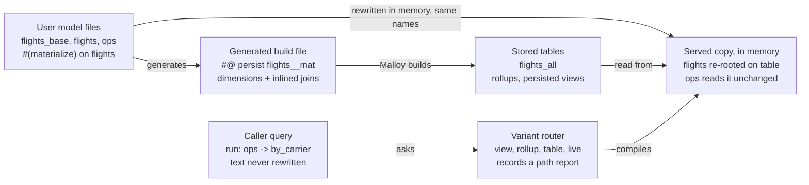
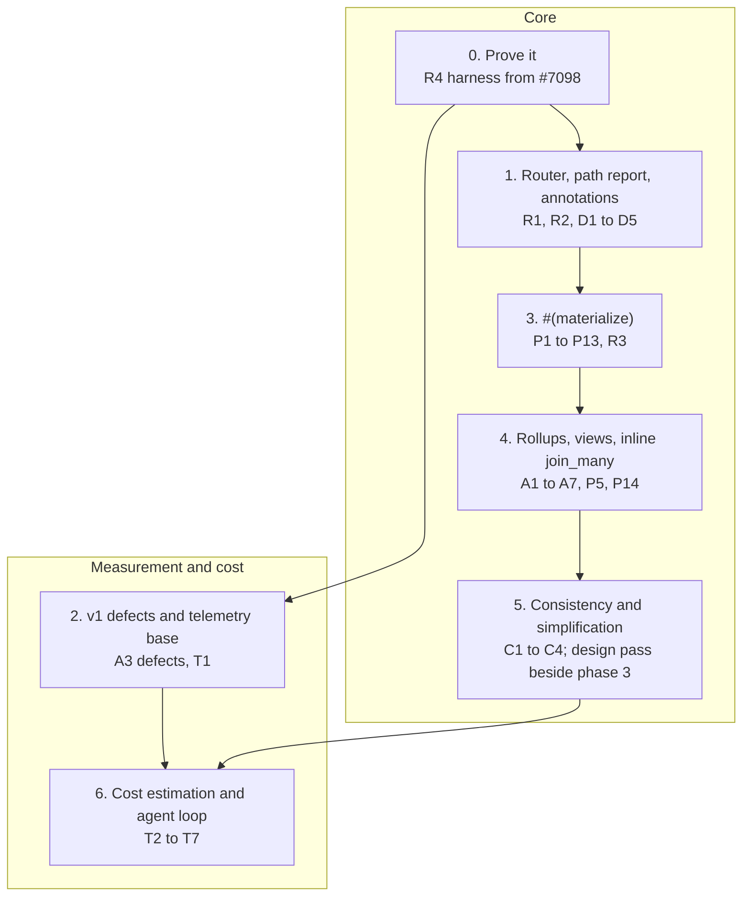

<!--
Copyright (c) Credible Data Inc.
SPDX-License-Identifier: MIT
-->

# Materialization v2: the implementation plan

**Status: plan of record, as of 2026-11-12.** How Publisher implements materialization v2: `#(materialize)`, `#(preaggregate)` and routed `#@ persist` views, built and served in Publisher alone, with no Malloy change. It is sequenced with the Publisher v1 plan ([#1563](https://github.com/malloydata/publisher/pull/1563), `docs/publisher-v1.md`): the path report is part of `/api/v1` (decision A52), generations build on v1's Track B1 records, and the deprecations and outcome tiers follow v1's package rules. Requirement numbers (P, A, R, D, C, T) and scenario numbers (S) refer to the materialization v2 requirements and programming model; issue numbers without a repository are in Credible's tracker.

## Summary

Every v2 requirement can still be built in Publisher alone, with no Malloy change and no edits to compiler internals. The updated requirements add telemetry, cost estimation and package-wide consistency, and the shared pieces also absorb the per-annotation code that `#(authorize)`, `#(access_filter)`, `#(classification)` and `storage=` carry today. The design's load-bearing claims were re-run on Malloy 0.0.436 on 2026-11-07 and hold; the run corrected two details, how a view call is recognized and `count()` measures in the child-measure rollup. This answers the scoping ask in the requirements doc's 2026-11-02 revision.

- **Build.** `#(materialize)` desugars exactly as the requirements define it: Publisher writes a generated `#@ persist` source, `src -> { select: <row-level dimensions>, <inlined join paths> }`, and Malloy's own persistence planner builds it on v1's pipeline (build, fingerprinting, storage, incremental, hosted).
- **Serve.** Publisher re-roots the source on its table in an in-memory copy of the user's files. Measures, joins, views and access rules are re-bound by leaving them as written, so every source that extends or joins it reads the table untouched.
- **Route.** One variant router replaces today's fixed chain: persisted view by exact call, then rollup, then the nearest materialized table up the chain, then live. On main today the order differs (Phase 3 status). It writes the path report (D1), and it takes its table catalog as an input, so what-if (T3) is the same code run against a proposed catalog.
- **Changed since the Nov 1 plan.** Joins are reference by default, with `inline=` opt-in; a current-time `where:` is a rolling window, not a compile error; outcomes are tiered; `#@ persist` views are routed; telemetry and consistency are new. The appendix has the full list.
- **Corrections to the hand-off.** The `name=` view and generations are Publisher mechanisms, with the control plane choosing what is current and cleaning up (Ownership). Core needs to expose nothing beyond its public API. S25's expected rows are wrong for a "last 30 days" window (Rolling windows).
- **Biggest risk.** `inline=` on a join_many (P5) is correct Publisher-only, but a pair table makes parent-only queries scan the fanned rows. Decided 2026-11-12: the pair table is served flat, as the source itself with no join at read, and measured on 2M and 10M flights at fan-out up to 5, child and mixed queries ran at 0.2 to 0.4 times live while parent-only queries ran at 2 to 5.5 times live (the cheapest, `flight_count` by carrier, is the 5.5). Also decided 2026-11-12: a parent-only query (one that reads no child field) skips the pair table for the parent's own stored table or live, so every query the pair table serves is at or below live (Joins). The Nov 11 form (parent rows joined back to child rows) ran parent-only queries at 1.1 to 2.7 times and child queries at about live; the Nov 1 figure of 3 to 15 times was the form that derives the parents per query. The estimate warns on high fan-out and the skill steers to cheaper shapes first (Joins).

## Design

Publisher treats `#(materialize)` and `#(preaggregate)` as a front end: it turns them into Malloy that v1 already builds, then serves from a rewritten copy of the user's files. The user's files are never edited.

**Build: the desugaring, written as a file.** For `#(materialize) name="flights_all" inline=["carriers", "origin_airport"]` on the running example's `flights`, Publisher writes an in-memory build file:

```malloy
##! experimental.persistence
import "flights.copy.malloy"   // the user's file, its own #@ persist lines removed

#@ persist name="flights_all"
source: flights__mat is flights -> {
  select:
    id2, carrier, origin, distance, cancelled, dep_time,  // primary key and raw columns
    route,                                                // row-level dimension, under its own name
    carrier_name,                                         // through carriers, inlined
    origin_region,                                        // through origin_airport, inlined
    carriers__code is carriers.code,                      // the inlined source's exposed dimensions,
    carriers__nickname is carriers.nickname,              //   as internal j__<field> columns
    origin_airport__code is origin_airport.code,
    origin_airport__faa_region is origin_airport.faa_region
  // dep_hour depends on the query time zone: not stored, computed at read
}
```

- Every stored column keeps the author's name, computed or not, so the table reads as the author's source to anything outside Malloy. The table is named by `name=`; without one, a `storage=` source's table is the source's own name, and a source built into its own warehouse is refused, since its default could be the very table it reads. `flights__mat` is only the build source's name inside the generated file (decided 2026-11-12).
- No suffix on stored columns (no `__s`): a stored computed dimension keeps the author's name. A timeframe truncation keeps its timeframe in the served copy through `internal rename: <dim>__stored is <dim>` and the redefinition `<dim> is <dim>__stored.<tf>`, since Malloy's `type:` can't carry a timeframe (probed 2026-11-12). `__mat` is internal: the build plan, warnings, scoped runs (`sourceNames` takes the author's name), the manifest and the path report show only the author's source name and `sourceID`; addresses are unchanged. An inlined join's columns are internal `j__<field>` columns for readers outside Malloy, kept out of the served `type:` (decided 2026-11-12).
- Generator refusals are `materialize-not-built` package warnings, and the source serves live: a malformed value, a source carrying both `#@ persist` and `#(materialize)`, and a colocated `#(materialize)` (no `storage=`) with no `name=`, since its default table could be the one it reads. A named colocated `#(materialize)` is built into its own warehouse and served by the served copy there (phase 3 pull request 6, below; #1666 had stopped building it until then); v1's colocated `#@ persist` is unchanged. An unknown key is malformed under the outcome rule below (`materialize-unknown-key`, refused at publish; a misspelt `name=` never falls back to a default table), checked against the route's closed set in the annotation reader, and so is a line that does not parse (`materialize-unparseable`) (decided 2026-11-12). `freshness` and `queryMetadata` are carried onto the generated `#@ persist` (decided 2026-11-12).
- The experimental flag lives in the generated file, so the user's file needs none (D3).
- The build runs over a copy of the source's file with its own access modifiers lifted, because a query can't select internal or private fields; the served copy re-applies them as written (P3). Decided 2026-11-12: one build copy per source (the #1644 mechanism, shared with P2's given terms) deletes the source's own `private`/`internal` statement labels, makes its own `include` labels `public` (adding `public: *` where a block has no wildcard), and wraps the declaration in `include { public: * }`, which lifts the `internal` fields it inherits from any file. Which hidden fields are stored is read off the compiled copy: a field still hidden there is not stored, so a field private on a source it extends (Malloy keeps it inaccessible under `public: *`) and an `except:`'d field are never selected. A hidden field with a timeframe is stored (decided 2026-11-12, known limitation 8 lifted): the served copy restores its timeframe with the same `__stored` redefinition as a public one, the redefinition carrying the author's modifier and the `__stored` column `private`. In the served copy a hidden column the source's own trailing `extend` defines keeps that definition (computed at read), and every other one is re-hidden with an `include { public: *; private: …; internal: … }` written just before the author's `extend`, where Malloy lets that `extend` read it as it read the author's field. Malloy refuses a `rename:` in the block just after an `include` (it cannot find the old name to set its access on), so the include is written only for a hidden column kept under its own name, and then every internal name it gives a stored column (a timeframe's `__stored`, an inlined join's `j__<field>__stored`) is renamed in a block ahead of the include, which hides it: `private` for a hidden field's or a hidden join's column, so no caller reaches it by any path, `internal` for a public one's (probed 2026-11-12). A hidden timeframe column or a hidden join's columns alone are hidden by a labelled `private rename:` in the re-root's first block instead, with no include, so an author's own `rename:` (and the inverse rename block before it) still compiles; an include there refuses it, and with it the model's whole served copy. A load-time check refuses any re-rooted source whose fields are not exactly as hidden as the author's (`fields_not_carried`), and any internal name it adds that is public or less hidden than the author's field it is named after (`<field>__…`). Storing them changes the build SQL, so every `#(materialize)` table re-addresses once, before the switch ships (2026-11-12 audit); v1 `#@ persist` addresses do not move. An extension table's build copy lifts its own declaration over its parent's re-root exactly as over the raw chain, and stores the hidden fields the raw-chain copy lets the build select, chained or not; its `storage=` build text carries the same lift and its flag (decided 2026-11-12, merge of #1661 into #1666).
- A materialized extension builds from its parent's build source, so Malloy's planner orders the builds (P10). Only a source's own `#(materialize)` is planned: an extension or rename that declares none does not inherit it, though Malloy shares the base's notes with it (decided 2026-11-12, #1645). The extension's build copy re-roots the parent on the parent's build source, and the generated sources sit in one level file per depth of the chain, which the companion imports. A pair in one file on one tier (both colocated, or one `storage=` destination) with no incremental key chains; a colocated pair's build reads the parent's build source in its own warehouse, which Malloy's planner resolves to the parent's table through the build manifest. A `storage=` extension's build compiles, in its destination alone, the parent's build source declared as the virtual source of its stored table and the declarations from the parent down to the extension as its build copy writes them, so it reads nothing from the warehouse; the plan compiles that text against a stand-in destination first, and one that reads anything else builds over the raw chain (decided 2026-11-12, extension tables, review of #1661). The extension's re-root keeps the `extend` blocks of every source it is built on in its file, ahead of its own, so it inherits every measure, join and view; the re-hiding `include` sits on the stored table ahead of those blocks, and a hidden dimension a kept ancestor block defines keeps that definition, as one in the source's own block does. A `rename:` carrying an access modifier, in the source's own blocks or a kept one, still refuses that source's re-root (and its chained build) now that hidden fields are stored: undoing it would rename a hidden column, which nothing checks yet, so it fails closed (kept 2026-11-12).
- A `where:` term that reads a given is left out of the build: the build imports a build copy of the author's file with the term's text replaced by `true`, and the term is written again on the generated source's own `extend`, where persistence keeps it out of the build SQL (#1644). A current-time lower bound is built as written, with the build's own `now`; a current-time term holding an upper bound is left out of the build the same way, own or inherited (Rolling windows, decided 2026-11-12). All stay in the served copy and are re-applied at read (P2). A given term written on a base the source extends in its own file is left out too (#1688): the source's build copy writes `true` in the base's text, and the served copy keeps that base's trailing `extend` blocks over the table (`MaterializePlan.keptBases`, the walk in `materialization/kept_ancestors.ts`), so the term is re-applied at read as the author wrote it. One written where the served copy cannot keep it (another file, a parenthesised head, a base whose fields the source renames, redefines or drops, or a base a join of the source also reads, since the copy takes the term out of every reader of the base in it), or one that reads a joined or unstored field, refuses the source, which serves live (decided 2026-11-12, #1644). One classifier sorts every term by what it reads (`classifyWhereTerms`, below), and the plan carries one list of the terms the served copy re-applies (`MaterializePlan.readTimeTerms`, one entry per term, by `kind`). A term that reads both a given and `now` is refused, and the source serves live: #1641's current-time rule wins over #1644's (decided 2026-11-12).

**Serve: re-root the source in place.** In an in-memory copy of the user's file, `flights` keeps its name and is redefined over the stored table.

- The extend blocks from the root table up to `flights` are copied verbatim, each inside its own file's copy, so names resolve where they were written.
- Each stored dimension's definition is dropped, so the stored column of the same name stands in for it. Its annotations move onto that column's entry in the served `type:` declaration, where Malloy keeps them (probed: `#(doc)` on a `type:` field survives; redefining or renaming a field to its own name does not compile).
- A `rename:` whose new name is a stored column is undone ahead of the kept blocks (`rename: <old> is <new>`, last first), since the build applied it, and the author's `rename:` stays as written, so kept text that reads the old name (an ancestor's measure, in an extension table's kept blocks) still compiles; a `rename:` with an access modifier refuses the re-root, and the source serves live (#1657 dropped the statement instead; one mechanism since #1661, decided in its review). Fixed `where:` terms, `except:` and `accept:` are kept as written: the re-root keeps the trailing `extend` byte for byte (#1637), so a fixed term runs again at read, which is harmless (decided 2026-11-12). Given-reading and current-time terms, `primary_key:`, joins, measures, views and access modifiers are kept.
- A reference join stays as written; its target is re-rooted on the joined source's own table when that source is materialized. An inlined join_one is answered from its stored `j__` columns (#1665): the served copy replaces the join with a record of them under the join's name, so `carriers.nickname` reads a column and, on the storage tier, no longer crosses connections. An inlined join declared in a kept ancestor's block (an extension table's re-root) is replaced the same way, since the record substitution runs over every kept block. What the columns cannot answer (a measure, view or join of the joined source, an aggregate at the join's grain) is answered live.
- The served model compiles at load against `conn.virtual('<handle>')::T`, with `T` a `type:` declared from the build query's output, so compile errors show before any table exists. It needs `##! experimental.virtual_source` in the served copy (flags don't cross an import) and a per-query `virtualMap` entry, which may name a table not built yet (Evidence). Today's storage serve shape works the same way.

**v1 packages keep working.** A v1 `#@ persist` on a query-shaped source keeps core's meaning, and its `extend` refinements are an ordinary chain to the rewriter: the query-shaped base is replaced by its table and the extend block is kept, which is what today's storage serve shape does by hand. The serve shape retires in phase 3 only after the conformance fixture (#7098) shows every bundled v1 package serving unchanged, standalone and on Credible. Moving a package to `#(materialize)` is optional, and the skill gets a migration recipe in phase 3.



**Five shared pieces.** Materialize, preaggregate, view routing and what-if are built on these, and so are Publisher's other annotations; Consolidation says what each one replaces.

| Piece | What it does |
| --- | --- |
| Source map | Package-wide: each source's extend chain, block text, and the range of every statement, declaration and annotation; which source wrote an annotation; which joins a source has, by path. Keyed by `sourceID`, on the same chain the gate walk uses |
| Annotation reader | Reads every route Publisher owns (`#(materialize)`, `#(preaggregate)`, `#@ persist`, the gate and classification routes) against a closed key set; near-miss routes (D5); deprecations; sorts every finding into compile error, publish warning or skip |
| Re-root rewriter | Moves a source chain onto a new base: a stored table, a build source, or a rollup at a join key; hosts the generated files |
| Probe compiler | Compiles small generated queries on the load worker, never running them, and reads the givens used, compile errors, generated SQL and result schema |
| Variant router | Compiles a query against view, rollup, table and live variants in order over a table catalog; records why each was used or skipped; hands the chosen variant to `QueryGovernor.govern()`; the same code answers what-if over a proposed catalog |

## Consolidation with Publisher's other annotations

The five pieces are not new code beside `#(authorize)`, `#(access_filter)`, `#(classification)`, `#(carries)`, `#(secure)` and `storage=`: most of each already exists, once per annotation, and v2 is the occasion to make each one shared. Checked against `main` at `3c3ef1bd8` on 2026-11-08, after the architecture refactor this plan assumed landed as #1559; every file and symbol named below is there. Files are under `packages/server/src/service/`; materialization code is in its `materialization/{plan, run, serve}` module.

| Piece | Already exists, per annotation | Consolidate to |
| --- | --- | --- |
| Annotation reader | Route detection four ways: Malloy's `routeOf` in `authorize.ts` and a second copy in `authorize_grammar.ts`, a regex in `classification.ts`, a string prefix in `filter.ts`, `note.route` in `given.ts`. A near-miss scan for `authorize`/`access_filter` only (`collectAuthorizeNearMisses`). A bracketed-list reader for `#(carries)` (`readTagList`) beside comma-string parsers for `grain=` and `partition=`. The `#@ persist` tag parsed in eight places: seven under `materialization/plan/` (`build_plan.ts` twice, `persist_source_fields.ts`, `persist_dynamic_terms.ts`, `preaggregation_annotation.ts`, `preaggregation_synthesis.ts`, `incremental_declaration.ts`) and once in `model.ts`, with `storage=` read three ways (`persist.storage`, `preaggregate.storage`, bare `storage`, each with its own fallback). A retired-route list (`RETIRED_ROUTES`) in the gate grammar. | One reader for every Publisher route: route by `routeOf`, payload by `payloadOf`, lists by `readTagList`, keys checked against each route's closed set, near-misses scanned for every owned route (D5 is `collectAuthorizeNearMisses` generalized), one deprecation list (`#@ preaggregate`, `#@ -persist`, `#(partition)`). The comma forms of `grain=` and `partition=` retire on the new routes, while v1's #@ persist keeps them. The reader also catches near-misses of #@ persist itself (#persist, #@persist, # persist, an unknown key), and surfaces Malloy's own malformed-route warnings at publish, such as #(classification "x"), which today declares nothing. |
| Source map | Author-text finders in `materialization/serve/materialization_serve_transform.ts` (lifts by location) and `caller_joins.ts`. The derivation chain walked from the IR in `governance/ir/source_graph.ts`, behind `gatePlan`, the one gate-inheritance walk. Caller text parsed in `query_text.ts`. | One chain: `source_graph.ts`'s three hops (declaration, query-source base, composite member) are what "up the chain" means for routing and for gate inheritance alike. The source map adds author-text ranges keyed by the same `sourceID`. `query_text.ts` stays separate: it reads untrusted caller text before compile, a different job. |
| Re-root rewriter and generated files | Overlay serving by URL in `request_overlay.ts` and `overlay_key.ts`; the synthesized rollup model served from an overlay inside the package directory (`materialization/plan/preaggregation_compile.ts`). The given-reading `where:` classifier in `materialization/plan/persist_dynamic_terms.ts` (`classifyDynamicTerms`), which reads the persist source's private `_sourceDef` and so is one of the IR reads question 9 covers. The bind guard in `filter_binding_guard.ts`, which proves an inherited `where:` or grafted gate still reads the field it was written against. | One generated-file host for the build file, the served copy and rollup variants (a new piece, not the existing `MaterializationHost`, which is the package-side interface the module calls). `classifyDynamicTerms` becomes P2's term classifier, extended for current-time terms. Every re-rooted source passes the existing bind guard, which replaces the plan's ad hoc field-and-type comparison. *2026-11-12 audit:* `classifyWhereTerms` was added beside `classifyDynamicTerms` rather than replacing it. Done since: `classifyWhereTerms` is the one `where:` classifier, and v1 persistence reads its given-reading subset (`givenTerms`) through the position rule `admitGivenPositions`. The served copy does not use the bind guard; it checks given terms with its own guard (`keepsGivenTerms`, which compares the given-reading filters' code and the givens they read), plus a lost-fields check and a carries re-check. Moving it onto the bind guard is assigned to phase 5's simplification pass (decided 2026-11-12). The generated-file host is not built either: each feature writes its own overlay. The `#@`-line blanking is shared (`materialization/persist_blanking.ts`, from #1659, which the `#(preaggregate)` build adopts), and so is the variant's import text (`materialization/serve/author_imports.ts`); both are to merge into the host (below). |
| Probe compiler | "Which givens does this read" answered four ways: `QueryGovernor.givenNamesReadByQuery`, `gate_dimension.ts` (`expandRefSummaryGivenIds`), `persist_dynamic_terms.ts` (`refSummary.givenUsage`), and gate probes in `authorize.ts` compiled on the load worker, whose connection refuses to run SQL. | One probe service on the load worker, keeping its compile-never-run guarantee: givens read, current-time and time-zone dependence, gate shape, and "does this compile against that variant". Gates, `#(secure)` summaries, P9 and the router all ask it. *Done in #1684 (2026-11-12):* the probe service is `service/probe_compiler.ts`, on the load worker inside the build plan, compile-never-run: givens read (`_query.givenUsage` and `PreparedQuery.givens`), current time (a scan of the generated SQL counted against a baseline probe of the same source), and time zone (the SQL at no zone and at two zones), each relative to the source so its own `where:` and base relation are not charged to a field. It now holds the IR given walk (`readsAGiven`, which v1 persistence's position rule and P9 share) and reads `givenUsage` through one reader in `governance/ir/prepared_query.ts` (`queryGivenUsageIds`, also used by `givenNamesReadByQuery` and report tiles). Still separate, since they answer a gate's question rather than a field's: `gate_dimension.ts`'s transitive expansion and `authorize.ts`'s gate probes; asking gate shape and "does this compile against that variant" of the probe service stays with the router. |
| Outcomes (part of the reader) | Fatal at load for gates and `#(carries)` leaks; advisory warnings for classification coverage (`classification_report.ts`, split out of `classification.ts` in #1559), join bypass and `materialization/plan/materialization_config_validation.ts`; strict-at-publish checks joined in `publish_checks.ts`; both load paths in `model_load_checks.ts` (`extractCheckedModel`). | D2's three tiers as the one finding type for every annotation, emitted from `extractCheckedModel` so the worker and `Model.create` agree. A gate that fails to parse stays fatal, which is the compile-error tier. |
| Variant router | `QueryGovernor.govern()`, the fixed sequence that mints every `GovernedRunnable`, already takes a routed runnable beside the live one (`CompiledQuery { live, runnable }`). The tier choice itself still sits in `Model.runQueryResults`, which blocks both storage and rollups for any entry point carrying a gate, a lock or a row filter (`routingBlockedByRowLevelGate`, route-blind despite its name), because the v1 serve shape strips annotation bytes. #1559 kept routing before the governance bind on purpose; `preaggregation_seams.spec.ts` pins the lock case. `materialization/run/freshness.ts` drops stale entries per query. | Route, then govern: the router picks a variant and `govern()` grafts and proves the gates on it. The v2 served copy keeps the domain's text, so the graft lands on any variant and the blanket block becomes a per-variant skip with reason `contract` (R3). Freshness becomes a router skip reason. |
| Telemetry hooks | The access record (`access_record.ts`) carries `servedFrom` and the gates enforced; `statement_usage.ts` meters every statement on a storage or managed connection; `materialization/run/build_read_cost.ts` already reads BigQuery bytes and Snowflake warehouse-seconds for `storage=` builds. | D1 and T1 extend the access record; T2 and T5 start from `statement_usage.ts` and `build_read_cost.ts` rather than new adapters. |

**Two boundaries kept on purpose.** Enforcement keeps reading compiler-set IR through `governance/ir/`, the one module that touches Malloy's private `_query` and `_modelDef`: a gate must decide on facts a caller cannot write. Materialization reads the same chain through that module, read-only, and never edits IR, which keeps the Nov 1 rule against grafting compiler internals (question 9). `#(filter)` is deprecated and is not migrated.

**One outcome rule, shared with the v1 plan.** D2 here and the Publisher v1 plan's Track C (invalid annotations fail loudly) use the same three tiers (decided 2026-11-10):

- **Malformed:** the annotation can't be read as written. It doesn't parse, has an unknown key on a new route, names nothing, or sits on the wrong kind of field. Refused at publish; a package already published keeps loading until that problem's counter reads zero.
- **Unservable:** well-formed, but it can't be honored here: a connection that can't hold a table, a missing destination, an access filter added later, a caller-dependent view, a source that can't be materialized. A coded, counted publish warning, and the source serves live. Never refused, because the cause is often another author or the deployment.
- **Skipped:** one query can't use the table. A reason in the path report.

Near-miss routes are unservable, so they warn, with one exception (decided 2026-11-11, #1605): a misspelled gate, a route word within two edits of `authorize` or `access_filter` that doesn't contain the gate's name, refuses the load, because a gate loaded inert leaves its source open.

The one exception is v1's `#@ persist`, where an unknown key warns until 1.0.0 (P13).

**Security fix that falls out.** Routing every `#@ persist` read through the shared reader also closes an `@env.` handling defect in the build plan. The fix ships now as a standalone PR, not with a v2 phase, and the details stay out of this doc until it lands.

**Sequencing.** The reader, the outcome tiers land in phase 1, after the standalone @env. fix; the shared chain, the probe service and the generated-file host in phase 3. *Moved (decided 2026-11-12):* none of the three was built in phase 3's first five pull requests, and P9's probes weren't either (a dimension that reads a given refused its source; a time-zone-dependent one was stored as built and a `timezone:` query went live). The generated-file host, and the probe service with P9's probes, move to phase 3's pull request 6, the v1 cutover; the shared chain moves to phase 5. *Done in #1684:* the probe service and P9 for `#(materialize)` builds and the served copy (Known limitations, row 5). P9 needed no generated-file host: a left-out dimension is only missing from the build's `select:`, and the served copy keeps its definition as written; the host stays with the v1 cutover. Each step is a refactor with the existing specs as its net; the gate specs (`gate_proof_precedence`, `authorize_gate_walk`, the `governed_runnable_audit`) and `preaggregation_seams` must pass unchanged. So must `entities_golden.spec.ts`: since #1564 the package entities extraction (`entities/`) reuses the gate grammar and queryability rule, so it is one more consumer of the reader and the probe service. Since #1559 the import-direction lint and `import_cycles.spec.ts` also decide where the pieces live: all five go under `service/`; whatever `governance/` calls (the reader, the probe service, the shared chain) must not import `service/model.ts` (R3); and T7's MCP tools take a use case from the composition root, never a controller (R2).

## Ownership

The split in the hand-off holds with two corrections. Core needs to expose nothing beyond its public API. The `name=` view and generations are Publisher mechanisms that the control plane drives, by the OSS-first rule: a declaration, build mechanic or check goes in OSS Publisher, and making it dependable at scale goes in Credible.

| Layer | Hand-off says | This plan says |
| --- | --- | --- |
| Malloy core | Query-shaped persistability, content address, build target, and the compiled IR that Publisher reads time-zone dependence and view identity from | Nearly the same minus the IR. Publisher uses `#@ persist`, `getBuildTargets`, `PreparedQuery.givens`, the result schema (which also names an exact view call), generated SQL and compile errors; the one IR read is the derivation chain through `governance/ir` (question 9). No core change is required. |
| Publisher | Vocabulary and validation, desugaring, load checks and publish warnings, routing, path report, telemetry, what-if, estimation | All of that, plus the `name=` view (`CREATE OR REPLACE VIEW`, comment-marked), the generation manifest and single-generation reads, as-of recording, and the workload log on the access record |
| Control plane | Generations and atomic publish, as-of builds, stable names and the `name=` view, reference-counted cleanup | Which generation is current (the promote instruction), scheduling generation builds, reference-counted cleanup, and retaining and querying the workload log at fleet scale |

Why generations need a Publisher half: an OSS server running the opt-in scheduler builds tables too, and it must never serve a rollup beside a newer base either. A run already commits one manifest per package (`ManifestCommitter` in `materialization/run/manifest_committer.ts`, called from `materialization_service.ts`), so C1 extends that rather than starting fresh.

**Generations build on the v1 storage plan.** The Publisher v1 plan's Track B1 ([#1563](https://github.com/malloydata/publisher/pull/1563)) owns the records: `physical_tables` and `manifest_entries`, generational table names (`base__g<N>`), the claim and commit transactions, and the reclaimer. Phase 5 builds C1–C4 on those records instead of a manifest of its own. Under generational names a physical table never equals `name=`, so `name=` always yields the view, and the v1 plan drops its `alias=true` in favour of it (decided 2026-11-10). Until then the `name=` view exists only for generational or versioned runs: a self-instructed, unversioned build names its table `name=` itself, with no view, and a v1 `#@ persist name=` gets none (decided 2026-11-12, #1648).

**Control-plane contract, to specify before phase 3.** The table above gives the control plane generations, cleanup and the workload log. Four more things cross the boundary and each needs an owner on both sides.

| Crosses the boundary | What has to hold |
| --- | --- |
| Generated build sources on the build-plan wire | The wire maps each one back to the user's source name and file. The control plane keys anchors on (version, source name, model path) and runs its name-collision and container checks on those names, so generated names and in-memory model paths must not reach anchors, runs, cred or the app. |
| The `name=` view | A new warehouse object. The orphan sweeper, the table dropper, the tier reclaimer and package delete recognize it by its comment mark and clean it up. Under the v1 plan's B1 the reclaimer owns it, beside the generational tables. |
| The rolling-window delete | A new mutation. The incremental ledger records it. Not yet: the delete runs in the build's own transaction and shows in the step's statements, but the ledger column and wire field wait for a spec sync with the control plane (2026-11-12). |
| New wire fields (`servedBy`, the skip reasons, the outcomes) | The spec sync lands in the same PR as the Publisher bump, because the generated clients are strict. |

**The core interface each requirement needs.** The hand-off asks this for P3, P9, P14, R1 and A1.

| Req | What Publisher needs | Where it gets it |
| --- | --- | --- |
| P3 | Which fields are row-level dimensions, their types, and their access modifiers | Field kinds and types from the public `Explore`; modifiers and declaring source from the source map |
| P9 | Whether a dimension depends on a given, the current time or the query time zone | `PreparedQuery.givens` on a probe select; a scan of the generated SQL for current-time functions; compiling the probe at two query time zones and comparing SQL |
| P14 | Whether a query is an exact call of a persisted view | An exact call shows in the public result schema: `resultExplore.name` is the view's name, and `__stage0` for a hand-written or refined query whose SQL is identical. A query that starts from the view (`ops -> by_carrier -> { … }`) is read from the query text, the way `query_text.ts` reads run targets. |
| R1 | Whether a variant can answer a query | Compile the query against the variant; a `field-not-found` problem names the missing field, which becomes the skip reason. It is read by its code, not its message: Malloy message matching lives only in `mcp/malloy_error_text.ts`, which the domain can't import (lint rule R1) |
| A1 | Whether an annotation on an include-list item attaches to that measure | Works today: all three spellings on an include-list item attach to that measure on the including source only; a tag at the declaring site is inherited by reference, so the reader attributes it by declaring source (Evidence). |

Two optional core asks remain, neither on the critical path: route claiming, so the parser itself warns on `#(materialise)` (deferred in the hand-off), and a way to declare a stored table's grain keys so symmetric aggregates run over a pair table without a self-join (Joins).

**`getBuildTargets` is the current entry point** (checked 2026-11-07). Publisher pins Malloy 0.0.436; 0.0.437 has identical build API typings, and the last persistence change on Malloy's main branch, #3173 (givens in a table's key; per-build `givens` and `virtualMap`), is already in 0.0.436. Publisher doesn't call the deprecated `Model.getBuildPlan()`, but `materialization/plan/build_plan.ts` still calls two deprecated `PersistSource` methods, `getSQL()` and `makeBuildId()`, for `computeSourceEntityId`, `compilerBuildId` and the wire `sql`. Malloy's doc says these can disagree with the key the build computed, which matters once given-reading terms stay out of the build (P2). Phase 2 moves them to the target's `buildId`, `sql` and `buildSQL()`, keeping the partition-layout fold and the incremental ledger's address stable. A spec asserts the old and new addresses are equal across a corpus of real packages and lists any source that moves, because the incremental ledger, reuse, refresh streams and anchors all key on them (#6145 is what drift does).

Editors: the load-time checks already run through `compile_model` and the package compile route, so an editor calls those. `malloy-code-server` is gone (#1559), so there is no separate Credible code server to update. The VS Code extension sees nothing, which is safe because an annotation never changes an answer.

## Joins

Reference joins and inlined join_ones need no new storage machinery and read as fast as live or faster. An inlined join_many is the one shape whose cost Publisher can't fully control: answers match live, and child and mixed queries beat live, and a parent-only query, which would scan the fanned pair rows, skips the pair table (decided 2026-11-12) for the parent's own stored table or live.

| Instruction | Served as | Cost against live |
| --- | --- | --- |
| Reference (default) | The join as written; its target re-rooted on the joined source's table if it has one, or on its rollup at the join key when A7 applies | About the same as live, or faster when the joined side is stored |
| `inline=` on a join_one | Joined dimensions read columns, with no join in the SQL; a measure at the joined source's grain is answered live | Faster: the join is eliminated (verified Nov 1) |
| `inline=` on a join_many | Pair rows, one per row of live's LEFT JOIN, with one parent-row flag written at build that marks one row per parent. Served flat, with no join (decided 2026-11-12): the join's name is a record of the child columns, measures over the source's own fields aggregate the flagged rows, and an aggregate through the join reads every row. A query the flat table cannot answer exactly is answered live, and a query that reads no child field skips the pair table for the parent's own stored table or live (decided 2026-11-12) | 0.2 to 0.4 times live for child and mixed queries; a parent-only query is not served from it, so at or below live for every query it serves (tables below). join_cross is refused |

**What an inlined join_many costs, and why.** Malloy deduplicates parent rows only when a query goes through a join_many, and a pair table has none. Deriving the parents per query (`pair -> { group_by: parent columns }`) re-aggregates the whole pair table on every query; that is the form behind the Nov 1 figure of 3 to 15 times. On Nov 11 a parent-row flag written at build (one flagged row per parent, childless parents included) let the served source be the flagged rows with a join_many back to the pair rows, so a mixed or child query compiled to live's own LEFT JOIN with symmetric aggregates over the pair table; measured then (Malloy 0.0.436, DuckDB, 10M flights, 24M segments, 20% childless; warm medians in ms):

| Query | Live | Reference join | Pair table, derived parents | Pair table, parent-row flag | Single-scan SQL (needs core) |
| --- | --- | --- | --- | --- | --- |
| `flight_count`, distance by carrier | 4.5 | 3.8 | 152 | 12.2 | 11.9 |
| `flight_count` by route | 57 | 57 | 167 | 62 | 62 |
| `seg_miles` by carrier | 78 | 63 | 194 | 73 | 6.3 |
| parent and child measures by carrier | 298 | 280 | 434 | 322 | 15.5 |
| by `segments.is_long_leg` | 117 | 128 | 248 | 128 | 77 |

Across a fan-out sweep from 1.25 to 20 (2M flights), that joined-back form stayed within 1.25 times live on high-cardinality parent grouping and 0.9 to 1.4 times on mixed queries; a cheap parent-only query went from 2.1 times at fan-out 1.25 to 5.1 times at 20. The single-scan column is what reading the pair table once allows: 0.05 to 0.2 times live on mixed and child queries, because the join disappears.

**Served flat (decided 2026-11-12).** The single scan needs no core change. The pair table holds exactly the rows of live's LEFT JOIN through the join, so an aggregate through the join (`segments.miles.sum()`, `segments.count()`) reads every row and equals live's as it stands, including live's count of one for a childless parent (malloydata/malloy#1762); only an aggregate over the parent's own fields must read one row per parent. So the served source is the pair table itself: the join_many statement is replaced by a record of the child columns under the join's name (`segments.miles` reads the column on the same row), the stored child columns and the flag are renamed internally, and each measure that aggregates only the parent's own fields is re-declared as itself `{ where: <flag> }`. A measure that reads it by name (a ratio, a view) reads the re-declared one. One flag is enough: a child-row flag would mark every row but a childless parent's, and live counts that row. Every query that reads the table is checked, on its compiled IR (`governance/ir/pair_flat_query.ts`), before it is answered: a parent-level aggregate must be one of the re-declared measures, and nothing the query (or an enclosing stage) groups or filters by may read the child, since a parent's flagged row would place it in one child's group only. Answered live instead (path report `COUNT_SEMANTICS`): a parent aggregate written in the query, a parent measure grouped or filtered by a child field, an aggregate reading both sides at once, an aggregate through another join, windows, `all()`/`exclude()`, `select:`, and a join to the pair source from another source. A classified or annotated child field returned as a column is answered live with `MISSING_FIELD`, by the same check as an inlined join_one (`governance/ir/joined_field_output.ts`; a record's fields carry no annotations). The joined source's own measures and views are not in the record, so `segments.seg_miles` (a measure of `segments`) does not compile in the served copy and is answered live (`MISSING_FIELD`); author text that reads one through the join leaves the pair table unserved (`pair_not_compiled`). Measured with `bun` over the generated SQL (DuckDB 1.5.5, fan-out up to 5, 20% childless; warm medians in ms; every served answer equal to live's):

| Query | Live, 2M | Flat, 2M | Live, 10M | Flat, 10M |
| --- | --- | --- | --- | --- |
| `flight_count`, distance by carrier | 4.6 | 18.5 | 18.2 | 100.6 |
| `flight_count` by route | 20.3 | 26.5 | 39.1 | 77.5 |
| `leg_miles` (`segments.miles.sum()`) by carrier | 33.7 | 13.1 | 145.9 | 50.6 |
| `leg_count` (`segments.count()`) by carrier | 33.4 | 9.9 | 151.5 | 45.3 |
| parent and child measures by carrier | 129.8 | 22.3 | 655.2 | 139.6 |
| child measures by `segments.is_long_leg` | 42.4 | 16.0 | 193.8 | 67.5 |
| nest: carrier, then `segments.is_long_leg` | 131.8 | 35.6 | 689.7 | 184.5 |

A parent-level filtered aggregate is a `CASE WHEN` over every pair row rather than a filtered scan, which is why the cheapest parent-only query costs more than the Nov 11 form; the planner trades that for no join anywhere.

**Parent-only queries skip the pair table (decided 2026-11-12).** Which queries: any query that reads no child field, that is no field, aggregate, filter, group-by or nest through the inlined join_many (directly, or through a dimension, measure or view it reads by name, or the source's own `where:`). What changes: such a query is not answered from the pair table even where the flagged rows would answer it exactly; it goes to the router's next candidate, the parent's own stored table if there is one (a rollup over the source, or a colocated table on its chain that live reads through the manifest), or live otherwise. It is declined with the existing skip reason `COUNT_SEMANTICS` (internal code `served_copy_pair_parent_only`), so no enum changes: the pair table's rows are not the parents the query counts, and the other reasons name unrelated failures (`WARNED` promises a package warning or an opt-out that does not exist here). How it decides: "reads a child field" is read from the compiled query's IR through `governance/ir/pair_flat_query.ts` (`pairQueryReadsChild`), never from the text; a query whose IR cannot be read skips the pair table, which is the safe direction for both correctness and cost. Proof: R4 (`served_copy_pair_table.component.spec.ts`) shows parent-only queries skipping the pair table with `COUNT_SEMANTICS` and equal to live, and child-only and mixed queries still served from it and equal to live; the timing bench rerun below puts every served shape at or below live.

Rerun with the rule (same bench, DuckDB 1.5.5, 4 threads, fan-out up to 5, 20% childless, warm medians in ms; "next" is the next candidate, here live, since the bench source has no other table; every served answer equal to live's):

| Query | Live, 2M | Pair, 2M | × | Live, 10M | Pair, 10M | × |
| --- | --- | --- | --- | --- | --- | --- |
| parent only: `flight_count`, distance by carrier | 3.5 | next | 1.00 | 16.5 | next | 1.00 |
| parent only: `flight_count` by route | 19.2 | next | 1.00 | 39.8 | next | 1.00 |
| parent only: avg, `flight_count` by carrier | 3.5 | next | 1.00 | 16.6 | next | 1.00 |
| parent only: `count()` written in the query | 3.6 | next | 1.00 | 14.2 | next | 1.00 |
| `leg_miles` (`segments.miles.sum()`) by carrier | 29.9 | 10.8 | 0.36 | 143.4 | 50.0 | 0.35 |
| `leg_count` (`segments.count()`) by carrier | 29.8 | 9.4 | 0.31 | 143.0 | 44.6 | 0.31 |
| parent and child measures by carrier | 123.0 | 19.9 | 0.16 | 613.6 | 108.6 | 0.18 |
| child measures by `segments.is_long_leg` | 38.1 | 14.6 | 0.38 | 173.9 | 63.5 | 0.37 |
| nest: carrier, then `segments.is_long_leg` | 125.3 | 35.6 | 0.28 | 657.9 | 170.1 | 0.26 |
| `flight_count`, `leg_count` by route | 88.7 | 27.4 | 0.31 | 336.4 | 82.3 | 0.24 |
| `segments.seg_miles` (a child-source measure) | 30.1 | live | 1.00 | 150.2 | live | 1.00 |
| `flight_count` by `segments.is_long_leg` | 52.7 | live | 1.00 | 243.0 | live | 1.00 |

The spec accepts this tax ("inlining a join_many taxes parent-only queries"), and the pair table is what an outside tool reading `name=` wants. The plan keeps the table, no longer pays the tax on reads (parent-only queries skip it, decided 2026-11-12), and still limits the damage three ways: the estimate reports the fan-out ratio and warns over the configured limit (S19); the path report shows the pair table skipped (`COUNT_SEMANTICS`) for parent-only queries; and the skill offers the two cheaper shapes below first. Served flat (decided 2026-11-12), the pair table already beats live on mixed and child queries, so the core ask under Ownership (declared grain keys) would now only close the parent-only gap.

**Pair-table details.** A parent with no children keeps one row with null child columns, since `select:` through a join_many is a left join; that row is live's own null-extended row, so child counts through the join include it exactly as live's do. One flag, `__parent_row`, marks one row per parent (decided 2026-11-12: the plan's single-flag form; the child-row flag of the first build is dropped, since no exact answer reads it). Incremental refresh replaces whole parents (known limitation 9, narrowed): the declaration names a watermark field on each side of the join (`watermark=["updated_at", "segments.loaded_at"]`), and the build writes `__pair_watermark`, per parent the greatest of those fields over the parent's row and every child row, one value on every row of a parent. v1's machinery runs over it (the ledger, the frontier, the range), with the merge key the parent's primary key and one change: the range is open above, since one child stamped past the clock would otherwise hold its parent above every bounded range, the parent's own changes with it, until the clock caught up (found in review, 2026-11-12; replacing a parent whole is idempotent, so reading it again is safe); the delta is the build's own SQL over that range, which holds all of a parent's rows or none, so the flag its window writes is the full build's. The apply stages the delta once (one source read, so the delete and the insert see one snapshot), then in one DuckDB transaction deletes every stored row of each staged parent by key (NULL-safe, as the window partitions the NULL key as one parent), inserts the staged rows, runs the rolling window's delete (a parent column, so it removes whole parents), and fails unless every parent in the table has exactly one flagged row; a failed check rolls back and the table is rebuilt in full. A child-only change is seen through the child's field; a deletion or a move to another parent moves no field, so it reaches the table only when the old parent's own field moves (the incremental contract every source has: rows arrive or move their watermark forward). The fallbacks are a full rebuild with a `materialize-pair-full-refresh` warning, the table built and served: a watermark with no child field (a child-only change could not be seen), with no parent field (a new childless parent could not), an unstored field, mixed types, a `merge_key=` other than the parent key, or a rolling window over a child field. Proven by R4 (`served_copy_pair_incremental.component.spec.ts`): two refreshes after parents gain and lose children, a childless parent gains its first, late-arriving children of old parents, restated parents and children, new parents with and without children, each table equal to a full rebuild and every served answer equal to live, parent-only queries included; removing the delete by key fails the check and re-seeds, and removing the check too counts a parent twice. The Nov 1 shared-child build error is not needed: a child shared by two parents is stored with each, as live's LEFT JOIN pairs it with each, so a many-to-many join_many serves exactly.

**The two cheaper shapes for children.**

- **Child-grain source**, `#(materialize) inline=["flight"]` on `segment_facts is segments_base extend { join_one: flight is flights with flight_id }`: one wide row per segment, no fan-out, because the join runs the one-to-one direction. Measured 16 ms against 66 live for `seg_miles` by `carrier_name`. A flight-level measure still goes through the join (101 ms against 128 live), and parent numbers repeat on every child row, so the skill says to flatten parent attributes, not parent numbers, into a table other tools read.
- **Child-measure rollup (A7)**, `#(preaggregate) grain=["flight_id"]` on a `segments` sum measure such as `seg_miles`: the router adds a variant whose `segments` join is re-pointed, as join_one on `flight_id`, at a source over the rollup, with the measure summing its stored partial. A query that reads any other `segments` field fails to compile in that variant and falls to the next one. The SQL has no fan-out join, though Malloy still wraps the sum in its symmetric aggregate, so S9b should say "no fan-out join". S9b and A7's example read `segments.seg_miles`, a sum, not the spec's `segments.segment_count`: until Publisher's Malloy pin carries malloydata/malloy#3208, live counts each childless parent as one child, which a rollup over the child source can't reproduce (question 12).
- **A7 as built (phase 4, pull request 3, 2026-11-12).** The rollup leg tries the query source's own rollups first, then, for a query that reads a joined source's measures, that source's rollups through the join (`serve/join_rollup.ts`). The variant is generated beside the author's file like the base leg's: the query source is the author's, imported under another name, with `include { *; except: <join> }` (every other field keeps its access modifier and annotations; `public: *` would publish internal fields, probed) and the join re-pointed at the rollup on its key, `join_one` when the grain is the key alone and `join_many` when the grain also keeps child dimensions, so a query can group or filter by them. It reads the joined source's stored measures only (sum, min, max, filtered, and expressions of them), and answers equal to live for unmatched parents (sums 0, maxes null). A named view of the query source is served too: it is the author's view over the re-pointed join. Declined, with existing reasons: a joined field outside the grain (`GRAIN_TOO_COARSE`) or a measure not stored (`MISSING_FIELD`); an aggregate the query, or a measure of the source it reads, computes over the join's rows itself (`segments.count()`, `count(segments.k)`), a `select:` or `index:` stage, a source whose own `where:` or another join's condition reads the join, and a join not keyed on one field each side (`COUNT_SEMANTICS`, read from the compiled IR through `governance/ir/prepared_query.ts` and the source map's join readers); a fan-out grain dimension or join-level sum or count of the joined source's rollup that the query neither groups nor fixes at a level that aggregates through the join (A6, A2: `GRAIN_TOO_COARSE`; row 27, below), and a join key that is itself a fan-out dimension; a `timezone:` anywhere, or a query source whose time zone is not the joined source's, since the build truncated and filtered in the joined source's zone and live reads the joined rows in the query source's (`TIME_ZONE`, review fix); through a join_one, an aggregate the query reads that is not taken at the join (`count()`, the parent's own sums, another join's measures, in any field, filter or `having:` of the first stage, read from the compiled IR by `aggregateOutsideJoin`), since a join_one the data does not keep unique repeats each parent row live and the rollup holds one row per key (`COUNT_SEMANTICS`, review fix), unless the rollup's build checked the key unique (known limitation 29, below); a gated entry point, or a joined source with a gate of its own (`CONTRACT`); and a joined source's rollup in a `storage=` destination, since the query source reads its own connection and Malloy joins within one (`CROSS_CONNECTION`, malloy#3032). Until malloydata/malloy#3208 is pinned (`malloyCountsChildlessParentsAsZero`, derived from the pinned version), a count through a join_many and any partial whose operand is not a bare column of the joined source (a constant, `??`, a computed value, which live aggregates on the unmatched row) are declined with `COUNT_SEMANTICS`; a count through a join_one is served, since live counts the joined key there. **The join_one key check (known limitation 29, resolved):** a rollup whose grain is one dimension that a join_one in the package is keyed on (`joinOneKeysOf`, over every model the build plan compiles) carries a key check compiled from the rollup companion (`where: k != null; group_by: k; having: count() > 1; limit: 1` over the base alias, so it reads exactly the rows the build groups); a rollup no join_one keys on gets none, so no build scans for nothing. Auto-run runs it after the rollup's table is written and records unique or repeated in #1675's ledger (`metadata.inlineUniquenessChecks.rollupKeys`, keyed by content address, with the table's identity and a digest of table and SQL): carried to the next run while the table is not written and the check is the same, under the same newest-run proof as a pass, dropped by `markWritten`, forgotten with the passes when a run record is deleted. A check that cannot run records nothing and never fails the build; an orchestrated run runs none. The record reaches serving only with the manifest it describes: the committing run's auto-load, or a restore from the store when the newest run is uncontested (`withRollupKeyRecords`); a host's manifest never carries one, and a run forgets the bound check of every table it is about to write, so a run that fails part-way leaves none over rows it did not read. At route time, through a join_one: unique serves an aggregate outside the join; repeated or unknown declines it (`COUNT_SEMANTICS`, the detail says which). A query that reads another join_one whose key a rollup's build found repeated is declined (`COUNT_SEMANTICS`): re-pointing the leg's join changes Malloy's symmetric-aggregate choice over the rows the other repeats (15.5 live against 10.5 served before the check); one never checked is served, as before. A join_one's own measures are served whatever the check says, since live sums each joined row once too. **Row 27 (2026-11-12):** the A6 and A2 rules hold through the join, judged per query on the caller's compiled query (`checkJoinCoverage`): each level that aggregates through the join groups or fixes (`where: <join>.d = <value>`, there or above) every fan-out grain dimension, and every other grain dimension of a join-level sum or count it reads; grouping or fixing the query source's key field fixes the join's key column (every rollup row a parent row meets carries it). A level that aggregates only the query source's own rows asks nothing, since those aggregates are taken over the parent's rows whatever the join matches; an expression, a `having:`, a query-source measure that reads the join, or a field the check cannot trace is held to every requirement, and `all()`/`exclude()` declines. A join-level operand (`kinds.weight`) counts as a bare column for the unmatched-row rule when its join is keyed on a bare column of the joined source (NULL there meets no row); one keyed on a computed dimension declines (`COUNT_SEMANTICS`), since it can match a row for a childless parent. A join read as a join_many (declared, or a join_one re-pointed at a finer grain) must be keyed on the query source's primary key (`keyRepeatRefusal`, review fix): keyed on another field, a rollup row meets several parent rows, which live sums once per parent row (a join_many) or once at the joined row (a join_one), so it declines (`COUNT_SEMANTICS`); this held for the leg before row 27 too, through a join_one at a finer grain and a join_many from a source with no primary key.

**Many-to-many.** Left as reference, a many-to-many join stays a definition and pairs up at read; answers matched live on Nov 1 (flights to weather observations, `weather.count()` identical). Inlined, it stores every pair, which is where storage blows up; the estimate's fan-out ratio is the warning. The bridge pattern (flights → crew_assignments → crew) needs nothing special: each hop follows its own instruction.

**Reference joins on the storage tier.** A source stored with `storage=` is read from the managed store, so a reference join to a source not stored there crosses connections at read, which Malloy can't compile (malloy#3032). Today such a query runs live. With reference as the default, that would hit every storage-tier core whose dimension tables aren't stored, so the plan makes it explicit:

- The storage variant leaves out the joins it can't reach (the rewriter's "chain with some joins left out"), so a query that doesn't use them still reads the table.
- A query that does use one skips the table with reason `cross_connection` and falls to the next variant, usually live (question 11).
- The serve verdict at publish names each such join and offers the three fixes: inline it, materialize the joined source on the same tier, or keep the source colocated. The estimate counts the logged queries that touch each one.

**The join_one uniqueness check (P8)** is a group-by over the dimension table on every build: usually small next to the fact table, but a full scan. The estimate counts it in build cost, and a build skips it when the joined table is unchanged since the last passing check, where the warehouse reports a last-modified time (BigQuery, Snowflake). Elsewhere it always runs. The first cut runs it on every build; the skip is not built yet.

**Joins as built in phase 3 (decided 2026-11-12, #1643).**

- **Reference by default.** The table stores the source's own rows and the served copy keeps every join as written. A dimension whose value reads through a join that is not inlined is not stored but computed at read through the join; storing it would have fanned a join_many's rows out into the table.
- **`inline=` on a join_one** stores the dimensions that read through that join, one hop, and the joined source's own dimensions as internal `j__<field>` columns, with a uniqueness check generated per build that fails the build naming the join. The served copy answers the join from those columns (decided 2026-11-12): the join is replaced by a dimension of the join's name, a record literal of the stored fields over the `j__<field>` columns (renamed internally, so only the record shows them), so `j.<field>` compiles unchanged and reads a column, with no join in the SQL and nulls for an unmatched row, as live's LEFT JOIN. On the storage tier the join therefore no longer crosses connections, which makes "inline it" a real fix for `cross_connection`. A record has no grain of its own, so an aggregate at the join's grain (`j.x.sum()`, `j.count()`, a measure that reads one, in `having:`, filtered, under `all()`/`exclude()`, or declared in a query's `extend:`) would be computed per source row; Malloy marks each such aggregate with a `uniqueKeyRequirement` on its path, read by `joinGrainAggregatePaths` in `governance/ir`, and the served copy declines it (`COUNT_SEMANTICS`) to live. Row-grain aggregates (`sum(j.x)`, `source.sum(j.x)`, `count(j.k)`) and `max`/`min` are served. A measure, view or join of the joined source is not in the record, so the query fails to compile there and goes live (`MISSING_FIELD`), as does a `j.*` selection. **Annotations (decided 2026-11-12):** each joined field's notes are written on its stored column in the `type:`, and a column whose field infers its class (a dimension computed from a classified field) declares that class, so the record's fields keep their classes and the served copy's `#(carries)` and coverage findings equal the compile of record's; the classification lineage reads each part of a record literal from its own element. A record's field still carries no annotation onto a result, so a query that returns an annotated joined field as a column (`group_by: j.f`, in a stage, a nest or a view it reads) is answered live, with `MISSING_FIELD`; one that filters on it, aggregates it, or returns it under another name keeps the table (`governance/ir/joined_field_output.ts`, the one check for both legs: the pair table's record declines the same output with the same reason). When the record does not compile in the source's own text (it reads the joined source past one hop), the served copy keeps the join as written and says so in a `served-copy-not-served` warning naming the join and the compiler's reasons. A join_cross, a join defined in place, a join on another connection, a condition that isn't a single key equality, and a `j__` name that clashes with one of the source's dimensions are refused. **A hidden join (decided 2026-11-12, known limitation 24 lifted for join_one):** an `internal` or `private` join_one is inlined; its joined columns carry the join's modifier on the plan, so the build copy's lift (P3) lets the build read the join, and the served record is declared under the join's modifier (read off the author's compiled source, not the text), its stored columns `private`; Malloy accepts an access modifier on a record dimension and enforces it as on the join (probed 2026-11-12), so a caller reads `j.x` exactly where live lets it and the author's fields, views and gates over it still compile. A hidden join_many stays refused: the pair table's record does not carry a modifier yet. A `storage=` extension table's build over its parent's stored table (P10) reads a join the parent inlines from the parent's `j__` columns through the same record, so it no longer falls back to the raw chain for that join (#1661's follow-up).
- **`inline=` on a join_many** (phase 4, PR 4) stores the pair table: a `group_by:` of the source's stored columns and the joined source's `j__<field>` columns (rows distinct because both primary keys are among them, one per row of live's LEFT JOIN), with `__parent_row` (one row per parent, childless parents included) written by a window at build, in parent-key order. Rows are served from the inlined table, with no join at read (decided 2026-11-12): the served copy re-roots the source on the whole pair table, replaces the author's `join_many` statement with a record of the child columns under the join's name, renames the stored child columns and the flag internally, and re-declares each measure that aggregates only the source's own fields as itself `{ where: <flag> }`; an aggregate through the join reads every row, so it equals live's, live's `count()` of a childless parent included (malloydata/malloy#1762): the pair table reproduces live rather than correcting it, and changes with it when core fixes the count. Each query that reads the table is checked on its compiled IR (`governance/ir/pair_flat_query.ts`) and answered live, with path report reason `COUNT_SEMANTICS`, when the flat table would not reproduce it (a parent aggregate written in the query, grouped or filtered by a child field, mixed in one aggregate with the child, through another join, windowed or ungrouped, a `select:`, a join to the pair source); the joined source's own measures and views are not in the record, so a query reading one is answered live (`MISSING_FIELD`), and so is a query that returns a classified or annotated child field as a column, by the inlined join_one's check (`governance/ir/joined_field_output.ts`, run before the pair table's own). A query that reads no child field (no field, aggregate, filter, group-by or nest through the join, read from its compiled IR; an unreadable one counts) skips the pair table for the parent's own stored table or live, with `COUNT_SEMANTICS` (decided 2026-11-12). A row-level gate grafted at read that reads the child counts as a filter on the child, so parent measures under it are answered live. A many-to-many join_many is served (each pair is a row, as live pairs it). A dimension of the source that reads through the join_many is computed at read, over the record. **Multi-hop and multi-join (known-limitations row 9, #1681).** `inline=["items.options"]` names a path of join_manys: its pair table holds one row per row of live's LEFT JOIN through the whole path, the leaf's columns named `items__options__<field>`, and one row flag per level above the leaf (`__parent_row`, then `__child_row`, `__child_row_2`, …, each one row per distinct keys down to its level, a childless row's null row included). Served flat, the path's first join is a nested record (`items.options.kind` reads a column). The leaf reads every row (exact for any aggregate there, `count()` included); a level above the leaf is exact only through the source's own measures over it, re-declared under its flag, and only when nothing grouped or filtered reads below it; a middle level is exact only when the query reads nothing below it, because live then joins down to that level and aggregates plainly, while once the leaf is read live aggregates the middle level symmetrically by its key (a childless parent then counts as no row), which no flag reproduces, so such a query is answered live (`COUNT_SEMANTICS`). A path that is the start of another named one is stored by the longer one. More than one inlined join_many is stored as blocks of one table, one block per path (the table's identity stays one `sourceID`, one binding, one `name=`): each block is that path's own pair table, marked by `__pair_lane`, the other blocks' columns typed nulls on its rows, built in one query as a `UNION ALL` of each block's Malloy query embedded in a SQL source on the source's connection (Malloy has no union). The served copy compiles one copy of the model per block (block 0 at bind, another the first time a query reads it), each reading only its block's rows, with every block's first join as a record; a query is read for which blocks it reads: none goes to the parent-only rule, one is answered from that block's copy, two or more are answered live (`COUNT_SEMANTICS`; live aggregates each by its key over their cross product, which no block holds). A row-level gate that reads a join fanning out the pair rows (a join_many the table does not inline, or another block's record) sends the query live; before #1681 a gate through a stored, not-inlined join_many was grafted over the pair rows and gave wrong child aggregates. Refused at plan: a source or a joined source at any level without a stored primary key, a joined source with joins off its path, a path through a join_one (live aggregates a join_many past a join_one once per joined row however many parents share it), two paths that part below one join, and a column of a multi-block table whose type no typed null takes. A path's table or a multi-block table with `refresh="incremental"` is rebuilt in full with `materialize-pair-full-refresh`. Incremental refresh replaces whole parents by key, over a per-parent watermark that names a field on each side of the join, and otherwise rebuilds in full with a `materialize-pair-full-refresh` warning (Pair-table details). A join_many that shares its `join_many:` statement with other joins, or that a base declares, cannot be replaced by its record, so the served copy leaves the source as written (`pair_join_not_found`). A served copy that does not compile (author text that reads the joined source's measures through the join) is compiled again without its pair tables, so the model's other tables still serve.
- **Refusals** are `materialize-not-built` package warnings, the generator's one refusal path, and the source serves live; that includes P8's missing key on an inlined join.
- **Joins across origin connections (#6982).** An author file that joins sources on two origin connections loads from a build view: the author's text with those joins, and every definition that reads them, left out. That view is the compile of record for discovery and gates, and the builds are planned from it; a gate or `where:` that reads a left-out join leaves out its whole source, which fails closed. The served copy answers the join once both sides are stored in one destination; while one side is unbuilt, only the queries that reach it are refused. The `#(carries)` leak and classification-coverage checks also run on the served copy's own compile, the one that answers through the join once both sides are built; if they flag, the served copy refuses those sources (decided 2026-11-12).

## Rolling windows

A lower-bound current-time `where:` term is built as written, so the build evaluates `now` at its own start *b*, and the served copy re-applies every window term at read, inherited ones too, since the re-root replaces the base that carried them (decided 2026-11-12, #1641). An upper-bound term is left out of the build and re-applied at read (decided 2026-11-12, option A, question 2). The build stores no literal `now`: the build SQL is the same from build to build, so the content address stays stable. The earlier text of this section wrote `now` as a literal, which would have re-addressed the table on every build; it is superseded. The widest-set rule below still decides what the table must hold, and the build's own `now` is that choice for a lower bound. Pinned-clock reads at *b*, *b* + interval / 2 and just before *b* + interval each equal live, for own and inherited windows and a `now`-reading dimension. Malloy spells the current time `now`; `now()` compiles with a warning, so the term parser accepts both.

The rule: over the table's serving window, from build start *b* to *b* + refresh interval, the stored set must be the widest any read needs. The programming model states this for the backward case; P2 then applies the backward case's `now` to every term, which is wrong for a lower bound. All four cases in the table were run on 2026-11-07: both widest-set choices matched live exactly, and both narrow ones came up short.

| Term | `now` the stored set needs | Stored rows | Why |
| --- | --- | --- | --- |
| `dep_time >= now` `- 30 days` (lower bound, "last 30 days") | *b* | From *b* − 30d | Every later read's cut-off is later, so the read trims |
| `dep_time < now` `- 30 days` (upper bound, "older than 30 days") | *b* + interval; with no interval known, no bound at all | Every row at build time: the term is left out of the build and re-applied at read | Every later read's cut-off is later, so the table must already reach it; a build on demand has no interval, so it keeps every row |

S25 expects the lower-bound table to hold rows from *b* + 1d − 30d. A read at *b* + 12h needs rows from *b* + 12h − 30d, which that table lacks, so the answer would come up 12 hours short of live. S25 should expect rows from *b* − 30d (question 1).

- **Accepted form.** A lower or an upper bound: a stored timestamp compared with `now`, optionally offset by a whole number of one unit, read from the compiled filters rather than the text by the one `where:` classifier (`classifyWhereTerms` in `persist_dynamic_terms.ts`). A two-sided window is accepted too, as one `and` of such comparisons (`ts >= now - 60 days and ts < now - 30 days`, parenthesised or not, or the range `ts ? now - 60 days to now - 30 days`, which compiles to the same) or as two `where:` terms. A lower bound is built as written. A term holding an upper bound is left out of the build: the build copy replaces its text with `true` wherever the source's model file writes it, on the source's own declaration or on a base it extends there, as a given term's is (#1644), and the served copy re-applies it at read (decided 2026-11-12, option A, question 2). A one-term two-sided window is left out whole, and its lower bound is written again in the build query from its parts, so it builds as a lower bound alone does. An upper bound written in another file than the source's model is refused, since the build copy cannot reach it, and so is one a join named in `inline=` also applies (a self-join on the base it is inherited from), since taking it out of that base takes it out of the join and the stored joined columns would hold rows the read cannot remove; so is any other `where:` that reads `now` (an `or`, a bound `and`ed with a fixed term, a truncation); a `where:` that reads `now` through a dimension or a join counts as current-time and is refused like any other unaccepted shape. A refused source isn't built and serves live, with a `materialize-not-built` warning (decided 2026-11-12). A dimension that depends on the current time is never stored; it is computed at read.
- **No literal (decided 2026-11-12, phase 3 PR 5).** For a lower bound the widest-set `now` is *b*, and the build query's own `now` is at or after *b* while every read of the table runs after it was written, so the build file writes the term as the author did. The content address is computed over that text, never over a clock value, so it does not move between builds. An upper bound, the one case that would need a literal (*b* + interval), is left out of the build instead (option A), so it adds none either: the address is the same from build to build, and changing the upper bound's offset does not move it, since the table holds the same rows.
- **Clocks.** The build evaluates `now` at the origin and the read at the destination. They agree because every Malloy connector reads `now` in UTC (DuckDB, Postgres, Snowflake and Trino pin the session; BigQuery and SQL Server read UTC). A query `timezone:` moves the cut-off to that zone's wall time, which across a daylight-saving change needs up to an hour the table does not hold, so the served copy answers it live (`time_zone`).
- **Incremental.** Each refresh appends rows above the watermark, as v1 does, and then deletes rows below the run's cut-off less a one-day margin, in the build's own transaction (decided 2026-11-12). The margin covers session time zones and the build's lag, so an error only keeps a row, which reads trim. v1's incremental pipeline only range-replaces, so the delete is a new step per warehouse. The table stays one window plus one interval plus a day in size (S25c). An upper bound deletes nothing: each refresh appends above the watermark and the table keeps every row, so a refresh reads equal to a full rebuild; a two-sided window deletes below its lower bound. The incremental ledger doesn't record the delete yet; that needs a ledger column and wire field, a spec-sync follow-up (Ownership).
- **Derived tables.** A rollup or persisted view over a rolling-window source must carry the time field in its grain or `group_by`, or it is a compile error (S25b).
- **Refresh interval.** It comes from the opt-in scheduler's cron in OSS and from the deployment's schedule in hosted mode. A manual-only OSS deployment has none (question 2). Option A needs none: an upper bound works the same with or without a scheduler, and no control-plane change is needed. Stamping the interval into the build, to trim an upper-bound table to *b* + interval − N (option B), is a possible later optimisation for a table whose old rows cost more than they are worth; it is not built.
- **Tests.** The R4 harness reads each rolling-window table at *b*, at *b* + interval / 2 and just before *b* + interval, with the clock pinned, and compares each read with live as of *b*. Done in #1641. Upper-bound and two-sided windows, own and inherited, are also read 20 and 90 days on with no rebuild, a gated one proven per caller, and an incremental refresh is checked equal to a full rebuild (`rolling_window_upper` specs).

## Phased plan

Seven phases in two lanes: telemetry work runs beside the core. The core (phases 0, 1, 3, 4 and 5) is vetted and simplified before phase 6 optimizes it with cost estimation and the agent loop.

| Phase | Scope | Scenarios |
| --- | --- | --- |
| Now. Standalone fixes | #6644 (a same-named source reads the wrong table; v1 fix), #5967 (stale data reporting fresh; control plane) and the @env. fix. Each is its own PR and waits for no phase. | None |
| 0. Prove it | Most of this ran on 2026-11-07 (Evidence): the re-rooted served copy with inline join_one, the pair table with childless parents, rolling windows, view-call recognition and the include-item annotation. The R4 harness grown from the #7098 fixture, the cross-connection join (#6982) and the pair-table timing rerun are done (2026-11-11, Evidence). Three smaller checks of the served form move to phase 3, which builds it (Evidence 3–5). | S1, S2, S2a, S25 |
| 1. Router, path report, annotations (on v1) | Variant router replacing the `runQueryResults` chain, taking a catalog; D1 report; three-tier outcomes with serve verdict at publish (#6277), preview (#7090) and reasons (#6446); one annotation reader for every Publisher route, with closed keys and the near-miss scan; the path report on v0's query result too (Phase 1 design) | S9, S12a, S13, S14, S14a |
| 2. v1 defects and telemetry base | #7096, #6646, #6293 (interim; real fix in phase 4), #6642, #6145, #6986 and #6847 (failure classification), #7078; workload log on the access record and an opt-in local store (T1), which also carries each query's path report and a `storage=` build's row count; build_plan.ts moved off the deprecated getSQL() and makeBuildId() | S17 |
| 3. `#(materialize)` | Source map; re-root rewriter (cross-file, query-shaped segments, inline joins); build-file generator; served model on `virtual` with load-time compile; reference joins; inline join_one with the uniqueness check; P9 probes; rolling windows with the incremental delete; extension tables; `name=` view; contracts at read (R3); phase 0's three open checks (pinned-clock rolling-window reads, the text reader for a query starting from a view, and the served copy against the #7098 fixture); the shared chain, probe service and generated-file host (the host, the probe service and P9 moved to pull request 6 and the chain to phase 5, 2026-11-12); P12, the storage destination in the content address (#7087), shipped with P2's re-address so each `storage=` table moves once (question 13); v1 packages served through the same rewriter, gated on the #7098 fixture; joins across origin connections between sources stored in one destination (#6982): builds planned from the author's file with those joins removed (the file does not compile live), the build view as the compile of record for discovery and gates, and a coded refusal from build state, leaving the join out of the served copy while one side is unbuilt (#1643); the v1-to-#(materialize) migration recipe, which ships with the minor that ships the v2 annotations; publish warnings for a connection that can't hold a table or a missing destination (P13); the orchestrator refusing the warehouse recompute (#6756) | S1–S7, S2c, S2d, S3, S3a, S6a, S12, S25–S25c |
| 4. Rollups, view routing, inline join_many | `#(preaggregate)` A1–A7 on the source map and measure grammar; the real fix for a rollup over a storage base (#6293); rollup variants in the user's file; retire `preaggregation_coverage.ts` and the IR classifier; `#@ persist` view leg (P14); join-to-rollup leg (A7); pair-table serving (P5) | S2a, S8–S11, S9a, S9b, S15, S16, S16a |
| 5. Consistency and simplification | Consistency's own design pass first (it can run beside phase 3), then: run manifest published whole, per-query manifest pinning, upstream-pinned fingerprints, per-warehouse as-of reads, as-of in D1 and T1; the control plane's promote and cleanup, all on the v1 plan's B1 records (#1563). Then a simplification pass over the core: remove what the router and rewriter replaced, merge duplicate paths, and leave it easy to understand and maintain. The core is vetted (R4, the hammer suite, the #7098 fixture) before phase 6 starts. The pass also gives Publisher one reader of the Malloy IR: the governance, gate, classification, extraction and retrieval code that walks model and source definitions directly moves onto `governance/ir` and the source map (materialization moves in phase 3). Duplicated interpretation of the same IR has already produced disagreements, and the IR is not a stable public API, so one reader limits the blast radius of a Malloy upgrade (Appendix: direct readers of the Malloy IR) | S22–S24 |
| 6. Cost estimation and the agent loop | T2 table stats; T4 (row counts first, then column widths and dry runs), T5 adapters, T6 compare, T7 tools; what-if (T3) over existing v1 and proposed v2 annotations; the `estimating` skill reference and tuning guide | S18–S21 |



The core lane is the critical path, phases 0, 1, 3, 4 and then 5; phase 2 fits beside it, and phase 6 starts once the core is vetted and simplified.

**Where the suggested delivery order changes.**

1. **Build routing once.** The hand-off puts the path report on v1 first (item 1) and new routing later (item 6), which builds routing twice. Phase 1 builds the variant router on v1's annotations, and D1 comes from it; phase 4 adds legs to the same router.
2. **What-if waits for phase 6.** Over proposed v2 annotations it needs the build-source generator (phase 3) for a proposed `#(materialize)`'s columns, and it waits for phase 6 anyway, over existing v1 annotations and proposed v2 ones alike: it is the estimate half of the agent loop, and until then the dry-run preview (`POST …/packages?dryRun=true`) gives an author the build plan and a serve verdict for every materialized source and named view. Row-count estimates need no generator, but they wait for phase 6: their consumer is the same loop, and until the T5 adapters land the only method is an exact count that scans everything the build would read. Table stats (T2) wait for phase 6 too: their consumers are `compare` and the agent tools. Phase 2 keeps their inputs, the path report on the workload log and a `storage=` build's row count, so the history is there when phase 6 reads it.
3. **Wrong-data issues move early.** #6644 (a same-named source reading the wrong table), #5967 (reuse reporting fresh) and the @env. fix each ship now as a standalone PR, outside the phases. #5967 stays a control-plane fix, and C2 still depends on it.
4. **D3 goes with the in-memory copy** in phase 3, since the flag is carried by the files phase 3 generates; the `#@ preaggregate` warning ships in phase 4, once its replacement works (Phase 1 design, 2026-11-11). `#@ -persist` gets no warning: it stays supported (question 5, decided 2026-11-12).

**Dependencies.** Phases 3 and 4 need phase 1's router and annotation reader. Phase 4 needs phase 3's source map and rewriter. Phase 5's design pass can run beside phase 3; its build waits for phase 4, since generations must cover rollups. It also waits for the v1 plan's B1, which supplies the generation records. The control plane's promote instruction (for `name=` and generations) is a Credible change. Phase 6 needs phase 2's log, phase 3's generator, and a core that phase 5 has vetted and simplified: estimates and the agent loop optimize the core, so they wait until it is settled.

**Phase 3 in six pull requests (decided 2026-11-11).** The clean-ups the phases 0–2 review recommends ride in the pull request that needs them rather than landing separately.

| # | Pull request | Scope |
| --- | --- | --- |
| 1 | Source map | The design note in the description; the source map on the governance IR, replacing the three hand-written chain walkers; one keying rule: a declaration by `sourceID`, a stored table by address and destination, a name for display only |
| 2 | Build side | Addressing split out of `build_plan.ts`; the build-file generator; P12 and P2 as one re-address with its rollout (question 13) |
| 3 | Serving core | One module that writes Malloy text; the re-root rewriter (single-file, cross-file, query-shaped segments); the served model on `virtual` with load-time compile; routing out of `model.ts` behind one answer record |
| 4 | Joins | Reference joins; inline join_one with the uniqueness check; joins across origin connections on one destination (#6982) |
| 5 | Table behaviours | Rolling windows with the incremental delete; extension tables; the `name=` view; contracts at read (R3); phase 0's three remaining checks |
| 6 | v1 cutover | v1 packages through the rewriter behind the public #7098 fixture; today's storage serve shape retired once Credible's private CI passes (question 15); D3 removal; the migration recipe; docs and skill; the generated-file host, and the probe service with P9's probes (moved here 2026-11-12); colocated tables served through the served copy too, so the colocated build-manifest path retires with the storage serve shape and one serving path remains (decided 2026-11-12) |

Order: 1, then 3, 4, 5 and 6, with 2 beside 3. If 2 or 3 is too large to review, 3 splits into the text module and answer record, then the rewriter and served model; 2 lands the generator before the re-address.

**Phase 3 status (2026-11-12).** Each row above now spans more than one pull request; the numbering is kept.

- **Merged:** #1641 (5, rolling windows and phase 0's three checks); #1645 (only a source's own `#(materialize)` is planned; extensions don't inherit it); #1625 (1, source map); #1628 (2, addressing split) and #1635 (2, build-file generator); #1627, #1633 and #1636 (3, the Malloy text module and its ratchet), #1634 (3, the answer record) and #1637 (3, the re-root rewriter and the served copy on `virtual`); #1644 (2, P2's re-address: a given-reading `where:` left out of the build; P12 needed no new code, since #1628 already folds the destination behind a switch); #1643 (4, joins); #1642 (5, contracts at read, behind its own switch, `materialize.gatedSources` / `PUBLISHER_MATERIALIZE_GATED_SOURCES`, off by default); #1648 (5, the `name=` view); #1647 (P13's publish warnings with #6756); #1649 (6, part 1: the `#@ -persist` and `#@ preaggregate` deprecations and the v1-to-v2 migration recipe; the `#@ -persist` deprecation is withdrawn by question 5's 2026-11-12 decision); #1650 (6, the public #7098 conformance fixture: 25 packages, 370 cases); #1652 (the fix for the wrong answers the fixture found on main).
- **In review:** #1661 (5, extension tables, P10: an extension's own table built over its parent's (pairs in one file on one tier; a `storage=` one over the parent's stored table, in the destination), its re-root keeping its ancestors' blocks, and the source graph's base edge for an extension of a table-backed source, read from the compiled structure); #1657 (6, the served copy's conformance gaps from #1650) merged; its `rename:` handling is now #1661's. Phase 4 has started beside it: #1660 (1a, `#(preaggregate)` read and built; it replaces #1651, with the serve half stacked on it), #1659 (2, the `#@ persist` view leg) and #1658 (4, the pair table); #1658, #1660's build side and #1665 have since merged.
- **Approved fixes from the 2026-11-12 audit, in progress** (serving an inlined join_one's columns is done, #1665; serving from an inlined join_many's pair table is done, #1658): store private and internal fields (P3); stop building a colocated `#(materialize)` until the served copy serves it (today it is built and never read, #1652; #7097; it is served since the colocated piece of pull request 6, below); one `where:` classifier, and `#(materialize)` and `#(preaggregate)` registered as annotation routes with closed keys and the near-miss scan; and the S25b check, a rollup over a rolling window is not built (in #1660, carried over from #1651's review).
- **Still to do:** the rest of 6, the v1 cutover, which now also carries the generated-file host. The probe service with P9's probes is done (#1684).
- **Colocated serving moves onto the served copy (decided 2026-11-12, pull request 6).** Today a colocated table (`#@ persist` with no `storage=`) is served through Malloy's build manifest, a second, older path: a persisted source reached only through a join is not substituted (#6643, #6983, a warehouse join beside a stored source), and none of phase 3's served-copy features apply (given terms and rolling windows re-applied at read, inline joins, pair tables, gates proven on the served compile, hidden fields, extension tables), so a colocated `#(materialize)` cannot be served and is not built until it can. Pull request 6 teaches the served copy to re-root onto a table on the source's own connection, binding from the colocated manifest, and retires the manifest path together with today's storage serve shape. It is gated the same way: the public #7098 fixture's colocated variants pass through the served copy, and Credible's private CI on real packages (question 15) passes first, since colocated is how most v1 packages are served today. Until then, colocated stays on the manifest path and its gaps answer live, which is correct. When it lands, colocated `#(materialize)` is built and served again, and `name=` views on colocated runs are handled by the same path.
  - *Done for `#(materialize)` (2026-11-12, the colocated piece of pull request 6):* a colocated `#(materialize)` (one with a `name=`) is built into its own warehouse again, and the served copy re-roots it on that table. Its binding comes from the colocated manifest (`serve/colocated_bindings.ts`), keyed as a `storage=` binding is, by content address on a connection, with `colocated` set: the connection is the source's own (read through the package's connection of that name, never a server-only alias, since an author can already read their own warehouse), the table path is canonical for that connection's dialect, and the schema is the build source's compiled output (`MaterializePlan.storedColumns`), since a colocated build captures none and one address holds exactly one build's columns. A type the `type:` cannot declare faithfully (`timestamptz`, `json`, a nest off DuckDB) is left out, so that source serves live. Every phase 3 feature applies (stored computed dimensions and timeframes, inline joins, pair tables, hidden fields, given terms and rolling windows re-applied at read, extension tables chained over the parent's build source, gates grafted and proven by `QueryGovernor.govern()` on the served compile), and #6643/#6983 answer from the table, since a colocated re-root stays on one connection. The served copy no longer needs `PERSIST_STORAGE_MODE=on` for a colocated table (it reads `storage=` tables only while that tier serves). A gated colocated `#(materialize)` follows the `storage=` rule, built and served only with `materialize.gatedSources` on, so a table is never built that cannot be served. A served-copy answer that read only colocated tables reports no `servedFrom` (it is the source's own warehouse, as a colocated `#@ persist` answer is), and its path report names the table, `via: "served_copy"`. Proof: R4 live against served on DuckDB and a real Postgres (`served_copy_colocated.component.spec.ts`), real builds with incremental and rolling-window deltas on Postgres (`colocated_served_copy.spec.ts`), and the `name=` view lifecycle specs #1666 skipped. *Still on the manifest path:* v1's colocated `#@ persist` (and the colocated `#@ preaggregate` rollups), which retire with the storage serve shape, behind the #7098 fixture and question 15; D3's removal after that.
- **Router order on main (2026-11-12 audit).** `routeCandidates` in `query_serving.ts` tries the served copy, then the storage serve shape, then the v1 pre-aggregate composite, then colocated tables, then live, not R1's rollup first; the served copy also needs `PERSIST_STORAGE_MODE=on` for a `storage=` table (a colocated `#(materialize)` table needs only `PUBLISHER_MATERIALIZE`, since the colocated piece of pull request 6). *Decided 2026-11-12:* settle the order when the rollup leg lands (#1651, now #1660 and its stacked serve half).
- **Deferred to phase 5's simplification pass (decided 2026-11-12).** The bind guard for re-rooted sources (Consolidation). One reader each for the IR and the author's text: the source map still walks pipelines itself (`pipelineReferences`, `reachableSourceIDs`; its base edge moved into `source_graph.ts` with #1661), and author text is read by `malloy_lexer.ts`, `declaration_text.ts`, the rewriter's token rewrites, the cross-connection blanking, the build copy's code search (#1644) and the rollup measure grammar (Appendix: direct readers of the Malloy IR). The shared chain.
- **Infrastructure:** a per-instance DuckDB thread cap (default the smaller of 4 and the CPUs available, cgroup quotas included; `PUBLISHER_DUCKDB_THREADS`) fixed the macOS crash in the unit suite (#1639), and the hammer suite picks free ports so concurrent runs don't collide (#1640).

**The served copy's six calls (decided 2026-11-12, pull request 3b).**

1. The materialize switch moves query-shaped `#@ persist storage=` sources onto the served copy as well as `#(materialize)` ones. The v1 cutover (pull request 6) needs exactly that, and the switch is off by default.
2. A source whose re-root would lose a measure, view or join declared on its base is left as written and serves live with a coded warning, rather than having the inherited fields copied in.
3. A stored computed dimension keeps its timeframe. Today its `type:` declaration is bare, so `order_date.month` reads back as a plain `date`: the answers match, but result metadata, chart granularity and filters can differ from live. Settled in pull request 3b by probe: a `type:` field cannot carry a timeframe, so the served copy re-applies it. In the re-rooted source's first extend it writes `internal rename: order_month__stored is order_month` (an internal name checked against every field name in the model, `internal` so extensions see it), and rewrites the author's definition in place as `order_month is order_month__stored.month`, annotations kept; an inherited truncation, or a `#@ persist` query's output column, is defined there with its annotations. Results, rows and filters match live on DuckDB. A query that sets its own `timezone:` over a stored computed dimension is declined to live, since the build evaluated it in the default timezone.
4. Tables built under an older type stay on today's serve shape until the v1 cutover retires it.
5. The served copy reaches a storage destination through a connection name chosen at random per process, so a model cannot name a destination.
6. A query that reads no re-rooted table does not pay a served-copy compile on every call: the router remembers the decline per compiled copy, up to 1,000 queries, and skips that candidate until the model reloads.

**Declines and refusals on the served copy (decided 2026-11-12).**

- A declined query reports an existing skip reason, with no new API value: `TIME_ZONE`, `CROSS_CONNECTION`, or `WARNED` with the code `served-copy-not-served` or `persist-opt-out`. `persist-opt-out` is a reader carrying `#@ -persist`, Malloy core's opt-out, which stays honoured (question 5). `MISSING_FIELD` is reported only for a query that doesn't compile against the table.
- A query that sets its own time zone over a stored computed dimension is declined to live.
- A source whose given-reading `where:` the re-root would drop (a term written in a parenthesised head or an inline extend in the base) is refused and serves live, failing closed. The check compares the compiled filters of the author's source and the served source, not their text.

**v1 cutover design (pull request 6, proposed 2026-11-12).** The rest of pull request 6: every v1 `#@ persist` and `#@ preaggregate` table served through the served copy and the rollup leg, then today's storage serve shape, the pre-aggregation composite and the colocated build-manifest path retired, then D3. It assumes #1684 (P9 probes), #1688 (base given terms) and #1685 (colocated `#(materialize)` on the served copy) have merged, and #1691 (annotations on a `storage=` persisted view and a v1 rollup).

*Measured.* Main with #1684, #1688 and #1685 merged, on DuckDB, through the real package path of the #7098 fixture (`conformance/package_harness.ts`), plus two shapes the fixture lacks (a v1 `#@ preaggregate` rollup on annotated measures, and `#@ persist` on a view). Each query was answered live, then as today (materialize switch off: serve shape, composite, colocated manifest), then as after the cutover (switch and `PUBLISHER_MATERIALIZE_GATED_SOURCES` on, no storage serve shape, no build manifest on the live compile, and each v1 colocated `#@ persist` source bound on the served copy with its schema read off the compiled output). Rows, result types (timeframes included) and annotations were compared, not rows alone. The full R4 suite was also run in the cutover configuration. Of 137 v1 cases (25 shapes, `storage=` and colocated):

| Outcome after the cutover | Cases | What |
| --- | --- | --- |
| Served, equal to live | 87 | Every baseline, import, chain, extension, rename, nest, reserved-word, spaced-name, raw-SQL, `#@ -persist` sibling and given-term case that is served today. 77 of them lose a number's integer or decimal subtype (G6) |
| Newly served, equal to live | 22 | `storage=`: renames, imports under another name, a query-shaped source over an import, a named query, a nest, a keyed `join_one … with`, same-named sources in two models, an access-filtered extension of a stored source; five answers that today's serve shape serves with wrong metadata (below). Colocated: a warehouse source joining a stored one (#6643, #6983), and `#@ persist` views |
| Live both ways | 22 | By design: opt-out readers, a stored source joined across connections, colliding table names, a gated `storage=` source, queries a rollup does not cover |
| Regressions: served today, live after | 4 here, 20 in R4 | G2 and G4 here, G5 in R4; with `PUBLISHER_MATERIALIZE_GATED_SOURCES` off, two more (G3) |
| Wrong rows or errors | 0 | — |
| Wrong metadata | 2 | A `storage=` persisted view drops its measures' annotations; not the cutover's (the view leg is unchanged), fixed by #1691 |

*The serve shape's metadata defects.* Measured, not only read from the code: today's serve shape answers a v1 `storage=` source with its stored timeframes dropped (`order_month` reads back as a plain `date`, `created_hour` as a plain `timestamp`) and its output columns' annotations dropped (`# percent`, `#(doc)`, `# label`), and a v1 `#@ preaggregate storage=` rollup with its measures' annotations dropped (`# currency`, `#(doc)`); rows and `fieldsRead` are equal. The cutover fixes the first by moving those sources onto the served copy, which carries both. The second is fixed only by G4's fix; without it the rollup answers live, which drops the speedup and the defect together. Neither needs a fix in `serveShapeFragment` first, since that code is deleted here; if the cutover slips past a release, a metadata-only fix there would be throwaway work.

*The gap list.*

| # | Gap | Evidence | Proposed fix |
| --- | --- | --- | --- |
| G1 | v1 colocated `#@ persist` is not on the served copy at all, and a colocated build records no schema | #1685 binds only `#(materialize)` (`colocated_bindings.ts`). Bound by hand from the compiled output, colocated answers stay equal to live, after two corrections a real binding needs: a stored column is the pre-`rename:` name, and a nest is a column (Malloy gives it a `join`) | Bind every planned v1 colocated `#@ persist` source the colocated tier admits. Capture the table's schema after a colocated build, as a `storage=` build does (`DESCRIBE`); for a table built before that, derive it from the compiled output with the two corrections |
| G2 | A v1 colocated source with an `internal` or `private` column fails the whole model's served copy | The v1 path narrows a binding to public columns (`narrowSchemaToPublic` in `served_copy_serve.ts`), right for a v1 `storage=` table (public columns only) and wrong for a colocated one, which Malloy built with them; `'home_region' is not defined`, and every source in that model answers live | For a colocated v1 binding, keep the hidden columns and re-hide them with P3's `include`, by giving the source a generated plan (below) instead of the v1 shortcut |
| G3 | A gated colocated v1 source answers live | The manifest path keeps the author's gate on the live compile; the served copy declines with `CONTRACT` until `PUBLISHER_MATERIALIZE_GATED_SOURCES` is on. With it on, both fixture cases are served, equal to live, per caller | Turn contracts at read on for colocated tables at the cutover (question 14's own proposal: colocated first, the managed tier after its review) |
| G4 | v1 `#@ preaggregate storage=` answers live | Only the serve shape serves it: the composite is inapplicable when every rollup is storage-bound, and the served copy skips `origin: "preaggregate"` bindings. The same shape as `#(preaggregate)` is served by the rollup leg, equal to live with the author's annotations | Read each v1 rollup plan into the rollup leg as a `#(preaggregate)` plan; the composite and its coverage check retire with it. The v2 build names its table differently (`orders__rollup__…` against `orders__preagg__…`), so v1 rollups rebuild once unless the leg reads the v1 table at its address |
| G5 | A source with one stored column the served copy cannot declare answers live in full | 20 R4 cases (`r4.component.spec.ts`: stored column types, a mistyped column kept local, sources built on a mistyped source) move from storage to live, rows equal: the served copy refuses the whole source (`column_types`) where the serve shape casts a castable column and keeps an uncastable one live per query (plan call 4) | Port that handling: declare a castable column as its declared type and cast it in the bound relation (probe first: a `virtualMap` entry naming a casting subquery, else a `sql()` re-root for those sources), and decline per query (`MISSING_FIELD`) only a query that reads an uncastable column. Call 4 then retires |
| G6 | Colocated answers lose a number's subtype | 48 of 54 colocated answers served from a table: the manifest path keeps Malloy's compiled definition, the served copy's `type:` cannot say integer or decimal (known limitation 12). Re-rooting on `conn.table()` does not fix it (probed: `count()` reads back `bigint` against live's `integer`) | Accept as limitation 12 for colocated too (the fixture already tolerates it per case), or hold the cutover for typed `type:` declarations in Malloy core |
| G7 | Incremental v1 tables were not measured on answers | The fixture is DuckDB, and an incremental `#@ persist` needs Postgres, BigQuery or Snowflake. Serving reads the same table either way, and #1685's Postgres spec serves incremental `#(materialize)` tables equal to live | A Postgres variant of the fixture (follow-up 3), before the default flips |

*What flips.* One new switch, `materialize.v1ServedCopy` (`PUBLISHER_V1_SERVED_COPY`), `off` / `shadow` / `on`, so the v1 cutover rolls out separately from `PUBLISHER_MATERIALIZE`, which also turns on v2 planning (call 1 currently reuses it for v1 `storage=`). `shadow` serves as today and also compiles every v1 query against the served copy, logging the decline reason or a difference in rows or metadata; `on` serves through the served copy, the rollup leg and live only. `PERSIST_STORAGE_MODE` keeps its meaning (whether `storage=` tables serve at all); G3 turns contracts at read on for colocated tables. R1 is settled as main already runs it: persisted view by exact call, rollup, served copy, live. With the switch on, the router lists no storage serve shape and no composite candidate, and the live compile gets no build manifest, so a stored table is read only by a candidate that reports it in the path report. When the switch is removed (the retirement pull request), `on` is the only behaviour.

*What retires with the serve shape.* Under `packages/server/src/service/`:

- `materialization/serve/model_serve_shape.ts`, whole (`StorageServeShape`, `isolateCompilable`, `VIEW_ISOLATION_COMPILES`), and `Model.storageServe` with it.
- In `materialization/serve/materialization_serve_transform.ts`: `buildServeShapeModel`, `buildServeShapeModelForBindings`, `buildServeShapeTiers`, `buildOverTiers`, `REFINEMENT_TIER_KINDS`, `NEVER_THINNED`, `serveShapeDiagnostics`, `extractRefinements`, `extractSourceFilters`, `extractJoins`, `extractViews`, `authorRefinementsFor`, `documentFlagsForLifts`, `withholdUnreproducibleCallerScopedJoins`, `RollupShapeGroup`. Kept, because the served copy or the build reads them: `ServeBinding`, `deriveServeBindings`, `boundTablePath`, `buildVirtualMap`, `narrowSchemaToPublic`, `optsOutOfPersist`, `authorModelLiftContext`, `duckdbTypeToMalloy`, and, until a v1 chained `storage=` build moves onto #1661's chained build (pull request 6f), `buildChainedStorageBuildModel`, `assertServesInDuckDB` and `liftDerivedSources` (`run/storage_build_strategy.ts`, `run/materialization_build_session.ts`).
- With G4: `materialization/serve/preaggregation_serve_bindings.ts`; the composite companion in `materialization/plan/preaggregation_synthesis.ts` and `preaggregation_compile.ts`; `materialization/plan/preaggregation_coverage.ts` (`rollupCoverageViolation`), which phase 4 meant to retire; `Model.buildPreaggregateServeModel` and `preaggregateServeMaterializer`; `pushPreaggregateServeModels` in `package_materialization.ts`.
- In `query_serving.ts`: the `storage` and composite candidates of `routeCandidates`, `RollupCoverageError` and `explainCoverageSkip`; `buildManifestFor` and `recordingManifest` for the live compile.
- In `model.ts`: `storageRoutingPossible`, and `liveBuildManifest` with the filters that build it (D3, below).
- Plan call 4 (tables built under an older type stay on the serve shape), once G5 lands.
- Specs that pin the retired paths: `r4.component.spec.ts`'s `[serve_shape]` mode, `serve_shape_views.component.spec.ts`, `isolate_compilable.spec.ts`, the serve-shape half of `materialization_serve_transform.spec.ts`, and the composite lock case in `preaggregation_seams.spec.ts`, which Consolidation says must pass unchanged; at retirement it is replaced by the same case against the rollup leg, not kept.

*What D3 removal deletes.* Four guards exist only because an author's file must carry `##! experimental.persistence` and Malloy refuses a non-empty build manifest on a file that does not:

1. `build_plan.ts`: the early return before `getBuildTargets` when the model lacks the flag, so a v1 `#@ persist` in an unflagged file is never planned.
2. `model.ts`: `manifestIfPersistent` and `persistenceFlagMemo`, which withhold the manifest from an unflagged model.
3. `model.ts`: `withoutPreaggregateEntries`, which keeps rollup entries off an author's model that need not carry the flag.
4. `model.ts`: `withoutPersistedViewEntries`, which keeps persisted-view entries off the live compile, since only a view variant carries the flag.

Guards 2 to 4 go when the live compile stops taking a manifest (the retirement pull request). Guard 1 goes with the generated companion for v1: for each model file that declares a v1 `#@ persist`, the planner compiles a build copy of the author's file (the #1644 build-copy mechanism) with `##! experimental.persistence` as its first line and asks it for build targets, so the author's file needs no flag and a file that has one is unchanged. v1 addresses must not move: a corpus-wide spec over `persist_corpus.ts` asserts that every v1 source's BuildID from the companion equals the BuildID from the author's own file, and the companion lands only with it passing.

*What Credible's private CI must pass (question 15), and what Publisher provides.* Per real package snapshot, with `PUBLISHER_V1_SERVED_COPY=on`: the package loads with no new warning; every v1 source's serve verdict is unchanged or improved (no source moves from a table to live without a coded, expected reason); and for a sample of each package's recorded queries, the served answer equals live in rows, result types and annotations, with the subtype tolerance of G6 if it is accepted. Then the same with `shadow` in a running deployment for a release, with zero logged differences. Publisher makes that a configuration job, not new code:

1. The conformance runner as a library entry point: a package directory, a query list with givens, and a data snapshot in, one row per query out (live, today, after the cutover, classified as above). It is the scratch measurement above, made a supported runner.
2. `shadow` mode, with its differences counted by reason in the existing metrics and logged once per query text.
3. The serve verdict naming the path that will serve each source after the cutover (`served_copy`, `rollup`, or a decline reason), in the dry-run publish, so a package can be checked without data.

*Order of pull requests.*

| # | Pull request | Gate |
| --- | --- | --- |
| 6a | `PUBLISHER_V1_SERVED_COPY` with `off`, `shadow` and `on`; v1 colocated bound on the served copy (G1); hidden columns re-hidden (G2); colocated contracts at read (G3); the fixture gains an after-the-cutover column, with G4 to G6 as declared gaps | The fixture passes under `on` |
| 6b | Per-column cast and decline in the served copy (G5) | The 20 R4 cases serve under `on` |
| 6c | v1 `#@ preaggregate` read into the rollup leg (G4) | The fixture's rollup shapes serve under `on` |
| 6d | The generated companion for v1 and guard 1 (D3, first half) | The corpus address-equality spec |
| 6e | The conformance runner as a library entry point, and the cutover serve verdict in dry-run | Credible's private job runs on it |
| — | Credible's private CI passes under `on`, then `shadow` runs a release with no differences (question 15) | — |
| 6f | Default `on`; v1 chained `storage=` builds over #1661's chained build | — |
| 6g | Retirement: the serve shape, the composite, the live manifest, guards 2 to 4, call 4, the switch; docs, skill and migration recipe | One release after 6f |

6a to 6e touch only new switch paths, so they can land in any order after 6a; 6b and 6c are independent of each other.

*Risks.*

- One source's re-root failing takes the whole model's served copy live (G2's shape). The served copy's retry without the failing source (`withoutKept`, extension tables only) should cover every re-root before the default flips.
- Every v1 package now compiles a served copy per model at load. The phase 3 risk row's load numbers (time and RSS per package, against today's serve shape) gate 6f.
- Real packages hold shapes the fixture lacks. `shadow` exists to find them before `on`.
- A v1 colocated table built before 6a has no recorded schema; the derived one must agree with the table, which a mismatch check at bind (as for `storage=`) enforces by declining that source.
- G4's rebuild of v1 `storage=` rollups, if the leg cannot read the v1 address.
- G3 puts gated colocated sources on the served copy, so question 14's review must cover colocated before 6a's default.

**Phase 4 in four pull requests (decided 2026-11-11).**

| # | Pull request | Scope |
| --- | --- | --- |
| 1 | `#(preaggregate)` | A1 to A7 on the source map and measure grammar; rollup variants in the user's file; `preaggregation_coverage.ts` and the IR classifier retired; the real fix for #6293 (a rollup over a `storage=` base); one build-plan entry per rollup (review bug 8); the `#@ preaggregate` deprecation warning, turned on here: #1649 counts its usage and holds the warning until `#(preaggregate)` is read (decided 2026-11-12) |
| 2 | View routing | The `#@ persist` view leg (P14): a persisted view answers a query only when the query calls that view exactly |
| 3 | Join-to-rollup | The A7 leg (Joins, "A7 as built"); its count measures, and sums of a value not NULL on an unmatched row, wait for Publisher's Malloy pin to include malloydata/malloy#3208, which replaced #3207 (merged 2026-11-12, not released; question 12). One switch, `malloyCountsChildlessParentsAsZero`, turns them on with the pin |
| 4 | Inline join_many | Pair-table serving (P5), flat from the pair table with one parent-row flag written at build; parent-only queries skip the pair table for the parent's own stored table or live (Evidence 8; decided 2026-11-12) |

Order: 1 first; 2, 3 and 4 in parallel after it, since they are separate legs of the same router. Rollups listed once per importing model file (review bug 8) are de-duplicated in pull request 1, which replaces the rollup synthesis that causes the duplication (decided 2026-11-12).

### Design: gated queries on rollups (row 1)

*Proposed 2026-11-12.* Lifts row 1 of "Known limitations, to revisit" (#1670): a query whose entry point carries a row-level gate or lock skips every rollup (`CONTRACT`), so governed models get no rollup speedup. The goal is R3 for rollups: route, then govern, as #1642 does for the served copy. The operating model is unchanged (AGENTS.md): a gate holds only behind the authenticating gateway that sets the givens.

**Why rollups are vetoed today.** The router's veto is per candidate (#1642): `rowLevelGateVeto` returns `entry_point`, only a candidate that `keepsContracts` goes past it, and `govern()` then grafts and re-proves the gate on that candidate's own `GraftScope` (model, materializer, runtime, cache scope), denying (`no_graft_scope`, `no_gate_found`) when it cannot. The rollup leg (#1663) sets no `keepsContracts` and returns no scope, and could not keep a gate if it did: its query model redeclares the base as a new source, `source: orders is <table> extend { … }`, with a new `sourceID` and none of the author's gate notes. The persisted-view leg (#1659) already solved this shape: it redeclares the source in an overlay of its own declaring file, so the `sourceID` is the author's, writes the source's entry-point gates on it as note lines (`gateLines`), and hands `govern()` the variant's scope.

**1. Which gates a rollup can prove.** A rollup row is one group of the grain, so a gate is exact on it only when the base rows it admits fill whole groups.

| Gate | On a rollup | Why |
| --- | --- | --- |
| `#(authorize)` lock (givens only, by grammar; `false`, `true`) | Provable at any grain | Decided about the caller before compile; reads no row |
| `#(access_filter)` whose fields are all grain dimensions (a column, a computed dimension, a truncation) | Provable | Each base row lands in one group carrying the field's value, so filtering groups equals filtering rows; every stored measure (`sum`, `count`, `min`, `max`, A2) merges over any subset of groups |
| Lock and filter together; an inherited gate; `#(authorize) true` re-opening a locked base beside a filter | Provable, as their parts | The gate set is the governor's (`collectEntryPointGates`), inherited and composite gates included |
| Filter field not in the grain | Not built (A4, question 3); live | Rows of different gate values share a group |
| Filter through a join (`account.org_id = $ORG_ID`) | Not built; live | A4 counts a join as unkeepable. A join_one whose foreign key is in the grain would be exact if the variant kept the join; deferred (question 4 below) |
| Filter over a measure, or anything not a row-level dimension | Never | Not a row filter; A4 refuses it |
| Filter over a `private` field | Never, until row 20 lifts | The gate itself cannot compile today |
| A caller join into a gated source | Live, unchanged | The veto returns `caller_join`; no routed shape goes past it |

**2. Mechanism.** Read side, each step failing closed:

- *Keep the author's `sourceID`.* The rollup variant redeclares the base in an overlay of its declaring file, over the rollup's table, with the base's gates written by `gateLines`, as `view_variants.ts` does; the shared part (the author copy, name imports, gate lines) becomes one helper both legs call. The compile returns a `GraftScope` with its own runtime and a cache scope per rollup and compile (`rollup:<sourceID>:<generation>`), so two variants naming `orders` never share a grafted materializer.
- *Pre-prove at route time, re-prove in `govern()`.* `RollupVariantServe.attempt` skips a rollup (`CONTRACT`) unless the gate set written on the variant equals the live entry point's (route and expression, `collectEntryPointGates` on each) and every field those gates read is a grain column of the variant. `govern()` then grafts the gate on the variant's scope, and the bind guard (`filter_binding_guard.ts`) proves it binds to the variant source's own field. A failure there denies (403), as on the served copy; the pre-proof makes it unreachable short of a bug, so an unprovable rollup is skipped, and a denial is a defect signal rather than a routing outcome.
- *Let it through.* The rollup candidate sets `keepsContracts` behind the served copy's switch, `materialize.gatedSources`, and its `RoutedExtra` carries the scope. The live retry after a failed rollup read grafts on the author's scope (#1642's rule).
- *Harden the re-proof, for every leg.* `govern()`'s `no_gate_found` check passes when any gate is enforced on the routed compile. Tighten it to the pre-proof's equality, so a variant that kept the lock but lost the filter is denied. This hardens the served copy and the view leg too.

Coverage is unchanged: `checkCoverage` and `queryLevelFacts` read the caller's compiled query before the graft, and the grafted `where:` reads only grain columns, so it cannot uncover a covered query. A grafted `in` filter does not fix a fan-out grain dimension to one value (A6), but a gate field reached through a join is never built, so the case does not arise.

**3. Build side.**

- *Row 21's predicate flips.* Today a rollup over a gated base whose grain keeps the gate's fields is built in the warehouse, or refused by the storage tier check (`referencesAuthorize`) where that sees the gate, and either way never read. Proposed: one predicate, `rollupGateEnforcedAtRead`, beside `gateEnforcedAtRead` and asked by the build plan, the host-instructed build and the serve bind alike. True when the switch is on, the rollup is a `#(preaggregate)` one (never v1 `#@ preaggregate`, whose serve shape keeps no gates), and every gate is provable by table 1. With the switch off, a rollup over a filter-gated base is not planned at all (row 21's wasted cost), with the existing `preaggregate-access-filter` warning code.
- *A4 reads the governor's gate set.* `gateFieldNames` in `rollup_plan.ts` scans identifiers in the source's gate annotations. It should read `collectEntryPointGates`, so the build and the proof walk the same gates (inherited, composite) and can never disagree about whether a rollup covers them.
- *What is stored.* The grain dimensions and the measures' partials, nothing else. One change: a gate's field is commonly `internal` (row 20's advice), and today a hidden grain dimension refuses the rollup (`preaggregate-hidden-field`). Allow a hidden grain dimension only when a gate reads it, stored and redeclared on the variant with the author's access modifier; every other hidden field stays refused. No other hidden field and no row-level column is stored, so a rollup holds strictly less than #1666's `#(materialize)` table over the same base.

**4. Access record and path report.** No new API values. A rollup that answers past a gate reports `servedBy.kind: rollup` and carries `pastEntryPointGate` on the answer record; the access record's grafts and enforced gates are those of the live path. A rollup the query cannot use because of its gate reports `CONTRACT` (which carries no `code`); one the build left out for its gate reports `WARNED` with the open-string code `preaggregate-access-filter`. With the switch on, the serve verdict for a rollup reached only through gated entry points reads `serves`, as #1642 did for stored tables. A `CONTRACT` skip's detail never names the gate's field or text.

**5. Security analysis.**

- *Cross-caller leakage.* One rollup table holds every tenant's groups, read only through a compile whose graft binds that caller's givens. The variant's compile cache (per rollup) holds no given value; givens bind per request in the graft, as on the served copy. Each answer equals live over the caller's admitted rows because the gate field is a grain column (table 1).
- *A caller's own `extend` or join.* A caller join into the gated source keeps every routed shape away (the veto). A caller `extend` that drops or renames the gate's field fails the bind guard and is denied, as live is (authorize.md: a derivation that drops the gate's column fails closed). A caller aggregate over the rollup's rows (`count()`, an internal partial) skips the rollup with `COUNT_SEMANTICS` before any graft. A caller can read an `internal` gate field through `extend`, within the rows the gate admits; that is Malloy's behaviour on live too (row 20).
- *Hidden fields (#1666).* Rollups store no `private` field, and with the change above only the `internal` fields a gate reads.
- *Managed tier (question 14).* A `storage=` rollup over a gated base puts tenant-keyed aggregates (the gate field and per-tenant partials) in the destination. That is less than the `#(materialize)` table the review already covers, behind the same switch and read path, so this design proposes it join the same review, listed explicitly. A colocated rollup stays in the author's warehouse, which makes it the first real case of question 14's "lift colocated first" (open question 1).

**6. Tests.** A two-caller adversarial R4 suite per gate kind (a column, a computed dimension, a truncation, an `internal` gate field, an inherited gate on an extension's own rollup, a lock alone at a grain with no gate field, lock and filter, a locked base re-opened by `true` beside a filter), on `storage=` and colocated: callers with different givens, interleaved and repeated; each answer equals live, is served by the rollup and holds only that caller's groups; the origin table emptied to prove the rollup is read; a caller with no givens denied. Negative cases answer live with the right reason: a gate field outside the grain, a gate through a join, a caller join, a caller `count()`; a caller `except:` or `rename:` of the gate field is denied, as live is. Mutation checks, each broken in turn with at least one test failing: `gateLines` dropped; one of two gates dropped (the equality hardening); the variant compiled outside its declaring file (a new `sourceID`); a scope without a runtime; the graft on the author's scope; `keepsContracts` on with the switch off; A4 removed (a rollup built without the gate field must skip, never leak); the pre-proof removed (`govern()` must deny, never answer).

**7. Pull requests.**

| # | Pull request | Depends on |
| --- | --- | --- |
| 1 | The declaring-file overlay helper from `view_variants.ts`, shared; the rollup variant moves onto it and keeps the author's `sourceID`. Still vetoed, so no behaviour change | — |
| 2 | Gate-set equality in `govern()`'s routed re-proof, for the served copy and the view leg | — |
| 3 | The rollup leg keeps contracts behind `materialize.gatedSources`: its scope, the pre-proof, the verdict and path report, the adversarial and mutation suite | 1, 2 |
| 4 | Build side: `rollupGateEnforcedAtRead` for build, bind and host build; A4 on `collectEntryPointGates`; the `internal` gate field in the grain; row 21's skip with the switch off | 3 |
| 5 | Docs: `preaggregation.md`, `authorize.md`'s colocated section, rows 1 and 21 of the limitations table | 4 |

Turning the switch on for `storage=` still waits for question 14's review. Gates through a join_one, and `private` gate fields (row 20), are later work.

**8. Open questions for the owner.**

1. May colocated rollups over gated bases serve before the managed-tier review (under the existing switch or one of their own), since nothing leaves the author's warehouse?
2. Is question 14's review this same review with rollups listed, or a second one?
3. Accept an `internal` gate field as a grain dimension (stored, redeclared `internal`), the one exception to `preaggregate-hidden-field`?
4. Gates through a join_one whose foreign key is in the grain: keep the join on the variant so the gate grafts through it, or leave them live until a user needs it?
5. Should the gate-set equality hardening (PR 2) land now on its own, since it tightens the served copy and view legs already shipped?
6. With the switch off, stop planning rollups over gated bases (row 21) on colocated too, at the cost of answering live after the switch is turned on until the next build?
7. Lock-only bases: a rollup holds exactly what every admitted caller sees live, so may a lock-only rollup serve with the switch off?

## Telemetry and cost estimation

T1–T7 reuse what Publisher already writes per query and per build; the new work is the store, the warehouse adapters, and estimates honest about their error. The Nov 1 plan's `estimate` call becomes the estimate half of `what_if`.

- **Workload log (T1).** Every query already writes one access record (`docs/access-record.md`). It gains the normalized shape (source or view, grouped and filtered dimensions, measures, time zone), the D1 path report, the as-of spread (C4) and the warehouse cost. The record still goes to the log; OSS keeps them, opt-in, in the v1 catalog (#1563) as derived tables that Track B3 later splits out, so `workload` can answer by source, shape and window; Credible ingests the same records at fleet scale (question 6). Shapes key on the query with literals replaced, so 100 runs with different carriers are one row.
- **Table statistics (T2).** Row count, bytes, columns, build time and cost from the run manifest and build records; hits and skips by R2 reason from the path reports in T1.
- **What-if (T3).** The router run against the catalog plus the proposed tables, for each shape in the log. No build, no warehouse call. It refuses a proposal that fails to compile, with the D2 error (S21).
- **Compare (T6).** The log split at the build's publish time, per shape: hit rate, bytes, latency, beside the table's own cost from T2. Every compare also records estimate against actual for calibration.

**How good the estimates can be (T4, T5).** Every estimate carries its method and error band, as T4 requires.

| Warehouse | Rows | Bytes | Build cost | Calibrated against |
| --- | --- | --- | --- | --- |
| BigQuery | Count query, exact | Dry run: exact bytes scanned | Bytes billed × price, exact before the run | `INFORMATION_SCHEMA.JOBS` bytes billed and slot-ms |
| Snowflake | Count query, or table metadata | `EXPLAIN` partition and byte estimates | Warehouse size × expected elapsed; an estimate | `QUERY_HISTORY`, `TABLE_STORAGE_METRICS` |
| Postgres | Count query, or `reltuples` when a full count is too slow | Sampled column widths × rows | `EXPLAIN` cost units, no money figure | `pg_stat_statements` elapsed |
| DuckDB | Count query, exact | Sampled column widths × rows | `EXPLAIN ANALYZE` on a sample | Measured elapsed |

Fan-out estimates cost one extra count per inlined join_many path: the pair count. The adapters' history sources need grants many deployments won't have (`JOBS` across a project, `ACCOUNT_USAGE`, `pg_stat_statements`); without them Publisher falls back to the elapsed time and bytes it measures itself and says so in the method.

**Agent tools (T7).** `workload`, `table_stats`, `explain`, `what_if` and `compare` go on Publisher's MCP endpoint and REST, in OSS. Their REST routes are /api/v1 routes in the materialization cluster (A12); v0 gets none. Credible serves the same tools over its own store.

**Skills.** The `malloy-materialization` skill gets an `estimating` reference and an updated tuning guide:

- Before proposing any annotation, run `what_if` and show the user a tradeoff table: shapes it would answer, rows, size, fan-out ratio, build cost per day. Apply nothing without approval.
- Flag the risky shapes, with starting thresholds to tune on real packages: a fan-out ratio above 10, a rollup that reduces rows less than 10 times, a table above a size the user sets, a materialized extension that keeps most of its parent's rows.
- Offer the cheaper shapes first: a reference join, a child-grain source (the fastest for a child measure by parent attributes; flatten parent attributes, never parent numbers), the child-measure rollup (to save bytes scanned on a warehouse billed by bytes, not for latency: on DuckDB it is slower than live below fan-out about 20), a selective extension instead of the core, a domain rollup instead of a wide table, incremental refresh when rows only arrive.
- After a build, run `compare` one window later; recommend removing a table that isn't read or didn't pay.

Open from Nov 1: an optional package budget in `publisher.json` (maximum fan-out ratio, rows per table) enforced as a publish warning. It is a check, so by the OSS-first rule it would live in Publisher.

## Risks

The two that most shape the schedule are the text rewriter's coverage across imports and the cost of inlined join_manys; generations are the most expensive but have their own design pass.

| Risk | Impact | Mitigation |
| --- | --- | --- |
| Rewriter coverage across files and constructs: imports, name clashes, inline extends in joins, query-shaped segments (the #6646 class) | Some sources can't be materialized at first | Generated build files import a copy of the user's file; rollup variants are appended to the user's own file, so names and givens resolve as written. Each unhandled construct is a compile error at the annotation. Every re-rooted source passes the existing bind guard (filter_binding_guard.ts); as built the served copy uses its own given-term guard, and the move to the bind guard is in phase 5 (decided 2026-11-12). Real prod packages, with imports, renames, inline extends and multi-line annotations, join the conformance corpus (#7098) as a gate for phase 3 (question 15). |
| Inlined join_many (P5) is slow for parent measures | Served flat, parent-only queries would run 2 to 5.5 times live at fan-out up to 5; 0.2 to 0.4 times live for mixed and child queries. 3 to 15 times without the flag | Serve the pair table flat through the parent-row flag, and skip it for parent-only queries (decided 2026-11-12), so every served query is at or below live; the estimate warns on fan-out above about 10; the path report shows the pair table answering; the skill offers reference joins and child-grain sources first; the optional core ask for declared grain keys would close the parent-only gap |
| Fan-out and join-level measures give wrong numbers (P5, A2, A6) | Wrong answers | Pair table served flat: parent measures re-declared over the parent-row flag, every query checked on its compiled IR and answered live when the flat table would not reproduce it, and a mutation test showing a parent measure without the flag answers wrong and is refused; join-level aggregates refused in rollups unless the key is in the grain; the A6 rule verified on Nov 1; R4 harness runs every scenario both ways |
| Rolling-window bound picked wrongly (P2) | Short answers until the next build | The widest-set rule (Rolling windows): a lower bound builds with the build's own `now`, an upper bound is left out of the build and re-applied at read (option A); only single comparisons and one `and` of them accepted; harness reads at three points in the serving window with a pinned clock. Untested: a non-DuckDB origin whose session isn't UTC |
| Caller-dependent values stored by mistake | Wrong answers | Public probes: givens, current-time SQL scan, two-time-zone compile. Anything flagged stays live. |
| Storage tier changes values: types, collation, raw SQL | Wrong answers on `storage=` only | Type comparison after build (#6642), Postgres collation check, raw-SQL compile error, as decided Nov 1 |
| Generations against today's per-source refresh (C1–C3) | A large change to build and serve; the hosted half needs control-plane work | Own design pass; the single-node manifest pinning ships first; promote and cleanup follow in Credible. Warehouses without as-of reads fall back to the build-window bound and say so. |
| Estimates mislead the agent (T4) | A table kept that doesn't pay, or one reverted that does | Method and error band on every estimate; `compare` records each miss for calibration; the agent keeps a change only when the measured sign matches |
| Warehouse history needs grants (T5) | Telemetry thinner on some deployments | Fall back to Publisher's own elapsed and bytes, labelled in the method |
| Per-query latency from compiling several variants | Slower first query of a shape | Rule out variants by field names from the first compile; cache decisions by query text, givens supplied and generation |
| Worker memory and cold start: each package loads a served copy, build files and rollup variants, all compiled at load, and the router compiles several variants per query | Liveness kills from main-thread compile (#6541) and a reload-storm OOM (2026-10-06) have both happened on today's serve shape | Measure load time and RSS per package against today's serve shape; keep variant compiles off the main thread. Router numbers gate phase 1, load numbers gate phase 3 |
| Near-miss route scan (D5) flags a legitimate route | Noisy warnings | Warnings, with a fixed distance threshold against the owned names; the one refusal is a misspelled gate (within two edits of `authorize` or `access_filter`, not a word containing the gate's name), since loaded inert it leaves the source open (#1605) |
| Malloy compiles a join_many count() as COUNT(1) over the LEFT JOIN, counting a childless parent as one child (found 2026-11-07) | A rollup built over the child source gives the true count and so disagrees with live; any R4 comparison that lacks childless parents would miss it | The A7 leg refuses count-based child measures through a join_many (reason `COUNT_SEMANTICS`) until Publisher's Malloy pin carries the fix, malloydata/malloy#3208; the R4 fixture keeps childless parents, and a test checks the switch against what the pinned Malloy answers (question 12) |

## Evidence

The load-bearing assumptions were tested twice on Malloy 0.0.436 with DuckDB: the Nov 1 set below, and a second set on 2026-11-07 for this revision's design (second table), run on a synthetic FAA model of 2,000 flights, 3,200 segments and 400 childless flights, comparing every served variant against live row for row.

| Claim | Result |
| --- | --- |
| Given-reading dimensions detectable | `PreparedQuery.givens` lists givens read directly, through other dimensions, and with defaults. |
| Givens with rollups | Rollup sources appended to the user's own file see its givens; a query reading a given-dependent dimension fell through to live. |
| Missing-field reasons | Compile errors list every missing field (`'region' is not defined`). |
| Rollup safety from the public API | The result schema's `expression` separates `flight_count` and `flight_count { where: … }` (safe) from `count()` and `dep_hour.sum()` (wrong over a rollup), nests included. |
| Access modifiers | `internal` is readable by extensions, not queries; `private` only by its own source; queries can't select either. |
| A6 fan-out rule | Re-summing a non-fan-out grain dimension, and `stype = 'x'` or `= null`, matched live; dropping the fan-out dimension or `'x' \| 'y'` gave 3 instead of 2. |
| Time-zone probe | `hour()`, `.month` and `::date` change SQL between two query time zones; `upper()` and a raw timestamp don't. |
| Join layouts | Every layout under Joins, pair tables included, returned live's answers on 10M flights and 25M segments; many-to-many via weather matched live. |

**Run on 2026-11-07** for this revision. Every "identical" below is a row-for-row match with live, with the row limit lifted.

| Claim | Result |
| --- | --- |
| Re-rooted served copy, inline join_one | Nine queries identical to live: by `carrier_name`, by `route`, `ops -> by_carrier` (12 rows), `long_haul`, by `segments.is_long_leg` through the reference join_many, `dep_hour` computed at read, `ops` with a fixed and with a given-reading `where:`, and a nest. The join is eliminated when only inlined dimensions are read and kept for a join-level aggregate. `#(doc)` on `route` carried through `flights` and `ops`. |
| Pair table (inline join_many) with 370 childless parents | `flight_count`, `total_distance`, `segment_count` and `seg_miles` by `carrier_name`, by `segments.is_long_leg`, by `dep_hour` (24 groups), `ops -> by_carrier` and a nest all identical to live; each childless parent kept as one row. The parent-measure SQL derives the parents per query (two GROUP BYs). |
| Rolling windows | Lower bound with `now` = *b*: 837, equal to live; with *b* + interval (S25 as written): 826, short. Upper bound with *b*: 996 against 1010, short; with *b* + interval: equal. |
| Include-item annotation | `#(preaggregate) grain=[…]`, `# preaggregate` and `#@ preaggregate` each land in the field's `annotations.notes` on the including source only. A tag at the declaring site is copied by reference onto every extension's field. |
| View-call identity | `resultExplore.name` is `by_carrier` for `ops -> by_carrier`, `__stage0` for a hand-written or refined call, `__stage1` for a second stage; the SQL of the call and the hand-written query is identical. |
| A7 rollup variant | `sum` measures identical to live. A `count()` child measure gives 738 against live's 831: Malloy compiles the join_many count as `COUNT(1)` over the LEFT JOIN, counting each childless parent once, while `count(segments.seg_id)` is a distinct count and right (question 12). A query reading a child dimension fails to compile in the variant, as the leg requires. |
| #6983, #6984 | A `with`-keyed `join_one` on the re-rooted source compiled and answered; a trailing `rename:` built and served. |
| `getBuildTargets` on the generated build file | One connection, one target carrying `buildId`, `sql`, `buildSQL`, `readsGivens`, `sources` and `dependsOn`; nothing unbuildable. |
| `PreparedQuery.givens` | Lists `REGION` for a probe select whose `where:` reads it. |
| Virtual source | Needs `##! experimental.virtual_source`; compiles to SQL with a per-query `virtualMap` entry (a `Map` of `Map`s) that may name a table not yet built; fails only at the catalog when run against it; runs once the entry names the real table. |
| Experimental flags | `##! experimental { access_modifiers }` and the dotted form both set the flag; a flag in an imported file does not reach the importer. |
| Spelling | Malloy's current time is `now`, a value; `now()` compiles with a warning. The programming model and requirements write `now()`. |
| Annotation parsing | `routeOf` + `payloadOf` + the tag parser read `#(materialize) name=… inline=[…] refresh=… watermark=…` into typed properties; `#persist` reads as a malformed route, `# persist` as the MOTLY route, `#(materialise)` as its own route. |

**Phase 0** status after the 2026-11-07 probes:

1. Done: `#(preaggregate) grain=[...]` on an include-list item attaches like the `#` form.
2. Done: the pair-table served form, with childless parents, matches live for parent measures, child measures and both together; served flat from 2026-11-12, with the shapes it cannot reproduce answered live.
3. Done at one read time (*b* + 12h, both directions); moved to phase 3 with rolling windows: the reads at *b* and just before *b* + interval with a pinned clock. Done in #1641: every read equals live.
4. Done: an exact view call is recognized from the result schema, and a hand-written look-alike is not; moved to phase 3 with the view leg's reader: the text reader for a query that starts from a view. Done in #1641.
5. Moved to phase 3, which builds the served copy: the served copy's answers equal the hand-written `->` form's on the #7098 fixture (the build file is that form, so its SQL is equal by construction; the comparison that matters is the served answers). Done in #1641: the fixture runs through the serve shape and the served copy, and every answer equals live in both.
6. Done for two of three tracker issues: a keyed `join_one … with` serves from the table (#6983) and a trailing `rename:` builds and serves (#6984). The A7 `count()` question is settled in core: malloydata/malloy#3208 (replacing #3207) merged 2026-11-12 and waits for a release and a pin bump (question 12).
7. Done (2026-11-11, #6982): two sources from different origin connections (DuckDB `wh_a` and `wh_b`), each `storage=` into one destination (a DuckDB file and DuckLake), joined on the destination through the served copy on `virtual`: one LEFT JOIN, compiled in about 9 ms and run in about 6 ms, with rows equal to a direct SQL join over both origins, unknown and null customers included. Live refuses at compile for the whole author's file, so its persist sources cannot be planned from that file either. With one side unbuilt, leaving its handle out of the `virtualMap` refuses only the queries that reach it, at compile; mapping it to a missing table fails only at run time. Not covered: an origin of a different dialect (no Postgres was available).
8. Done (2026-11-11): the pair-table timings, rerun on the served form (Joins has the table). The parent-row flag written at build is what brings parent-only queries from 3 to 15 times live down to 1.1 to 2.7 times at fan-out up to 5. The A7 rollup leg returned live's answers but ran 2.7 to 3.8 times slower than live on child sums on DuckDB at fan-out up to 5, because Malloy deduplicates a sum taken through a join_one; it reaches parity near fan-out 20 and wins on mixed queries there. A child-grain source was the fastest correct shape for child measures by parent attributes (about 0.1 times live), and gave wrong parent numbers, as the skill's rule says. Decided 2026-11-12: the pair table is served flat with one parent-row flag, no join at read: on 2M and 10M flights at fan-out up to 5, child and mixed queries ran at 0.2 to 0.4 times live and parent-only queries at 2 to 5.5 times; with parent-only queries skipping the pair table (decided 2026-11-12), every shape it serves is at or below live (Joins has both tables).

## Questions

Each comes with the answer this plan assumes; none blocks phases 0 to 2. Question 13 gates P12, which phase 3 carries with P2's re-address.

1. **S25's expected rows (P2).** For `dep_time >= now` `- 30 days`, the table should hold rows from *b* − 30d, not *b* + 1d − 30d, or a mid-interval read comes up short (Rolling windows). *Assumed:* the widest-set rule; P2 and S25 updated to match.
2. **A rolling window with no refresh interval.** A manual-only OSS deployment has no interval to bound `now` for an upper-bound term. *Decided 2026-11-12, option A:* with no interval, the widest set any read needs is every row that exists at build time, so an upper-bound term is left out of the build, as a given term is, and re-applied at read by the served copy, own or inherited; a two-sided window builds its lower bound and leaves its upper bound out. It needs no interval, no scheduler and no control-plane change, and works on a manual-only deployment. (This replaces the earlier decision the same day to refuse an upper bound and serve live.) Option B, stamping the scheduler's interval into the build as `now + <interval>` to trim the table to *b* + interval − N, is a possible later optimisation, not built.
3. **A later access filter breaks someone else's annotation (A4, P14).** A missing access-filter field in a grain or view `group_by` is a compile error, but the access filter may be added later by another author, which is the case the tiering rationale says should never fail a package. *Decided 2026-11-08**:* a publish warning in both cases (the rollup or view serves live). Revised 2026-11-10 from a same-file compile error, because moving code between files should not change behaviour.
4. **The pair-table tax (P5).** Should the router skip an inlined join_many's pair table for queries that touch no inlined field and read the parent's own table instead? *Decided 2026-11-12:* yes. A query that reads no child field skips the pair table (`COUNT_SEMANTICS`) for the router's next candidate: the parent's own stored table if there is one (a rollup, or a colocated table on its chain), or live. No second stored table is built for it.
5. **`#@ -persist`.** v1's opt-out on a reader of a persisted source. *Decided 2026-11-12, superseding the 2026-11-10 decision:* `#@ -persist` stays. It is Malloy core's persistence semantics, not a Publisher extension (Malloy's own documentation teaches it, in `documentation/experiments/persistence.malloynb`), and a customer package uses it deliberately. So Publisher keeps honouring it, under `#@ persist` and `#(materialize)` alike: it is not deprecated, not ignored at the v1 cutover and not refused at 1.0.0. A reader that opts out, and any source built on it, recomputes live, and the served copy keeps declining it with `WARNED` and the code `persist-opt-out`. P11 ("a materialized source serves every use") holds except where a reader opts out with `#@ -persist`. The `deprecated-persist-opt-out` warning #1649 added, and its `persist_opt_out` usage count, are removed. *Superseded (2026-11-10):* `#@ -persist` was to be deprecated, warned about with a rewrite, ignored from the v1 cutover, refused at 1.0.0 and removed in 1.1. *`#@ preaggregate` warning held (decided 2026-11-12):* #1649 counts its usage but shows no warning until `#(preaggregate)` is read; phase 4's pull request 1 (#1663) turned it on, so the warning arrived with its replacement. `#@ preaggregate` stays deprecated under the Publisher v1 plan's rule (#1563): it warns through 0.x, is refused at 1.0.0, and loses its reader in 1.1. The minor that ships v2's annotations ships the v1-to-v2 migration recipe.
6. **Where the workload log lives in OSS (T1).** Publisher writes the access record and forgets it today. *Assumed:* an opt-in store in the v1 plan's catalog (#1563), as derived tables that its Track B3 later splits out, which `workload` and `compare` read; logs only when it is off, with those tools answering that no store is configured.
7. **D1 field names.** The requirements spell them `served_by` and `not_considered`; Publisher's API is camelCase (`servedFrom`). *Decided 2026-11-08**:* camelCase (`servedBy`, `notConsidered`) and the rest of the fields (considered, joins, warnings) in camelCase, matching the API; reason values in snake_case, matching servedFrom's live_fallback. The skip reasons are not_built, warned, missing_field, contract, grain_too_coarse, time_zone, cross_connection, count_semantics and stale, which adds the last four to the requirements' D1 enum. *Revised 2026-11-12:* the reasons shipped in SCREAMING_CASE (`NOT_BUILT`, `WARNED`, `MISSING_FIELD`, `CONTRACT`, …) in `api-doc.yaml`'s `SkipReason` and in the v1 spec, with a tenth, `RUN_FAILED`. They are kept, since changing them now breaks the API; the snake_case spelling above is superseded. The fields go into /api/v1's QueryResultMetadata (#1563), so they are fixed before v1 ships: after 1.0 the API changes only additively.
8. **The package budget.** Carried from Nov 1: should `publisher.json` accept a maximum fan-out ratio and rows per table, enforced as a publish warning? *Assumed:* yes, in phase 6.
9. **Reading the chain through `governance/ir/` (Consolidation).** Sharing one chain with gate inheritance means materialization reads `sourceRegistry` and `structRef` through the governance IR module, read-only; admitGivenPositions (formerly classifyDynamicTerms) already reads a persist source's _sourceDef the same way. *Decided 2026-11-08**:* acceptable under the Nov 1 rule, which forbids editing or grafting compiler internals; the alternative is a second, text-only chain that could disagree with the gate walk about what is up the chain.
10. **SQL Server and S12a.** S12a uses a read-only SQL Server connection as the example of one that can't hold a table, while #7541 and #7547 make SQL Server materializable. *Assumed:* the publish warning reads each connection's capability, so it follows #7541 when that lands, and S12a switches to a connection type that truly can't hold a table.
11. **Reference joins across the storage boundary (Joins).** D1's skip reasons have no name for a storage-tier query that needs a join to a source stored elsewhere. *Decided 2026-11-08**:* a new reason, `cross_connection`, and a publish-time verdict naming each such join with the three fixes, rather than a publish warning on the annotation, since queries that don't use the join still serve from the table.
12. **Malloy's `count()` through a join_many (A7, R4).** Malloy compiles a child source's `count()` reached through a join_many as `COUNT(1)` over the LEFT JOIN, so a parent with no children counts as one child; `count(segments.seg_id)` compiles to a distinct count and is right. A rollup built over the child source answers the true count, so it disagrees with live. *Assumed:* the A7 leg refuses count-based measures until core decides whether that `COUNT(1)` is intended; raise it with the Malloy team alongside route claiming. File it as a wrong-answer bug: if live counts a childless parent as one child, every package is affected today, not only this leg. Before filing, reproduce it on stock Malloy and reconcile the fixture counts: live is 831 against 738, a gap of 93, while the fixture has 370 or 400 childless flights depending on the section. If core keeps it, the leg could instead add the childless parents back from the parent table, at the cost of a second count per query. Either way, A7's own example and S9b use segments.segment_count, a count, so both should switch to a sum measure until this is settled. *Settled in core (2026-11-12):* the `COUNT(1)` was a bug (malloydata/malloy#1762). malloydata/malloy#3208, which replaced #3207, makes an aggregate at a joined source read that source's own rows only: `count()` counts the joined key, and a sum, min or max no longer reads the row of NULLs an unmatched parent meets (which mattered for a value not NULL there: a constant, `??`, a column of the parent). It is merged and not yet released (Publisher pins 0.0.436). The A7 leg reads one switch, `malloyCountsChildlessParentsAsZero` (`serve/join_rollup.ts`), true from the first Malloy release that carries the fix; until then it declines a count through a join_many and a partial whose operand is not a bare column. S9b and A7's example now read `segments.seg_miles`.
13. **Rolling out the address change (P12).** Folding the storage destination into the content address re-addresses every `storage=` table in prod, and tables are named by address (#7054): reuse misses, every storage table rebuilds, and the tier reclaimer drops the old generations. Open: whether old tables can be adopted under the new address instead of rebuilt, what a rebuild costs per customer, whether the reclaimer holds old generations until the new ones pass, and whether leaving given-reading terms out of the build (P2, phase 3) is a second re-address. *Decided 2026-11-11:* P12 moves to phase 3 and ships with P2's re-address, so the two changes move each `storage=` table once, not twice; if the v1 plan's B1 lands in the same window, that one move also rides its generational renaming. Fold the destination only when non-null, and schedule the move per customer. The part of #7087 that needs no re-address (a chained build resolving its parent to a stale colocated entry) is fixed separately, without waiting. Leaving given-reading terms out of the build is not a second re-address (#1644): no built table's SQL ever held a given term, so the destination switch is the one move. *`WHERE true` in P2 addresses (decided 2026-11-12):* #1644 builds a source with its given-reading `where:` terms replaced by `true`, so new addresses carry `WHERE true`. That is the permanent spelling: it is harmless (optimised away) and stable, and the alternatives, editing the author's `where:` list or normalising it out of the hash, are more fragile. Changing the spelling later would re-address every P2 table, so it is fixed before `PUBLISHER_MATERIALIZE` ships. The long-term fix is a semantic content hash from Malloy core.
14. **Gated sources on the managed tier (R3, P3).** Route, then govern is sound, but with private and internal fields stored in the table it puts more sensitive columns in the managed tier. Open: who runs the security review it needs first. *Proposed:* lift the block for colocated tables first; the managed tier waits for the review. The served copy serves only `storage=` tables today, so there is no colocated case yet: the mechanism ships behind its own switch, `materialize.gatedSources` / `PUBLISHER_MATERIALIZE_GATED_SOURCES`, off by default, and turning it on waits for the review (#1642). *Since 2026-11-12 the review is live:* P3 now stores a `#(materialize)` source's private and internal columns, so with the switch on a gated source's hidden columns (its `org_id`) land in the destination; with it off a gated source is still refused at plan time (`authorize`) and nothing of it is built. *Proposed 2026-11-12 (row 1), one review with rollups listed:* `#(preaggregate)` rollups over gated bases now serve, colocated, under the same switch: the first real case of "lift colocated first", since nothing leaves the author's warehouse. A `storage=` rollup over a gated base would put tenant-keyed aggregates (the gate's field and each tenant's partials) in the destination, strictly less than the `#(materialize)` table over the same base, read through the same graft; it stays off (`rollupsServeGatedBases`, a test seam only) until this review covers it, listed explicitly beside `#(materialize)`. *The colocated case now exists (2026-11-12, the colocated piece of pull request 6):* a gated colocated `#(materialize)` follows the same switch, refused at plan with it off and served through the served copy, the gate grafted and proven, with it on. Lifting the block for colocated alone (its table stays in the author's warehouse) would need the router's `keepsContracts` decided per table read rather than per candidate, since one served-copy answer can read a colocated and a `storage=` table together; left for Kyle to decide.
15. **Prod packages in the conformance corpus (#7098).** Customer models can't go into public Publisher's tests. Open: whether the phase 3 gate runs in Credible's private CI on real packages, or on synthetic packages shaped like them. *Decided 2026-11-11:* both. A public fixture of synthetic packages shaped like the real ones (grown from the R4 harness and the bundled v1 packages) is the blocking gate on every pull request; Credible's private CI runs real package snapshots, compile plus served-equals-live on sampled data, before each release that changes serving. The private job has a Credible owner and must exist before phase 3 retires today's storage serve shape.
16. **Naming an inlined join's stored columns: a record alias, not a join (P5, #1658, #1665; revisit).** The stored layout is the plan's: an inlined join_many is one row per child with the parent's columns repeated (a childless parent keeps one row with null child columns, `__parent_row` marks one row per parent), and an inlined join_one adds the joined source's columns to the source's own rows. The open point is naming. The caller's query and the author's own views, measures and gates name child fields by join path, `segments.seg_miles`, and the served copy must compile that text unchanged; in the table the field is the column `j__seg_miles` on the same row. Malloy resolves a dotted name in exactly two ways: through a join named `segments`, which executes a join at read (the plan's original text, and #1658's first version, slower than live for child-only queries), or through a field named `segments` with members. *Built (2026-11-12):* the served copy declares a record alias, `dimension: segments is { seg_miles is j__seg_miles, … }`, so `segments.seg_miles` names this row's column and the SQL is a plain scan of the flat table (no join, no nesting; the record never reaches the SQL). Its costs, because the alias is a Malloy record field: (a) Malloy attaches no annotations to a record member, so a query that outputs an annotated or classified child field goes live (the stored column keeps the notes, and the decline is per query); (b) measures and views declared on the child source itself (`segments.seg_miles_total`) are reachable only through a real join, so they go live; (c) which join-level aggregates are exact over the flat rows is decided per query from the compiled IR. *Revisit:* a Malloy core primitive that lets a name like `segments.x` refer to column `j__x` of this table with `x`'s annotations and the joined source's measures, without executing a join (the hygienic patching ask), would remove the alias and costs (a) and (b). Until then the alias stands; the skip reason for (a) is the same in both legs (`MISSING_FIELD`), from one check (`governance/ir/joined_field_output.ts`).

## Known limitations, to revisit

The current implementation's significant limitations, in one place (as of 2026-11-12). Each is safe as built: it answers live, costs extra, or loses metadata; none serves a wrong answer. "Lifts it" names what would remove it.

| # | Limitation | Consequence | Lifts it | Owner outside Publisher |
|---|---|---|---|---|
| 1 | *Resolved (#1686, behind `materialize.gatedSources`):* a gated entry point reads a colocated `#(preaggregate)` rollup when every gate reads grain dimensions: the run target is redeclared over the rollup in its declaring file with its gates (the author's `sourceID`), pre-proven at route time (`proveGates`: same `sourceID`, `sameGateSet`, gate fields in the grain) and grafted and re-proven by `govern()`; otherwise `CONTRACT`. `storage=` rollups over gated bases wait for question 14's review (`rollupsServeGatedBases`); gates through a join_one, `private` gate fields (row 20), and the A7 join leg under a gated parent stay live | — | — | — |
| 2 | *Resolved (#1675):* The `#(carries)` ceiling check compiles against the cross-connection build view, so a clean query through a left-out join is refused | Those sources never answer through that join | **Resolved by #1675:** a served-copy answer is checked on the served copy's compile, and on live too when live compiles | — |
| 3 | Rollups build from raw rows, not over the stored or re-rooted base (A3 as written) | A rollup and its base table can be different snapshots; each rollup build scans the base | Phase 5's consistency work (a run manifest published whole), then build rollups over the stored base | — |
| 4 | Own-versus-inherited annotations are decided by annotation-object identity (`declared_notes.ts`) | If identity were lost (a JSON round trip), stray builds (safe, wasted) | A declaration graph with own and inherited annotations kept apart | Malloy core |
| 5 | *Resolved by #1684 (P9) and #1688:* a `#(materialize)` dimension that reads a given, the current time or the query time zone is left out of the build and computed at read by the served copy, wherever the served copy keeps its definition: the source's own declaration (#1684), or a base it extends or renames in its own file, whose trailing `extend` blocks the re-root now keeps (#1688, the `keptBlocks` mechanism of extension tables generalized; the inherited given term, row 32, rides the same mechanism). What is left is narrower and fails closed: a given-reading dimension declared where the served copy cannot keep it (another file, a parenthesised head, a base whose fields the source renames, redefines or drops) refuses the source, and a zone-dependent one declared there is stored as built (row 7) | Those sources, and those queries, answer live | Keep a base's blocks across files (the served copy would have to import or copy the base's file) | — |
| 6 | *Resolved (decided 2026-11-12, option A, #1687):* an upper-bound rolling window (`ts < now - N`) is left out of the build and re-applied at read, so the table holds every row at build time (question 2) | — | — | — |
| 7 | A query with its own `timezone:` over a stored truncation or window (narrowed by #1684 and #1688: a zone-dependent dimension the served copy keeps the definition of, the source's own or a kept base's, is computed at read, so a table declines only for one declared on a base in another file or that the source renames past, an inlined join's or pair table's column, a rolling window, or rows the probe did not clear: a `where:` or base relation whose SQL moves with the zone, such as a timestamp literal, including one a kept base writes) | Answered live | Effect and staging information from the compiler (time-zone dependence per expression) | Malloy core |
| 8 | *Resolved (#1678):* hidden (private or internal) timeframe fields are stored, and the served copy restores each with the `__stored` redefinition under the author's modifier, its stored column `private` | — | — | — |
| 9 | *Narrowed by #1681:* pair tables store a path of join_manys and more than one join_many (as blocks of one table), but a path through a join_one is refused, an aggregate written in the query above the leaf and a middle level aggregated beside the leaf answer live, a query reading two blocks answers live, and a path's or a multi-block table's incremental refresh rebuilds in full. A one-hop table's incremental refresh replaces whole parents over a per-parent watermark naming a field on each side of the join; a child deleted or moved to another parent reaches the table only when its old parent's own watermark field moves, and the source warehouse still computes the whole pair table each refresh | Those shapes answer live; those tables, and a one-hop table whose watermark has no child field, rebuild in full (`materialize-pair-full-refresh`) | A middle-level flag keyed by the middle source's key (exact beside the leaf when each middle row belongs to one parent, checked at build); the parent-replace rule per block; pushing the refresh's range into the source scan (the affected parents, not a filter over the windowed build) | — |
| 10 | Inlined join columns are named through a record alias (question 16) | Queries outputting annotated child fields, and the child source's own measures and views, answer live | A way to name `j.x` as a stored column with its annotations and the joined source's measures, without a join | Malloy core |
| 11 | *Resolved (#1677):* named views route to rollups. A query that runs, refines, starts from or nests a named view is compiled against the rollup with the view as written, and answered from it when the view's own query passes coverage; a persisted view of the name answers first (R1). A view defined as a refinement of another (`view: a is b + { … }`) brings `b`, at any depth, each held to the compiled-pipeline check (row 27's pull request) | — | — | — |
| 12 | Stored number columns (`storage=`, and colocated `#(materialize)` since the served copy reads it) read back as plain `number` (integer and decimal subtypes lost) | Answers equal live; result metadata differs | Typed `type:` declarations that keep the subtype | Malloy core |
| 13 | The rolling-window delete is not recorded in the incremental ledger | The ledger omits row removals | A ledger column and wire field (spec sync) | Credible control plane |
| 14 | *Resolved for auto-runs (#1675):* The inline uniqueness check runs on every build | Extra warehouse cost per build | **Resolved by #1675 for auto-runs over a `#@ persist` joined table:** skipped while the run records prove the table unchanged since a pass. A joined warehouse or incremental table, and every control-plane build, still check on every build | — |
| 15 | Colliding v1 sources still build, though neither is served from the shared table (#1652) | Wasted warehouse cost | Refuse them in the plan (needs a new `RefusedSource.reason`, a closed enum) or by default with `PERSIST_COLLISION_ENFORCE` at publish | Credible control plane (enum) |
| 16 | The served copy adds a compile per model; declined queries are remembered by text, up to 1,000 | Cold-start cost and memory | Incremental compilation and a stable compiled-query object | Malloy core |
| 17 | Rewriting is text-based: the served copy, build copies, `#@`-line blanking, the cross-connection build view | Fragile across Malloy upgrades; helpers such as the URL-reading closure exist in several copies (`materialize_compile.ts`, `persisted_view_compile.ts`, `view_variants.ts`, the rollup files) | Phase 5 simplification; a lossless syntax tree and printer | Malloy core |
| 18 | *Lifted for `#(materialize)` (2026-11-12):* a colocated `#(materialize)` is built and served through the served copy on its own connection, with every phase 3 feature. *Remaining:* v1's colocated `#@ persist` (and colocated `#@ preaggregate` rollups) are still served through Malloy's build manifest | For v1 colocated sources only: gaps (#6643, #6983) answer live, and no phase 3 features | The rest of phase 3 pull request 6: v1 sources through the served copy, retiring the manifest path with the storage serve shape (#7098 fixture, question 15); D3 after it | — |
| 19 | *Resolved, not a limitation (decided 2026-11-12):* `#@ -persist` is Malloy core's persistence opt-out, and Publisher keeps honouring it: a reader that opts out recomputes live, on v1 and under `#(materialize)` (question 5) | — | — | — |
| 20 | An author's gate cannot read a `private` field: the gate's condition is compiled as a caller-level `extend`, where Malloy refuses `private` (decided 2026-11-12: wait for Malloy core) | A gate over a `private` column refuses the model's load (own gate) or denies every caller (inherited gate); fails closed. Authors make a gate's column `internal` instead, which a caller's own `extend` or `include { public: … }` can still read, within the rows the gate admits (Malloy's own behaviour; storing hidden fields doesn't widen it), so a policy that wants the tenant column itself hidden waits too | Filtered sources in Malloy core (a filter bound at declaration, in the source's own scope). #1669 does it now by compiling the gate check against a copy of the compiled model with the modifier removed; held as a draft because it edits Malloy's IR (the plan's rule is Malloy text, never `_modelDef`) | Malloy core |
| 21 | *Resolved (#1677, then #1686):* a rollup over a gated base is planned only where a query reads it past the gate: `rollupGateEnforcedAtRead`, asked through `gateEnforcedAtRead` by the build plan, the host-instructed build and the serve bind (switch on, colocated, a `#(preaggregate)` rollup whose gates A4 proves on the governor's gate walk). Otherwise `preaggregate-access-filter`, so nothing is built that no query reads | — | — | — |
| 22 | *Resolved (#1677):* a query on an extension or rename of a rollup's base routes to the base's rollups when the extension adds no `where:`, gate or `timezone:`, and reads only grain dimensions, stored measures and its own dimensions over grain dimensions | — | — | — |
| 23 | *Resolved (#1677):* a join-level `max`/`min` with the join key in the grain is stored and merged with `max`/`min`, NULL and empty groups as live | — | — | — |
| 24 | `inline=` naming an `internal` or `private` **join_many** is refused for that source (`materialize-not-built`) (#1666; lifted for join_one in #1678) | That source answers live | Carry the join's modifier on the pair table's record (`replacePairJoin`, pair renames) as the join_one record does | — |
| 25 | Join-to-rollup (A7, #1676): a `count()` through a join_many, and a partial whose operand is not a bare column of the joined source (`sum(miles + 1)`), are declined (`COUNT_SEMANTICS`): the pinned Malloy counts a childless parent as one child (malloy#1762) | Those queries answer live | Pin the first Malloy release carrying malloy#3208; `malloyCountsChildlessParentsAsZero()` then turns true by itself | Malloy core (release) |
| 26 | Join-to-rollup (A7, #1676): a joined source's rollup in a `storage=` destination is declined (`CROSS_CONNECTION`): the query source reads its own connection, and Malloy refuses a model that spans two connections (malloy#3032, by design) | Those queries answer live | Serve the query source from the destination as well (the served copy) | — |
| 27 | *Resolved (#1695):* Join-to-rollup (A7, #1676): a rollup with a fan-out grain dimension or a join-level measure is not read through a join (`GRAIN_TOO_COARSE`), even with the fan-out dimension grouped | Those queries answer live | Apply #1663's level-by-level coverage rule (A6/A2) to `join.dim` paths | — |
| 28 | Join-to-rollup (A7, #1676): a joined source that declares a gate of its own (`#(access_filter)` or `#(authorize)`) is declined (`CONTRACT`). *Decided 2026-11-12:* live's behaviour stays: a joined source's gate governs queries on that source, not queries that reach it through an author's join, so this decline is stricter than live and is kept as a conservative choice. With #1677, a gated source has no rollup to join to anyway while row 21's predicate is off | Those queries answer live | With row 1's machinery, serve these through the rollup as live answers them (the joined gate not applied through the join); enforcing gates through joins would be a separate governance design, on live too | — |
| 29 | *Resolved (#1699):* Join-to-rollup (A7, #1676): the leg does not check a join_one's key for uniqueness at build. Through a join_one, a query that also aggregates the querying source's own rows (`flight_count` beside `crew.crew_size`) declines (`COUNT_SEMANTICS`); a query reading only the joined source's measures is served, and a non-unique join_one on another join the query reads is not guarded | A correct 1:1 join_one's mixed queries answer live. When the data breaks a declared join_one, live's answer is the inflated one (15.5 live against 10.5 served, with a duplicated key on another join), so served and live can differ | A uniqueness check on each join_one key at build, as P8 does for `inline=`: serve mixed queries when it passes, decline or warn when it fails | — |
| 30 | A re-root that writes an `include` (a hidden stored column kept under its own name) followed by an inverse rename block (the author's `rename:` of a stored column) or a pair table's renames: Malloy refuses a `rename:` in the block just after an `include` (#1678) | With an inverse rename block, that source's re-root is refused (`definition_not_parsed`) and it answers live; with a pair table's renames, the model's whole served copy does not compile, so every source in it answers live (fails closed) | Write the statements that read a private name in the block just after the include and every `rename:` in a later block; until then, refuse a pair table's re-root alone as the inverse-rename case does; or Malloy core accepts a `rename:` after an `include` | Malloy core |
| 31 | *Resolved (#1680):* The routed re-proof's `no_gate_found` check (`govern()`, `query_governor.ts`) passes when any one gate is enforced on the routed compile, rather than requiring the routed gate set to equal the live entry point's (found in #1674's design) | A hardening gap, not a known leak: the gates enforced on a routed answer are the ones found on its own compile, so a leg that lost one of several gates would answer under the rest. No leg is known to: only the served copy (the author's gate text kept as written) and the persisted-view leg (`gateLines`, from `collectEntryPointGates`) route past a gate, both behind `materialize.gatedSources` (off by default); rollups never do (`CONTRACT`) | Require the enforced gate set to equal live's on every leg (#1674's design, section 2); fixed by #1680 (open): a routed answer must enforce exactly the gate set live does, denied otherwise (`gate_set_differs`) | — |
| 32 | *Resolved by #1688:* an inherited given `where:` term no longer refuses the source when the base that writes it is one the source extends or renames in its own file and the source inherits its fields unchanged: the build copy takes the base's term out (no join of the source may read that base), and the served copy keeps that base's trailing `extend` blocks over the stored table, so the term is re-applied at read as the author wrote it (not rewritten, unlike an inherited rolling window, so it reads the columns it read on the base); `keepsGivenTerms` still refuses any re-root whose compiled filters lost a given term. A term on a base in another file, in a parenthesised head, or on a base the source renames past still refuses the source (#1644) | Those sources answer live | Keep a base's blocks across files | — |
| 33 | *Resolved (#1689):* auto-run named a stored table after its source or its `name=`, so two packages, or two environments, on one schema or storage destination wrote one table, and each served whichever built last, possibly another tenant's rows (found reviewing #1675). Now a name the author did not choose carries the package (`__p<hash>` of environment and package); an explicit `name=` keeps its name, is marked with its owner, and is refused (`table-owned-elsewhere`) to any other package, which answers live; a drop skips another package's marked table; skip-if-unchanged reuses a `name=` table only while it is still marked as this package's | Two servers with the same environment and package names on one schema stay unguarded (as #1417) | — | — |

## Appendix: traceability

How the plan maps to what came before it: the Nov 1 plan, the requirements, the open tracker, and the Nov 5 design review.

### What changed since the Nov 1 plan

The build-and-serve design survives intact; the join layout, the current-time rule and the failure model were replaced, and three areas are new. Requirement numbers changed too: the old P4–P11 are now spread over P4–P13.

| Topic | Nov 1 plan | Now | Effect on the plan |
| --- | --- | --- | --- |
| Spelling | `# persist` on a source, `# preaggregate grain="a, b"` | `#(materialize)` with options after the route; `#(preaggregate) grain=[...]`; `#@ persist` for views; `#@ preaggregate` deprecated | Annotation reader with a closed key set, near-miss check and deprecation (D4, D5) |
| Joins | join_one flattened by default; one stored table per join_many path; `# -persist` on a join | Reference by default; `inline=[...]` opt-in per table, one hop, not inherited; an inlined join_many fans out to pair rows, served flat with one parent-row flag, parent-only queries skipping it (decided 2026-11-12) | Table-per-path, `__wm`, the shared-child build error and `name__<path>` tables are dropped; P5 becomes the top risk (Joins) |
| Current-time `where:` | Compile error | Rolling window: evaluated at build, re-applied at read | New build rewrite and an incremental delete step (Rolling windows) |
| Failure model | Everything malformed or unservable is a compile error | Compile error, publish warning (serve live), or reported skip | Load path must carry warnings and serve live per annotation (D2) |
| `#@ persist` on a view | Not covered | Routed by exact call; access-filter fields must be grouped | New router leg (P14) |
| Child measure at the parent's key | Not covered | A rollup a reference join reads one-to-one (A7) | New router leg inside joins |
| Cost | An `estimate` call and skills | Workload log, table stats, what-if, estimation, adapters, compare, MCP tools (T1–T7) | Phases 2 and 6 |
| Consistency | Out of scope | Generations, upstream-pinned derived tables, as-of reads (C1–C4) | Phase 5, after its own design pass |
| `#@ -persist` | Dropped | Not mentioned | Kept as Malloy core's opt-out; honoured under `#(materialize)` (question 5) |

Kept as decided on Nov 1, now in the spec's own text: storing the source's own private and internal fields (P3), serving every use of the definition (P11), the `include { public: }` site for inherited measures (A1), the fan-out grain rule (A6), `not_considered` for siblings and sources below (D1), the `name=` view (P13), and R4's float tolerance with the storage-tier type, collation and raw-SQL checks.

### Requirement mapping

All 41 requirements land in Publisher, with C1, C3, T1 and T2 shared with the control plane as Ownership describes. Phase numbers refer to the phased plan.

| Req | How Publisher meets it | Phase |
| --- | --- | --- |
| P1 any source | Build-source generator emits the desugaring in a generated file that imports a copy of the user's file; re-root rewriter serves it. The conformance fixture (#7098) compares the served answers with the hand-written `->` form. `compose()` is a compile error that says to materialize the members. | 3 |
| P2 rows after `where:` | Fixed terms in the build query. Given terms left out of it and kept in the served copy, a term inherited from a base in the source's own file included (the served copy keeps that base's blocks, #1688). Current-time lower bounds built as written with the build's own `now` and re-applied in the served copy; upper bounds left out of the build and re-applied in the served copy (option A); incremental deletes rows below the cut-off less a day (Rolling windows). | 3 |
| P3 row-level dimensions as columns | Build selects each visible row-level dimension under its own name over the chain with access modifiers stripped; the served copy re-applies them. Ancestor-private and `except:`'d fields never selected, on every storage path. Decided 2026-11-12 (Design): the build copy lifts the source's own modifiers and its inherited `internal`; the served copy re-hides each stored hidden column, and a load-time check refuses a served source whose fields are not exactly as hidden as the author's. | 3 |
| P4 reference by default | Join kept as written in the served copy; its target re-rooted on the joined source's own table when there is one. | 3 |
| P5 `inline=` | join_one: the dimensions read through the join, and the joined source's exposed dimensions as internal `j__<field>` columns. join_many: pair rows, one per row of live's LEFT JOIN, with one parent-row flag, served flat with no join at read: the join's name a record of the child columns, parent measures over the flagged rows; a query that reads no child field skips it for the parent's own stored table or live (decided 2026-11-12; Joins). join_cross: refused. | 3 (join_one), 4 (join_many) |
| P6 reserved | `nest=` deferred. | — |
| P7 one hop, not inherited | Source map resolves `inline=` paths per table; an unknown join is a compile error. | 3 |
| P8 join_one uniqueness | Generated group-by over the dimension table at each build; a duplicate is a build error naming the join. A missing key on an inlined path is a `materialize-not-built` warning. The same check on a rollup a join_one is keyed on records rather than fails (known limitation 29, "A7 as built"). | 3 |
| P9 caller-dependent dimensions | Probe compiler: givens, current-time SQL scan, two-time-zone compile. Flagged dimensions stay live with their inputs stored. Done for `#(materialize)` (#1684): flagged when the probe or the IR walk says so. One declared on a base the source extends in its own file is left out too and computed at read in that base's kept block (#1688); one declared where the served copy cannot keep it refuses the source (given) or is stored as built (zone; its table declines `timezone:` queries). | 3 |
| P10 extension's own table | Own build source over the parent's build source (same file, same tier; a `storage=` one over the parent's stored table in the destination; otherwise over the raw chain, also when it stores a dimension the parent left out that a base above the parent declares, #1688); own re-root, keeping its ancestors' `extend` blocks (a source that is not an extension table keeps its bases' blocks too when its plan left out a base's given term or caller-dependent dimension, #1688); own `inline=` list. | 3 |
| P11 serves every use | In-place re-root serves queries, extensions, joins and query-shaped sources; never a parent or sibling, nor a reader that opts out with `#@ -persist` (question 5). | 3 |
| P12 rebuild on change | Fingerprint = connection digest + build SQL + storage destination (fixes #7087). The destination is folded in only when it is non-null, so colocated addresses don't move. Every storage= table still re-addresses once, so the bump needs a scheduled rollout (question 13), shipped with P2's re-address. | 3 |
| P13 options | Closed key set in the annotation reader; on v1's #@ persist an unknown key stays a publish warning until 1.0.0, under the Publisher v1 plan's deprecation rule (#1563); bracketed lists; publish warnings for a connection that can't hold a table or a missing destination (moved to phase 3; in review with #6756 in #1647); `name=` view (#5655, in review in #1648). | 1 (validation), 3 (warnings, `name=`) |
| P14 `#@ persist` on a view | Router leg for an exact call, recognized from resultExplore.name, and for a query starting from the view, recognized from the query text (Ownership); publish warning for an access-filter view not grouping the filter fields; publish warning for a caller-dependent view. | 4 |
| A1 on the measure | Annotation reader on the source map, including include-list items; `#@ preaggregate` accepted, with its deprecation warning once `#(preaggregate)` works. | 1 (spelling), 4 (warning) |
| A2 qualifying measures | Grammar over the measure's text (sum, count, min, max and expressions of them); join-level aggregates refused unless the join key is in the grain. Replaces the IR classifier. | 4 |
| A3 grain dimensions | Rollup built over the re-rooted source, reference joins resolved at build; one artifact per content address (#7096, #6646); builds on a storage base (#6293: interim in phase 2, real fix in phase 4). A rollup's name carries its declaring model (a digest of the base's package-relative sourceID), so same-named bases in two models never share a table; v1 names fold only base and grain, and two that collide are served live with a publish warning (decided 2026-11-10). | 2 (defects), 4 |
| A4 access filter in grain | Publish warning at the annotation; the rollup serves live (question 3). | 4 |
| A5 coverage | Rollup variants appended to the user's own file so givens resolve; skipped for a query in another time zone. | 4 |
| A6 fan-out grains | The Nov 1 rule, now spec text: fan-out dimension fixed at every aggregating level, others re-summed. | 4 |
| A7 child measure at the parent key | Router variant re-points the reference join at the rollup on the key, join_one at the key alone, join_many at a finer grain (Joins, "A7 as built"); colocated rollups only. A count-based child measure through a join_many waits for malloydata/malloy#3208 in Publisher's Malloy pin (question 12). | 4 |
| R1 order | Variant router: view by call, rollup, nearest table, live; join legs inside reference joins. | 1 (v1 tables), 4 (view and join legs) |
| R2 skip, never bend | One variant per candidate; reasons from compile errors and catalog state; anything uncertain refuses. | 1 |
| R3 contracts at read | The domain's text is never rewritten, so `where:`, `#(access_filter)`, `#(authorize)` and the public list apply to whichever variant answers. Lifts today's storage-tier refusal of gated sources. Needs a security review first on the managed tier, since with P3 it puts more sensitive columns there; see question 14. | 3 |
| R4 same result | Differential harness grown from #7098; float tolerance; stored types checked against declared types (#6642). The #1650 fixture also tolerates, on every stored read, a number's integer or decimal subtype and the served copy's drill metadata (`#(malloy)` drill_expression), both result metadata, not values (recorded 2026-11-12). | 0 onward |
| D1 path report | Router output plus the query's shape from the result schema; `not_considered` from the source map at load. The path report goes into /api/v1 (api-doc.v1.yaml, #1563) before the v1 plan's step 4; v1 carries servedBy, and servedFrom stays on the frozen v0 until 1.0.0. | 1 |
| D2 never silent | Three-tier outcomes; serve verdict at publish (#6277); preview before publishing (#7090); a reason on every live fallback (#6446). | 1 |
| D3 no file flag | Publisher reads annotations itself; the flag lives in generated files. | 3 |
| D4 spellings | Annotation reader. | 1 |
| D5 route ownership | Scan of every bracketed route for near-misses to the owned ones; warnings reach publish and the editor; a misspelled gate refuses the load (#1605). | 1 |
| C1 one generation per query | A run's manifest is published whole; each query pins one manifest. | 5 |
| C2 derived tables pinned to upstream | Derived fingerprints include the upstream build id; needs the control plane's #5967 fix first. | 5 |
| C3 as-of reads | Per-warehouse as-of in the build SQL, falling back to the build window. | 5 |
| C4 as-of on every table | Recorded in the manifest; shown in D1; spread logged in T1. | 5 |
| T1 workload log | Shape, path report and cost added to the access record; an opt-in local store in OSS, Credible's store at scale. | 2 |
| T2 table statistics | From the manifest, build records and path reports. | 6 (its inputs land in 2) |
| T3 what-if | The router over a proposed catalog. | 6 |
| T4 cost estimation | Count queries, column widths, dry runs (Telemetry and cost estimation). | 6 |
| T5 warehouse adapters | BigQuery, Snowflake, Postgres, DuckDB. | 6 |
| T6 before/after | Workload log split at the build time. | 6 |
| T7 agent tools | `workload`, `table_stats`, `explain`, `what_if`, `compare` on MCP and REST. | 6 |

### Open tracker coverage (#6647)

The plan accounts for all 60 open issues under [ms2data/service#6647](https://github.com/ms2data/service/issues/6647), read 2026-11-07 with its five theme parents expanded and the DuckLake EA umbrella (#5580) left out. 40 need Publisher code: the plan fixes or schedules 34, and 6 are independent of v2. The other 20 are control-plane only, and 7 of those feed the consistency design.

**Issues that need Publisher code**, by priority:

| Issue | Pri | Problem | What the plan does | Phase |
| --- | --- | --- | --- | --- |
| #6644 | P0 | `storage=` serve bindings match by source name, so a same-named source can read the wrong table | v2 retires name-keyed bindings: each source is re-rooted in its own file's copy, keyed by `sourceID`. Wrong data now, so v1 is fixed first. The public conformance fixture (#1650) finds same-named sources with no `name=` still share one table on main, behind a warning only, for v1 and `#(materialize)` alike (2026-11-12). | Now (v1 fix), 3 |
| #7087 | P1 | Moving a source to `storage=` keeps its content address | P12: the storage destination is part of the fingerprint, with P2's re-address; the chained-build half needs no re-address and is fixed by #1619. A host-instructed build refuses a host-supplied upstream entry at the wrong tier rather than recomputing it (decided 2026-11-12: two workers with separate stores sharing one config is a case the control plane prevents); a self-instructed build recomputes and warns | 2 (chained build, #1619), 3 |
| #6983 | P1 | A keyed `join_one … with` sends the source live; the serve shape drops `primary_key:` | The served copy keeps `primary_key:` and joins as written (verified 2026-11-07) | 3 |
| #6277 | P1 | A package that materializes but never serves says nothing | D2: serve verdict at publish | 1 |
| #7096 | P1 | A rollup on a source `index.malloy` re-exports collides by name | A3: one artifact per content address; first check whether #7054 already cleared it | 2 |
| #6984 | P1 | A trailing `extend { rename: }` fails the storage build | Re-rooting drops `rename:`, which the build already applied (verified 2026-11-07) | 3 |
| #6986 | P1 | A source failed by its upstream's deterministic failure is retried to the cap | Publisher half: each build target's failure classified deterministic or transient | 2 |
| #6847 | P1 | A chained rollup that outgrows the worker's DuckDB bound is retried five times | The same classification (phase 2); the pre-dispatch size check over T4 is not scheduled; when it is, it reads the phase 6 estimates | 2 |
| #6982 | P1 | A join across connections between stored sources is rejected at compile (malloy#3032) | When both sides are on the storage tier, both re-root onto the storage connection, so the join is on one connection. Across connections colocated stays a Malloy limit. The file loads from a build view with those joins left out, and the served copy answers once both sides are stored (Joins, #1643) | 0 (verified 2026-11-11), 3 |
| #6145 | P1 | The echoed ledger address disagrees with Publisher's | Root cause: a connection edit left the cached build plan stale, so the plan served the old address while runs compiled the new one; fixed by #1620 and #1622. A Postgres statement-timeout edit re-addresses every table on that connection (the timeout rides in the setup SQL), an input for phase 3's address design | 2 |
| #6642 | P1 | Stored column types come from the warehouse | R4 type check after build | 2 |
| #6643 | P1 | A joined persisted source serves only if the queried model imports its file directly | Each file's own copy is re-rooted, so P11 serves a join wherever it is declared | 3 |
| #7541 | P1 | SQL Server on the storage tier | Independent of v2; needs #6642. Conflicts with S12a (question 10). | — |
| #6266 | P2 | Consume `getBuildTargets` | Landed in publisher#1495; publisher#1608 removes the two deprecated `PersistSource` calls (`getSQL()`, `makeBuildId()`) | 2 |
| #6292 | P2 | A bound rollup that never serves is invisible | D2 serve verdict; T2 hit counts per table | 1, 6 |
| #6293 | P2 | A rollup on a storage-persisted base cannot build | Interim (#1595): the rollup is left out of the plan with a `preaggregate-over-stored-base` warning; real fix with A3 over the re-rooted source | 2 (interim), 4 |
| #6282 | P2 | Narrow the pre-aggregate fan-out refusal | The A6 rule | 4 |
| #6425 | P2 | A derived rollup freezes a parameter's default, and rollups build for sources nobody annotated | A1: rollups only for annotated measures; variants in the user's file read givens at read. Source parameters are out of scope. | 4 |
| #6446 | P2 | `servedFrom: null` conflates three outcomes | D1 path report | 1 |
| #7089 | P2 | Fields served from storage lose `#(doc)`, `# percent` and timeframes | The served copy keeps every annotation (`#(doc)` verified 2026-11-07); a stored computed dimension keeps its timeframe (decided 2026-11-12) | 3 |
| #6272 | P2 | No routing metric on the colocated pre-aggregation rung | The router records a metric per variant | 1 |
| #7547 | P2 | SQL Server colocated | Independent of v2 | — |
| #5957 | P2 | Materialization failures surface as an indexing error | Publisher half: D2's structured outcomes | 1 |
| #7097 | P2 | A query over a colocated persisted source recomputes from source | Colocated serving goes through the same re-root. A colocated `#(materialize)` was built and never read (#1652), then not built (#1666); since the colocated piece of pull request 6 the served copy re-roots it on its own connection. v1 colocated `#@ persist` still serves through the manifest until the cutover | 3 |
| #7098 | P2 | Conformance fixture, standalone against Credible | The R4 harness grows from it | 0 |
| #6738 | P2 | Known limits of chained builds and the serve-shape lift; one bad field sends every stored source live | The lift is replaced by a per-source re-root, and one variant per candidate means a bad field skips only its own source. The rewriter quotes reserved words. | 3 |
| #6756 | P2 | Let the orchestrator refuse the warehouse recompute | Chained-build work, moved to phase 3 with the build side; in review with P13's publish warnings (#1647) | 3 |
| #6638 | P2 | Bound partition cardinality | `partition=` carries over unchanged; v1 work | — |
| #7090 | P2 | Preview what a package builds and serves | D2 preview | 1 |
| #7092 | P2 | `search_malloy_docs` says `storage=` and `#@ preaggregate` don't exist | The docs index learns the v2 spellings | 5 |
| #6734 | P2 | Reference manifests omit a storage upstream's destination | C2: derived tables pinned to their upstream | 5 |
| #7078 | P2 | A source the eligibility gate refuses fails the built source that shares its address | For `storage=`, a refused source fails alone and serves live while the table it shares is built (fixed in phase 2). Colocated refuses the whole table, matching colocated serving, which substitutes a table for every source on its address; per-source refusal there arrives with phase 3's serving, which re-roots each source by name | 2, 3 |
| #6645 | P2 | The next Publisher bump must carry malloy-tag ≥ 0.0.434 | Verify on the next bump | — |
| #5557 | P2 | KR1 serve-path measured proof | T6 `compare` produces the measurement | 6 |
| #6300 | P3 | `ServeBinding.sourceName` means two things | Retired with serve bindings | 3 |
| #6440 | P3 | The hammer test asserts a persist-name shape #1106 made illegal | Fixed by publisher#1617: the scenarios now assert the refusal, keeping #1106 | 2 |
| #6646 | P3 | The rollup companion fails to compile in importing models | A3 | 2 |
| #5655 | — | `name=` as a stable view over the current table | P13; in review (#1648) | 3 |
| #5595 | P3 | Supported DuckLake catalog-version range | A product decision, outside v2 | — |
| #5691 | P3 | Reconcile the query-metadata and DuckLake config substrate | `queryMetadata` carries over unchanged | — |

**Control-plane only.** Seven feed the consistency design pass in phase 5: #5967 (P0, reuse reporting fresh), #5706 (a shared refresh advances every binder), #5704, #6308, #5683, #5705 (lineage after a `name=` change), and #7153 (a build verdict per version, the control plane's half of D2). The rest are outside v2: #6985, #7088, #5763, #6075, #5748, #6307, #6649, #5904, #6093, #5658, #6092, and two that share content with phase 6: #6987 (the `credible-materialization` skill) and #7091 (runs and build plans on the Credible MCP, the managed counterpart of T7).

### Review coverage (the Nov 5 design review)

Every point in the Nov 5 design review, "Review: Materialization v2", is answered. His seven headline asks (tier the guarantee, owned routes that validate every key, state the desugaring, consistency in its own doc, fix the rolling-window contradiction, name an owner for each piece, give the source primitive its own name) were adopted into the programming model and requirements, and this plan builds on them. Most of his section comments map straight to a requirement: the path report as an API (D1), the `name=` view (P13), view routing (P14), one rollup per content address (A3), the access-filter field in the grain (A4), one-hop inlining (P7), a reference join resolved against a rollup (A7), as-of limits (C3), `nest=` deferred. The table keeps the rest, where the answer is more than a requirement number.

| Review point | Where the plan answers it |
| --- | --- |
| Adding an annotation can break a model; it constrains later edits | Malformed fails, unservable warns and serves live; question 3 covers an access filter added later |
| Compiling depends on the deployment (SQL Server `read_only_dialect`) | A connection that can't hold a table is a publish warning (P13); question 10 |
| "Never silent" only for annotations the parser recognizes | **Added:** the reader catches near-misses of `#@ persist` itself and surfaces Malloy's `malformed-route` warnings at publish |
| Apps claim their routes in core | An optional core ask, deferred as the hand-off decided; Publisher's near-miss scan holds until then |
| Time zone and view identity from the compiled IR | Public API instead: a two-time-zone probe, and `resultExplore.name` for an exact view call |
| The desugaring across imports is the riskiest piece (#6646) | Risks, first row |
| Some checks only at publish (destination, name collision) | P13 publish warnings; a `name=` already taken by something Publisher didn't create is a build error |
| What happens to v1 packages | **Added:** v1 `#@ persist` serves through the same rewriter; the serve shape retires only after the #7098 fixture passes v1 packages |
| Gated domains on storage are new capability | R3: route, then govern (Consolidation) |
| The `join_one` uniqueness check is a full scan | **Added:** counted in the estimate, skipped when the joined table is unchanged (Joins) |
| Is `partition=` deprecated? | No: it carries over unchanged (P13) |
| On storage, a join to an unpersisted source runs live | **Added:** a `cross_connection` skip and a publish verdict naming the join and its fixes (Joins, question 11) |

## Appendix: direct readers of the Malloy IR

Inventory of `packages/server/src` (non-test) on 2026-11-12, read file by file: 63 files mention the IR types (`ModelDef`, `StructDef`, `SourceDef`, `FieldDef`, pipeline segments, `structRef`). 42 walk or interpret the IR; 18 only pass a model definition through; 3 are false positives (`db_utils.ts`, `connection.ts`, `controller/connection.controller.ts` read warehouse schema fields, not the IR). The package-load worker (`package_load_worker.ts`, and `source_extraction.ts`, which it shares with `Model.create`) runs in a worker thread, so whatever replaces those readers must be importable there.

**The layering (decided 2026-11-12).** Two layers, one shared at the bottom. `governance/ir/source_graph.ts` (with `prepared_query.ts`) is the one reader of a source's segments: its extends chain, renames, query bases, composites, joins and reachability. Every part of Publisher that needs segments reads it. The source map is materialization's view over that structure and adds only what materialization needs (keying by `sourceID`, stored tables, addresses, which annotations apply where); it never walks segments itself, and a walk it lacks is added to `source_graph.ts` first. Gates, classification, extraction and retrieval read `source_graph.ts`, not the source map, so they never depend on materialization concepts. *Not met yet (2026-11-12 audit):* `plan/source_map.ts` still walks the IR itself (`baseEdgeOf`, `pipelineReferences`, `reachableSourceIDs`), and `served_copy_serve.ts` reads raw IR for `setsTimezone`. Author text has the same problem: it is read by `malloy_lexer.ts` (one lexer since #1644), `declaration_text.ts`, the rewriter's token rewrites in `served_copy.ts`, the text blanking in `cross_connection_joins.ts`, the build copy's code search (#1644) and the rollup measure grammar. Both move in phase 5's simplification pass, to one IR reader and one text reader (decided 2026-11-12).

Dispositions: **shared reader** is the target; **phase 5** moves onto `governance/ir` or the source map; **phase 3** or **phase 4** is replaced or absorbed by that phase's work; **as is** reads a narrow, stable signal or is trivial.

| Area | File | What it reads | Uses `governance/ir` | Disposition |
| --- | --- | --- | --- | --- |
| Shared reader | `governance/ir/source_graph.ts` | Extends chains, query bases, derivation hops, joins | It is it | Shared reader; the source map builds on it |
| Shared reader | `governance/ir/prepared_query.ts` | Compiled query view: stages, struct refs, filters | It is it | Shared reader |
| Governance | `governance/query_governor.ts` | Filter lists, struct refs, joins, locations across the entry point and caller joins | Partly (`derivedStructsReachable`) | Phase 5 |
| Governance | `governance/gate_plan.ts` | Gate inheritance up the chain, per route | No | Phase 5: walk the chain through `source_graph`, keep the gate logic |
| Governance | `gate_classification.ts` | Entry-point gates, notes, joins | Partly (`resolveDeclaredSource`) | Phase 5 |
| Governance | `gate_registry_walk.ts` | Query-source base hop (`resolveQuerySourceBase`) | No | Phase 5 (duplicates `source_graph`'s query-base hop) |
| Gates and access | `filter_binding_guard.ts` | Filters, fields, renames, joins, locations | No | Phase 5 |
| Gates and access | `caller_joins.ts` | Joins a caller wrote in a compiled query, pipeline stages | Partly | Phase 5 |
| Gates and access | `join_bypass.ts` | Struct joins and stage joins | No | Phase 5 (overlaps `caller_joins.ts`) |
| Gates and access | `sql_embed_gates.ts` | Pipeline segments' struct refs | No | Phase 5 |
| Gates and access | `gate_dimension.ts` | Field and join path resolution | No | Phase 5 |
| Gates and access | `entities/access_gates.ts` | Query-source base hop | No | Phase 5 |
| Gates and access | `given.ts` | Given references in filter lists and query bases | No | Phase 5 |
| Gates and access | `authorize.ts` | A query's filter list (one place) | Partly | As is |
| Classification | `classification.ts` | Fields, joins, pipeline lineage of classes | Partly | Phase 5 |
| Classification | `classification_report.ts` | Source classifications and view exposures | No | Phase 5 (through `classification.ts`) |
| Extraction | `source_extraction.ts` | Sources, queries, fields, notes (load worker and `Model.create`) | Partly (`derivedStructsReachable`) | Phase 5 |
| Extraction | `entities/source_extraction.ts` | Struct parameters and filters | No | Phase 5 |
| Extraction | `entities/dim_index_discovery.ts` | Struct parameters for `#(index)` | No | Phase 5 (with `entities/source_extraction.ts`) |
| Extraction | `entities/field_helpers.ts` | A field's annotation notes | No | As is (or the annotation reader) |
| Extraction | `entities/filters.ts` | One struct field | No | As is |
| Retrieval | `retrieval/model/catalog.ts` | Joins, fields, extends edges, connections | No | Phase 5 (its extends and join edges duplicate `source_graph`) |
| Retrieval | `retrieval/model/package_entities.ts` | Joins, fields, types | No | Phase 5 |
| Model and package | `model.ts` | Named queries, views, fields | No | Phase 5 (phase 3 PR 3a moves routing out first) |
| Model and package | `model_info.ts` | The model definition, projected to the API's `ModelInfo` | No | As is (the public projection) |
| Model and package | `model_projection.ts` | Query struct refs, join fields | No | As is |
| Model and package | `compile_document.ts` | A document's query struct ref | No | Phase 5 |
| Model and package | `package_load/package_load_worker.ts` | Struct definitions for the worker's results | No | Phase 5 (worker thread) |
| Annotations and reports | `annotations.ts` | Model and block notes folded across imports | No | Phase 5 (with the annotation reader) |
| Annotations and reports | `annotation_near_miss.ts` | Authored notes on structs and fields | No | Phase 5 (with the annotation reader) |
| Annotations and reports | `report_manifest.ts` | Notes, struct refs, pipeline, joins | No | Phase 5 |
| Materialization | `serve/materialization_serve_transform.ts` | Chains, fields, refinements, joins | No | Phase 3 (the rewriter replaces it) |
| Materialization | `serve/query_path.ts` | Source chain; query shape | Chain on the source map (#1625) | Phase 3 for the chain; phase 5 for the shape (one reader with `workload_shape.ts`) |
| Materialization | `workload_shape.ts` | First stage's fields, filters, time zone | Partly (`resolveStructRef`) | Phase 5 (one shape reader with `query_path.ts`) |
| Materialization | `plan/persist_dynamic_terms.ts` | Givens in a persisted query; every `where:` term by what it reads (fixed, given, current time) and the fields that depend on the current time (`classifyWhereTerms`, phase 3 PR 5) | No | Phase 3 (source map); the one reader of `where:` terms and their field dependencies |
| Materialization | `stored_column_types.ts` | Declared fields and query time zone of a build target | No | Phase 3 (source map) |
| Materialization | `plan/preaggregation_coverage.ts` | Composite resolution and rollup fields | No | Phase 4 (retired) |
| Materialization | `plan/preaggregation_classifier.ts` | Measure expressions | No | Phase 4 (retired) |
| Materialization | `plan/preaggregation_annotation.ts` | Measure annotations | No | Phase 4 |
| Materialization | `plan/persist_partition.ts` | A source's `partition=` columns | No | As is |
| Materialization | `plan/build_plan.ts` | Build targets, model definitions | Through build targets | As is (addressing moves in phase 3 PR 2) |
| Materialization | `package_materialization.ts` | Source IDs and struct refs for eligibility | Partly | As is (keyed by sourceID in phase 3 PR 1) |

Pass-through only (hold or forward a model definition without walking it): `model_runtime.ts`, `model_notebook_cell.ts`, `compile_source.ts`, `report.ts`, `notebook.ts`, `model_policy.ts`, `model_load_checks.ts`, `access_record.ts`, `package.ts`, `package_load/protocol.ts`, `package_load/protocol_decode.ts`, `package_load/package_load_pool.ts`, `package_load/job_files.ts`, `materialization/plan/preaggregation_compile.ts`, `materialization/plan/materialization_eligibility.ts`, `materialization/serve/model_serve_shape.ts`, `materialization/run/storage_build_strategy.ts`, `materialization/run/source_build.ts`.

The interpretations repeated most often, and so the first to fold into one reader:

1. **The query-source base hop** (`query.structRef`): `source_graph.ts`, `gate_registry_walk.ts`, `entities/access_gates.ts`, `sql_embed_gates.ts`, `compile_document.ts`, `given.ts`, `model_projection.ts`, `workload_shape.ts`.
2. **Joins on a struct and in pipeline stages:** `caller_joins.ts`, `join_bypass.ts`, `catalog.ts`, `package_entities.ts`, `classification.ts`, `gate_dimension.ts`, `filter_binding_guard.ts`, the serve transform.
3. **Notes and annotations across imports and inheritance:** `annotations.ts`, `annotation_near_miss.ts`, `entities/field_helpers.ts`, `report_manifest.ts`, `source_extraction.ts`, beside the annotation reader.
4. **Givens and filter lists:** `given.ts`, `persist_dynamic_terms.ts`, `query_governor.ts`, `filter_binding_guard.ts`, `entities/source_extraction.ts`, `entities/dim_index_discovery.ts`.
5. **The extends chain and derivation:** `source_graph.ts`, `gate_plan.ts`, `catalog.ts`'s extends edges, `classification.ts`'s lineage, the source map.
6. **A query's shape:** `workload_shape.ts` and `query_path.ts` (`queryShapeOf`), already fixed twice in step for nested views.
