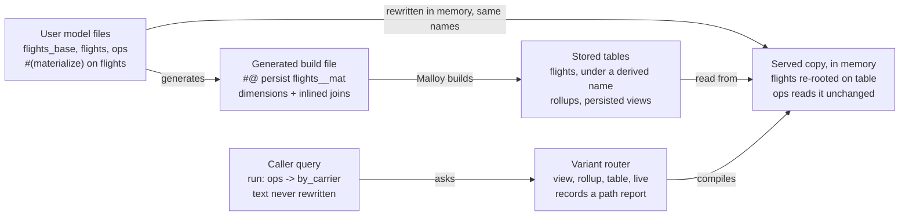
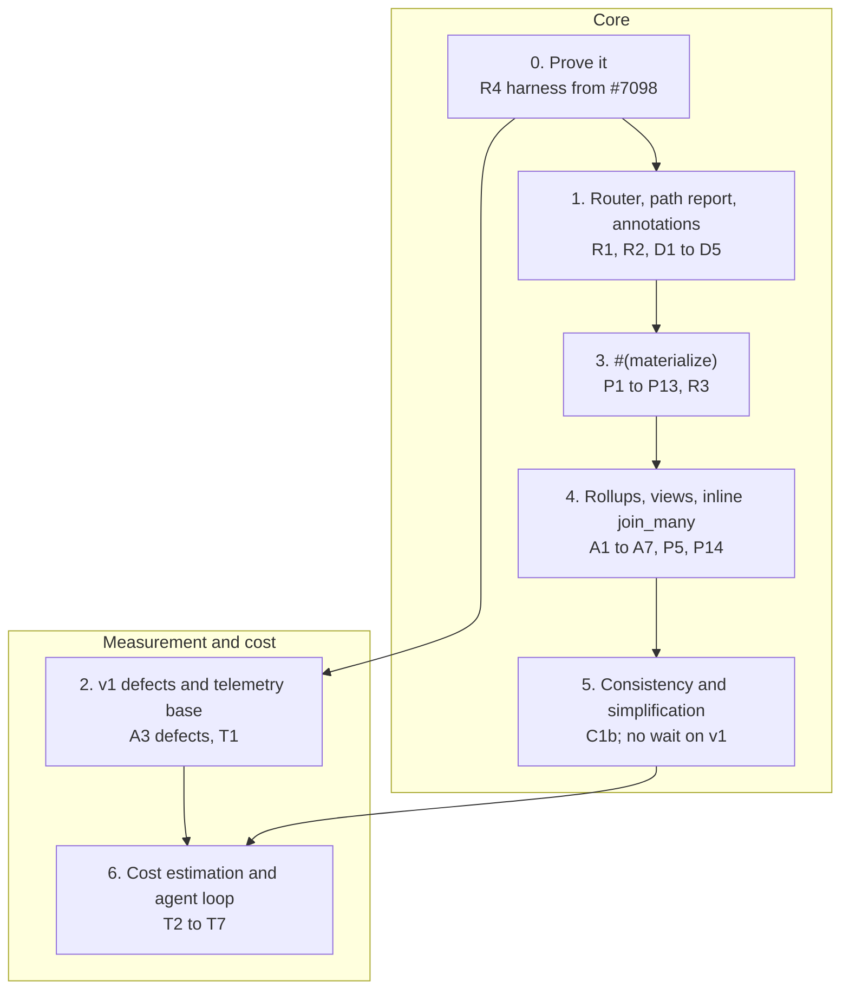
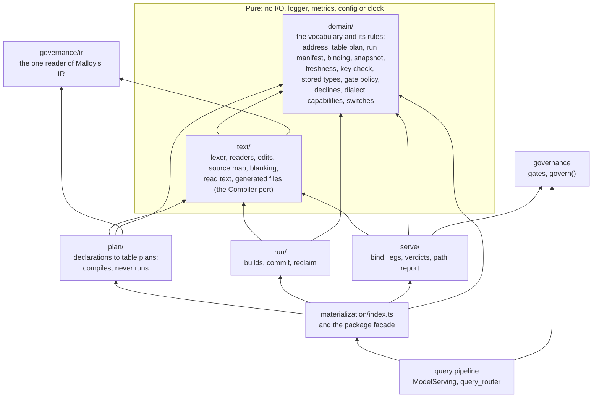
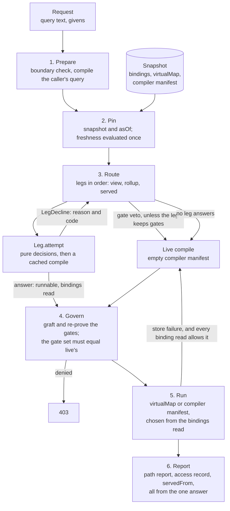
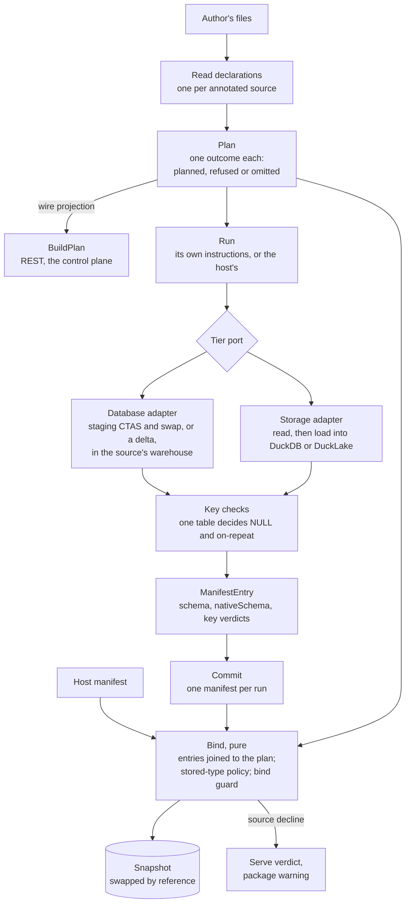
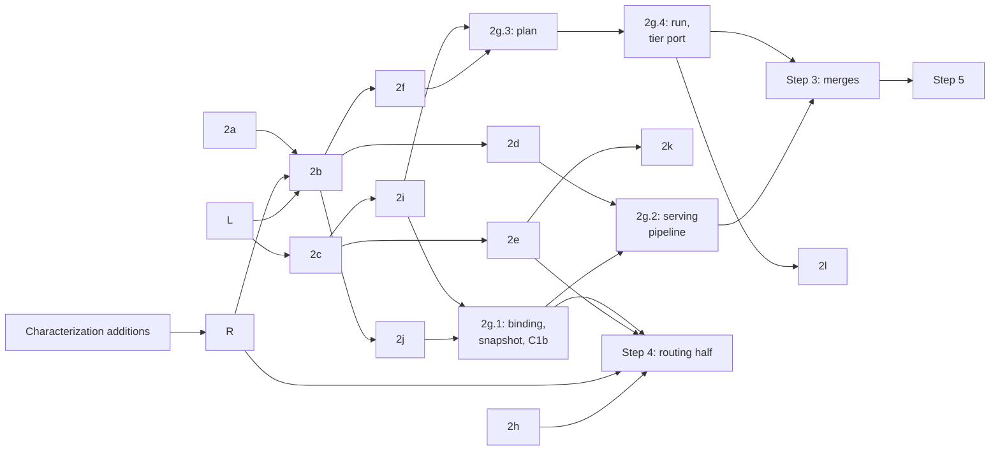
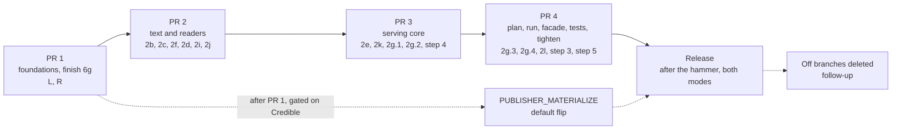

<!--
Copyright (c) Credible Data Inc.
SPDX-License-Identifier: MIT
-->

# Materialization v2: the implementation plan

**Status: plan of record, as of 2026-11-15.** Phases 0 to 4 and the v1 cutover shipped in 0.13.0. Phase 5, the consistency and simplification pass, landed as four pull requests (Phase 5 design, section 3), all merged (#1747, #1751, #1753, #1779), and shipped in 0.14.0; the distillation pass that followed it is merged in part (#1829, #1831, #1833). On 2026-11-15 the scope was narrowed: three features were removed (#1757, #1758, #1759), given-reading `where:` was narrowed (#1762), persisted named queries were added (#1763), the tables a standalone Publisher names itself got readable names (#1776), and the hosted table lifecycle was settled in part (Scope, below). The next release is held until PR 4 merges (decision 48). This plan covers how Publisher implements materialization v2: `#(materialize)`, `#(rollup)` and routed `#@ persist` views, built and served in Publisher alone, with no Malloy change. It is sequenced with the Publisher v1 plan ([#1563](https://github.com/malloydata/publisher/pull/1563), `docs/publisher-v1.md`): the path report's `/api/v1` form, the agent tools' `/api/v1` routes, and the consistency work that needs v1's Track B1 records (whole-run generations, upstream pinning, as-of reads, the control plane's promote and cleanup) are scheduled there, so this plan completes without waiting on v1. Requirement numbers (P, A, R, D, C, T) and scenario numbers (S) refer to the materialization v2 requirements and programming model; issue numbers without a repository are in Credible's tracker.

## Scope

v2 builds what real packages need and refuses, loudly, what nobody uses and costs the most to keep correct. The evidence is a coverage review of 2026-11-14: every v2 annotation is unused outside Publisher's own tests, and real packages are v1 `#@ persist name= storage=` sources, mostly query-shaped, cross-file and often chained.

### What v2 supports

- **`#(materialize)` on any source**, in its own warehouse or a `storage=` destination. The source is built by a generated `#@ persist` and served by re-rooting the author's text on the stored table (Design). Reference joins by default; `inline=` on a join_one stores its columns and answers the join from them; given-reading `where:` terms and rolling windows are re-applied at read; caller-dependent dimensions are computed at read; hidden fields are stored and re-hidden; an extension can have its own table (Joins, Rolling windows).
- **`#(rollup)` rollups**, with view routing, extensions of the base, gated bases on database tables behind `PUBLISHER_MATERIALIZE_GATED_SOURCES`, and join-to-rollup (A7) (Joins).
- **`#@ persist` on a view**, answered only for an exact call of the view (P14). Kept (decided 2026-11-15).
- **`#@ persist` on a named query** (`query:`), approved 2026-11-15 and merged in #1763: its result is built from a generated companion source and answered by its own leg, after the view leg, for `run: q`, a `queryName` request, a report tile naming it and `run: q -> { … }`. The route counter labels it `leg="query"` and the path report's table `kind: "query"`. A query that reaches a row-level gate, or returns a nested result, is not built (`persist-query-not-built`) and answers live, whatever `PUBLISHER_MATERIALIZE_GATED_SOURCES` says.
- **v1 `#@ persist`**, including its `name=`, and the deprecated v1 `#@ preaggregate`, served through the same served copy and rollup leg since the v1 cutover (0.13.0).
- **The path report and the three outcome tiers**: every query says what answered it and why each candidate was skipped, and an annotation that cannot be honoured warns and serves live (narrowed by the load-versus-refused policy, below).
- **Readable table names** for the tables a standalone Publisher names itself (#1776; Ownership).
- Pair tables (`inline=` on a join_many) are built and served today; whether v2 keeps them is under consideration (below).

### Removed, and refused loudly (decided 2026-11-15)

Each removal refuses the publish with a coded error in every mode, so nothing an author wrote is silently ignored. Each can come back later if a user needs it.

1. **`name=` views.** The `name=` view machinery (`CREATE OR REPLACE VIEW` over a generation-named table, its comment mark, preflight, put-back and reclaim) is removed entirely; a one-shot cleanup drops this package's own leftover marked views when its tables are reclaimed. A generation-named table gets no view, and there is no control-plane alias reconciler. `name=` on `#(materialize)` itself is kept (decision 44, superseding the same day's decision 36, which refused it): it names the table where the table can sit at a stable name, and its dotted path places the table in a schema or dataset everywhere, and under `scope: version` its last segment is the readable name's prefix (#1776, decision 47). v1 `#@ persist name=` is unchanged: its table is written at that name, with no view, under the ownership marks of known limitation 33. Why the views go: no customer reads hosted tables by name outside Malloy, and a `scope: version` user does not need a stable latest-version name. Done in #1757 (with the plan's correction in #1767); #1752, a fix for a race in dropping `name=` views, was closed rather than merged, since the views go. The `PUBLISHER_MATERIALIZE` default flip (#1754) merged before it, and no release carried the flip without this removal.
2. **`partition=`**, on `#@ persist` and on `#(materialize)`. It refuses the publish. It was a layout choice with no isolation, and no real source sets it. Done in #1759, with its follow-ups in #1771.
3. **The cross-connection build view.** A model that joins sources on two origin connections fails to load, as Malloy says (malloy#3032), rather than loading from a build view with those joins left out. The served copy still leaves out a join to a source stored elsewhere, so the rest of the model serves (Joins). Done in #1758.

### Narrowed and frozen (decided 2026-11-15)

Two features stay supported, within these limits. Both exist to keep access controls correct, so each narrows only by refusing a source at plan, which then answers live under its terms and gates.

1. **Given-reading `where:` (P2), narrowed.** Only a materialized source's own given-reading `where:` is served from a table. A term or given-reading dimension inherited from a base, in the same file or another (the #1688 kept-base path), is refused at plan, and that source answers live under its terms: a v1 `#@ persist` as `inherited_where_with_given`, a new `RefusedSource.reason` (approved), and a `#(materialize)` with `materialize-not-built`. The kept-base machinery (`MaterializePlan.keptBases`, `keptBasesInText`) is gone; `text/kept_ancestors.ts` stays, since the served copy still uses it for extension tables (P10) and for bases that declare measures, views or joins; the guards `keepsGivenTerms` and `keepsTermsAsWritten` stay. This matches access filters, where an inherited access filter is already refused at any switch. Done in #1762.
2. **Gated sources on tables, frozen.** `PUBLISHER_MATERIALIZE_GATED_SOURCES` stays off by default. No new leg, tier or kind may keep its gates until question 14's security review signs off; `domain/gate_policy.ts`'s rows are pinned by `gate_policy_frozen.spec.ts` (phase 5's PR 3, #1753). The code behind the switch stays, so the review has something to evaluate.

### Load versus refused (decided 2026-11-15; review in progress)

An invalid annotation, or invalid code an annotation covers (a compile-time error), fails the publish or the load. A per-item refusal (a coded warning, the source answering live) is only for a valid annotation Publisher cannot build: an environment, dialect or governance limit. This narrows the outcome rule's tiers (Consolidation, "One outcome rule"): where an earlier decision in this plan refuses a malformed annotation per source, this policy governs. A full review of every refusal against the policy is in progress, and its outcomes are not decided yet. Its first piece, also in flight: a valid rollup refused on its own gets the new warning code `rollup-not-built` (approved; #1781, open), and `preaggregate-malformed` is kept for lines that fail the load.

### Still under consideration (not decided)

Candidates from the coverage review, each a product call:

- **Merging R4's `buildScenario` into the package runner** (future work, a possible standalone pull request; not scheduled, and it does not block a release). `tests/component/r4/harness.ts`'s `buildScenario` (about 870 of its 1,302 lines, called from 50 specs at 160 sites) drives one model with bindings it derives itself, with options the package path has no equivalent for (a pinned clock, extra origins, `unbuilt`, the key-check switches, persisted views, a Postgres warehouse). The way to do it: keep the harness's interface as a facade and move one scenario option at a time onto the package runner, each move with before and after test counts.
- **Pair tables** (`inline=` on a join_many): the largest feature by code and tests, unused.
- **Join-to-rollup (A7)**: owns five known limitations and three of the five key-check writers, unused.
- **Moving v1 `#@ preaggregate`'s refusal earlier** than 1.0.0, with the migration recipe. Decided meanwhile (2026-11-15, approved): a v1 `#@ preaggregate` over a stored base is routed through the v2 rollup path; its pull request is in progress.
- **Upper-bound rolling windows** (`ts < now - N`): unused; the lower bound stays.

- **A per-connection materialization dataset** (future work, recorded 2026-11-15; not decided or approved for building). A database `#(materialize)` or rollup built into BigQuery needs a dataset-qualified `name=` (or `namespace=`), since BigQuery refuses an unqualified `CREATE`, so today such a source is not built (`materialize-not-built`): the `name=` is the only reason its author must name anything, where the readable name would otherwise do. Proposal: an optional connection setting, e.g. `materializationDataset: "publisher_scratch"`, naming the dataset or schema where Publisher builds a database table that has no dataset-qualified `name=`; the table takes its readable name there. Rules: unset, nothing changes (today's refusal, so it fails closed); Publisher never creates the dataset, which must exist and be writable by the connection's credential; an author's `name=` or `namespace=` still wins. BigQuery first; other dialects take an unqualified name in their default schema, but the setting could redirect them too. Needs: approval of the new connection key; the planner's check (`needsQualifiedTable` in `domain/dialect.ts`, read by `plan/materialize_plan.ts`) and the rollup `namespace` default to match; docs (`materialization.md`, `preaggregation.md`, `connections.md`). Considered: the source's own dataset (no configuration, but it writes beside source data) and a package-level default in `publisher.json`; the per-connection setting is preferred.
- **Cross-connection joins in the served copy** (future work, recorded 2026-11-15; not decided or approved for building). A stored source joined to a source on another connection is the ranking's worst limitation. Where the join can be left out, a query through it answers live (`CROSS_CONNECTION`, warned `cross_connection_join`). Where it cannot, `cross_connection_unbuilt` costs the whole model's served copy until both sides are built into one destination: gtm-funnel serves none of its 30 built tables, and four of its sources, 85 GB live against a 25 GB bytes-billed cap, cannot be queried at all. It waits for Malloy to support a join across connections, which it does not yet. The possible approach then is to step back only the joined source's re-root, so the source that reads the join answers live and the rest of the model's copy serves (row 34 records the related whole-model failure).
- **Correcting the cross-connection warning's advice** (future work, with cross-connection support above). `cross_connection_join` offers to inline the join (`inline=`) first, whatever the source's annotation, but only `#(materialize)` takes `inline=`. For a v1 `#@ persist` source it should offer only what that author can do: persist the joined source into the same destination, named in the message, or keep the source database. `cross_connection_unbuilt` should name the joined sources too.
- **A `#(materialize)` over a base that declares a measure, view or join** (future work; sixth in the 2026-11-15 ranking). It is built on every run and never read: the served copy cannot carry the base's measures, views or joins over the table (`fields_not_carried`, warned `served-copy-not-served` only after the build). The migration guide calls it the trap a migration hits most. Possible fix: decide `fields_not_carried` at plan and refuse the source before building, naming the inherited fields.
- **A failed upstream's strict downstream** (future work; tenth in the 2026-11-15 ranking). When an upstream build fails, its strict downstream fails with "Persisted source not found in manifest … strict manifest mode forbids fallback", which names neither the upstream nor its failure (bars-sales-mix-native-demo; partial-failure-demo, where `pf_good` fails with `pf_bad`'s error). Possible fixes: an explicit "upstream failed" refusal naming the failed upstream, or building the downstream over the upstream's previous table.

Known gaps with no pull request yet: a Malloy upgrade re-addresses the tables that aggregate through joins (address drift), and the flags on the control-plane side.

Also open: the rest of the hosted lifecycle redesign (Ownership). Table naming is decided (decision 47; question 17's rollup placement settled by one placement key, `name=`).

### Support matrix, in brief

From the coverage review (on `main` at `81503c380` with #1751), with the persisted named query row and the 2026-11-15 refusals added from their merged pull requests. "Served" means equal to live under the R4 comparator; "live" means a correct answer with no speedup; "refused" means an author-facing refusal or warning.

| Area | Served | Live | Refused |
| --- | --- | --- | --- |
| v1 `#@ persist` | Query-shaped, imports and re-exports, renames, multi-stage, nests, chains (same file and across files), stored timeframes and annotations, given terms per caller, hidden columns, database gates (switch on), incremental | A join to a warehouse source from a `storage=` source; two models sharing one table; `#@ -persist` readers; a `storage=` table with hidden columns | A given in the persisted query; `#(authorize)` on a `storage=` source; incremental on a dialect without merge; `partition=` (from 2026-11-15); a given-reading `where:` inherited from a base (`inherited_where_with_given`, from 2026-11-15) |
| `#(materialize)` | Every v1 shape above, computed dimensions, extension tables, inlined join_one, pair tables (accepted shapes), rolling windows, caller-dependent dimensions, hidden fields, gated sources (switch on) | An inlined join's measures, views or annotated fields; a pair-table count written in the query; a zone-dependent stored value under `timezone:`; a cross-connection join | Both `#@ persist` and `#(materialize)` on one source; an unkeepable given term; a given-reading term or dimension inherited from a base (from 2026-11-15) |
| Persisted view | The exact call, and a later stage over it | A refinement, nest, look-alike or extension call | A view reading a given or `now`, or a gate not grouped |
| Persisted named query (#1763) | `run: q`, a `queryName` request, a report tile naming it, `run: q -> { … }` | `run: q + { … }`; an aggregate-only query; any use of `q` in another definition; caller text that names the run target or `q` again | A nested result; any query that reaches a row-level gate |
| v1 `#@ preaggregate` | Rollups with annotations kept; gated bases (switch on, database) | A query outside the grain; a `storage=` rollup over a gated base | A fan-out base, a bad grain (refused at publish) |
| `#(rollup)`, A7 | sum, count, min, max, filtered and expressions of them; views and extensions; counts and sums through a join_many | `GRAIN_TOO_COARSE`, `TIME_ZONE`, `CONTRACT`, `CROSS_CONNECTION` and `COUNT_SEMANTICS` per query (known limitations 25 to 28) | Unmergeable aggregates, a source with its own `timezone:`, a given or `now` in its rows |
| Column types | Big integers past 2^53 (exact cast), decimals, timestamps with zone, lists and records | Types a `type:` cannot declare (map, blob, interval, enum, union, uuid, json, and limitation 42's Postgres types) | — |

What the evidence does not cover: every executed served-against-live test is DuckDB. The real Postgres-to-DuckLake build is checked only by the nightly hammer and by opt-in integration specs that no CI workflow runs; BigQuery, Snowflake, Databricks and MotherDuck have no served-against-live test. The conformance fixture today is 31 shapes and 222 cases (the "25 packages, 370 cases" quoted below is its count at #1650).

## Summary

Every v2 requirement can still be built in Publisher alone, with no Malloy change and no edits to compiler internals. The updated requirements add telemetry, cost estimation and package-wide consistency, and the shared pieces also absorb the per-annotation code that `#(authorize)`, `#(access_filter)`, `#(classification)` and `storage=` carry today. The design's load-bearing claims were re-run on Malloy 0.0.436 on 2026-11-07 and hold; the run corrected two details, how a view call is recognized and `count()` measures in the child-measure rollup. This answers the scoping ask in the requirements doc's 2026-11-02 revision.

- **Build.** `#(materialize)` desugars exactly as the requirements define it: Publisher writes a generated `#@ persist` source, `src -> { select: <row-level dimensions>, <inlined join paths> }`, and Malloy's own persistence planner builds it on v1's pipeline (build, fingerprinting, storage, incremental, hosted).
- **Serve.** Publisher re-roots the source on its table in an in-memory copy of the user's files. Measures, joins, views and access rules are re-bound by leaving them as written, so every source that extends or joins it reads the table untouched.
- **Route.** One variant router replaces the fixed chain: persisted view by exact call, then rollup, then the nearest materialized table up the chain, then live. It writes the path report (D1), and it takes its table catalog as an input, so what-if (T3) is the same code run against a proposed catalog.
- **Changed since the Nov 1 plan.** Joins are reference by default, with `inline=` opt-in; a current-time `where:` is a rolling window, not a compile error; outcomes are tiered; `#@ persist` views are routed; telemetry and consistency are new. The appendix has the full list.
- **Corrections to the hand-off.** Generations are a Publisher mechanism, with the control plane choosing what is current and cleaning up (Ownership). Core needs to expose nothing beyond its public API. S25's expected rows are wrong for a "last 30 days" window (Rolling windows).
- **Biggest risk.** `inline=` on a join_many (P5) is correct Publisher-only, but a pair table holds the fanned rows. Served flat, with one parent-row flag and no join at read, child and mixed queries ran at 0.2 to 0.4 times live on 2M and 10M flights at fan-out up to 5; a parent-only query skips the pair table for the parent's own stored table or live, so every query it serves is at or below live (Joins). Whether v2 keeps pair tables is under consideration (Scope).

## Design

Publisher treats `#(materialize)` and `#(rollup)` as a front end: it turns them into Malloy that v1 already builds, then serves from a rewritten copy of the user's files. The user's files are never edited.

**Build: the desugaring, written as a file.** For `#(materialize) inline=["carriers", "origin_airport"]` on the running example's `flights`, Publisher writes an in-memory build file:

```malloy
##! experimental.persistence
import "flights.copy.malloy"   // the user's file, its own #@ persist lines removed

#@ persist name="<derived name>"
source: flights__mat is flights -> {
  select:
    id2, carrier, origin, distance, cancelled, dep_time,  // primary key and raw columns
    route,                                                // row-level dimension, under its own name
    carrier_name,                                         // through carriers, inlined
    origin_region,                                        // through origin_airport, inlined
    carriers__code is carriers.code,                      // the inlined source's exposed dimensions,
    carriers__nickname is carriers.nickname,              //   as internal j__<field> columns
    origin_airport__code is origin_airport.code,
    origin_airport__faa_region is origin_airport.faa_region
  // dep_hour depends on the query time zone: not stored, computed at read
}
```

- Every stored column keeps the author's name, computed or not, so the table reads as the author's source to anything outside Malloy. The table takes a Publisher-derived name (readable since #1776, Ownership), or the control plane's generation name in hosted mode; `name=` on `#(materialize)` names the table where it can sit at a stable name and places it in a schema or dataset everywhere (decision 44; decision 36's refusal of `name=` is superseded). `flights__mat` is only the build source's name inside the generated file (decided 2026-11-12).
- No suffix on stored columns (no `__s`): a stored computed dimension keeps the author's name. A timeframe truncation keeps its timeframe in the served copy through `internal rename: <dim>__stored is <dim>` and the redefinition `<dim> is <dim>__stored.<tf>`, since Malloy's `type:` can't carry a timeframe (probed 2026-11-12). `__mat` is internal: the build plan, warnings, scoped runs (`sourceNames` takes the author's name), the manifest and the path report show only the author's source name and `sourceID`; addresses are unchanged. An inlined join's columns are internal `j__<field>` columns for readers outside Malloy, kept out of the served `type:` (decided 2026-11-12).
- Generator refusals are `materialize-not-built` package warnings, and the source serves live: a malformed value, and a source carrying both `#@ persist` and `#(materialize)`. `name=` is not a refusal (decision 44). A database `#(materialize)` is built into its own warehouse and served by the served copy there; v1's database `#@ persist` is unchanged. An unknown key is malformed under the outcome rule below (`materialize-unknown-key`, refused at publish), checked against the route's closed set in the annotation reader, and so is a line that does not parse (`materialize-unparseable`) (decided 2026-11-12). `freshness` and `queryMetadata` are carried onto the generated `#@ persist` (decided 2026-11-12).
- The experimental flag lives in the generated file, so the user's file needs none (D3).
- The build runs over a copy of the source's file with its own access modifiers lifted, because a query can't select internal or private fields; the served copy re-applies them as written (P3). Decided 2026-11-12: one build copy per source (the #1644 mechanism, shared with P2's given terms) deletes the source's own `private`/`internal` statement labels, makes its own `include` labels `public` (adding `public: *` where a block has no wildcard), and wraps the declaration in `include { public: * }`, which lifts the `internal` fields it inherits from any file. Which hidden fields are stored is read off the compiled copy: a field still hidden there is not stored, so a field private on a source it extends (Malloy keeps it inaccessible under `public: *`) and an `except:`'d field are never selected. A hidden field with a timeframe is stored (decided 2026-11-12, known limitation 8 lifted): the served copy restores its timeframe with the same `__stored` redefinition as a public one, the redefinition carrying the author's modifier and the `__stored` column `private`. In the served copy a hidden column the source's own trailing `extend` defines keeps that definition (computed at read), and every other one is re-hidden with an `include { public: *; private: …; internal: … }` written just before the author's `extend`, where Malloy lets that `extend` read it as it read the author's field. Malloy refuses a `rename:` in the block just after an `include` (it cannot find the old name to set its access on), so the include is written only for a hidden column kept under its own name, and then every internal name it gives a stored column (a timeframe's `__stored`, an inlined join's `j__<field>__stored`) is renamed in a block ahead of the include, which hides it: `private` for a hidden field's or a hidden join's column, so no caller reaches it by any path, `internal` for a public one's (probed 2026-11-12). A hidden timeframe column or a hidden join's columns alone are hidden by a labelled `private rename:` in the re-root's first block instead, with no include, so an author's own `rename:` (and the inverse rename block before it) still compiles; an include there refuses it, and with it the model's whole served copy. A load-time check refuses any re-rooted source whose fields are not exactly as hidden as the author's (`fields_not_carried`), and any internal name it adds that is public or less hidden than the author's field it is named after (`<field>__…`). Storing them changes the build SQL, so every `#(materialize)` table re-addresses once, before the switch ships (2026-11-12 audit); v1 `#@ persist` addresses do not move. An extension table's build copy lifts its own declaration over its parent's re-root exactly as over the raw chain, and stores the hidden fields the raw-chain copy lets the build select, chained or not; its `storage=` build text carries the same lift and its flag (decided 2026-11-12, merge of #1661 into #1666).
- A materialized extension builds from its parent's build source, so Malloy's planner orders the builds (P10). Only a source's own `#(materialize)` is planned: an extension or rename that declares none does not inherit it, though Malloy shares the base's notes with it (decided 2026-11-12, #1645). The extension's build copy re-roots the parent on the parent's build source, and the generated sources sit in one level file per depth of the chain, which the companion imports. A pair in one file on one tier (both database, or one `storage=` destination) with no incremental key chains; a database pair's build reads the parent's build source in its own warehouse, which Malloy's planner resolves to the parent's table through the build manifest. A `storage=` extension's build compiles, in its destination alone, the parent's build source declared as the virtual source of its stored table and the declarations from the parent down to the extension as its build copy writes them, so it reads nothing from the warehouse; the plan compiles that text against a stand-in destination first, and one that reads anything else builds over the raw chain (decided 2026-11-12, extension tables, review of #1661). The extension's re-root keeps the `extend` blocks of every source it is built on in its file, ahead of its own, so it inherits every measure, join and view; the re-hiding `include` sits on the stored table ahead of those blocks, and a hidden dimension a kept ancestor block defines keeps that definition, as one in the source's own block does. A `rename:` carrying an access modifier, in the source's own blocks or a kept one, still refuses that source's re-root (and its chained build) now that hidden fields are stored: undoing it would rename a hidden column, which nothing checks yet, so it fails closed (kept 2026-11-12).
- A `where:` term that reads a given is left out of the build: the build imports a build copy of the author's file with the term's text replaced by `true`, and the term is written again on the generated source's own `extend`, where persistence keeps it out of the build SQL (#1644). A current-time lower bound is built as written, with the build's own `now`; a current-time term holding an upper bound is left out of the build the same way, own or inherited (Rolling windows, decided 2026-11-12). All stay in the served copy and are re-applied at read (P2). A given term written on a base the source extends, in its own file or another, refuses the source at plan, which serves live (decision 42, #1762; it removed #1688's kept-base path, which left such a term out of the build and kept the base's blocks over the table). So does a term that reads a joined or unstored field (decided 2026-11-12, #1644). One classifier sorts every term by what it reads (`classifyWhereTerms`, below), and the plan carries one list of the terms the served copy re-applies (`MaterializePlan.readTimeTerms`, one entry per term, by `kind`). A term that reads both a given and `now` is refused, and the source serves live: #1641's current-time rule wins over #1644's (decided 2026-11-12).

**Serve: re-root the source in place.** In an in-memory copy of the user's file, `flights` keeps its name and is redefined over the stored table.

- The extend blocks from the root table up to `flights` are copied verbatim, each inside its own file's copy, so names resolve where they were written.
- Each stored dimension's definition is dropped, so the stored column of the same name stands in for it. Its annotations move onto that column's entry in the served `type:` declaration, where Malloy keeps them (probed: `#(doc)` on a `type:` field survives; redefining or renaming a field to its own name does not compile).
- A `rename:` whose new name is a stored column is undone ahead of the kept blocks (`rename: <old> is <new>`, last first), since the build applied it, and the author's `rename:` stays as written, so kept text that reads the old name (an ancestor's measure, in an extension table's kept blocks) still compiles; a `rename:` with an access modifier refuses the re-root, and the source serves live (#1657 dropped the statement instead; one mechanism since #1661, decided in its review). Fixed `where:` terms, `except:` and `accept:` are kept as written: the re-root keeps the trailing `extend` byte for byte (#1637), so a fixed term runs again at read, which is harmless (decided 2026-11-12). Given-reading and current-time terms, `primary_key:`, joins, measures, views and access modifiers are kept.
- A reference join stays as written; its target is re-rooted on the joined source's own table when that source is materialized. An inlined join_one is answered from its stored `j__` columns (#1665): the served copy replaces the join with a record of them under the join's name, so `carriers.nickname` reads a column and, on the storage tier, no longer crosses connections. An inlined join declared in a kept ancestor's block (an extension table's re-root) is replaced the same way, since the record substitution runs over every kept block. What the columns cannot answer (a measure, view or join of the joined source, an aggregate at the join's grain) is answered live.
- The served model compiles at load against `conn.virtual('<handle>')::T`, with `T` a `type:` declared from the build query's output, so compile errors show before any table exists. It needs `##! experimental.virtual_source` in the served copy (flags don't cross an import) and a per-query `virtualMap` entry, which may name a table not built yet (Evidence). Today's storage serve shape works the same way.

**v1 packages keep working.** A v1 `#@ persist` on a query-shaped source keeps core's meaning, and its `extend` refinements are an ordinary chain to the rewriter: the query-shaped base is replaced by its table and the extend block is kept, which is what today's storage serve shape does by hand. The serve shape retires in phase 3 only after the conformance fixture (#7098) shows every bundled v1 package serving unchanged, standalone and on Credible. Moving a package to `#(materialize)` is optional, and the skill gets a migration recipe in phase 3.



**Five shared pieces.** Materialize, preaggregate, view routing and what-if are built on these, and so are Publisher's other annotations; Consolidation says what each one replaces.

| Piece | What it does |
| --- | --- |
| Source map | Package-wide: each source's extend chain, block text, and the range of every statement, declaration and annotation; which source wrote an annotation; which joins a source has, by path. Keyed by `sourceID`, on the same chain the gate walk uses |
| Annotation reader | Reads every route Publisher owns (`#(materialize)`, `#(rollup)`, `#@ persist`, the gate and classification routes) against a closed key set; near-miss routes (D5); deprecations; sorts every finding into compile error, publish warning or skip |
| Re-root rewriter | Moves a source chain onto a new base: a stored table, a build source, or a rollup at a join key; hosts the generated files |
| Probe compiler | Compiles small generated queries on the load worker, never running them, and reads the givens used, compile errors, generated SQL and result schema |
| Variant router | Compiles a query against view, rollup, table and live variants in order over a table catalog; records why each was used or skipped; hands the chosen variant to `QueryGovernor.govern()`; the same code answers what-if over a proposed catalog |

## Consolidation with Publisher's other annotations

The five pieces are not new code beside `#(authorize)`, `#(access_filter)`, `#(classification)`, `#(carries)`, `#(secure)` and `storage=`: most of each already exists, once per annotation, and v2 is the occasion to make each one shared. Checked against `main` at `3c3ef1bd8` on 2026-11-08, after the architecture refactor this plan assumed landed as #1559; every file and symbol named below is there. Files are under `packages/server/src/service/`; materialization code is in its `materialization/{plan, run, serve}` module.

| Piece | Already exists, per annotation | Consolidate to |
| --- | --- | --- |
| Annotation reader | Route detection four ways: Malloy's `routeOf` in `authorize.ts` and a second copy in `authorize_grammar.ts`, a regex in `classification.ts`, a string prefix in `filter.ts`, `note.route` in `given.ts`. A near-miss scan for `authorize`/`access_filter` only (`collectAuthorizeNearMisses`). A bracketed-list reader for `#(carries)` (`readTagList`) beside comma-string parsers for `grain=` and `partition=`. The `#@ persist` tag parsed in eight places: seven under `materialization/plan/` (`build_plan.ts` twice, `persist_source_fields.ts`, `persist_dynamic_terms.ts`, `preaggregation_annotation.ts`, `preaggregation_synthesis.ts`, `incremental_declaration.ts`) and once in `model.ts`, with `storage=` read three ways (`persist.storage`, `preaggregate.storage`, bare `storage`, each with its own fallback). A retired-route list (`RETIRED_ROUTES`) in the gate grammar. | One reader for every Publisher route: route by `routeOf`, payload by `payloadOf`, lists by `readTagList`, keys checked against each route's closed set, near-misses scanned for every owned route (D5 is `collectAuthorizeNearMisses` generalized), one deprecation list (`#@ preaggregate`, `#(partition)`). The comma form of `grain=` retires on the new routes, while v1's #@ persist keeps it; `partition=` is refused on every route (decision 37). The reader also catches near-misses of #@ persist itself (#persist, #@persist, # persist, an unknown key), and surfaces Malloy's own malformed-route warnings at publish, such as #(classification "x"), which today declares nothing. |
| Source map | Author-text finders in `materialization/serve/materialization_serve_transform.ts` (lifts by location) and `caller_joins.ts`. The derivation chain walked from the IR in `governance/ir/source_graph.ts`, behind `gatePlan`, the one gate-inheritance walk. Caller text parsed in `query_text.ts`. | One chain: `source_graph.ts`'s three hops (declaration, query-source base, composite member) are what "up the chain" means for routing and for gate inheritance alike. The source map adds author-text ranges keyed by the same `sourceID`. `query_text.ts` stays separate: it reads untrusted caller text before compile, a different job. |
| Re-root rewriter and generated files | Overlay serving by URL in `request_overlay.ts` and `overlay_key.ts`; the synthesized rollup model served from an overlay inside the package directory (`materialization/plan/preaggregation_compile.ts`). The given-reading `where:` classifier in `materialization/plan/persist_dynamic_terms.ts` (`classifyDynamicTerms`), which reads the persist source's private `_sourceDef` and so is one of the IR reads question 9 covers. The bind guard in `filter_binding_guard.ts`, which proves an inherited `where:` or grafted gate still reads the field it was written against. | One generated-file host for the build file, the served copy and rollup variants (a new piece, not the existing `MaterializationHost`, which is the package-side interface the module calls). `classifyDynamicTerms` becomes P2's term classifier, extended for current-time terms. Every re-rooted source passes the existing bind guard, which replaces the plan's ad hoc field-and-type comparison. *2026-11-12 audit:* `classifyWhereTerms` was added beside `classifyDynamicTerms` rather than replacing it. Done since: `classifyWhereTerms` is the one `where:` classifier, and v1 persistence reads its given-reading subset (`givenTerms`) through the position rule `admitGivenPositions`. The served copy does not use the bind guard; it checks given terms with its own guard (`keepsGivenTerms`, which compares the given-reading filters' code and the givens they read), plus a lost-fields check and a carries re-check. Moving it onto the bind guard is assigned to phase 5's simplification pass (decided 2026-11-12). The generated-file host is not built either: each feature writes its own overlay. The `#@`-line blanking is shared (`materialization/persist_blanking.ts`, from #1659, which the `#(rollup)` build adopts), and so is the variant's import text (`materialization/serve/author_imports.ts`); both are to merge into the host (below). |
| Probe compiler | "Which givens does this read" answered four ways: `QueryGovernor.givenNamesReadByQuery`, `gate_dimension.ts` (`expandRefSummaryGivenIds`), `persist_dynamic_terms.ts` (`refSummary.givenUsage`), and gate probes in `authorize.ts` compiled on the load worker, whose connection refuses to run SQL. | One probe service on the load worker, keeping its compile-never-run guarantee: givens read, current-time and time-zone dependence, gate shape, and "does this compile against that variant". Gates, `#(secure)` summaries, P9 and the router all ask it. *Done in #1684 (2026-11-12):* the probe service is `service/probe_compiler.ts`, on the load worker inside the build plan, compile-never-run: givens read (`_query.givenUsage` and `PreparedQuery.givens`), current time (a scan of the generated SQL counted against a baseline probe of the same source), and time zone (the SQL at no zone and at two zones), each relative to the source so its own `where:` and base relation are not charged to a field. It now holds the IR given walk (`readsAGiven`, which v1 persistence's position rule and P9 share) and reads `givenUsage` through one reader in `governance/ir/prepared_query.ts` (`queryGivenUsageIds`, also used by `givenNamesReadByQuery` and report tiles). Still separate, since they answer a gate's question rather than a field's: `gate_dimension.ts`'s transitive expansion and `authorize.ts`'s gate probes; asking gate shape and "does this compile against that variant" of the probe service stays with the router. |
| Outcomes (part of the reader) | Fatal at load for gates and `#(carries)` leaks; advisory warnings for classification coverage (`classification_report.ts`, split out of `classification.ts` in #1559), join bypass and `materialization/plan/materialization_config_validation.ts`; strict-at-publish checks joined in `publish_checks.ts`; both load paths in `model_load_checks.ts` (`extractCheckedModel`). | D2's three tiers as the one finding type for every annotation, emitted from `extractCheckedModel` so the worker and `Model.create` agree. A gate that fails to parse stays fatal, which is the compile-error tier. |
| Variant router | `QueryGovernor.govern()`, the fixed sequence that mints every `GovernedRunnable`, already takes a routed runnable beside the live one (`CompiledQuery { live, runnable }`). The tier choice itself still sits in `Model.runQueryResults`, which blocks both storage and rollups for any entry point carrying a gate, a lock or a row filter (`routingBlockedByRowLevelGate`, route-blind despite its name), because the v1 serve shape strips annotation bytes. #1559 kept routing before the governance bind on purpose; `preaggregation_seams.spec.ts` pins the lock case. `materialization/run/freshness.ts` drops stale entries per query. | Route, then govern: the router picks a variant and `govern()` grafts and proves the gates on it. The v2 served copy keeps the domain's text, so the graft lands on any variant and the blanket block becomes a per-variant skip with reason `contract` (R3). Freshness becomes a router skip reason. |
| Telemetry hooks | The access record (`access_record.ts`) carries `servedFrom` and the gates enforced; `statement_usage.ts` meters every statement on a storage or managed connection; `materialization/run/build_read_cost.ts` already reads BigQuery bytes and Snowflake warehouse-seconds for `storage=` builds. | D1 and T1 extend the access record; T2 and T5 start from `statement_usage.ts` and `build_read_cost.ts` rather than new adapters. |

**Two boundaries kept on purpose.** Enforcement keeps reading compiler-set IR through `governance/ir/`, the one module that touches Malloy's private `_query` and `_modelDef`: a gate must decide on facts a caller cannot write. Materialization reads the same chain through that module, read-only, and never edits IR, which keeps the Nov 1 rule against grafting compiler internals (question 9). `#(filter)` is deprecated and is not migrated.

**One outcome rule, shared with the v1 plan.** D2 here and the Publisher v1 plan's Track C (invalid annotations fail loudly) use the same three tiers (decided 2026-11-10):

- **Malformed:** the annotation can't be read as written. It doesn't parse, has an unknown key on a new route, names nothing, or sits on the wrong kind of field. Refused at publish; a package already published keeps loading until that problem's counter reads zero.
- **Unservable:** well-formed, but it can't be honored here: a connection that can't hold a table, a missing destination, an access filter added later, a caller-dependent view, a source that can't be materialized. A coded, counted publish warning, and the source serves live. Never refused, because the cause is often another author or the deployment.
- **Skipped:** one query can't use the table. A reason in the path report.

Near-miss routes are unservable, so they warn, with one exception (decided 2026-11-11, #1605): a misspelled gate, a route word within two edits of `authorize` or `access_filter` that doesn't contain the gate's name, refuses the load, because a gate loaded inert leaves its source open.

The one exception is v1's `#@ persist`, where an unknown key warns until 1.0.0 (P13).

*Narrowed 2026-11-15 (decision 45):* an invalid annotation or invalid covered code fails the publish or the load, and a per-source refusal is only for a valid annotation that cannot be built here (Scope, "Load versus refused"). The review that applies it to each existing refusal is in progress.

**Security fix that falls out.** Routing every `#@ persist` read through the shared reader also closes an `@env.` handling defect in the build plan. The fix ships now as a standalone PR, not with a v2 phase, and the details stay out of this doc until it lands.

**Sequencing.** The reader, the outcome tiers land in phase 1, after the standalone @env. fix; the shared chain, the probe service and the generated-file host in phase 3. *Moved (decided 2026-11-12):* none of the three was built in phase 3's first five pull requests, and P9's probes weren't either (a dimension that reads a given refused its source; a time-zone-dependent one was stored as built and a `timezone:` query went live). The generated-file host, and the probe service with P9's probes, move to phase 3's pull request 6, the v1 cutover; the shared chain moves to phase 5. *Done in #1684:* the probe service and P9 for `#(materialize)` builds and the served copy (Known limitations, row 5). P9 needed no generated-file host: a left-out dimension is only missing from the build's `select:`, and the served copy keeps its definition as written; the host stays with the v1 cutover. Each step is a refactor with the existing specs as its net; the gate specs (`gate_proof_precedence`, `authorize_gate_walk`, the `governed_runnable_audit`) and `preaggregation_seams` must pass unchanged. So must `entities_golden.spec.ts`: since #1564 the package entities extraction (`entities/`) reuses the gate grammar and queryability rule, so it is one more consumer of the reader and the probe service. Since #1559 the import-direction lint and `import_cycles.spec.ts` also decide where the pieces live: all five go under `service/`; whatever `governance/` calls (the reader, the probe service, the shared chain) must not import `service/model.ts` (R3); and T7's MCP tools take a use case from the composition root, never a controller (R2).

## Ownership

The split in the hand-off holds with two corrections. Core needs to expose nothing beyond its public API. Generations are a Publisher mechanism that the control plane drives (the `name=` view was one too, superseded 2026-11-15: removed, decision 44), by the OSS-first rule: a declaration, build mechanic or check goes in OSS Publisher, and making it dependable at scale goes in Credible.

| Layer | Hand-off says | This plan says |
| --- | --- | --- |
| Malloy core | Query-shaped persistability, content address, build target, and the compiled IR that Publisher reads time-zone dependence and view identity from | Nearly the same minus the IR. Publisher uses `#@ persist`, `getBuildTargets`, `PreparedQuery.givens`, the result schema (which also names an exact view call), generated SQL and compile errors; the one IR read is the derivation chain through `governance/ir` (question 9). No core change is required. |
| Publisher | Vocabulary and validation, desugaring, load checks and publish warnings, routing, path report, telemetry, what-if, estimation | All of that, plus the generation manifest and single-generation reads, as-of recording, and the workload log on the access record |
| Control plane | Generations and atomic publish, as-of builds, stable names and the `name=` view, reference-counted cleanup | The sole owner of the hosted table lifecycle (decided 2026-11-15): which generation is current (the promote instruction), scheduling generation builds, reference-counted cleanup, and retaining and querying the workload log at fleet scale |

Why generations need a Publisher half: an OSS server running the opt-in scheduler builds tables too, and it must never serve a rollup beside a newer base either. A run already commits one manifest per package (`ManifestCommitter` in `materialization/run/manifest_committer.ts`, called from `materialization_service.ts`), so C1 extends that rather than starting fresh.

**Generations moved to the v1 storage plan.** The generation records (`physical_tables` and `manifest_entries`, generational table names, the claim and commit transactions, the reclaimer) are the [Publisher v1 plan](https://github.com/malloydata/publisher/pull/1563)'s Track B1, and the consistency work built on them is scheduled there (moved 2026-11-13; Phase 5 design, section 2). The `name=` view over a generation-named table (#1648) is superseded: removed 2026-11-15 (decision 44).

**Control-plane contract, to specify before phase 3.** The table above gives the control plane generations, cleanup and the workload log. Four more things cross the boundary and each needs an owner on both sides.

| Crosses the boundary | What has to hold |
| --- | --- |
| Generated build sources on the build-plan wire | The wire maps each one back to the user's source name and file. The control plane keys anchors on (version, source name, model path) and runs its name-collision and container checks on those names, so generated names and in-memory model paths must not reach anchors, runs, cred or the app. |
| The `name=` view | *Superseded 2026-11-15 (decision 44, #1757):* the view is removed. A one-shot cleanup (`run/leftover_name_views.ts`) drops a package's own leftover marked views when its tables are reclaimed. |
| The rolling-window delete | A new mutation. The incremental ledger records it. Not yet: the delete runs in the build's own transaction and shows in the step's statements, but the ledger column and wire field wait for a spec sync with the control plane (2026-11-12). |
| New wire fields (`servedBy`, the skip reasons, the outcomes) | The spec sync lands in the same PR as the Publisher bump, because the generated clients are strict. |

**The core interface each requirement needs.** The hand-off asks this for P3, P9, P14, R1 and A1.

| Req | What Publisher needs | Where it gets it |
| --- | --- | --- |
| P3 | Which fields are row-level dimensions, their types, and their access modifiers | Field kinds and types from the public `Explore`; modifiers and declaring source from the source map |
| P9 | Whether a dimension depends on a given, the current time or the query time zone | `PreparedQuery.givens` on a probe select; a scan of the generated SQL for current-time functions; compiling the probe at two query time zones and comparing SQL |
| P14 | Whether a query is an exact call of a persisted view | An exact call shows in the public result schema: `resultExplore.name` is the view's name, and `__stage0` for a hand-written or refined query whose SQL is identical. A query that starts from the view (`ops -> by_carrier -> { … }`) is read from the query text, the way `query_text.ts` reads run targets. |
| R1 | Whether a variant can answer a query | Compile the query against the variant; a `field-not-found` problem names the missing field, which becomes the skip reason. It is read by its code, not its message: Malloy message matching lives only in `mcp/malloy_error_text.ts`, which the domain can't import (lint rule R1) |
| A1 | Whether an annotation on an include-list item attaches to that measure | Works today: all three spellings on an include-list item attach to that measure on the including source only; a tag at the declaring site is inherited by reference, so the reader attributes it by declaring source (Evidence). |

Two optional core asks remain, neither on the critical path: route claiming, so the parser itself warns on `#(materialise)` (deferred in the hand-off), and a way to declare a stored table's grain keys so symmetric aggregates run over a pair table without a self-join (Joins).

**`getBuildTargets` is the current entry point** (checked 2026-11-07). Publisher pins Malloy 0.0.436; 0.0.437 has identical build API typings, and the last persistence change on Malloy's main branch, #3173 (givens in a table's key; per-build `givens` and `virtualMap`), is already in 0.0.436. Publisher doesn't call the deprecated `Model.getBuildPlan()`, but `materialization/plan/build_plan.ts` still calls two deprecated `PersistSource` methods, `getSQL()` and `makeBuildId()`, for `computeSourceEntityId`, `compilerBuildId` and the wire `sql`. Malloy's doc says these can disagree with the key the build computed, which matters once given-reading terms stay out of the build (P2). Phase 2 moves them to the target's `buildId`, `sql` and `buildSQL()`, keeping the partition-layout fold and the incremental ledger's address stable. A spec asserts the old and new addresses are equal across a corpus of real packages and lists any source that moves, because the incremental ledger, reuse, refresh streams and anchors all key on them (#6145 is what drift does).

Editors: the load-time checks already run through `compile_model` and the package compile route, so an editor calls those. `malloy-code-server` is gone (#1559), so there is no separate Credible code server to update. The VS Code extension sees nothing, which is safe because an annotation never changes an answer.

**Hosted table lifecycle (decided in part, 2026-11-15).** An as-is map of how tables are created, recorded, served and dropped across Publisher and the control plane found two record sets that are never reconciled, and drops on both sides. Decided:

- In hosted mode the control plane is the sole lifecycle owner and Publisher is a stateless executor: it builds the names it is told to build and drops nothing on its own initiative. Where Publisher still decides alone today (an in-place re-seed at a serving name, a chained storage rebuild, and the reclaim of a failed orchestrated run's storage tables; the `name=` views were removed in #1757) is the redesign's work list.
- The control plane never used `DELETE …/materializations/{id}?dropTables=true`, and the option is removed: a run's delete is record-only everywhere, and table cleanup is the caller's, through the connection. A request with `dropTables=true` answers 400; `false` is accepted and ignored.
- No control-plane alias reconciler: with the `name=` views removed (Scope, decision 44), nothing needs a stable alias moved at promote. Under generation names, `name=` only places the table in its container.

The rest of the lifecycle redesign is open: in-place writes in hosted, ownership marks on hosted tables, the drop contract's dependents check, what "stop" guarantees, crash leftovers (staging and aside copies), package and environment delete, retrying a failed reclaim, reporting a binding's generation back to the control plane, and whether the hosted content address includes the destination.

**Readable table names (decided 2026-11-15; standalone side merged in #1776).** Wherever a table cannot sit at a stable `name=` (decision 44), a generated name is the only name people see in the warehouse, so it says what the table is. A table a standalone Publisher names itself is `[<container>.]<pkg>__<file>__<source>[__v<ver>]__p<8hex>` (`domain/table_name.ts`, pure):

- The prefix is shared with the control plane's hosted names (ms2data/service#7799, which matches Publisher on the companion suffixes, the shared-table tie-break and re-keying an anchor when a source's model path changes). The hosted name adds its own tail; Publisher reserves none for it.
- `<file>` is the declaring model's base name, read from the `sourceID`, with each of the seven generated companion suffixes mapped back to the author's file; `PersistSourcePlan.modelPath` is now the declaring file too. A rollup's label is `<base>_by_<grain>`, a persisted view's `<source>_<view>`.
- Each segment is sanitized, and the leaf is budgeted per dialect: 50 for Postgres (Redshift included), MySQL, Trino, Presto and any unlisted dialect; 115 for SQL Server; 120 for DuckDB, Snowflake, BigQuery, Databricks and any storage destination. The tail is never cut.
- A table shared by several sources is named after the smallest model path and label, whatever the build order.
- `name=` in an unversioned or `scope: package` package is the exact table name, as before. Under `scope: version` its dotted path is the container and its last segment, lowercased and cut, replaces the prefix (one the readable name would otherwise rewrite fails the load with its route's `-invalid` code, as a rollup's leaf does), followed by the version and the tail.
- Names are sticky: a table keeps its readable name for the same address and container across a file move or a source rename.
- Existing default-named tables are rebuilt once under the new name by the next auto-run, and the old table is dropped only through a guarded migration (five guards; a run's `renamedTables` record is retried by later runs, and every loaded slot is rebound first, `ensureBound`). Servers sharing a schema must upgrade together.
- A second address on a name already taken in the run is not built and is refused with the new `RefusedSource.reason` `table_name_collision` (approved). Not a breaking change. Hosted and orchestrated runs are untouched: only self-instructed runs derive names.

Question 17's last part, rollup placement and a placement-only key, is settled: a rollup is placed by its `name=` container (or its base's), and `namespace=` is deprecated.

## Joins

Reference joins and inlined join_ones need no new storage machinery and read as fast as live or faster. An inlined join_many is the one shape whose cost Publisher can't fully control: answers match live, and child and mixed queries beat live, and a parent-only query, which would scan the fanned pair rows, skips the pair table (decided 2026-11-12) for the parent's own stored table or live.

| Instruction | Served as | Cost against live |
| --- | --- | --- |
| Reference (default) | The join as written; its target re-rooted on the joined source's table if it has one, or on its rollup at the join key when A7 applies | About the same as live, or faster when the joined side is stored |
| `inline=` on a join_one | Joined dimensions read columns, with no join in the SQL; a measure at the joined source's grain is answered live | Faster: the join is eliminated (verified Nov 1) |
| `inline=` on a join_many | Pair rows, one per row of live's LEFT JOIN, with one parent-row flag written at build that marks one row per parent. Served flat, with no join (decided 2026-11-12): the join's name is a record of the child columns, measures over the source's own fields aggregate the flagged rows, and an aggregate through the join reads every row. A query the flat table cannot answer exactly is answered live, and a query that reads no child field skips the pair table for the parent's own stored table or live (decided 2026-11-12) | 0.2 to 0.4 times live for child and mixed queries; a parent-only query is not served from it, so at or below live for every query it serves (tables below). join_cross is refused |

**What an inlined join_many costs, and why.** Malloy deduplicates parent rows only when a query goes through a join_many, and a pair table has none. Deriving the parents per query (`pair -> { group_by: parent columns }`) re-aggregates the whole pair table on every query; that is the form behind the Nov 1 figure of 3 to 15 times. On Nov 11 a parent-row flag written at build (one flagged row per parent, childless parents included) let the served source be the flagged rows with a join_many back to the pair rows, so a mixed or child query compiled to live's own LEFT JOIN with symmetric aggregates over the pair table; measured then (Malloy 0.0.436, DuckDB, 10M flights, 24M segments, 20% childless; warm medians in ms):

| Query | Live | Reference join | Pair table, derived parents | Pair table, parent-row flag | Single-scan SQL (needs core) |
| --- | --- | --- | --- | --- | --- |
| `flight_count`, distance by carrier | 4.5 | 3.8 | 152 | 12.2 | 11.9 |
| `flight_count` by route | 57 | 57 | 167 | 62 | 62 |
| `seg_miles` by carrier | 78 | 63 | 194 | 73 | 6.3 |
| parent and child measures by carrier | 298 | 280 | 434 | 322 | 15.5 |
| by `segments.is_long_leg` | 117 | 128 | 248 | 128 | 77 |

Across a fan-out sweep from 1.25 to 20 (2M flights), that joined-back form stayed within 1.25 times live on high-cardinality parent grouping and 0.9 to 1.4 times on mixed queries; a cheap parent-only query went from 2.1 times at fan-out 1.25 to 5.1 times at 20. The single-scan column is what reading the pair table once allows: 0.05 to 0.2 times live on mixed and child queries, because the join disappears.

**Served flat (decided 2026-11-12).** The single scan needs no core change. The pair table holds exactly the rows of live's LEFT JOIN through the join, so an aggregate through the join (`segments.miles.sum()`, `segments.count()`) reads every row and equals live's as it stands, including live's count of one for a childless parent (malloydata/malloy#1762; since Malloy 0.0.438 live counts none there, and the served copy re-declares such a measure over the level's stored key, known limitation 40); only an aggregate over the parent's own fields must read one row per parent. So the served source is the pair table itself: the join_many statement is replaced by a record of the child columns under the join's name (`segments.miles` reads the column on the same row), the stored child columns and the flag are renamed internally, and each measure that aggregates only the parent's own fields is re-declared as itself `{ where: <flag> }`. A measure that reads it by name (a ratio, a view) reads the re-declared one. One flag is enough: a child-row flag would mark every row but a childless parent's, and live counts that row. Every query that reads the table is checked, on its compiled IR (`governance/ir/pair_flat_query.ts`), before it is answered: a parent-level aggregate must be one of the re-declared measures, and nothing the query (or an enclosing stage) groups or filters by may read the child, since a parent's flagged row would place it in one child's group only. Answered live instead (path report `COUNT_SEMANTICS`): a parent aggregate written in the query, a parent measure grouped or filtered by a child field, an aggregate reading both sides at once, an aggregate through another join, windows, `all()`/`exclude()`, `select:`, and a join to the pair source from another source. A classified or annotated child field returned as a column is answered live with `MISSING_FIELD`, by the same check as an inlined join_one (`governance/ir/joined_field_output.ts`; a record's fields carry no annotations). The joined source's own measures and views are not in the record, so `segments.seg_miles` (a measure of `segments`) does not compile in the served copy and is answered live (`MISSING_FIELD`); author text that reads one through the join leaves the pair table unserved (`pair_not_compiled`). Measured with `bun` over the generated SQL (DuckDB 1.5.5, fan-out up to 5, 20% childless; warm medians in ms; every served answer equal to live's):

| Query | Live, 2M | Flat, 2M | Live, 10M | Flat, 10M |
| --- | --- | --- | --- | --- |
| `flight_count`, distance by carrier | 4.6 | 18.5 | 18.2 | 100.6 |
| `flight_count` by route | 20.3 | 26.5 | 39.1 | 77.5 |
| `leg_miles` (`segments.miles.sum()`) by carrier | 33.7 | 13.1 | 145.9 | 50.6 |
| `leg_count` (`segments.count()`) by carrier | 33.4 | 9.9 | 151.5 | 45.3 |
| parent and child measures by carrier | 129.8 | 22.3 | 655.2 | 139.6 |
| child measures by `segments.is_long_leg` | 42.4 | 16.0 | 193.8 | 67.5 |
| nest: carrier, then `segments.is_long_leg` | 131.8 | 35.6 | 689.7 | 184.5 |

A parent-level filtered aggregate is a `CASE WHEN` over every pair row rather than a filtered scan, which is why the cheapest parent-only query costs more than the Nov 11 form; the planner trades that for no join anywhere.

**Parent-only queries skip the pair table (decided 2026-11-12).** Which queries: any query that reads no child field, that is no field, aggregate, filter, group-by or nest through the inlined join_many (directly, or through a dimension, measure or view it reads by name, or the source's own `where:`). What changes: such a query is not answered from the pair table even where the flagged rows would answer it exactly; it goes to the router's next candidate, the parent's own stored table if there is one (a rollup over the source, or a database table on its chain that live reads through the manifest), or live otherwise. It is declined with the existing skip reason `COUNT_SEMANTICS` (internal code `served_copy_pair_parent_only`), so no enum changes: the pair table's rows are not the parents the query counts, and the other reasons name unrelated failures (`WARNED` promises a package warning or an opt-out that does not exist here). How it decides: "reads a child field" is read from the compiled query's IR through `governance/ir/pair_flat_query.ts` (`pairQueryReadsChild`), never from the text; a query whose IR cannot be read skips the pair table, which is the safe direction for both correctness and cost. Proof: R4 (`served_copy_pair_table.component.spec.ts`) shows parent-only queries skipping the pair table with `COUNT_SEMANTICS` and equal to live, and child-only and mixed queries still served from it and equal to live; the timing bench rerun below puts every served shape at or below live.

Rerun with the rule (same bench, DuckDB 1.5.5, 4 threads, fan-out up to 5, 20% childless, warm medians in ms; "next" is the next candidate, here live, since the bench source has no other table; every served answer equal to live's):

| Query | Live, 2M | Pair, 2M | × | Live, 10M | Pair, 10M | × |
| --- | --- | --- | --- | --- | --- | --- |
| parent only: `flight_count`, distance by carrier | 3.5 | next | 1.00 | 16.5 | next | 1.00 |
| parent only: `flight_count` by route | 19.2 | next | 1.00 | 39.8 | next | 1.00 |
| parent only: avg, `flight_count` by carrier | 3.5 | next | 1.00 | 16.6 | next | 1.00 |
| parent only: `count()` written in the query | 3.6 | next | 1.00 | 14.2 | next | 1.00 |
| `leg_miles` (`segments.miles.sum()`) by carrier | 29.9 | 10.8 | 0.36 | 143.4 | 50.0 | 0.35 |
| `leg_count` (`segments.count()`) by carrier | 29.8 | 9.4 | 0.31 | 143.0 | 44.6 | 0.31 |
| parent and child measures by carrier | 123.0 | 19.9 | 0.16 | 613.6 | 108.6 | 0.18 |
| child measures by `segments.is_long_leg` | 38.1 | 14.6 | 0.38 | 173.9 | 63.5 | 0.37 |
| nest: carrier, then `segments.is_long_leg` | 125.3 | 35.6 | 0.28 | 657.9 | 170.1 | 0.26 |
| `flight_count`, `leg_count` by route | 88.7 | 27.4 | 0.31 | 336.4 | 82.3 | 0.24 |
| `segments.seg_miles` (a child-source measure) | 30.1 | live | 1.00 | 150.2 | live | 1.00 |
| `flight_count` by `segments.is_long_leg` | 52.7 | live | 1.00 | 243.0 | live | 1.00 |

The spec accepts this tax ("inlining a join_many taxes parent-only queries"). The plan keeps the table, no longer pays the tax on reads (parent-only queries skip it, decided 2026-11-12), and still limits the damage three ways: the estimate reports the fan-out ratio and warns over the configured limit (S19); the path report shows the pair table skipped (`COUNT_SEMANTICS`) for parent-only queries; and the skill offers the two cheaper shapes below first. Served flat (decided 2026-11-12), the pair table already beats live on mixed and child queries, so the core ask under Ownership (declared grain keys) would now only close the parent-only gap.

**Pair-table details.** A parent with no children keeps one row with null child columns, since `select:` through a join_many is a left join; that row is live's own null-extended row, which live's counts read until Malloy 0.0.438 and skip since (malloy#3208): the served copy re-declares a measure through the join that counts, or sums a value not null there, over the rows where that level's stored key is not null, exact where the key is checked unique and never null (a level above the leaf at every build, the leaf by a check an auto-run records beside the table; known limitation 40). One flag, `__parent_row`, marks one row per parent (decided 2026-11-12: the plan's single-flag form; the child-row flag of the first build is dropped, since no exact answer reads it). Incremental refresh replaces whole parents (known limitation 9, narrowed): the declaration names a watermark field on each side of the join (`watermark=["updated_at", "segments.loaded_at"]`), and the build writes `__pair_watermark`, per parent the greatest of those fields over the parent's row and every child row, one value on every row of a parent. v1's machinery runs over it (the ledger, the frontier, the range), with the merge key the parent's primary key and one change: the range is open above, since one child stamped past the clock would otherwise hold its parent above every bounded range, the parent's own changes with it, until the clock caught up (found in review, 2026-11-12; replacing a parent whole is idempotent, so reading it again is safe); the delta is the build's own SQL over that range, which holds all of a parent's rows or none, so the flag its window writes is the full build's. The apply stages the delta once (one source read, so the delete and the insert see one snapshot), then in one DuckDB transaction deletes every stored row of each staged parent by key (NULL-safe, as the window partitions the NULL key as one parent), inserts the staged rows, runs the rolling window's delete (a parent column, so it removes whole parents), and fails unless every parent in the table has exactly one flagged row; a failed check rolls back and the table is rebuilt in full. A child-only change is seen through the child's field; a deletion or a move to another parent moves no field, so it reaches the table only when the old parent's own field moves (the incremental contract every source has: rows arrive or move their watermark forward). The fallbacks are a full rebuild with a `materialize-pair-full-refresh` warning, the table built and served: a watermark with no child field (a child-only change could not be seen), with no parent field (a new childless parent could not), an unstored field, mixed types, a `merge_key=` other than the parent key, or a rolling window over a child field. Proven by R4 (`served_copy_pair_incremental.component.spec.ts`): two refreshes after parents gain and lose children, a childless parent gains its first, late-arriving children of old parents, restated parents and children, new parents with and without children, each table equal to a full rebuild and every served answer equal to live, parent-only queries included; removing the delete by key fails the check and re-seeds, and removing the check too counts a parent twice. The Nov 1 shared-child build error is not needed: a child shared by two parents is stored with each, as live's LEFT JOIN pairs it with each, so a many-to-many join_many serves exactly.

**The two cheaper shapes for children.**

- **Child-grain source**, `#(materialize) inline=["flight"]` on `segment_facts is segments_base extend { join_one: flight is flights with flight_id }`: one wide row per segment, no fan-out, because the join runs the one-to-one direction. Measured 16 ms against 66 live for `seg_miles` by `carrier_name`. A flight-level measure still goes through the join (101 ms against 128 live), and parent numbers repeat on every child row, so the skill says to flatten parent attributes, not parent numbers, into a table other tools read.
- **Child-measure rollup (A7)**, `#(rollup) grain=["flight_id"]` on a `segments` sum measure such as `seg_miles`: the router adds a variant whose `segments` join is re-pointed, as join_one on `flight_id`, at a source over the rollup, with the measure summing its stored partial. A query that reads any other `segments` field fails to compile in that variant and falls to the next one. The SQL has no fan-out join, though Malloy still wraps the sum in its symmetric aggregate, so S9b should say "no fan-out join". S9b and A7's example read `segments.seg_miles`, a sum, not the spec's `segments.segment_count`: before Malloy 0.0.438 (malloydata/malloy#3208), live counted each childless parent as one child, which a rollup over the child source can't reproduce (question 12). Publisher now pins 0.0.438, so a count is served too.
- **A7 as built (phase 4, pull request 3, 2026-11-12).** The rollup leg tries the query source's own rollups first, then, for a query that reads a joined source's measures, that source's rollups through the join (`serve/join_rollup.ts`). The variant is generated beside the author's file like the base leg's: the query source is the author's, imported under another name, with `include { *; except: <join> }` (every other field keeps its access modifier and annotations; `public: *` would publish internal fields, probed) and the join re-pointed at the rollup on its key, `join_one` when the grain is the key alone and `join_many` when the grain also keeps child dimensions, so a query can group or filter by them. It reads the joined source's stored measures only (sum, min, max, filtered, and expressions of them), and answers equal to live for unmatched parents (sums 0, maxes null). A named view of the query source is served too: it is the author's view over the re-pointed join. Declined, with existing reasons: a joined field outside the grain (`GRAIN_TOO_COARSE`) or a measure not stored (`MISSING_FIELD`); an aggregate the query, or a measure of the source it reads, computes over the join's rows itself (`segments.count()`, `count(segments.k)`), a `select:` or `index:` stage, a source whose own `where:` or another join's condition reads the join, and a join not keyed on one field each side (`COUNT_SEMANTICS`, read from the compiled IR through `governance/ir/prepared_query.ts` and the source map's join readers); a fan-out grain dimension or join-level sum or count of the joined source's rollup that the query neither groups nor fixes at a level that aggregates through the join (A6, A2: `GRAIN_TOO_COARSE`; row 27, below), and a join key that is itself a fan-out dimension; a `timezone:` anywhere, or a query source whose time zone is not the joined source's, since the build truncated and filtered in the joined source's zone and live reads the joined rows in the query source's (`TIME_ZONE`, review fix); through a join_one, an aggregate the query reads that is not taken at the join (`count()`, the parent's own sums, another join's measures, in any field, filter or `having:` of the first stage, read from the compiled IR by `aggregateOutsideJoin`), since a join_one the data does not keep unique repeats each parent row live and the rollup holds one row per key (`COUNT_SEMANTICS`, review fix), unless the rollup's build checked the key unique (known limitation 29, below); a gated entry point, or a joined source with a gate of its own (`CONTRACT`); and a joined source's rollup in a `storage=` destination the query source is not stored in, since the query source reads its own connection and Malloy joins within one (`CROSS_CONNECTION`, malloy#3032). **In a storage destination (known limitation 26, #1704).** When the query source is stored in the rollup's destination (a `#(materialize) storage=` table or a `#@ persist storage=` source, re-rooted by the served copy on a fresh table there, the query source or a source on its chain), the variant is compiled over the served copy's own files and connections (`ServedCopyServe.joinRollupBasis`): its query model imports every name from the copy, declares the rollup over `virtual()` on the destination's alias (the base leg's storage declaration, `storedRollupDeclaration`), and declares the query source as the copy's with the join re-pointed, so the source's table and the rollup are read on one connection, the virtual map the copy's with the rollup's handle added. The copy keeps the source's given-reading `where:` terms and rolling windows at read and its access modifiers, so the variant does too. When the copy left the join out across connections (the joined source is not stored in the destination, #1643's leave-out), the join is added back rather than excepted, and the definitions the copy left out with it (a measure or view over the join) are not there, so a query reading one declines (`CROSS_CONNECTION`); when the joined source is stored there too, the copy keeps the join and the variant replaces it, those definitions included. Every check of the leg runs first; then the copy's own checks run on the variant's compile for the tables it reads: a reader that opts out with `#@ -persist` or a source the copy's classification checks flag (`CROSS_CONNECTION`), a pair table read through it (`COUNT_SEMANTICS`), and an inlined join_one's grain and annotation rules (`COUNT_SEMANTICS`, `MISSING_FIELD`); the copy's time-zone rule is already the leg's (every `timezone:` declines). The SQL must read both tables; a stale query-source table is not re-rooted and a stale rollup has no table, so either declines. A failed run degrades live only when every table read allows it (the answer carries both bindings). Proven by R4 (`join_rollup_storage.component.spec.ts`): sums, min, max, filtered measures and expressions through join_many and join_one, childless parents and NULLs, grain dimensions, `having:`, nests and `calculate:`, a given term per caller, a rolling window at three pinned clocks, an internal field, for both a `#(materialize) storage=` and a `#@ persist storage=` query source, and every decline with its reason. Since Publisher pins Malloy 0.0.438, which carries malloydata/malloy#3208, a `count()`, `sum` or `avg` taken at the joined source skips the row of NULLs an unmatched parent meets, so a count through a join_many and a sum of any operand are served (they were declined before, with the version switch `malloyCountsChildlessParentsAsZero`, now removed). Two leaves still read that row live and are declined with `COUNT_SEMANTICS` (`unmatchedRowProblem`, row 25): a `min` or `max` whose operand is not NULL there (a constant, `??`, `coalesce(miles, 0)`), which Malloy does not guard; and a sum or count taken at a join of the joined source keyed on a computed dimension, which matches a row for the unmatched parent and whose own key is then not NULL. **The join_one key check (known limitation 29, resolved):** a rollup whose grain is one dimension that a join_one in the package is keyed on (`joinOneKeysOf`, over every model the build plan compiles) carries a key check compiled from the rollup companion (`where: k != null; group_by: k; having: count() > 1; limit: 1` over the base alias, so it reads exactly the rows the build groups); a rollup no join_one keys on gets none, so no build scans for nothing. Auto-run runs it after the rollup's table is written and records unique or repeated in #1675's ledger (`metadata.inlineUniquenessChecks.rollupKeys`, keyed by content address, with the table's identity and a digest of table and SQL): carried to the next run while the table is not written and the check is the same, under the same newest-run proof as a pass, dropped by `markWritten`, forgotten with the passes when a run record is deleted. A check that cannot run records nothing and never fails the build; an orchestrated run runs none. The record reaches serving only with the manifest it describes: the committing run's auto-load, or a restore from the store when the newest run is uncontested (`withRollupKeyRecords`); a host's manifest never carries one, and a run forgets the bound check of every table it is about to write, so a run that fails part-way leaves none over rows it did not read. At route time, through a join_one: unique serves an aggregate outside the join; repeated or unknown declines it (`COUNT_SEMANTICS`, the detail says which). A query that reads another join_one whose key a rollup's build found repeated is declined (`COUNT_SEMANTICS`): re-pointing the leg's join changes Malloy's symmetric-aggregate choice over the rows the other repeats (15.5 live against 10.5 served before the check); one never checked is served, as before. A join_one's own measures are served whatever the check says, since live sums each joined row once too. **Row 27 (2026-11-12):** the A6 and A2 rules hold through the join, judged per query on the caller's compiled query (`checkJoinCoverage`): each level that aggregates through the join groups or fixes (`where: <join>.d = <value>`, there or above) every fan-out grain dimension, and every other grain dimension of a join-level sum or count it reads; grouping or fixing the query source's key field fixes the join's key column (every rollup row a parent row meets carries it). A level that aggregates only the query source's own rows asks nothing, since those aggregates are taken over the parent's rows whatever the join matches; an expression, a `having:`, a query-source measure that reads the join, or a field the check cannot trace is held to every requirement, and `all()`/`exclude()` declines. A join-level operand (`kinds.weight`) counts as a bare column for the unmatched-row rule when its join is keyed on a bare column of the joined source (NULL there meets no row); one keyed on a computed dimension declines (`COUNT_SEMANTICS`), since it can match a row for a childless parent. A join read as a join_many (declared, or a join_one re-pointed at a finer grain) must be keyed on the query source's primary key (`keyRepeatRefusal`, review fix): keyed on another field, a rollup row meets several parent rows, which live sums once per parent row (a join_many) or once at the joined row (a join_one), so it declines (`COUNT_SEMANTICS`); this held for the leg before row 27 too, through a join_one at a finer grain and a join_many from a source with no primary key. **The query source's primary key (review fix, 2026-11-13):** a declared `primary_key` the data breaks broke that rule (a repeated `id` read flight 1's rollup row twice where live sums each segment once, 10 against 5; a NULL `id` was counted by the variant's `COUNT(1)` where live's `COUNT(DISTINCT id)` skips it, 6 against 5). The build plan now finds every named source with a declared primary key and a join keyed on it (`parentKeyNeedsOf`, over every model), and attaches to each database rollup it reads as a join_many (`readsAsJoinMany`, the same scope as `keyRepeatRefusal`) a check compiled against the author's model that names it (`parentKeyCheckQuery`: group on the key, one row when a value repeats or is NULL). The check runs at the rollup's build, not the query source's: the query source is usually not stored, and the rollup's build is the one build the leg always has, so a source that is never materialized is still checked. It runs on the rollup's connection only, after the table is written, auto-run only, and is recorded in the same ledger map as the join_one check under `<address>#<sourceID>` (`rollupKeyRecordKey`), so `markWritten`, carry (same table, same digest, same source), the uncontested-run restore and forgetting apply unchanged; it reaches serving as `keyUniqueness.parentKeys` on the bound entry, never from a host's manifest. At route time (`parentKeyProblem`) unique serves; repeated, NULL or unknown declines (`COUNT_SEMANTICS`). A rollup in a `storage=` destination (#1704) is read beside the query source's stored table there, so the check moves to that table's own build: the build plan lists, by sourceID, each planned source's declared primary key when some storage rollup is read that way (`storedKeyChecksOf`, `storedKeyChecks`), and each storage build of one runs `storedKeyCheckSql` over its stored table in a destination session, over every row it holds (a given or rolling-window term the served copy applies at read only narrows them), when the table holds the key column. It is recorded in the same ledger under the stored table's own address and sourceID, so markWritten, carry and the restore apply unchanged; the committing run's storage entries and the restore (`withRollupKeyRecords`) carry it as `keyUniqueness.parentKeys`, `splitManifestEntries` strips it from any entry but the local store's, `deriveServeBindings` puts it on the storage binding as `primaryKeys`, and `forgetKeyUniqueness` drops it from a binding whose table a run is about to write. At route time the leg reads it from the binding `destinationOf` found for the query source (`storedKeyUniqueness`), only for a stored source that declares the join's key. Unknown covers a host-bound table, a check that reads a given (`parentKeyCheckCompiler`, from the check's own `givenUsage`, such as a `where:` that reads one, with or without a default, since a check compiled once would read the default caller's rows while another caller's leg reads its own; review fix), a check that did not compile or run, a source on another connection, and a source defined in the query. **A relationship change beside another join_many (review fix, lifted with Malloy 0.0.438):** re-pointing changes which joins Malloy sees fan out, so a `count()`, `sum` or `avg` the query takes through another join_many is written another way (`COUNT(1)` against `COUNT(DISTINCT key)`), and before #3208 the two counted a parent with no rows differently (4 live against 6 served), so `relationshipChangeProblem` declined it. #3208 makes an aggregate at a joined source test that source's key (`count()` counts the key, the others aggregate `CASE WHEN key IS NOT NULL`), which is exactly the unmatched row the two forms disagreed on, so the decline, `relationshipChangeProblem`, `uniqueKeyAggregatePaths` and `pathFansOut` are removed and these queries are served (row 35). On Malloy 0.0.436 the same served answers differ from live (6 against 4, 3 against 2), which the R4 cases show when run against it.

**Many-to-many.** Left as reference, a many-to-many join stays a definition and pairs up at read; answers matched live on Nov 1 (flights to weather observations, `weather.count()` identical). Inlined, it stores every pair, which is where storage blows up; the estimate's fan-out ratio is the warning. The bridge pattern (flights → crew_assignments → crew) needs nothing special: each hop follows its own instruction.

**Reference joins on the storage tier.** A source stored with `storage=` is read from the managed store, so a reference join to a source not stored there crosses connections at read, which Malloy can't compile (malloy#3032). Today such a query runs live. With reference as the default, that would hit every storage-tier core whose dimension tables aren't stored, so the plan makes it explicit:

- The storage variant leaves out the joins it can't reach (the rewriter's "chain with some joins left out"), so a query that doesn't use them still reads the table.
- A query that does use one skips the table with reason `cross_connection` and falls to the next variant, usually live (question 11).
- The serve verdict at publish names each such join and offers the three fixes: inline it, materialize the joined source on the same tier, or keep the source database. The estimate counts the logged queries that touch each one.

**The join_one uniqueness check (P8)** is a group-by over the dimension table on every build: usually small next to the fact table, but a full scan. The estimate counts it in build cost, and a build skips it when the joined table is unchanged since the last passing check, where the warehouse reports a last-modified time (BigQuery, Snowflake). Elsewhere it always runs. The first cut runs it on every build; the skip is not built yet.

**Joins as built in phase 3 (decided 2026-11-12, #1643).**

- **Reference by default.** The table stores the source's own rows and the served copy keeps every join as written. A dimension whose value reads through a join that is not inlined is not stored but computed at read through the join; storing it would have fanned a join_many's rows out into the table.
- **`inline=` on a join_one** stores the dimensions that read through that join, one hop, and the joined source's own dimensions as internal `j__<field>` columns, with a uniqueness check generated per build that fails the build naming the join. The served copy answers the join from those columns (decided 2026-11-12): the join is replaced by a dimension of the join's name, a record literal of the stored fields over the `j__<field>` columns (renamed internally, so only the record shows them), so `j.<field>` compiles unchanged and reads a column, with no join in the SQL and nulls for an unmatched row, as live's LEFT JOIN. On the storage tier the join therefore no longer crosses connections, which makes "inline it" a real fix for `cross_connection`. A record has no grain of its own, so an aggregate at the join's grain (`j.x.sum()`, `j.count()`, a measure that reads one, in `having:`, filtered, under `all()`/`exclude()`, or declared in a query's `extend:`) would be computed per source row; Malloy marks each such aggregate with a `uniqueKeyRequirement` on its path, read by `joinGrainAggregatePaths` in `governance/ir`, and the served copy declines it (`COUNT_SEMANTICS`) to live. Row-grain aggregates (`sum(j.x)`, `source.sum(j.x)`, `count(j.k)`) and `max`/`min` are served. A measure, view or join of the joined source is not in the record, so the query fails to compile there and goes live (`MISSING_FIELD`), as does a `j.*` selection. **Annotations (decided 2026-11-12):** each joined field's notes are written on its stored column in the `type:`, and a column whose field infers its class (a dimension computed from a classified field) declares that class, so the record's fields keep their classes and the served copy's `#(carries)` and coverage findings equal the compile of record's; the classification lineage reads each part of a record literal from its own element. A record's field still carries no annotation onto a result, so a query that returns an annotated joined field as a column (`group_by: j.f`, in a stage, a nest or a view it reads) is answered live, with `MISSING_FIELD`; one that filters on it, aggregates it, or returns it under another name keeps the table (`governance/ir/joined_field_output.ts`, the one check for both legs: the pair table's record declines the same output with the same reason). When the record does not compile in the source's own text (it reads the joined source past one hop), the served copy keeps the join as written and says so in a `served-copy-not-served` warning naming the join and the compiler's reasons. A join_cross, a join defined in place, a join on another connection, a condition that isn't a single key equality, and a `j__` name that clashes with one of the source's dimensions are refused. **A hidden join (decided 2026-11-12, known limitation 24 lifted for join_one):** an `internal` or `private` join_one is inlined; its joined columns carry the join's modifier on the plan, so the build copy's lift (P3) lets the build read the join, and the served record is declared under the join's modifier (read off the author's compiled source, not the text), its stored columns `private`; Malloy accepts an access modifier on a record dimension and enforces it as on the join (probed 2026-11-12), so a caller reads `j.x` exactly where live lets it and the author's fields, views and gates over it still compile. A hidden join_many is inlined too (known limitation 24 lifted for join_many, below). A `storage=` extension table's build over its parent's stored table (P10) reads a join the parent inlines from the parent's `j__` columns through the same record, so it no longer falls back to the raw chain for that join (#1661's follow-up).
- **`inline=` on a join_many** (phase 4, PR 4) stores the pair table: a `group_by:` of the source's stored columns and the joined source's `j__<field>` columns (rows distinct because both primary keys are among them, one per row of live's LEFT JOIN), with `__parent_row` (one row per parent, childless parents included) written by a window at build, in parent-key order. Rows are served from the inlined table, with no join at read (decided 2026-11-12): the served copy re-roots the source on the whole pair table, replaces the author's `join_many` statement with a record of the child columns under the join's name, renames the stored child columns and the flag internally, and re-declares each measure that aggregates only the source's own fields as itself `{ where: <flag> }`; an aggregate through the join reads every row, so it equals live's, live's `count()` of a childless parent included (malloydata/malloy#1762): the pair table reproduces live rather than correcting it, and changes with it when core fixes the count. Each query that reads the table is checked on its compiled IR (`governance/ir/pair_flat_query.ts`) and answered live, with path report reason `COUNT_SEMANTICS`, when the flat table would not reproduce it (a parent aggregate written in the query, grouped or filtered by a child field, mixed in one aggregate with the child, through another join, windowed or ungrouped, a `select:`, a join to the pair source); the joined source's own measures and views are not in the record, so a query reading one is answered live (`MISSING_FIELD`), and so is a query that returns a classified or annotated child field as a column, by the inlined join_one's check (`governance/ir/joined_field_output.ts`, run before the pair table's own). A query that reads no child field (no field, aggregate, filter, group-by or nest through the join, read from its compiled IR; an unreadable one counts) skips the pair table for the parent's own stored table or live, with `COUNT_SEMANTICS` (decided 2026-11-12). A row-level gate grafted at read that reads the child counts as a filter on the child, so parent measures under it are answered live. A many-to-many join_many is served (each pair is a row, as live pairs it). A dimension of the source that reads through the join_many is computed at read, over the record. **Multi-hop and multi-join (known-limitations row 9, #1681).** `inline=["items.options"]` names a path of join_manys: its pair table holds one row per row of live's LEFT JOIN through the whole path, the leaf's columns named `items__options__<field>`, and one row flag per level above the leaf (`__parent_row`, then `__child_row`, `__child_row_2`, …, each one row per distinct keys down to its level, a childless row's null row included). Served flat, the path's first join is a nested record (`items.options.kind` reads a column). The leaf reads every row (exact for any aggregate there, `count()` included); a level above the leaf is exact only through the source's own measures over it, re-declared under its flag, and only when nothing grouped or filtered reads below it; a middle level is exact when the query reads nothing below it, because live then joins down to that level and aggregates plainly; once the leaf is read live aggregates the middle level symmetrically by its key (a childless parent then counts as no row), and the table answers only a sum or average of one of its stored columns there, where each middle row has one parent (every join down to it keyed on its parent level's primary key, checked at build), otherwise the query is answered live (`COUNT_SEMANTICS`). A path that is the start of another named one is stored by the longer one. More than one inlined join_many is stored as blocks of one table, one block per path (the table's identity stays one `sourceID`, one binding): each block is that path's own pair table, marked by `__pair_lane`, the other blocks' columns typed nulls on its rows, built in one query as a `UNION ALL` of each block's Malloy query embedded in a SQL source on the source's connection (Malloy has no union). The served copy compiles one copy of the model per block (block 0 at bind, another the first time a query reads it), each reading only its block's rows, with every block's first join as a record; a query is read for which blocks it reads: none goes to the parent-only rule, one is answered from that block's copy, two or more are answered live (`COUNT_SEMANTICS`; live aggregates each by its key over their cross product, which no block holds). A row-level gate that reads a join fanning out the pair rows (a join_many the table does not inline, or another block's record) sends the query live; before #1681 a gate through a stored, not-inlined join_many was grafted over the pair rows and gave wrong child aggregates. Refused at plan: a source or a joined source at any level without a stored primary key, a joined source with joins off its path, a path through a join_one (live aggregates a join_many past a join_one once per joined row however many parents share it), two paths that part below one join, and a column of a multi-block table whose type no typed null takes. A path's table and a multi-block table refresh incrementally as a one-hop table does (this batch): a watermark field at every level of every path, each level's flag checked after the delta, and for blocks one watermark per parent across blocks. Incremental refresh replaces whole parents by key, over a per-parent watermark that names a field on each side of the join, and otherwise rebuilds in full with a `materialize-pair-full-refresh` warning (Pair-table details). A join_many that shares its `join_many:` statement with other joins, or that a base declares, cannot be replaced by its record, so the served copy leaves the source as written (`pair_join_not_found`). A served copy that does not compile (author text that reads the joined source's measures through the join) is compiled again without its pair tables, so the model's other tables still serve. **A hidden join_many (decided 2026-11-12, known limitation 24 lifted):** an `internal` or `private` join_many is inlined; its pair columns carry the join's modifier on the plan, so the build copy's lift (P3) lets the build read it. The served copy replaces the `join_many:` statement, its access label included, with the record declared under the join's modifier read off the author's compiled source (`PairReroot.access`), followed in the same block by a `private rename:` of every stored column the record reads (each level of a path; a block's own join's columns, for a table of several blocks). A private name is readable only in the block that defines it, which is the record's, so no caller reaches a stored column by any path; the row flags stay `internal` (the re-declared parent measures read them in a later block), carry no hidden value, and a caller's own `extend` over a pair source is declined to live anyway. The renames are in the author's block, never just after an `include`, so an author's `rename:` beside a hidden join_many still compiles (row 25). `keepsAccess` stays the backstop: a record or a stored column less hidden than the join refuses the re-root (`fields_not_carried`). A path through a join the joined source hides is refused for that source (no source joining it reads through it; its build query did not compile and took the whole companion down, so every `#(materialize)` source in the model went unbuilt).
- **Refusals** are `materialize-not-built` package warnings, the generator's one refusal path, and the source serves live; that includes P8's missing key on an inlined join.
- **Joins across origin connections (#6982).** *Superseded 2026-11-15 (decision 38):* a model that joins sources on two origin connections fails to load, as Malloy says (malloy#3032). It used to load from a build view, the author's text with those joins left out, which served as the compile of record. A join to a source stored elsewhere is still left out of the served copy, so the rest of the model serves (Reference joins on the storage tier, above).

## Rolling windows

A lower-bound current-time `where:` term is built as written, so the build evaluates `now` at its own start *b*, and the served copy re-applies every window term at read, inherited ones too, since the re-root replaces the base that carried them (decided 2026-11-12, #1641). An upper-bound term is left out of the build and re-applied at read (decided 2026-11-12, option A, question 2). The build stores no literal `now`: the build SQL is the same from build to build, so the content address stays stable. The widest-set rule below still decides what the table must hold, and the build's own `now` is that choice for a lower bound. Pinned-clock reads at *b*, *b* + interval / 2 and just before *b* + interval each equal live, for own and inherited windows and a `now`-reading dimension. Malloy spells the current time `now`; `now()` compiles with a warning, so the term parser accepts both.

The rule: over the table's serving window, from build start *b* to *b* + refresh interval, the stored set must be the widest any read needs. The programming model states this for the backward case; P2 then applies the backward case's `now` to every term, which is wrong for a lower bound. All four cases in the table were run on 2026-11-07: both widest-set choices matched live exactly, and both narrow ones came up short.

| Term | `now` the stored set needs | Stored rows | Why |
| --- | --- | --- | --- |
| `dep_time >= now` `- 30 days` (lower bound, "last 30 days") | *b* | From *b* − 30d | Every later read's cut-off is later, so the read trims |
| `dep_time < now` `- 30 days` (upper bound, "older than 30 days") | *b* + interval; with no interval known, no bound at all | Every row at build time: the term is left out of the build and re-applied at read | Every later read's cut-off is later, so the table must already reach it; a build on demand has no interval, so it keeps every row |

S25 expects the lower-bound table to hold rows from *b* + 1d − 30d. A read at *b* + 12h needs rows from *b* + 12h − 30d, which that table lacks, so the answer would come up 12 hours short of live. S25 should expect rows from *b* − 30d (question 1).

- **Accepted form.** A lower or an upper bound: a stored timestamp compared with `now`, optionally offset by a whole number of one unit, read from the compiled filters rather than the text by the one `where:` classifier (`classifyWhereTerms` in `persist_dynamic_terms.ts`). A two-sided window is accepted too, as one `and` of such comparisons (`ts >= now - 60 days and ts < now - 30 days`, parenthesised or not, or the range `ts ? now - 60 days to now - 30 days`, which compiles to the same) or as two `where:` terms. A lower bound is built as written. A term holding an upper bound is left out of the build: the build copy replaces its text with `true` wherever the source's model file writes it, on the source's own declaration or on a base it extends there, as a given term's is (#1644), and the served copy re-applies it at read (decided 2026-11-12, option A, question 2). A one-term two-sided window is left out whole, and its lower bound is written again in the build query from its parts, so it builds as a lower bound alone does. An upper bound written in another file than the source's model is refused, since the build copy cannot reach it, and so is one a join named in `inline=` also applies (a self-join on the base it is inherited from), since taking it out of that base takes it out of the join and the stored joined columns would hold rows the read cannot remove; so is any other `where:` that reads `now` (an `or`, a bound `and`ed with a fixed term, a truncation); a `where:` that reads `now` through a dimension or a join counts as current-time and is refused like any other unaccepted shape. A refused source isn't built and serves live, with a `materialize-not-built` warning (decided 2026-11-12). A dimension that depends on the current time is never stored; it is computed at read. A window over a hidden (`internal` or `private`) dimension the source's kept text defines is not written on the stored table, where that dimension is not yet defined (it is computed at read, P3): the kept text applies it as the author wrote it, and the serve side requires that text in the served source's compiled filters (`read_terms_not_kept` otherwise; decided 2026-11-13).
- **No literal (decided 2026-11-12, phase 3 PR 5).** For a lower bound the widest-set `now` is *b*, and the build query's own `now` is at or after *b* while every read of the table runs after it was written, so the build file writes the term as the author did. The content address is computed over that text, never over a clock value, so it does not move between builds. An upper bound, the one case that would need a literal (*b* + interval), is left out of the build instead (option A), so it adds none either: the address is the same from build to build, and changing the upper bound's offset does not move it, since the table holds the same rows.
- **Clocks.** The build evaluates `now` at the origin and the read at the destination. They agree because every Malloy connector reads `now` in UTC (DuckDB, Postgres, Snowflake and Trino pin the session; BigQuery and SQL Server read UTC). A query `timezone:` moves the cut-off to that zone's wall time, which across a daylight-saving change needs up to an hour the table does not hold, so the served copy answers it live (`time_zone`).
- **Incremental.** Each refresh appends rows above the watermark, as v1 does, and then deletes rows below the run's cut-off less a one-day margin, in the build's own transaction (decided 2026-11-12). The margin covers session time zones and the build's lag, so an error only keeps a row, which reads trim. v1's incremental pipeline only range-replaces, so the delete is a new step per warehouse. The table stays one window plus one interval plus a day in size (S25c). An upper bound deletes nothing: each refresh appends above the watermark and the table keeps every row, so a refresh reads equal to a full rebuild; a two-sided window deletes below its lower bound. The incremental ledger doesn't record the delete yet; that needs a ledger column and wire field, a spec-sync follow-up (Ownership).
- **Derived tables.** A rollup or persisted view over a rolling-window source must carry the time field in its grain or `group_by`, or it is a compile error (S25b).
- **Refresh interval.** It comes from the opt-in scheduler's cron in OSS and from the deployment's schedule in hosted mode. A manual-only OSS deployment has none (question 2). Option A needs none: an upper bound works the same with or without a scheduler, and no control-plane change is needed. Stamping the interval into the build, to trim an upper-bound table to *b* + interval − N (option B), is a possible later optimisation for a table whose old rows cost more than they are worth; it is not built.
- **Tests.** The R4 harness reads each rolling-window table at *b*, at *b* + interval / 2 and just before *b* + interval, with the clock pinned, and compares each read with live as of *b*. Done in #1641. Upper-bound and two-sided windows, own and inherited, are also read 20 and 90 days on with no rebuild, a gated one proven per caller, and an incremental refresh is checked equal to a full rebuild (`rolling_window_upper` specs).

## Phased plan

Seven phases in two lanes: telemetry work runs beside the core. The core (phases 0, 1, 3, 4 and 5) is vetted and simplified before phase 6 optimizes it with cost estimation and the agent loop.

| Phase | Scope | Scenarios |
| --- | --- | --- |
| Now. Standalone fixes | #6644 (a same-named source reads the wrong table; v1 fix), #5967 (stale data reporting fresh; control plane) and the @env. fix. Each is its own PR and waits for no phase. | None |
| 0. Prove it | Most of this ran on 2026-11-07 (Evidence): the re-rooted served copy with inline join_one, the pair table with childless parents, rolling windows, view-call recognition and the include-item annotation. The R4 harness grown from the #7098 fixture, the cross-connection join (#6982) and the pair-table timing rerun are done (2026-11-11, Evidence). Three smaller checks of the served form move to phase 3, which builds it (Evidence 3–5). | S1, S2, S2a, S25 |
| 1. Router, path report, annotations (on v1) | Variant router replacing the `runQueryResults` chain, taking a catalog; D1 report; three-tier outcomes with serve verdict at publish (#6277), preview (#7090) and reasons (#6446); one annotation reader for every Publisher route, with closed keys and the near-miss scan; the path report on v0's query result too (Phase 1 design) | S9, S12a, S13, S14, S14a |
| 2. v1 defects and telemetry base | #7096, #6646, #6293 (interim; real fix in phase 4), #6642, #6145, #6986 and #6847 (failure classification), #7078; workload log on the access record and an opt-in local store (T1), which also carries each query's path report and a `storage=` build's row count; build_plan.ts moved off the deprecated getSQL() and makeBuildId() | S17 |
| 3. `#(materialize)` | Source map; re-root rewriter (cross-file, query-shaped segments, inline joins); build-file generator; served model on `virtual` with load-time compile; reference joins; inline join_one with the uniqueness check; P9 probes; rolling windows with the incremental delete; extension tables; the `name=` view (superseded 2026-11-15); contracts at read (R3); phase 0's three open checks (pinned-clock rolling-window reads, the text reader for a query starting from a view, and the served copy against the #7098 fixture); the shared chain, probe service and generated-file host (the host, the probe service and P9 moved to pull request 6 and the chain to phase 5, 2026-11-12); P12, the storage destination in the content address (#7087), shipped with P2's re-address so each `storage=` table moves once (question 13); v1 packages served through the same rewriter, gated on the #7098 fixture; joins across origin connections between sources stored in one destination (#6982, superseded 2026-11-15: such a model now fails to load): builds planned from the author's file with those joins removed (the file does not compile live), the build view as the compile of record for discovery and gates, and a coded refusal from build state, leaving the join out of the served copy while one side is unbuilt (#1643); the v1-to-#(materialize) migration recipe, which ships with the minor that ships the v2 annotations; publish warnings for a connection that can't hold a table or a missing destination (P13); the orchestrator refusing the warehouse recompute (#6756) | S1–S7, S2c, S2d, S3, S3a, S6a, S12, S25–S25c |
| 4. Rollups, view routing, inline join_many | `#(rollup)` A1–A7 on the source map and measure grammar; the real fix for a rollup over a storage base (#6293); rollup variants in the user's file; retire `preaggregation_coverage.ts` and the IR classifier; `#@ persist` view leg (P14); join-to-rollup leg (A7); pair-table serving (P5) | S2a, S8–S11, S9a, S9b, S15, S16, S16a |
| 5. Consistency and simplification | Per-query manifest pinning (C1b), single-node, with step 2g. The rest of consistency (run manifest published whole, upstream-pinned derived tables, per-warehouse as-of reads, as-of in D1 and T1, and the control plane's promote and cleanup) needs the v1 plan's B1 records and moved to the Publisher v1 plan (#1563; 2026-11-13), so phase 5 does not wait for it. Then a simplification pass over the core: remove what the router and rewriter replaced, merge duplicate paths, and leave it easy to understand and maintain. The core is vetted (R4, the hammer suite, the #7098 fixture) before phase 6 starts. The pass also gives Publisher one reader of the Malloy IR: the governance, gate, classification, extraction and retrieval code that walks model and source definitions directly moves onto `governance/ir` and the source map (materialization moves in phase 3). Duplicated interpretation of the same IR has already produced disagreements, and the IR is not a stable public API, so one reader limits the blast radius of a Malloy upgrade (Appendix: direct readers of the Malloy IR). Design and audit: Phase 5 design, below | None (S22–S24 moved to the Publisher v1 plan with the consistency work, 2026-11-13) |
| 6. Cost estimation and the agent loop | T2 table stats; T4 (row counts first, then column widths and dry runs), T5 adapters, T6 compare, T7's MCP tools (their `/api/v1` REST routes moved to the Publisher v1 plan, 2026-11-13); what-if (T3) over existing v1 and proposed v2 annotations; the `estimating` skill reference and tuning guide | S18–S21 |



The core lane is the critical path, phases 0, 1, 3, 4 and then 5; phase 2 fits beside it, and phase 6 starts once the core is vetted and simplified.

**Where the suggested delivery order changes.**

1. **Build routing once.** The hand-off puts the path report on v1 first (item 1) and new routing later (item 6), which builds routing twice. Phase 1 builds the variant router on v1's annotations, and D1 comes from it; phase 4 adds legs to the same router.
2. **What-if waits for phase 6.** Over proposed v2 annotations it needs the build-source generator (phase 3) for a proposed `#(materialize)`'s columns, and it waits for phase 6 anyway, over existing v1 annotations and proposed v2 ones alike: it is the estimate half of the agent loop, and until then the dry-run preview (`POST …/packages?dryRun=true`) gives an author the build plan and a serve verdict for every materialized source and named view. Row-count estimates need no generator, but they wait for phase 6: their consumer is the same loop, and until the T5 adapters land the only method is an exact count that scans everything the build would read. Table stats (T2) wait for phase 6 too: their consumers are `compare` and the agent tools. Phase 2 keeps their inputs, the path report on the workload log and a `storage=` build's row count, so the history is there when phase 6 reads it.
3. **Wrong-data issues move early.** #6644 (a same-named source reading the wrong table), #5967 (reuse reporting fresh) and the @env. fix each ship now as a standalone PR, outside the phases. #5967 stays a control-plane fix, and C2 (now in the Publisher v1 plan) still depends on it.
4. **D3 goes with the in-memory copy** in phase 3, since the flag is carried by the files phase 3 generates; the `#@ preaggregate` warning ships in phase 4, once its replacement works (Phase 1 design, 2026-11-11). `#@ -persist` gets no warning: it stays supported (question 5, decided 2026-11-12).

**Dependencies.** Phases 3 and 4 need phase 1's router and annotation reader. Phase 4 needs phase 3's source map and rewriter. Phase 5 waits for phase 4 and the cutover (6g), since its simplification pass starts once the serve shape is gone; C1b rides with step 2g. It does not wait for the v1 plan: the consistency work that needs B1's generation records, and the control plane's promote instruction for generations (a Credible change), moved to the Publisher v1 plan (2026-11-13). Phase 6 needs phase 2's log, phase 3's generator, and a core that phase 5 has vetted and simplified: estimates and the agent loop optimize the core, so they wait until it is settled. It does not wait for the v1 plan: T7's tools ship on MCP, and their `/api/v1` REST routes moved to the Publisher v1 plan (2026-11-13).

**Phases 3 and 4 as delivered.** Phase 3 was planned as six pull requests (source map; build side; serving core; joins; table behaviours; v1 cutover) and phase 4 as four (`#(rollup)`; view routing; join-to-rollup; inline join_many). Each row became several pull requests; `git log` and the pull requests record the order. What a reader needs from that history:

- The source map (#1625), addressing and the build-file generator (#1628, #1635), the Malloy text module and the re-root rewriter on `virtual` (#1627, #1633, #1636, #1634, #1637), P2's re-address (#1644), joins (#1643), rolling windows (#1641), contracts at read behind `materialize.gatedSources` (#1642), P13's publish warnings (#1647), the conformance fixture (#1650), extension tables (#1661), P9's probes (#1684), base given terms (#1688, narrowed by #1762), database `#(materialize)` on the served copy (#1685), the rollup leg (#1660, #1663), the persisted-view leg (#1659), the pair table (#1658) and the inlined join_one record (#1665).
- The `name=` view (#1648) is superseded (2026-11-15: removed, Scope).
- Joins across origin connections through a build view (#1643's #6982 half) is superseded (2026-11-15: such a model fails to load, Scope).
- Deferred to phase 5 and planned there: the bind guard for re-rooted sources (step 2e), one reader each for the IR and the author's text (2c, 2d), and the shared chain.
- Infrastructure: a per-instance DuckDB thread cap (`PUBLISHER_DUCKDB_THREADS`, #1639) and free ports for the hammer (#1640).

**The served copy's six calls (decided 2026-11-12).**

1. The materialize switch moves query-shaped `#@ persist storage=` sources onto the served copy as well as `#(materialize)` ones.
2. A source whose re-root would lose a measure, view or join declared on its base is left as written and serves live with a coded warning, rather than having the inherited fields copied in.
3. A stored computed dimension keeps its timeframe. A `type:` field cannot carry a timeframe, so the served copy writes `internal rename: order_month__stored is order_month` in the re-rooted source's first extend and rewrites the author's definition as `order_month is order_month__stored.month`, annotations kept. A query that sets its own `timezone:` over a stored computed dimension is declined to live, since the build evaluated it in the default time zone.
4. Tables built under an older type stayed on the serve shape until the v1 cutover retired it. *Superseded by G5 (the served copy's per-column cast and decline) in 6g.*
5. The served copy reaches a storage destination through a connection name chosen at random per process, so a model cannot name a destination.
6. A query that reads no re-rooted table does not pay a served-copy compile on every call: the router remembers the decline per compiled copy, up to 1,000 queries, and skips that candidate until the model reloads.

**Declines and refusals on the served copy (decided 2026-11-12).**

- A declined query reports an existing skip reason, with no new API value: `TIME_ZONE`, `CROSS_CONNECTION`, or `WARNED` with the code `served-copy-not-served` or `persist-opt-out`. `persist-opt-out` is a reader carrying `#@ -persist`, Malloy core's opt-out, which stays honoured (question 5). `MISSING_FIELD` is reported only for a query that doesn't compile against the table.
- A query that sets its own time zone over a stored computed dimension is declined to live.
- A source whose given-reading `where:` the re-root would drop is refused and serves live, failing closed. The check compares the compiled filters of the author's source and the served source, not their text.

**The v1 cutover (6a to 6g, #1703 and #1713, shipped in 0.13.0).** Every v1 `#@ persist` and `#@ preaggregate` table is served through the served copy and the rollup leg. Today's storage serve shape, the pre-aggregation composite, the database build-manifest path on the live compile and D3's file-flag guards are retired, and so is the rollout switch `PUBLISHER_V1_SERVED_COPY`. Measured before it shipped on 137 v1 cases: 87 served equal to live, 22 newly served, 22 live both ways by design, and no wrong rows. The gaps it closed:

| # | Gap | Resolution |
| --- | --- | --- |
| G1 | v1 database `#@ persist` not on the served copy; a database build recorded no schema | Bound on the served copy; the schema captured after a database build |
| G2 | A v1 database source with a hidden column failed the whole model's served copy | Hidden columns re-hidden with P3's `include`; a failing re-root now steps back alone (known limitation 34) |
| G3 | A gated database v1 source answered live | Contracts at read for database tables, under `PUBLISHER_MATERIALIZE_GATED_SOURCES` |
| G4 | v1 `#@ preaggregate storage=` answered live | Read into the rollup leg as a `#(rollup)` plan; the composite retired |
| G5 | One undeclarable stored column sent its source live in full | Per-column cast and decline in the served copy; call 4 retired |
| G6 | Database answers lose a number's subtype | Accepted as known limitation 12 |
| G7 | Incremental v1 tables not measured on answers | Covered by the Postgres served-copy specs and the hammer |

What it kept, because other readers still need them: guard 3 (`withoutPreaggregateEntries`, for notebook cells and the view leg), the reload-time runtime manifest (notebook cells and `/compile`), and `compile_source.ts`. The build-side serve-shape helpers that v1 chained `storage=` builds used were removed by phase 5's step R (known limitation 38). The private CI gate (question 15) is ms2data/service#7733, which drives `packages/server/scripts/v1-cutover-conformance.ts` against Publisher main; that runner's entry point and output columns are an external contract (Phase 5 design, section 7).

**Phase 4 in four pull requests (decided 2026-11-11).**

| # | Pull request | Scope |
| --- | --- | --- |
| 1 | `#(rollup)` | A1 to A7 on the source map and measure grammar; rollup variants in the user's file; `preaggregation_coverage.ts` and the IR classifier retired; the real fix for #6293 (a rollup over a `storage=` base); one build-plan entry per rollup (review bug 8); the `#@ preaggregate` deprecation warning, turned on here: #1649 counts its usage and holds the warning until `#(rollup)` is read (decided 2026-11-12) |
| 2 | View routing | The `#@ persist` view leg (P14): a persisted view answers a query only when the query calls that view exactly |
| 3 | Join-to-rollup | The A7 leg (Joins, "A7 as built"); its count measures, and sums of a value not NULL on an unmatched row, are served since Publisher pins Malloy 0.0.438, which carries malloydata/malloy#3208 (question 12); a `min`/`max` of such a value, and an aggregate at a join keyed on a computed dimension, stay declined (row 25) |
| 4 | Inline join_many | Pair-table serving (P5), flat from the pair table with one parent-row flag written at build; parent-only queries skip the pair table for the parent's own stored table or live (Evidence 8; decided 2026-11-12) |

Order: 1 first; 2, 3 and 4 in parallel after it, since they are separate legs of the same router. Rollups listed once per importing model file (review bug 8) are de-duplicated in pull request 1, which replaces the rollup synthesis that causes the duplication (decided 2026-11-12).

### Design: gated queries on rollups (row 1)

*Built (#1686, #1680), behind `materialize.gatedSources`.* A query whose entry point carries a row-level gate or lock reads a database `#(rollup)` rollup when every gate reads grain dimensions, the goal being R3 for rollups: route, then govern. The operating model is unchanged (AGENTS.md): a gate holds only behind the authenticating gateway that sets the givens.

**Which gates a rollup can prove.** A rollup row is one group of the grain, so a gate is exact on it only when the base rows it admits fill whole groups.

| Gate | On a rollup | Why |
| --- | --- | --- |
| `#(authorize)` lock (givens only, by grammar; `false`, `true`) | Provable at any grain | Decided about the caller before compile; reads no row |
| `#(access_filter)` whose fields are all grain dimensions (a column, a computed dimension, a truncation) | Provable | Each base row lands in one group carrying the field's value, so filtering groups equals filtering rows; every stored measure (`sum`, `count`, `min`, `max`, A2) merges over any subset of groups |
| Lock and filter together; an inherited gate; `#(authorize) true` re-opening a locked base beside a filter | Provable, as their parts | The gate set is the governor's (`collectEntryPointGates`), inherited and composite gates included |
| Filter field not in the grain | Not built (A4, question 3); live | Rows of different gate values share a group |
| Filter through a join (`account.org_id = $ORG_ID`) | Not built; live | A4 counts a join as unkeepable. A join_one whose foreign key is in the grain would be exact if the variant kept the join; deferred |
| Filter over a measure, or anything not a row-level dimension | Never | Not a row filter; A4 refuses it |
| Filter over a `private` field | Never, until row 20 lifts | The gate itself cannot compile today |
| A caller join into a gated source | Live, unchanged | The veto returns `caller_join`; no routed shape goes past it |

**Mechanism.** The rollup variant redeclares the base in an overlay of its declaring file, so it keeps the author's `sourceID`, and writes the base's gates on it (`gateLines`), as the persisted-view leg does. At route time the leg pre-proves the gate set (the same gates as the live entry point, every field they read a grain column); `govern()` then grafts the gates on the variant's scope and re-proves them, and a routed answer must enforce exactly the gate set live does, or it is denied (`gate_set_differs`, #1680). A failure there is a defect signal, never a leak. On the build side one predicate, `rollupGateEnforcedAtRead`, decides whether a rollup over a gated base is planned at all, so nothing is built that no query reads (known limitation 21). A `CONTRACT` skip's detail never names the gate's field or text. One rollup table holds every tenant's groups, read only through a compile whose graft binds that caller's givens.

**Still open.**

1. `storage=` rollups over gated bases wait for question 14's security review, listed beside `#(materialize)`; until then `rollupsServeGatedBases` is a test seam only.
2. Gates through a join_one whose foreign key is in the grain: keep the join on the variant so the gate grafts through it, or leave them live until a user needs it.
3. `private` gate fields wait for row 20.

### Phase 5 design: consistency and simplification

**Status: decided, in progress.** Proposed 2026-11-13 and decided over 2026-11-13 and 2026-11-14 (section 7). Steps 2a and 2h are done (#1740); the rest ship as four pull requests (decision 35; status in section 3), all four merged (#1747, #1751, #1753, #1779) and shipped in 0.14.0. This is the audit and plan (step 1 of the quality pass). First measured on `main` at `95568293f` (#1701), refreshed at `c602d0807` (#1713), with the raw numbers kept outside the repo. Paths are under `packages/server/src/service/` unless they say otherwise.

#### 1. Audit summary

_Refreshed 2026-11-13, after 6g._ The audit was first measured on `main` at `95568293f` (#1701), before the cutover, and measured again at `c602d0807` (#1713, 6f and 6g), 44 commits later. The numbers here are the refreshed ones, each beside #1701's where both exist; the raw numbers stay outside the repo. Function lengths and exports come from the TypeScript AST, export callers from an identifier index over every `.ts`, `.tsx`, `.js` and `.mjs` file under `packages/`, duplicates from grep over the scope, and coverage from `bun test --coverage` (unit, `./src`: 9,825 tests in 164.5 s, one failure; component, `./tests/component`: 4,112 tests in 156.4 s, none). Credible was checked on its current development branch.

**Main execution path, after 6g.** One request path and one build path share the plan.

| Stage                                           | What happens                                                                                                                                                                                                                                                                                                                                             | Entry points                                                                                                                                                                                                                                |
| ----------------------------------------------- | -------------------------------------------------------------------------------------------------------------------------------------------------------------------------------------------------------------------------------------------------------------------------------------------------------------------------------------------------------- | ------------------------------------------------------------------------------------------------------------------------------------------------------------------------------------------------------------------------------------------- |
| Load (worker)                                   | The package compiles. Materialization plans every model, compiles the served copy per model with per-source containment, compiles the rollup and view variants on demand, and records serve verdicts                                                                                                                                                     | `package_load/package_load_worker.ts`, `materialization/package_materialization.ts`, `Model.prepareServedCopy`, `serve/served_copy_containment.ts`, `serve/serve_verdict.ts`                                                                |
| Plan                                            | Annotations are read (`#(materialize)`, `#(rollup)`, `#@ persist`, persisted views, v1 `#@ preaggregate`). Build copies and companions are generated: materialize, rollup, persisted view, and the v1 build companion that replaced D3's guard 1. A companion that fails to compile becomes `omittedSources` / `omittedFiles`                      | `plan/build_plan.ts`, `plan/build_file_generator.ts`, `plan/materialize_compile.ts`, `plan/rollup_plan.ts` and `rollup_compile.ts`, `plan/persisted_view*.ts`, `plan/v1_build_companion.ts`, `plan/omitted_sources.ts`, `probe_compiler.ts` |
| Build, database                                | One table per source in its own warehouse, its schema and native types captured. Inline join_one and pair key checks run first; `UniquenessLedger` skips a proven repeat                                                                                                                                                                                 | `run/database_build_strategy.ts`, `run/database_native_types.ts`, `run/inline_uniqueness.ts`, `run/source_build.ts`                                                                                                                       |
| Build, `storage=`                               | Read from the warehouse, then loaded into DuckDB or DuckLake. The DuckDB portability gate still compiles the retired serve shape, and v1 chains still build through the serve shape's lift (known limitation 38)                                                                                                                                         | `run/storage_build_strategy.ts`, `run/materialization_build_session.ts`, `run/storage_table_load.ts`, `serve/materialization_serve_transform.ts` (its lift half)                                                                            |
| Build, pair tables, incremental, rollups, views | Pair tables are checked for a null or repeated key at each level; incremental builds take a delta or a full refresh through a ledger; rollups build from raw rows with their own and their parent's key checks recorded on the manifest entry (A7); `name=` views are maintained and reclaimed (removed 2026-11-15, decision 44)                                                           | `plan/build_file_generator.ts` (`pairKeyChecks`), `governance/ir/pair_flat_query.ts`, `run/incremental_*.ts`, `plan/rollup_plan.ts`, `run/name_view*.ts`, `run/reclaimer.ts`                                                                |
| Run                                             | Claim, build per tier, commit one manifest, then telemetry                                                                                                                                                                                                                                                                                               | `run/materialization_service.ts` (`buildRun`), `run/instructed_build.ts`, `run/manifest_committer.ts`, `run/run_telemetry.ts`, `run/error_code.ts`, `run/build_failure_class.ts`                                                            |
| Bind                                            | Manifest entries (with `nativeSchema` and `keyUniqueness`) become serve bindings, which `Model.setServeBindings` fans out to four serving objects. The served copy re-roots the author's text on stored tables and guards each re-root (given terms, terms as written, access, the `#(carries)` ceiling); a failing re-root steps that source alone back | `run/manifest_loader.ts`, `serve/database_bindings.ts`, `serve/storage_bindings.ts`, `serve/served_copy.ts`, `serve/served_copy_serve.ts`                                                                                                  |
| Route                                           | Candidates in order: view by exact call, rollup, served copy, live (`routeCandidates`, 186 lines, was 320). The live compile gets `EMPTY_BUILD_MANIFEST`. A database rollup or view variant still reads through the build manifest, and every `storage=` read goes through `virtualMap`                                                                 | `query_serving.ts`, `query_router.ts`, `serve/view_variants.ts`, `serve/rollup_variants.ts`, `serve/join_rollup.ts`, `Model.runQueryResults`                                                                                                |
| Govern                                          | Gates are grafted onto the chosen variant and re-proved                                                                                                                                                                                                                                                                                                  | `governance/query_governor.ts` (`govern()`), `governance/ir/*`                                                                                                                                                                              |
| Answer                                          | The path report and the access record                                                                                                                                                                                                                                                                                                                    | `serve/query_path.ts` (`buildQueryPath`), `access_record.ts`, `workload_shape.ts`                                                                                                                                                           |

**What 6g resolved.** The serve shape (`model_serve_shape.ts`), the pre-aggregate composite, `preaggregation_serve_bindings.ts`, `preaggregation_coverage.ts` and the shadow comparison are gone: about 8.3k lines with their specs. `routeCandidates` is 186 lines, not 320, and its eight arguments are one object (it still passes the build manifest, which the view and rollup legs read). `PUBLISHER_V1_SERVED_COPY` and the code switch `malloyCountsChildlessParentsAsZero` (with Malloy 0.0.438) are removed. `Model` holds four serving objects and no composite. The one `TODO` and the commented-out line are gone, and `declaring_file_variant.ts` went from 6.5% to 90.9% unit line coverage.

**What 6g left behind.** _Since resolved, except item 4, which step 4 drops: R (#1747) replaced the gate, deleted the serve-shape builders and `materialization_serve_transform.ts`, and renamed the routed kind and `invalidateServeShapeCache`; 2b (#1751) removed `preaggregation_compile.ts`; #1754 rewrites the registry note; step 5 rewrites the comments._

1. _The `storage=` build still compiles the retired serve shape._ `assertStorageServeShapeCompiles` (`run/materialization_build_session.ts`) calls `assertServesInDuckDB`, which builds the serve-shape model. It runs from `StorageBuildStrategy.build` on every `storage=` build, not only chained ones, on a process-wide DuckDB session. The 6g list kept it "until limitation 38", but limitation 38 is about chained builds only, and the served copy now declines a source per column at bind (`column_types` with casts, plus containment), so the gate checks a form that serves nothing.
2. _`materialization_serve_transform.ts` is still 1,643 lines_ (its spec 1,956). About 850 are the limitation 38 lift and the serve-shape builders (`buildServeShapeModel`, `serveShapeFragment`, `refinementLines`, `liftDerivedSources` and its helpers, `buildOverTiers`, `REFINEMENT_TIER_KINDS`, `NEVER_THINNED`, `buildChainedStorageBuildModel`, `authorRefinementsFor`, `documentFlagsForLifts`, the `extract*` functions, `sliceSourceRange`, `UNREPRODUCIBLE_FILTER`, `assertServesInDuckDB`). The rest is shared code under a retired name (`ServeBinding`, `deriveServeBindings`, `buildVirtualMap`, `boundTablePath`, `sqlReadsTable`, `narrowSchemaToPublic`, `optsOutOfPersist`, `authorModelLiftContext` and two DuckDB type mappers), imported by fifteen files. The residue continues in `StorageBuildStrategy.buildDownstreamViaParents` (211 lines) and `planChainedDownstream`.
3. _The served copy routes as kind `storage`._ `RoutedExtra` has `kind: "storage"` with `via: "served_copy"` and a constant `origin: "persist"`; `VariantKind` still lists `"storage"`, which no candidate produces; `query_path.ts` still reads `decided.get("storage")`. The value surfaces as `servedFrom: "storage"`, which is wire contract: Credible's dataplane API documents and worker pool read `servedFrom` and `live_fallback`.
4. _Two metrics the step 4 specification dropped "with 6g" are still emitted_: `publisher_storage_serve_routing_total`, which now counts served-copy answers as `storage` (`recordStorageServeRouting`, `query_serving.ts`), and `publisher_storage_bindings_withheld_total`, now counted by the served copy.
5. _Smaller leftovers._ `plan/preaggregation_compile.ts` is 20 lines holding one type (`SynthesizedRuntimeFactory`, imported by six files), the only scope file no unit test loads. `Model.invalidateServeShapeCache` keeps a retired name. The `materialize.enabled` registry note (`settings/registry/storage.ts`) still says "phase 3 … in development … leave it off". The router's header (`query_router.ts`) still describes the serve shape and "phase 3". 163 comment lines in scope mention the serve shape, the composite or the shadow.

**Size.** The refreshed scope is 115 non-spec files and 76,814 lines, wider than #1701's 107 files and 67,703 lines: it adds the bind guard, the given and gate helpers, `access_record.ts` and `materialization_metrics.ts`. The like-for-like number is the `materialization/` module:

| `materialization/` lines | #1701  | After 6g |
| ------------------------ | ------ | -------- |
| Total                    | 51,637 | 56,491   |
| Root                     | 4,235  | 5,100    |
| `plan/`                  | 17,082 | 18,188   |
| `run/`                   | 18,507 | 20,165   |
| `serve/`                 | 11,813 | 13,038   |

The module grew by about 8k lines of feature work net of 6g's roughly 3.5k-line deletion: the A7 key checks, native types, served-copy containment, run telemetry, omitted sources and the v1 cutover paths. Most of it landed in `served_copy_serve.ts` (2,247 to 3,293 lines), `rollup_variants.ts` (1,916 to 2,570), `build_file_generator.ts` (3,633 to 3,928) and `package_materialization.ts` (2,258 to 2,519). Functions over 100 lines went from 65 to 77 and over 200 from 23 to 26 in the wider scope (58 and 23 in `materialization/`). The longest:

| Lines, after 6g (#1701) | Function                                                |
| ----------------------- | ------------------------------------------------------- |
| 759 (758)               | `Model.runQueryResults` (`model.ts`)                    |
| 668 (471)               | `ServedCopyServe.compile`                               |
| 509 (490 as `runBuild`) | `MaterializationService.buildRun`                       |
| 482 (506)               | `planModelMaterialize` (`plan/build_file_generator.ts`) |
| 473 (390)               | `planSourceRollups` (`plan/rollup_plan.ts`)             |
| 467 (482)               | `build` (`run/storage_build_strategy.ts`)               |
| 433 (324)               | `buildInstructedSource`                                 |
| 377                     | `ServedCopyServe.rerootFor`                             |
| 373 (374)               | `build` (`run/source_build.ts`)                         |
| 321                     | `withBuildCopies` (`plan/materialize_compile.ts`)       |
| 312                     | `Model.runNotebookCell`                                 |
| 311                     | `ServedCopyServe.answer`                                |
| 301                     | `RollupVariantServe.attemptJoin`                        |
| 186 (320)               | `routeCandidates` (`query_serving.ts`): resolved by 6g  |

**#1701's findings, re-measured.** "Step" is the step that covers each finding, in section 3's revised order.

| Finding                                                                                      | #1701                                                | After 6g                                                                                                                                                                                                                                                                                                                                                          | Step                                               |
| -------------------------------------------------------------------------------------------- | ---------------------------------------------------- | ----------------------------------------------------------------------------------------------------------------------------------------------------------------------------------------------------------------------------------------------------------------------------------------------------------------------------------------------------------------- | -------------------------------------------------- |
| URL-reading closure (`typeof read === "string" ? read : read.contents`), known limitation 17 | 6 in materialization, 2 elsewhere                    | 7 and 2: `rollup_compile`, `materialize_compile`, `persisted_view_compile`, `v1_build_companion` (new), `declaring_file_variant`, `rollup_variants` twice; `model_runtime` and `package_load_pool`                                                                                                                                                                | 2b                                                 |
| Overlay writers                                                                              | 7                                                    | 8: blanking in `rollup_compile`, `persisted_view_compile`, `declaring_file_variant` and `rollup_variants`; keyed overlays in `served_copy_serve`, `cross_connection_joins` and `author_imports`, and `served_copy_containment` (new: it re-keys files and spans by `overlayKey` to trace a failure)                                                               | 2b                                                 |
| `persistBlankedFiles` callers                                                                | 4                                                    | 4                                                                                                                                                                                                                                                                                                                                                                 | 2b                                                 |
| `createModelRuntime` calls in the module                                                     | 7                                                    | 8 (`declaring_file_variant` 3, `rollup_variants` 4, `served_copy_serve` 1), plus two runtimes built by hand: `assertServesInDuckDB` with `InMemoryURLReader`, and `v1_build_companion`                                                                                                                                                                            | 2b; R for the gate's                               |
| Source-chain walkers                                                                         | 5                                                    | 5 and 1: `source_graph`, `source_map`, `kept_ancestors`, `build_file_generator` (`chainLevels`, `settledChains`), `inlineExtendBase` (kept by the lift); also `filter_binding_guard`'s `chainDefinedFrom`, which #1701 did not count                                                                                                                              | 2c; `inlineExtendBase` with R                      |
| Query time-zone readers                                                                      | 5                                                    | 9 sites: `setsTimezone`, `queryTimezoneOf` and `persistSourceQueryTimezone`, plus six inline reads (`rollup_variants` 3, `rollup_plan` 1, new with zoned rollups, `query_path` 1, `workload_shape` 1)                                                                                                                                                             | 2c                                                 |
| Given-reference walkers over IR                                                              | 5                                                    | 6: `probe_compiler.readsAGiven`, `persist_dynamic_terms`, `given.collectGivenRefs`, `gate_dimension.expandRefSummaryGivenIds`, `join_bypass.givensOf`, and an inline walk in `query_governor`. `prepared_query.queryGivenUsageIds` reads Malloy's own `givenUsage`, the right primitive, and has 3 readers                                                        | 2c (plan side); the gate side in the wider IR pass |
| Query-shape readers                                                                          | 2                                                    | 2                                                                                                                                                                                                                                                                                                                                                                 | 2c                                                 |
| Malloy tokenizers                                                                            | 2                                                    | 2; lexer clients 9 to 10 (`served_copy_containment`)                                                                                                                                                                                                                                                                                                              | 2d                                                 |
| `#@` payload readers (`parseRouteTag(…, "@")`)                                               | 12                                                   | 10; 6g removed the `rollup_variants` read and the second `model.ts` read                                                                                                                                                                                                                                                                                          | 2f                                                 |
| `storage=` read N ways                                                                       | 5                                                    | 5, with three fallback styles: `persist.storage ?? storage`, `preaggregate.storage ?? storage`, bare `storage`, and `#(rollup)`'s `keys.includes("storage")`                                                                                                                                                                                                | 2f                                                 |
| Re-root guards                                                                               | 2                                                    | 4 served-copy guards beside `filter_binding_guard.ts`: `keepsGivenTerms`, `keepsTermsAsWritten` (new), `keepsAccess`, and the `#(carries)` ceiling (`classification_not_kept`, new), plus the lost-fields check                                                                                                                                                   | 2e                                                 |
| Router skip vocabularies                                                                     | 2                                                    | Unchanged, and part of nine decline vocabularies (new findings, below)                                                                                                                                                                                                                                                                                            | 2h                                                 |
| Own-file-only exports                                                                        | 132                                                  | 135 in #1701's scope (164 in the wider scope, 124 in `materialization/`)                                                                                                                                                                                                                                                                                          | 2a                                                 |
| Test-only exports, product-dead                                                              | 4                                                    | 7: the decided `isNameViewComment` and `isServedCopyAlias`; `parseMeasureExpression`; and new, `hiddenInclude`, `pairQueryReadsChild` and `probeFieldDependence`. `pairConditionReadsChild` is still unreferenced. Deliberate test seams kept: `GENERATOR_KEYS`, `allowGatedStorageRollupsForTests`, `unrecordedAudit`, `resetMaterializationTelemetryForTesting` | 2a                                                 |
| `Model` as serving root                                                                      | 4 serving objects and the composite, about 600 lines | 4 objects, no composite (6g); about 385 lines of serving (`model.ts` ~2690–3075) plus `runQueryResults`                                                                                                                                                                                                                                                           | 2g with C1b                                        |
| Switches                                                                                     | 6 and a code switch                                  | 5: `PUBLISHER_MATERIALIZE` (default on in #1754, its gate passed), `PUBLISHER_MATERIALIZE_GATED_SOURCES`, `PERSIST_STORAGE_MODE`, `PUBLISHER_PERSIST_ADDRESS_INCLUDES_DESTINATION`, `PERSIST_COLLISION_ENFORCE`                                                                                                                                                                      | Decision 9                                         |
| Retired-path code                                                                            | 3.5k to 4k source lines to delete                    | Mostly deleted by 6g; the serve-shape builders and the build gate remain (about 1.1k source and 1.5k spec lines)                                                                                                                                                                                                                                                  | R                                                  |
| Ticket references in comments                                                                | 84                                                   | 97 (in #1701's scope)                                                                                                                                                                                                                                                                                                                                             | 5                                                  |
| "Phase N" tags                                                                               | 34                                                   | 35, plus 44 "pull request N", "step N", `6a`–`6g`, `G1`–`G5` and `C1b` tags                                                                                                                                                                                                                                                                                       | 5                                                  |
| Stale "today" notes                                                                          | 27                                                   | 20 contain "today", most now "today's serve shape"; a new class of 163 comment lines names the serve shape, the composite or the shadow                                                                                                                                                                                                                           | 5; R for the ones on deleted code                  |
| Dated notes                                                                                  | 8                                                    | 9                                                                                                                                                                                                                                                                                                                                                                 | 5                                                  |
| "Previously" or "no longer" notes                                                            | 32                                                   | 37                                                                                                                                                                                                                                                                                                                                                                | 5                                                  |
| `TODO` and commented-out code                                                                | 1 and 1                                              | 0                                                                                                                                                                                                                                                                                                                                                                 | Resolved                                           |

**New findings since #1701.**

- _Key checks: five writers, three runners, two NULL rules._ A key check's query text is written five times, by three independent paths. `instructed_build.ts` adds a third set of adapters (`rollupKeyCheckOf`, `rollupParentKeyChecksOf`, `storedKeyCheckOf`). The NULL difference may be intended (a NULL never joins, so it cannot inflate a join_one or rollup join, while a pair flag needs a non-NULL key), so it is kept explicit rather than unified away (step 2i).

  | Check                                        | Text                                                                                                                 | NULL key | On a repeat                                 | Recorded in                           |
  | -------------------------------------------- | -------------------------------------------------------------------------------------------------------------------- | -------- | ------------------------------------------- | ------------------------------------- |
  | Inline join_one (P8)                         | `emitUniquenessCheck`, non-pair branch (`build_file_generator.ts`), Malloy                                           | ignored  | fails the build (`inline_uniqueness.ts`)    | `UniquenessLedger`                    |
  | Pair table, per level                        | `emitUniquenessCheck`, pair branch, and `pairKeyChecks`                                                              | fails    | fails the build                             | `UniquenessLedger`                    |
  | Rollup's own key (A7, limitation 29)         | `rollupKeyCheckQuery` (`rollup_plan.ts`), Malloy                                                                     | ignored  | recorded, never fails (`runRollupKeyCheck`) | `KeyUniqueness` on the manifest entry |
  | Parent (query source) key                    | `parentKeyCheckQuery`, with `parentKeyNeedsOf`, `joinedKeyNeedsOf`, `storedKeyChecksOf` and `compileParentKeyChecks` | fails    | recorded                                    | `KeyUniqueness.parentKeys`            |
  | Stored table key (a rollup in a destination) | `storedKeyCheckSql` (`inline_uniqueness.ts`), raw SQL                                                                | fails    | recorded                                    | `KeyUniqueness`                       |

- _Decline-to-live vocabularies: nine sets._ Per query: `RouterSkipReason` (3), `ServedCopyDeclineCode` (8), `RollupSkipCode` (7), `ViewSkipCode` (3) and a pair table's free-string `FlatPairVerdict.refused.reason`, mapped onto the public `SkipReason` by `VARIANT_SKIP_CODES` (18 entries onto 11) and onto warnings by `VARIANT_WARNED_CODES` (2). Per source: `ServedCopyProblem.reason` at bind (14), the re-root's own reasons in `served_copy.ts` (4; `not_query_shaped` is filtered before it reaches the 14), `ServeVerdictReason` (11), and, per plan, `OmittedSourceReason` (9, new). Step 2h collapses the per-query layer; the per-source layer becomes step 4's bind label set, which already covers `classification_not_kept` and must say that `not_query_shaped` is silent by design.
- _A stored column's type is computed in six modules_: `materialization_serve_transform.ts` (`duckdbTypeToMalloyType`, strict, and `duckdbTypeToMalloy`, the serve shape's lossy fallback); `served_copy.ts` (`storedTypeText`, `storedMalloyType`, `parseNestedType`, `typeDeclaration`, `withTypes`, `pairTypedColumns`); `stored_column_types.ts` (`storedTypeServesAs`, `storedTypeOfField`, `serveTypePlan`, `castToDeclaredTypes`, `nativeTypeLookup`); `run/database_native_types.ts` (new with #1714 and #1716: the database build reads the warehouse catalog); `database_build_strategy.ts` and `package_materialization.ts` (`capturedDatabaseSchema`, and `previewNativeSchema` in dry-run); `types.ts` (`boundSchemaOf`, `boundNativeSchemaOf`); and, for what a build will store, `build_file_generator.ts` (`columnType`, `joinedColumnType`, `materializeColumns`), `materialize_compile.withStoredColumns` and `incremental_declaration.outputColumnTypes`. The native-type capture is correctly isolated; only its consumers spread (step 2j).
- _"Never an undefined build manifest" (#1721) is enforced at three choke points_: `EMPTY_BUILD_MANIFEST` is substituted in `model.ts` (4 sites), `rollup_variants.ts` (5) and `query_execution.ts` (2). C1b's snapshot makes it one.
- _Freshness is evaluated in five places_, each on its own entries at its own moment in the query, all through `run/freshness.ts`'s `evaluateManifestFreshness`: `model_policy.freshBuildManifestEntries`, `storage_bindings.ts`, `served_copy_serve.ts` (which also feeds the withheld-bindings metric), `rollup_variants.ts` and `view_variants.ts`. C1b replaces them with one snapshot check.
- _Omitted sources and files: one catch pattern in four compilers._ `materialize_compile`, `persisted_view_compile`, `rollup_compile` (twice, once for a blanking failure) and `v1_build_companion` each catch a companion's compile failure and name the sources it would have planned, and `build_plan` adds one more. It belongs in 2b's generated-file host. `omittedSources` and `omittedFiles` are wire fields; Credible does not read them yet.
- _Run telemetry and error codes (#1717, #1719) are clean_: `errorCodeOf` gives the log code, `classifyBuildError` and `BuildRetryable` whether a failure retries, `failureClassOf` the metric label. Unit coverage is 100%, and `never_log.spec.ts` guards the never-log rules. One leftover: `run_telemetry.ts` re-exports `errorCodeOf` (2a).
- _Pair tables span four modules._ A pair decline at serve (limitation 40, #1728) is a free-string `reason` from `unmatchedRowRefusal` and `flatPairQueryVerdict`, surfacing as `COUNT_SEMANTICS`, the one open vocabulary in serving (2h). A pair table runs through `build_file_generator`, `served_copy_serve.pairRerootOf` (210 lines), `pair_flat_query` and `inline_uniqueness`.
- _Three package runners for materialization specs_: `tests/component/r4/harness.ts` (1,537 lines, was 1,111), `src/test_helpers/conformance/package_runner.ts` (491, with `v1_cutover_runner.ts` and `answer_difference.ts`) and `tests/component/materialization_goldens/package_case.ts` (296). All three load a package and run queries against it (step 3). The DuckDB close-race guard and the conformance pool reuse (#1720, #1729, #1735) sit outside materialization's code and need nothing.
- _Three primary-key readers_ of one IR slot: `materialization_serve_transform.primaryKeysOf`, `rollup_variants.primaryKeyOf` and `rollup_plan.parentKeyNeedsOf` (2c).

**Dead code.** Credible's current development branch references none of these. db-publisher depends only on `@malloydata/malloy` and axios and imports no Publisher source (section 7), so no export trim can reach it.

| Item                                                                                             | Evidence                                           | Proposal                                                                  |
| ------------------------------------------------------------------------------------------------ | -------------------------------------------------- | ------------------------------------------------------------------------- |
| `pairConditionReadsChild` (`governance/ir/pair_flat_query.ts`)                                   | no reference anywhere                              | delete (2a)                                                               |
| `isNameViewComment`, `isServedCopyAlias`                                                         | spec-only                                          | delete (2a, decided)                                                      |
| `parseMeasureExpression`, `hiddenInclude`, `pairQueryReadsChild`, `probeFieldDependence`         | spec-only; the last three new since #1701          | case by case in 2a (#1740)                                                |
| 135 own-file-only exports                                                                        | an `export` with no importer                       | drop the keyword (2a)                                                     |
| The serve-shape builders and the lift                                                            | live only through the build gate and limitation 38 | delete with R                                                             |
| `RoutedExtra.kind "storage"`, `VariantKind "storage"`, `origin`, `via`, `decided.get("storage")` | no producer but the served copy's mislabel         | rename to `served` internally, keep `servedFrom: "storage"` (R, approved) |
| `publisher_storage_serve_routing_total`, `publisher_storage_bindings_withheld_total`             | the step 4 specification retires them              | drop in step 4's routing commit (decision 17)                             |
| `plan/preaggregation_compile.ts`                                                                 | 20 lines, one type                                 | absorbed by 2b's generated-file host                                      |
| `run_telemetry.ts`'s re-export of `errorCodeOf`                                                  | a second path to one function                      | import from `error_code.ts` (2a)                                          |

**Highest risk, least tested.** Line coverage by module. The refreshed columns count bun's `DA` lines; #1701's column counted its `LF`/`LH` totals, which differ by about a point (`serve/` unit is 72.1% by `LF`), so compare within a column first. Serving is well covered once the component (R4) specs are counted; the weak spot moved to the `storage=` build, its load and the reclaimer, which only the integration and nightly hammer suites reach. The integration suite (CI Postgres, about 5 minutes) was not run for the refresh.

| Module                      | Unit, #1701 | Unit  | Component | Combined  |
| --------------------------- | ----------- | ----- | --------- | --------- |
| `materialization/` (root)   | 96.3%       | 94.2% | 93.0%     | 98.0%     |
| `materialization/plan/`     | 91.6%       | 93.5% | 82.2%     | 94.7%     |
| `materialization/run/`      | 91.6%       | 82.8% | **34.2%** | **82.9%** |
| `materialization/serve/`    | **63.8%**   | 71.5% | 86.7%     | 93.5%     |
| `governance/ir/`            | 92.0%       | 93.9% | 95.3%     | 97.6%     |
| `governance/`               | 89.8%       | 89.5% | 92.7%     | 96.1%     |
| Router, text and `model.ts` | 96.0%       | 95.0% | 96.8%     | 98.5%     |

Per file, unit then combined: `rollup_variants.ts` 49.1% and 89.4% (8.0% unit at #1701); `view_variants.ts` 12.3% and 87.5%; `served_copy_serve.ts` 72.8% and 96.0%; `prepared_query.ts` 84.7% and 96.6%; `query_serving.ts` 85.5% and 100%. `package_load/package_load_worker.ts` runs in a Worker, which bun does not instrument, and it carries the load-time materialization path. Ranked by blast radius times thin coverage:

1. **The `storage=` build, its load and its gate**, combined: `run/storage_table_load.ts` 35.4%, `run/storage_build_strategy.ts` 55.7%, `run/incremental_storage.ts` 64.4%, `run/materialization_build_session.ts` 66.2%. The component specs add nothing to the first two. They write and replace tables in a destination, with refresh in place and attach; Postgres and DuckLake are hammer-only, and the hammer runs nightly. Step R changes this code, so its characterization comes first.
2. **The reclaimer and claims**: `run/reclaimer.ts` 75.9%, `run/table_claims.ts` 72.2%, `run/name_view.ts` 80.8%, `run/name_view_sql.ts` 86.0%, `run/manifest_loader.ts` 78.3%. They drop warehouse tables and views (the view half goes with decision 44); `Reclaimer.dropManifestEntries` is 237 lines.
3. **The served copy's compile and guards.** `ServedCopyServe.compile` is 668 lines. One wrong re-root sends a source live or, worse, serves a re-root that lost a filter; the given, access and `#(carries)` guards are security-relevant (2e).
4. **The rollup legs**: 2,570 lines, `attemptJoin` at 301, and coverage decisions (grain, key checks, join leg) reachable only through R4 (2g extracts the pure parts).
5. **The key checks.** Covered (`inline_uniqueness.ts` 95.7%), but a check that wrongly passes serves inflated counts, and no golden captures `storedKeyCheckSql`'s raw SQL (2i).
6. **Text rewriting across a Malloy upgrade** (known limitation 17), guarded by `malloy_text_ratchet.spec.ts` and the conformance fixture.

**Tests by layer, at #1701.** Refreshed totals: unit 9,825 tests in 164.5 s; component 4,112 tests in 156.4 s. The per-file setup counts are refreshed in section 4.

| Layer | Count | Runtime | Notes |
| --- | --- | --- | --- |
| Unit, materialization-related | 112 spec files, 1,981 tests (`plan/` 592, `run/` 781, `serve/` 284) | part of the 205.7 s unit suite (9,733 tests in 508 files) | 37 spec files open their own `DuckDBConnection`, 21 their own `Runtime`, 23 their own temp directory. Local helpers repeat across files: `compiled` in 7, `model` in 6, `plan` and `compile` in 5 each |
| Component | 66 files, 3,028 tests | 85.0 s (31 skipped, mostly without Postgres) | R4 is 36 files, 371 test declarations and 20,132 lines (22 `served_copy_*`, 6 of them separate `_adversarial` files); conformance is 2 files (25 packages, 370 cases) |
| Integration | 80 files (29 materialization), 635 tests | not run here; about 4 to 5 minutes in CI by subtraction (CI's unit, component and integration step takes 565 s) | |
| Hammer | 145 materialization scenarios (`mz-storage` 123, `incremental-mz` 8, `partitioned-mz` 7, `preaggregation` 7) of 158 | nightly in CI since #1711 | |

Flaky tests seen at #1701: the pair-table nest whose legs tie (fixed in #1697 by ordering); `query_text.spec.ts` wall-clock asserts; hammer 119's table listing (#1694 polls it); the DuckLake schema race; and the Bun SIGSEGV, which the DuckDB thread cap (#1639) made rare but did not explain. Section 4 says what became of each.

**Telemetry, after 6g.** The run and build half of step 4 shipped (#1717): one build counter, duration and read-bytes histograms, and structured run and build events. Routing still has `publisher_query_variant_routing_total{variant, outcome, reason}` on the router's three internal reasons, `…_manifest_bind_total` and `…_database_bind_dropped_total`, as expected, since the routing half has not started. 6g deleted `publisher_v1_served_copy_shadow_total` and `publisher_storage_serve_shape_tier_drop_total`; `publisher_storage_serve_routing_total` and `publisher_storage_bindings_withheld_total` remain (above), and `publisher_storage_serve_shape_type_fallback_total` stays under its old name because the build's DuckDB type mapping emits it. Still missing: routing latency; served-copy compile time and decline-cache behavior; the age of what is served; why a source is declined at bind on the served copy; and the outcome of a routed gate re-proof.

#### 2. Consistency: one manifest per query (C1b)

**The problem on main.** A run commits one manifest per package (`ManifestCommitter`), but serving folds history per source (`newestServingEntries`), schedules fire per source, and `Model.setServeBindings` swaps a model's bindings in place. So two tables a query reads can come from different runs. A rollup builds from raw rows independently of its base (known limitation 3), so a rollup and its base can be different snapshots. C1b, below, pins one manifest per query; making the manifest a whole generation is the Publisher v1 plan's (next paragraph).

**Terms.** A *generation* is one committed run of a slot: its `manifest_entries` and the `serving_bindings` its commit writes. *Current* is the generation a loaded version serves. On OSS that is the last commit; on Credible it is the one the control plane promoted.

**C1b. Pin one manifest per query.** Each `Model` holds an immutable `BindingSnapshot { bindings, virtualMap, buildManifest, asOf }`, replaced by one reference swap when bindings change, never edited in place. `runQueryResults` reads the snapshot once, before `routeCandidates`. Every leg (view, rollup, served copy) and the path report take that one snapshot, so a rebind mid-query cannot split it. Freshness (`run/freshness.ts`) becomes one check on the snapshot (skip reason `STALE`) rather than a per-entry drop that thins a generation: today it is evaluated in five places, each on its own entries at its own moment in the query (section 1). The "never an undefined build manifest" rule (#1721), enforced today at three choke points, becomes the snapshot's. C1b needs no B1: it ships single-node, with step 2g.

_Reach and target._ After 6g tables are addressed two ways: `virtualMap` for the served copy and every `storage=` leg, and the build manifest for the database rollup and persisted-view legs, legacy `.malloynb` cells and `/compile`. So the snapshot pins the build manifest as well as `virtualMap`, for routed queries only; notebook cells and `/compile` keep the runtime's reload manifest (decision 19). In the target architecture the snapshot holds `Binding`s made by one pure `bind`, and pinning it evaluates freshness once, answering each lookup as bound, stale or not built, so `NOT_BUILT` and `STALE` are decided the same way for every leg. C1b lands in step 2g.1 (built in #1753).

**Moved to the Publisher v1 plan (2026-11-13).** The rest of consistency needs v1's Track B1 records (`manifest_entries`, `serving_bindings`, `physical_tables` with generational names, the claim and commit transactions, the reclaimer), which wait on v1's step 3. So it is scheduled with the [Publisher v1 plan](https://github.com/malloydata/publisher/pull/1563) (`docs/publisher-v1.md`, Track B1, ["Requested by materialization v2"](https://github.com/malloydata/publisher/blob/207bae4ddadbcc03c1c29b7c5a4904d5c2bf7671/docs/publisher-v1.md#requested-by-materialization-v2-consistency-on-the-commit-protocol)), with its decided options and the C3 probe's results intact, and phase 5 completes without it:

- C1a: the run manifest published whole, by carry-forward and dependent expansion.
- C1c: superseded tables kept for a time-based grace (decision 8).
- C2: derived tables pinned to their upstream through the manifest entry (decision 6). It lifts known limitation 3, rollups over the stored base.
- C3: each warehouse read as of one instant, re-rooted in Malloy text and opt-in (decision 7), with the probe's answer that the as-of clause enters the content address.
- C4: as-of recorded on every table, in the path report and on the access record, with the `method` wire enum and its spec sync.
- The control plane's promote (`PATCH …/versions/{v}` `{ generationId }`) and cleanup on B1, and the Credible-side changes (decision 13): #5967, #5706's rework, the promote call and its retries, the spec sync, and re-reading #5705, #7153, #5704, #6308 and #5683.
- The generation telemetry (section 5): `publisher_materialization_generation_commit_total`, `publisher_query_as_of_spread_seconds`, the `materialization.generation.committed` and `materialization.generation.promoted` events, `asOfMethod` on `materialization.run.started`, the `retention_exceeded` failure class and the `upstream_other_generation` bind reason.
- Their scenarios, S22 to S24 (none is covered by C1b alone: S22 needs C1a's whole-manifest publish).
- Their tests (section 4): a partial run's carry-forward and dependent expansion, bind refusing a derived entry pinned to another generation, rollup-over-stored-base snapshot equality in R4, and an exceeded retention window.

#### Target architecture

**Status: decided 2026-11-14 (section 7, decisions 21 to 29).** Sections 1 and 3 came bottom-up, from an audit of duplication. This is the top-down half: the modules, core types and seams phase 5 should end with, so each step moves toward one design and not only away from a copy. Where it disagrees with the step list, the step list changed (section 3). It adds no wire value and reopens no decision. Measured on `main` at `bb8ce0db6` (0.13.0), with #1740 (2a, 2h) and #1739 (one stored-type declaration rule) taken as given.

**Five layers, one direction.** An arrow is "may import". `plan`, `run` and `serve` are siblings over the two pure layers and never import one another (the component contracts below, decision 30; the earlier draft let `run` and `serve` import `plan`); only the facade composes them. Governance does not import materialization (true today). Outside the module, code imports only `materialization/index.ts` and `domain/` (decision 31).



| Layer           | Holds                                                                                                                                                                                                                                                        | Public surface                                                                                                                                                               | I/O                                                                                                                       |
| --------------- | ------------------------------------------------------------------------------------------------------------------------------------------------------------------------------------------------------------------------------------------------------------ | ---------------------------------------------------------------------------------------------------------------------------------------------------------------------------- | ------------------------------------------------------------------------------------------------------------------------- |
| `domain/` (new) | The types below and their pure rules                                                                                                                                                                                                                         | All of it: it is the vocabulary. Every type that crosses the load worker is plain data                                                                                       | None. Imports only itself, `api.ts` types and Malloy types                                                                |
| `text/` (new)   | `malloy_lexer`, `declaration_text`, `inlined_join_text`, `persist_blanking`, `kept_ancestors`, `field_notes`, `source_map`, 2b's `generated_files`, and `read_text` (the Malloy that declares a source over a stored table, which plan and serve both write) | Statement readers, text edits, the blanker, `SourceMap`, the read-text writers, `GeneratedFiles`. The lexer's token API is internal, shared only with `query_text.ts`'s core | None of its own: `GeneratedFiles` is handed a file reader and a compiler                                                  |
| `plan/`         | The declaration reader, one planner per kind, addressing, eligibility, the wire projection                                                                                                                                                                   | `planPackage`, one `PlanOutcome` per declaration; `deriveBuildPlan`. Nothing else                                                                                            | Compiles on the load worker, whose connection refuses to run SQL. No warehouse write, run store, clock, logger or metrics |
| `run/`          | The run lifecycle, the instructed build loop, the two tier adapters, the warehouse SQL table, incremental apply, commit, reclaim, the scheduler                                                                                               | `MaterializationService`, `Reclaimer`, `MaterializationScheduler`                                                                                                            | Warehouse SQL, the run store, DuckDB files, compiles over a run's compiler manifest, the clock, metrics and logs          |
| `serve/`        | `bind`, the three legs and `makeLegs`, the re-root rewriter, the serve verdict, the path report                                                                                                                                                              | `bind`, `makeLegs`, `computeServeVerdicts`, `buildQueryPath`                                                                                                                 | Compiles variants, cached per snapshot. Reads no warehouse, no clock, and emits no telemetry                              |

**One stored table, three lifecycle types.** `TablePlan` (it should exist), `ManifestEntry` (it was built; the wire type, unchanged) and `Binding` (it is served). On main the same table is also a `SourceBuild`, a `PlannedTable`, a `BoundTable`, a `FreshnessAwareManifestEntry`, a `BuildManifestEntry`, a `ServeBinding`, a `StorageTable` and a `ViewTable`.

**A build is three orthogonal values**, the ones the build metric shipped in 0.13.0 already labels. Kind is data, fixed at plan and carried to the binding; only tier needs a port.

| Axis     | Values                                             | Decided by                           | What varies with it                                                        |
| -------- | -------------------------------------------------- | ------------------------------------ | -------------------------------------------------------------------------- |
| `kind`   | `persist`, `materialize`, `pair`, `rollup`, `view` | The declaration, at plan             | The build text and the stored columns; nothing in how a build executes     |
| `tier`   | `database`, `storage`                             | The declaration's placement, at plan | Where SQL runs, and how a table is written, checked, described and dropped |
| `method` | `full`, `delta`                                    | The run, per build, from the ledger  | Whether the write replaces or advances the table                           |

On main, kind is re-derived by set membership wherever it is needed (`preaggregatePlans[id]` or `materializePlans[id]` present, `ServeBinding.origin?` and `database?`, the four filters in `Model.setServeBindings`), and tier from `storageDestinationName` being present at 66 sites in 16 `run/` files.

**The domain model.** Each concept has one definition and one owner. "On main" is what it replaces.

| Concept                | Definition and owner                                                                                                                                                                                                                                                                                                                                                              | Invariants                                                                                                                                   | Made by; read by                                                                          | On main                                                                                                                                                         |
| ---------------------- | --------------------------------------------------------------------------------------------------------------------------------------------------------------------------------------------------------------------------------------------------------------------------------------------------------------------------------------------------------------------------------- | -------------------------------------------------------------------------------------------------------------------------------------------- | ----------------------------------------------------------------------------------------- | --------------------------------------------------------------------------------------------------------------------------------------------------------------- |
| Declaration            | What the author wrote, parsed once: a union over `persist`, `materialize`, `rollup`, `view` and `opt_out`, each with one `Placement { tier, destination, name }`. `plan/declaration.ts`, internal to plan: a table plan carries the address and placement it resolved                                                                                                             | Keyed by `sourceID`; immutable; a tag that does not parse is a finding, never a half-read value                                              | The plan's reader, at load; plan only. Nothing below plan reads an annotation             | 10 `#@` payload reads; `storage=` read five ways with three fallbacks                                                                                           |
| Address                | A stored table's identity: `{ sourceEntityId, tier, destination }`. `domain/address.ts`; computed in `plan/addressing.ts`                                                                                                                                                                                                                                                         | A physical path is an attribute, never a key (the keying rule)                                                                               | Plan; every layer                                                                         | The keying rule's spec, with no type behind it                                                                                                                  |
| Table plan             | What should exist: `kind`, address, the declarations it serves, the connection and dialect by name, stored columns, build text, upstreams, key checks, read-time terms. Each declaration yields exactly one of planned, refused or omitted. Plain data, since it crosses the load worker. `domain/table_plan.ts`                                                                  | `kind` never changes after plan; every declaration is accounted for once                                                                     | Plan, at load and when a connection edit re-derives it; run, bind and the wire projection | `CompiledBuildPlan`'s seven maps keyed by `sourceID`; a declaration's fate spread over `refusedSources`, `omittedSources`, `droppedPersistSources` and findings |
| Build                  | One execution making one table: a table plan and a method, on its tier, under a run. `run/`                                                                                                                                                                                                                                                                                       | `pending`, `building`, then one of `built`, `reused`, `refused`, `failed`, `cancelled`; it ends in a manifest entry or a failure, never both | The run                                                                                   | `SourceBuilder.build` with eleven positional arguments; `BuildStrategy<Request>`, whose implementations are not interchangeable                                 |
| Manifest entry         | What a run committed about one table. The wire type, unchanged. A host's manifest is the same type with another provenance                                                                                                                                                                                                                                                        | A failed source is never an entry                                                                                                            | Run, or a host; bind, the reclaimer, reuse, REST                                          | "Manifest" also names Malloy's `BuildManifest`, `FreshnessManifest`, the Runtime's reload manifest and the table-name manifest                                  |
| Key check, key verdict | A check has a kind (`inline_join_one`, `pair_level`, `rollup_key`, `parent_key`, `stored_key`) and Malloy text (SQL for `stored_key`); its NULL rule and what a repeat does are read from one table by kind (decision 18). The run compiles a check through the Compiler port; a check carries no compiler. A verdict is `unique`, `repeated` or `unknown`. `domain/key_check.ts` | A verdict is never absent, so "not checked" cannot read as "unique"                                                                          | Plan makes checks; run makes verdicts; bind carries them                                  | Five writers, four plan types, three adapters, four verdict records, and a module-level `WeakMap` that plan fills so run can find a check's compiler            |
| Stored column type     | One policy, both directions: what a field is stored as, and what a stored column is declared as when served (`declared`, `cast`, `left out`), with #1739's rule as the declaration rule. `domain/stored_types.ts`                                                                                                                                                                 | Evaluated once, at bind, and carried on the binding                                                                                          | Bind; legs read the result                                                                | Computed in six modules                                                                                                                                         |
| Binding                | One stored table as serving sees it: address, `kind`, the declarations it serves, how it is read (a union: through `virtual`, as a table named in text, or through the compiler manifest), its columns' serve types, freshness fields, key verdicts. `domain/binding.ts`                                                                                                          | Exists only for an entry whose address a table plan names; `kind` comes from the plan, never a name                                          | `bind(plan, entries, facts)`, a pure function; serve                                      | `ServeBinding` with optional `origin`, `database` and `primaryKeys`; `FreshnessAwareManifestEntry`; `BoundTable`; binding done at six sites                    |
| Snapshot               | The bindings a model serves, immutable, with the `virtualMap` and compiler manifest derived from them once; its identity is its version, so a cache is keyed by the snapshot itself. A query pins it once with `asOf` (C1b), and `tableFor(sourceID)` answers `fresh`, `stale_ok`, `stale` or `not_built`                                                                         | Replaced by one reference swap; the compiler manifest is never undefined (#1721); freshness is evaluated in the pin and nowhere else         | Bind; every leg, the run and the path report take the same pin                            | Four serving objects, each with its own bindings and generation counter; each leg resolves and ages its own table                                               |
| Freshness              | `evaluateManifestFreshness`, unchanged. `domain/freshness.ts`                                                                                                                                                                                                                                                                                                                     | One evaluation per query                                                                                                                     | The pin                                                                                   | Six evaluation sites; five rebuild the same adapter because the binding and the entry spell the fields differently                                              |
| Serving leg            | `kind`, `applies` (pure, no compile) and `attempt`, which resolves an answer naming every binding it read, or throws a `LegDecline`. Made per snapshot by `makeLegs`, which also returns the source declines it found preparing them. Whether an answer keeps gates is the router's question to the gate policy, not the leg's. `serve/leg.ts`                                    | Everything reported about a routed answer is a function of the bindings it read                                                              | `makeLegs`; the router                                                                    | `RoutedExtra`; `Answer` as one flat record with six leg-specific optional fields; three hand-written candidates                                                 |
| Decline                | Four stages, four closed vocabularies: refusal (plan), omission (plan failed), source decline (bind and leg preparation), leg decline (query). A lookup's `stale` and `not_built` become a leg decline in one function, `declineFor`. `domain/`                                                                                                                                   | A decline carries its public form by construction                                                                                            | Its stage                                                                                 | Nine vocabularies; one per query after #1740, three per source                                                                                                  |
| Gate policy            | Whether a table of this kind on this tier keeps its source's gates when read: one pure function of kind, tier and the switches. Gates themselves stay governance's. `domain/gate_policy.ts`                                                                                                                                                                                       | A table is never built that cannot be read past its gate; the proof stays in `govern()`, and an answer it cannot prove is denied             | Plan, the serve verdict and the router ask it                                             | Four predicates at plan, three `keepsContracts` expressions at route, a module-level test flag, and the switch read at 8 sites                                  |
| Generated files        | The one way Malloy text is compiled: author files and an overlay in, a model or a failure traced to its spans out. `text/generated_files.ts` (2b)                                                                                                                                                                                                                                 | Every generated file goes through it and through the Malloy-text emitters                                                                    | Plan, run and serve                                                                       | 8 `createModelRuntime` calls, 3 hand-built runtimes, 7 reader closures                                                                                          |

**Words that meant two things.** "Storage" is the tier and nothing else: the leg is `served` (decision 16), the wire value is written by one function, the catalog database is "the run store" as `host.ts` already calls it, and `StorageBindings` dissolves into the snapshot. "Manifest" is the run manifest (wire entries, from a run or a host); what is served is a binding in a snapshot; Malloy's shape is the compiler manifest. "Serve shape" leaves live code. The glossary under "Component contracts" has one definition per term.

**Where I/O enters.** Five ports, two of which exist.

| Port            | What it is                                                                                                                                                                                                     | On main                                                                                                                               |
| --------------- | -------------------------------------------------------------------------------------------------------------------------------------------------------------------------------------------------------------- | ------------------------------------------------------------------------------------------------------------------------------------- |
| Compiler        | `GeneratedFiles`, used by plan, run (build SQL and key checks over a run's compiler manifest) and serve                                                                                                        | See the row above                                                                                                                     |
| Tier            | Two adapters, database and storage, with one interface: write, apply a delta, run a key check, capture the schema, drop, list                                                                                 | 66 tier branches; about a dozen forwarding methods on `MaterializationService` that exist so a spec can replace them on the prototype |
| Run store, host | The run store as a named `Pick` of `ResourceRepository`, the methods a run calls; `MaterializationHost` and its environment and package interfaces (`host.ts`), with one `bind` where the environment has four | `host.ts` hands a run the whole repository; four bind methods on `MaterializationEnvironment`                                         |
| Clock           | `asOf`, read once per query in the pin                                                                                                                                                                         | Five inline reads in `serve/` and `query_serving.ts`                                                                                  |

Not ports, because they do no I/O: the dialect tables, split so that plan can read a capability without importing run (capability flags in `domain/dialect.ts`, the SQL text that differs in `run/warehouse_sql.ts`; on main, seven capability sets in five files and 36 dialect comparisons in 10). Telemetry is emitted from three shells only: the query pipeline counts routes, the facade counts binds and plan refusals, the run emits build events. `plan/` and `serve/` emit nothing; step 4's instruments attach at those three points.

**The rules, mechanically.** The import-direction lint (`IMPORT_DIRECTION_RULES` in `eslint.config.mjs`, with an allowlist `import_direction.spec.ts` forces to shrink) gains six rows. Type-only imports count.

| Rule | Statement                                                                                                      | Violating edges on main                                                                                                                                                                                      | Removed by                                                             |
| ---- | -------------------------------------------------------------------------------------------------------------- | ------------------------------------------------------------------------------------------------------------------------------------------------------------------------------------------------------------ | ---------------------------------------------------------------------- |
| R5   | `domain/` imports nothing in `src/` but itself and `api.ts` types                                              | None                                                                                                                                                                                                         | —                                                                      |
| R6   | `text/` imports only `domain/`, `governance/ir`, `malloy_text.ts`, `overlay_key.ts` and `annotation_reader.ts` | 3: `persist_blanking` and `kept_ancestors` to `plan/source_map`; `inlined_join_text` to `plan/cross_connection_joins`                                                                                        | L                                                                      |
| R7   | `plan/` never imports `run/`, `serve/` or `service/model.ts`                                                   | 3: `materialize_compile` to `run/inline_uniqueness` (the check-compiler registry); `incremental_policy` to `run/incremental_apply` (two dialect sets); `build_plan_compile` to `model.ts`                    | 2i, 2l, 2b                                                             |
| R8   | `plan/`, `run/` and `serve/` never import one another (widened, decision 30)                                   | 9: four `run/` files to `serve/materialization_serve_transform`; four `serve/` files to `run/freshness` and one to `run/storage_table_path`. Widened: 15 `run/` files and 10 `serve/` files to `plan/`       | R, L; 2g.2 (`serve/`), 2g.3 (`run/`)                                   |
| R9   | `governance/` imports nothing of materialization but `domain/`                                                 | None                                                                                                                                                                                                         | —                                                                      |
| R10  | Outside `materialization/`, only `materialization/index.ts` and `domain/` are imported (decision 31)           | About 20 files import 29 of the module's files (`model.ts` 13 imports, `query_serving.ts` 8, `package.ts` 6, the load worker, `environment.ts`, a controller, `catalog_admin.ts`, `DatabaseInterface.ts`, …) | L (the entry), then each step that narrows a surface; empty after 2g.3 |

Two more edges go with R and 2j (`stored_column_types.ts` to `serve/`) and L (`host.ts`'s type import of `plan/build_plan`), 17 in all. Five ratchets in the style of `keying_rule.spec.ts`, each an exact list that only shrinks: annotation payload reads outside `plan/declaration.ts` (15 sites, 2f); reads of `_modelDef`, `_query`, `_sourceDef` and `_explore` outside `governance/ir` (35 lines in materialization, 2c); clock reads in `serve/` and `domain/` (4, 2g.1); a dialect compared to a string literal outside the dialect table and `quoting.ts` (36, 2l); and a function over 200 lines (26, the 2g passes). The decline table, the key rules and the dialect table are typed as total records, so a missing row does not compile. The documentation checks (H1 to H5) are under "Component contracts".

**The principles, where they apply.**

| Principle                         | Applied to                                                                                                                                                                                                                                              | Replaces                                                                                                                                                                                      |
| --------------------------------- | ------------------------------------------------------------------------------------------------------------------------------------------------------------------------------------------------------------------------------------------------------- | --------------------------------------------------------------------------------------------------------------------------------------------------------------------------------------------- |
| Functional core, imperative shell | Bind is one pure function. Each leg's decisions (coverage, grain, join-leg choice, exact-call recognition, the pair verdict) are pure functions that return a decline; only the leg's shell compiles and throws. Plan returns findings and does not log | Six binding sites that each mutate their own copy; decisions reachable only through a compile (`rollup_variants.ts` is 49% unit-covered, `view_variants.ts` 12%); `logger` in 7 `plan/` files |
| Illegal states unrepresentable    | `Answer` as a union over the bindings read; `Binding`'s read union and required `kind`; the three-state table lookup and key verdict; one outcome per declaration                                                                                       | Six optional fields and a four-deep ternary that picks the run's manifest (`model.ts`); two optional discriminants and three hand-built virtual maps; absent meaning unknown                  |
| One pipeline, explicit stages     | The query path as prepare, pin, route, govern, run, report. The load path as read declarations, plan, bind, verdict                                                                                                                                     | `Model.runQueryResults` (759 lines); `PackageMaterialization` (2,519 lines) interleaving the four                                                                                             |
| Ports and adapters                | The tier port and the dialect table                                                                                                                                                                                                                     | Branches on a field's presence and on a dialect string                                                                                                                                        |
| One policy per rule               | Freshness, key rules, stored types, gate keeping, declines: each a pure table or function in `domain/`                                                                                                                                                  | Six, five, six, three and nine copies                                                                                                                                                         |
| Immutable values passed down      | The pinned snapshot; a key check that carries its own compiler; switches read once at the shell and passed as a value                                                                                                                                   | Freshness and the manifest read mid-query; the `WeakMap` between plan and run; `getMaterializeGatedSources()` at 8 sites and a module-level flag                                              |
| Parse, don't validate             | `Declaration`                                                                                                                                                                                                                                           | Every later reader of a tag                                                                                                                                                                   |
| Composition over inheritance      | `Leg` and the tier are interfaces over plain objects; what legs share is functions (the pin, the lookup, `GeneratedFiles`)                                                                                                                              | Nothing: there is no base class, and none is added                                                                                                                                            |

**The query path.**



**The build path.**



**Three extensions, as a test of the design.** Modules with a real edit, tests aside. If one still needed many, the design would not be done.

| Extension               | On main                                                                                                                                                                                                                                                                      | Target                                                                                                                                                                        |
| ----------------------- | ---------------------------------------------------------------------------------------------------------------------------------------------------------------------------------------------------------------------------------------------------------------------------- | ----------------------------------------------------------------------------------------------------------------------------------------------------------------------------- |
| A new warehouse dialect | About 9: up to seven capability sets in five files, and switches in `run/name_view_sql.ts`, `incremental_apply.ts`, `table_ownership.ts`, `database_native_types.ts`, `build_read_cost.ts` and `build_query_tag.ts`                                                         | 1 record in the dialect table; 2 with a stored-type row; `quoting.ts` when its quote character differs                                                                        |
| A new kind              | About 8: a plan type and its map on `CompiledBuildPlan`, the merge and the wire projection, a `*_compile.ts` with its own overlay and omission catch, `gateEnforcedAtRead`, the instructed build's per-kind lookups, a filter in `Model.setServeBindings`, the serve verdict | 3: a `Declaration` arm, a planner, a gate-policy row. Run and bind do not branch on kind                                                                                      |
| A new leg               | About 8: `VariantKind`, `RoutedExtra`, `routeCandidates`, `routedAnswer` (the four `query_serving.ts`'s header lists), a field on `Model` with its bindings, context and three invalidation sites, `servedFromOf`, the manifest ternary, the path report                     | 3: one file implementing `Leg`, one entry in the leg list, rows in the decline table                                                                                          |
| A new decline reason    | 2 for a leg after #1740; about 5 for a source (`ServedCopyProblem`, `classifyServedCopyFailure`, `ServeVerdictReason`, its message, the bind label list)                                                                                                                     | 2 either way: a row and the site that returns it. A new public `SkipReason` is an API enum value and is not added; codes are open strings                                     |
| A new gate kind         | Governance, then each of `gateEnforcedAtRead`, `rollupGateEnforcedAtRead`, `gateLines`, `proveGates` and the three `keepsContracts` sites                                                                                                                                    | Governance, and the gate policy's rows. The legs do not change: the served copy keeps the author's text, and the variant legs write whatever `collectEntryPointGates` returns |

**Considered and rejected**, each because it adds a layer and removes no branch here: a step language for builds with a separate executor (a run's decisions depend on what each build returned, so the plan would be remade after every effect; the tier port gives the testability without it); a strategy class per build kind (kinds differ in generated text, which is data on the table plan); a base class for legs; a result type in place of the thrown `LegDecline` at the leg boundary, which #1740 just unified; a dependency-injection container; materialization as its own workspace package (the lint rows give the same guarantee); a rewrite of the router, which is 264 lines and already generic over its candidates; a dialect class hierarchy; a pipeline framework for the query path; a private syntax tree for generated Malloy (the right fix, and Malloy core's: known limitation 17).

**Deleted outright, not restructured:** with R, the serve-shape builders, the lift and `materialization_serve_transform.ts`; with 2i, the check-compiler registry; with 2g.1, `StorageBindings`, `Model.setServeBindings`' filters, `FreshnessManifest`, `BoundTable`, and `ServeBinding`'s `readCasts`, `refinements`, `origin` and `database`; with 2g.2, `RoutedExtra`, `routedAnswer` and `Answer`'s leg fields; with 2g.4, `BuildStrategy<Request>` and the service's forwarding methods; with 2k, the module-level gate flag; with the flip, every `PUBLISHER_MATERIALIZE` off branch. With the component contracts: in 2g.1, the facade's bind and bound-table readers and three of the host port's four bind methods; in 2g.2, the leg's `keepsContracts`, `keepsContractsFor`, `explain` and `onSkip` and #1740's `explainDecline`; in 2g.3, the rest of the facade's surface beyond its nine methods and `Package`'s 27 forwarders; in 2g.4, the service's four `reclaim*` forwarders.

**Corrections to the refreshed audit**, found reading the code for this pass. The audit's numbers stand as measured; these are the differences. Freshness is evaluated at six sites, not five: `package_materialization.ts`'s serve verdict filters the storage bindings by it too. `EMPTY_BUILD_MANIFEST` is substituted 2, 4 and 1 times in the three files (the audit's 4, 5 and 2 counted imports and a comment). Three runtimes are built by hand (`plan/materialize_compile.ts`, `run/materialization_build_session.ts`, `serve/materialization_serve_transform.ts`); `v1_build_companion.ts` takes a factory. And #1740 kept `RouterSkipReason` and the pair verdict's free-text reason, each for a stated reason, so 2h's row below says so. Found with the component contracts: `ServeVerdictReason` has 10 values on main, not 11.

#### Component contracts

**Status: decided 2026-11-14 (section 7, decisions 30 to 34).** The target architecture names the components; this pass says what each one promises, so a step can be implemented and reviewed against it. Each contract answers ten questions: responsibility in one sentence, public surface with every export's caller, inputs and outputs, invariants, effects, errors, what it may import, the concepts it owns, how it is tested, and the one place it is extended. The full set, with TypeScript signatures, is kept outside the repo; this is its condensed form. Cross-checked against `main` at `bb8ce0db6`, with #1740's `LegDecline` and #1739's `storedMalloyType`. It changes no rule and adds no wire value; what it changes in the target is listed first, and the decisions it needed are recorded in section 7 (decisions 30 to 34).

**What the contracts changed in the target.** Each item either removes an edge, an export or a branch, or corrects a claim that did not hold against the code.

| #   | Change                                                                                                                                                                                                           | Why                                                                                                                                                                                                                                                                                                                                                                                                                                                                                                                                           |
| --- | ---------------------------------------------------------------------------------------------------------------------------------------------------------------------------------------------------------------- | --------------------------------------------------------------------------------------------------------------------------------------------------------------------------------------------------------------------------------------------------------------------------------------------------------------------------------------------------------------------------------------------------------------------------------------------------------------------------------------------------------------------------------------------- |
| 1   | `plan`, `run` and `serve` are siblings: none imports another (R8 widened, decision 30)                                                                                                                           | 15 `run/` files import `plan/` (`CompiledBuildPlan`, `sourcesInBuildOrder`, `buildSQLOf`, `assertTierEligible`, `compilePackageBuildPlan`, …) and 10 `serve/` files do (`planSourceRollups`, `generateRollupBuildFile`, `planModelPersistedViews`, `generatePersistedViewFile`, `hiddenAccess`, …): the legs re-plan at query time and the run re-checks eligibility through plan's internals. With the table plan and gate policy in `domain/` and the read-text writers in `text/`, neither needs plan, and plan's surface is two functions |
| 2   | `Declaration` is internal to `plan/`                                                                                                                                                                             | Nothing outside plan reads it; a table plan carries what it resolved                                                                                                                                                                                                                                                                                                                                                                                                                                                                          |
| 3   | A table plan and a key check are plain data; the run compiles a check through the Compiler port                                                                                                                  | The plan is computed on the load worker and crosses to the main thread as data (`package_load/protocol.ts`). The earlier draft's `compileOver()` closure on a check could not cross it, nor can `CompiledBuildPlan.connections`' live connections; connections are named, not held                                                                                                                                                                                                                                                            |
| 4   | The dialect table splits: capability flags in `domain/dialect.ts`, SQL text in `run/warehouse_sql.ts`; neither is a port                                                                                         | Plan reads capabilities for its incremental-policy warnings. One table in `run/` would have kept the plan-to-run edge 2l claimed to remove                                                                                                                                                                                                                                                                                                                                                                                                    |
| 5   | `Leg` is `{ kind, applies, attempt }`. The router asks the gate policy before an attempt (of the leg's kind) and after it (of each binding read), takes the code from the `LegDecline`, and counts (decision 32) | Each leg passes its own gate answer today (`keepsContracts` three times, `keepsContractsFor`, `readsOnlyDatabaseTables`) and its own explainer (`explainDecline`). Per binding read is also the open point in Questions 14                                                                                                                                                                                                                                                                                                                   |
| 6   | `makeLegs(snapshot, ctx)` makes the legs once per snapshot and returns the source declines it found preparing them; `bind` stays pure                                                                            | The earlier draft put 2e's bind guard in a pure `bind`, but the guard needs the re-root's compile                                                                                                                                                                                                                                                                                                                                                                                                                                             |
| 7   | The table lookup has four states, `fresh`, `stale_ok`, `stale` and `not_built`, and one function turns the last two into a leg decline                                                                           | Three of #1740's 18 decline rows are each leg's own reading of freshness; three states had no place for a `stale_ok` table past its window                                                                                                                                                                                                                                                                                                                                                                                                    |
| 8   | The package facade has nine methods, not about 50; `Package`'s 27 forwarders go (decision 33)                                                                                                                    | Thirteen `*Warnings()`, five `format*()`, four bind methods, two "push to models" and seven readers of the bound tables, each called through `Package` for one fact at a time                                                                                                                                                                                                                                                                                                                                                                 |
| 9   | The host port has one `bind` where `MaterializationEnvironment` has four; the run store port is a named `Pick` of `ResourceRepository`                                                                           | One bind in the facade needs one in the port; a run is handed the whole catalog repository today                                                                                                                                                                                                                                                                                                                                                                                                                                              |
| 10  | One public entry, `materialization/index.ts` (R10, decision 31)                                                                                                                                                  | About 20 files outside the module import 29 of its files                                                                                                                                                                                                                                                                                                                                                                                                                                                                                      |
| 11  | `Reclaimer` is reached directly, not through four forwarding methods on `MaterializationService`                                                                                                                 | It has its own caller (the version lifecycle) and state; the service forwards only so callers hold one object                                                                                                                                                                                                                                                                                                                                                                                                                                 |
| 12  | Telemetry from three shells only: the query pipeline, the facade, the run. `bind` is not one                                                                                                                     | `bind` is pure; the facade already counts the worker's refusals                                                                                                                                                                                                                                                                                                                                                                                                                                                                               |
| 13  | A snapshot's identity is its version; caches are keyed by the snapshot                                                                                                                                           | Four generation counters today                                                                                                                                                                                                                                                                                                                                                                                                                                                                                                                |

**Layers.**

| Layer     | Responsibility                                                                           | Surface, and its callers                                                                                                                                           | Effects                                                                                              | Errors                                                                                                                                                                      | May import                                                                             |
| --------- | ---------------------------------------------------------------------------------------- | ------------------------------------------------------------------------------------------------------------------------------------------------------------------ | ---------------------------------------------------------------------------------------------------- | --------------------------------------------------------------------------------------------------------------------------------------------------------------------------- | -------------------------------------------------------------------------------------- |
| `domain/` | Name every concept two layers share, and hold the rules that are total functions of them | Everything, by file (below)                                                                                                                                        | None                                                                                                 | None thrown; absence is a value (`unknown`, `not_built`)                                                                                                                    | Itself, `api.ts` types, Malloy types                                                   |
| `text/`   | Read, write and compile Malloy text without knowing what materialization means           | Readers (`undefined` when they cannot parse), `TextEdit` writers and `applyEdits`, `SourceMap`, the blanker, read-text writers, `GeneratedFiles`; plan, run, serve | None of its own; `GeneratedFiles` compiles through the factory it is given and never runs SQL        | `CompileFailure` as a value, traced to spans                                                                                                                                | `domain/`, `governance/ir`, `malloy_text.ts`, `overlay_key.ts`, `annotation_reader.ts` |
| `plan/`   | Turn a compiled package's declarations into one outcome each                             | `planPackage` (the load worker, the facade on a connection edit); `deriveBuildPlan` (the facade, for REST and the control plane)                                   | Compiles, never runs                                                                                 | Per declaration, a `refused` or `omitted` outcome; per package, `PlanUnavailable` (503 with `Retry-After`, as today)                                                        | `domain/`, `text/`, `governance/ir`                                                    |
| `run/`    | Make the tables a run's instructions name, and record what it made                       | `MaterializationService` (REST, the scheduler, auto-run), `Reclaimer` (the version lifecycle), `MaterializationScheduler` (startup)                                | Warehouse SQL through the tier port, the run store, DuckDB files, compiles, the clock, metrics, logs | 409 claim or active run, 404, 422 with the existing open-string `reason` (`not_duckdb_portable`, …), 503; per build a `BuildFailure`, projected to the wire `SourceFailure` | `domain/`, `text/`, the host port                                                      |
| `serve/`  | Turn committed entries into what a query may read, and answer a query from it or decline | `bind`, `computeServeVerdicts` (the facade); `makeLegs`, `buildQueryPath` (the query pipeline)                                                                     | Compiles variants, cached per snapshot                                                               | `SourceDecline` values; a thrown `LegDecline`                                                                                                                               | `domain/`, `text/`, governance's gate collection and `filter_binding_guard`            |
| Facade    | Compose the three for one package version, and be the module's only door                 | Nine methods (below); `Package`, `Environment`                                                                                                                     | Metrics for binds and plan refusals; logs                                                            | Passes `PlanUnavailable` through as `buildPlan()`'s `unavailable` arm                                                                                                       | All four layers                                                                        |

**Core types and policies.** Each lives in one file of `domain/` unless it says otherwise.

| Component                                 | Responsibility                                                          | Shape                                                                                                                                                                                                               | Invariants                                                                                                                                                                   |
| ----------------------------------------- | ----------------------------------------------------------------------- | ------------------------------------------------------------------------------------------------------------------------------------------------------------------------------------------------------------------- | ---------------------------------------------------------------------------------------------------------------------------------------------------------------------------- |
| `TableAddress`                            | Say which stored table a thing is                                       | `{ sourceEntityId, tier, destination }`; `addressKey(a)` is the one map key                                                                                                                                         | A physical name is never part of it (the keying rule)                                                                                                                        |
| `TablePlan`, `PlanOutcome`, `PackagePlan` | Say what one table should be, or why not                                | `TablePlan` as in the target, with `connection` and `dialect` by name and `gate` facts; `PlanOutcome = planned \| refused (Refusal) \| omitted (Omission)`; `PackagePlan { outcomes, findings, connectionDigests }` | One outcome per declaration; `kind` fixed at plan; plain data                                                                                                                |
| `RunManifest`                             | Carry what a run committed, whoever ran it                              | `{ entries: Record<sourceEntityId, ManifestEntry>; provenance: "run" \| "host" }`; `ManifestEntry` is the wire type with `nativeSchema`, unchanged                                                                  | A failed source is never an entry                                                                                                                                            |
| `Binding`, `Snapshot`, `Pinned`           | Hold what a model may read now, and fix it for one query                | As in the target; `makeSnapshot(bindings)`; `pin(snapshot, asOf)`; `tableFor(id, kind)` returns `fresh`, `stale_ok`, `stale` or `not_built`                                                                         | Bindings exist only for planned addresses; `read` and `keys` total; the compiler manifest never undefined (#1721); freshness evaluated in `tableFor` only; one pin per query |
| `Leg`, `Answer` (`serve/leg.ts`)          | Answer a routed query from stored tables, or decline                    | `Leg { kind; applies(q, p); attempt(q, p) }`; `LegAnswer { runnable; tablesRead; graftScope?; rollupMember? }`; `Answer = live \| { leg, answer, considered, pastEntryPointGate, runFailed }`                       | `tablesRead` non-empty and complete; everything reported is a function of it; any non-decline throw is recorded `does_not_answer` and answered live                          |
| Build (`run/`)                            | Make one table once                                                     | `build(request, tier, compiler) → built \| reused \| refused \| failed \| cancelled`; `request = { plan, method, physicalName, compilerManifest }`                                                                  | Kind changes nothing about execution; tier picks the adapter; method is chosen per build from the ledger                                                                     |
| Freshness                                 | Say whether a table is fresh at an instant                              | `freshnessOf(facts, asOf) → fresh \| stale_ok \| stale`                                                                                                                                                             | Today's rule; called by `tableFor` alone                                                                                                                                     |
| Key rules                                 | Say what a check proves and what its failure does                       | `KEY_RULES: Record<KeyCheckKind, { nullKey; onRepeat }>`; `KeyVerdict`; `requireUnique(v)`                                                                                                                          | Decision 18 per kind; only `unique` satisfies `requireUnique`                                                                                                                |
| Stored types                              | Say how a field is stored, and how a stored column is served            | `storedTypeOf(field, dialect)`; `servedColumnsOf(stored, live) → declared \| cast \| left_out` per column                                                                                                           | #1739's rule; evaluated once at bind; `left_out` answers live                                                                                                                |
| Gate policy                               | Say whether a table, read, keeps its source's gates                     | `keepsGates({ kind, tier, v1, gate }, switches)`; `mayKeepGates(legKind, switches)`                                                                                                                                 | Asked by plan, the serve verdict and the router; it only permits an attempt, and `govern()` still proves (fail closed)                                                       |
| Declines                                  | Name each reason a table or a leg does not answer, with its public form | `SOURCE_DECLINES` with `SourceDecline`; #1740's `DECLINES` with `LegDecline`; `declineFor(lookup, leg)`                                                                                                             | Public form by construction (`satisfies`); existing `SkipReason`, `ServeVerdictReason` and warning codes only                                                                |
| Dialect capabilities                      | Say what a warehouse can do                                             | Closed `DialectName`; `CAPABILITIES: Record<DialectName, Capabilities>`; an unknown name has none                                                                                                                   | Read by plan and run; SQL text stays in `run/warehouse_sql.ts`                                                                                                               |
| Switches                                  | Carry deployment settings as one value                                  | `{ materialize, gatedSources, storageMode, gatedStorageRollupsReviewed }`                                                                                                                                           | Read once by the facade and the query pipeline, then passed                                                                                                                  |

**Entry points.** The whole public surface below the query pipeline:

```ts
// plan/
planPackage(input: PlanInput, compiler: Compiler): Promise<PackagePlan>;
deriveBuildPlan(plan: PackagePlan): BuildPlan;
// serve/
bind(plan: PackagePlan, manifests: readonly RunManifest[], facts: BindFacts): { snapshot: Snapshot; declines: readonly SourceDecline[] };
makeLegs(s: Snapshot, ctx: LegContext): { legs: readonly Leg[]; declines: readonly SourceDecline[] };
computeServeVerdicts(plan: PackagePlan, declines: readonly SourceDecline[], s: Switches): readonly ServeVerdict[];
buildQueryPath(a: Answer, p: Pinned, plan: PackagePlan): ApiQueryPath;
// the facade
class PackageMaterialization {
   load(plan: PackagePlan | PlanUnavailable): void;
   replan(changedConnections: ReadonlySet<string>): Promise<void>;
   bind(manifest: RunManifest): void;
   snapshot(): Snapshot;
   plan(): PackagePlan | undefined;
   buildPlan(waitMs?: number): Promise<BuildPlan | { unavailable: true; retryAfterSeconds: number }>;
   serveVerdicts(opts?: { preview: true }): Promise<readonly ServeVerdict[]>;
   warnings(): readonly ApiPackageWarning[];
   publishRejections(): readonly PublishRejection[];
}
```

**Ports.**

| Port      | Surface                                                                                                                                             | Used by                                               | Errors                                          |
| --------- | --------------------------------------------------------------------------------------------------------------------------------------------------- | ----------------------------------------------------- | ----------------------------------------------- |
| Compiler  | `compile(overlay, entry) → CompiledModel \| CompileFailure`; `GeneratedFiles` is the module's only caller of `createModelRuntime` and `new Runtime` | plan, run, serve                                      | A value for a Malloy error; a throw is a defect |
| Tier      | `TierAdapter { tier; write; applyDelta; checkKeys; describe; drop; list }`, with `DatabaseTier` and `StorageTier`                                  | run                                                   | A `BuildFailure` with its class                 |
| Run store | `RunStore`, a `Pick` of `ResourceRepository`                                                                                                        | run                                                   | The repository's, unchanged                     |
| Host      | `MaterializationHost`, `MaterializationEnvironment` (with one `bind` and `rebindFromStore`), `MaterializationPackage` with `chainBuildText(request) → ChainBuildText` (`domain/chain_build.ts`, R): the text a chained `storage=` build compiles on its destination alone, from the request's entries alone, written by the served copy | run                                                   | Unchanged                                       |
| Clock     | `now(): Date`                                                                                                                                       | run; the query pipeline, which passes `asOf` to `pin` | None                                            |

**The correctness invariants, and where each is held.**

| Invariant                                                                     | Held by                                                                                                         | Checked by                                                                           |
| ----------------------------------------------------------------------------- | --------------------------------------------------------------------------------------------------------------- | ------------------------------------------------------------------------------------ |
| Served equals live: rows, result types and annotations, or the answer is live | Each leg's decisions; `left_out` columns; `requireUnique`; the lookup's `stale`                                 | R4 per feature; the conformance fixture                                              |
| Gates fail closed                                                             | The gate policy permits an attempt only; `govern()` grafts and re-proves; a differing gate set is denied (403)  | `routed_gate_set.spec.ts`; the R4 adversarial suites; 2k's table test at each caller |
| Uncertainty answers live                                                      | Any decline, unknown verdict, stale table or non-decline throw                                                  | The pipeline's fake-leg test; the path-report goldens                                |
| Malloy text, never compiler internals                                         | `text/` writes through `malloy_text.ts`; `governance/ir` is the one IR reader; `GeneratedFiles` the one compile | The Malloy-text, IR and runtime-constructor ratchets                                 |
| Every declaration accounted for once                                          | `PlanOutcome`                                                                                                   | A corpus test                                                                        |
| One pin per query                                                             | The query pipeline                                                                                              | The snapshot-swapped-mid-query test                                                  |
| A plan crosses the worker as data                                             | Plain types                                                                                                     | A `structuredClone` round-trip test per type                                         |

**Glossary.** One definition per term; the owner is where the type lives.

| Term                                | Definition                                                                                                                                                                                                   | Owner                    |
| ----------------------------------- | ------------------------------------------------------------------------------------------------------------------------------------------------------------------------------------------------------------ | ------------------------ |
| Declaration                         | What an author wrote on one source to ask for a table, parsed once                                                                                                                                           | `plan/`                  |
| Placement                           | Where a declaration asks its table to live: tier, destination, and for v1 `#@ persist` a name                                                                                                                                 | `plan/`                  |
| Tier                                | `database` (the source's own warehouse) or `storage` (a configured storage destination). Where a table lives, nothing else                                                                                  | `domain/address.ts`      |
| Kind                                | What a table holds: `persist`, `materialize`, `pair`, `rollup`, `view`                                                                                                                                       | `domain/table_plan.ts`   |
| Method                              | How one build writes: `full` replaces, `delta` advances                                                                                                                                                      | `run/`                   |
| Address                             | A stored table's identity: source entity, tier, destination                                                                                                                                                  | `domain/address.ts`      |
| Table plan                          | What one table should be                                                                                                                                                                                     | `domain/table_plan.ts`   |
| Refusal                             | Plan decided not to build a declaration. Wire: `refusedSources`                                                                                                                                              | `domain/table_plan.ts`   |
| Omission                            | Plan could not plan a declaration or file; it did not compile. Wire: `omittedSources`, `omittedFiles`                                                                                                        | `domain/table_plan.ts`   |
| Source decline                      | A planned table not served for a source, decided at bind or leg preparation. Public form: a serve verdict and a package warning                                                                              | `domain/decline.ts`      |
| Leg decline                         | A leg that does not answer one query. Public form: the path report's `SkipReason` (the wire's "skip")                                                                                                        | `domain/decline.ts`      |
| Build text                          | The Malloy a build runs                                                                                                                                                                                      | `text/`                  |
| Read text                           | The Malloy that declares a source over a stored table                                                                                                                                                        | `text/read_text.ts`      |
| Run, build                          | One execution of a set of builds, with one record and one committed manifest; one execution making one table                                                                                                 | `run/`                   |
| Run manifest                        | What a run committed. "Manifest" alone is not used in the module                                                                                                                                             | `domain/run_manifest.ts` |
| Host manifest                       | A run manifest whose provenance is `host`                                                                                                                                                                    | `domain/run_manifest.ts` |
| Manifest entry                      | What a run committed about one table; the wire type                                                                                                                                                          | `domain/run_manifest.ts` |
| Compiler manifest                   | Malloy's `BuildManifest`, derived from a snapshot; what a notebook cell and `/compile` reload with (decision 19)                                                                                             | `domain/binding.ts`      |
| Binding                             | One stored table as serving sees it. A given's value is a "given value", never a binding                                                                                                                     | `domain/binding.ts`      |
| Snapshot                            | The immutable set of bindings a model serves. Not a data version (a "generation", the Publisher v1 plan) and not a DuckLake snapshot, which is always named as one                                           | `domain/binding.ts`      |
| Pin                                 | One query's fixed view: a snapshot and `asOf`                                                                                                                                                                | `domain/binding.ts`      |
| Fresh, `stale_ok`, stale, not built | At pin: within its window or with none; past it and allowed; past it and answered live; no binding                                                                                                           | `domain/binding.ts`      |
| Leg                                 | A way to answer from stored tables: `view`, `rollup` or `served`. The rollup's choice of join side is a "join branch", not a leg                                                                             | `serve/leg.ts`           |
| Served copy                         | The `served` leg: the author's source re-rooted on its stored table, gates and all                                                                                                                           | `serve/`                 |
| Re-root                             | The text rewrite that points a source at its stored table                                                                                                                                                    | `serve/`                 |
| Rollup, pair                        | Kinds: a source pre-aggregated to a grain; a parent and an inlined join_many stored flat                                                                                                                     | `domain/table_plan.ts`   |
| Database, storage                  | Tiers. "Storage" is not a leg (`served`), not the catalog database (the "run store"), and as `servedFrom: "storage"` is a wire value meaning "answered from a stored table", written by `servedFromOf` alone | `domain/address.ts`      |
| Gate                                | An `#(authorize)`, access filter or lock                                                                                                                                                                     | governance               |
| Keeps gates                         | A table, read, still enforces its source's gates: the gate policy's answer, which `govern()` proves                                                                                                          | `domain/gate_policy.ts`  |
| Key check, key verdict              | A uniqueness check on a stored key, and its result: `unique`, `repeated`, `unknown`                                                                                                                          | `domain/key_check.ts`    |
| Switches                            | Deployment settings as one value, read once at a shell                                                                                                                                                       | `domain/switches.ts`     |
| Run store                           | The catalog database's run, ledger and claim records                                                                                                                                                         | `run/`                   |

**Documentation, as a deliverable of each step.**

- _Module header._ Every non-spec file under `materialization/` opens, after the license, with one block comment: what it is responsible for (one sentence); its surface and who calls each export when that is not obvious; its invariants; its effects ("Pure.", or the I/O and the port). Why-comments only: no ticket numbers, phase or step names, or dates.
- _Layer README._ `domain/`, `text/`, `plan/`, `run/` and `serve/` each get a `README.md`: the layer's purpose in two sentences, a table of every module with its responsibility and its exports' callers, the dependency rule, and where a new dialect, kind, leg, decline or gate is added if it is added here. `materialization/README.md` holds the layer diagram and this glossary.
- _`docs/architecture.md`._ A materialization section with the layer, query-path and build-path diagrams, the three lifecycle types, the core of the glossary, and links to the READMEs.

Mechanical checks, beside R5 to R10, each seeded with today's list and shrinking (decision 34):

| Check | Statement                                                                                                                                                                 | Mechanism                                   |
| ----- | ------------------------------------------------------------------------------------------------------------------------------------------------------------------------- | ------------------------------------------- |
| H1    | Every non-spec `.ts` under `materialization/` has a block comment before its first import or declaration                                                                  | A local ESLint rule                         |
| H2    | No ticket number, `phase N`, `step 2x` or date in a comment under `materialization/` (seeded with section 6's 97 ticket references and 9 dated notes; empty after step 5) | A local ESLint rule                         |
| H3    | Each layer README's module table names exactly the non-spec files in its directory                                                                                        | A spec reading the README and the directory |
| H4    | Every export under `materialization/` is imported outside its file, or is on the test-seam list (2a's one-time trim, kept as a ratchet)                                   | A spec over the TypeScript program          |
| H5    | `logger` and `materialization_metrics` are imported only in `run/`, the facade and the query pipeline (seeded: `plan/` 7 and 3, `serve/` 5 and 2)                         | An `IMPORT_DIRECTION_RULES` row             |

#### 3. Prioritized refactor plan (steps 2 to 5)

The rules for every pass: no external behavior change unless the step names it; one commit group per step, L, R and 2a to 2l, with 2g as four (decided 2026-11-13 for 2a to 2h; R, 2i and 2j added by the refreshed audit; L, 2k, 2l and the split of 2g decided 2026-11-14 with the target architecture, section 7, decisions 21 to 29), and the groups shipped as four pull requests (decision 35, below); `bun run test:unit`, `test:component`, lint and typecheck after each group; R4, the conformance fixture and the characterization goldens (section 4) unchanged, or changed only in a commit that says why. Every contract change is listed, and none is assumed approved.

**Step 2: simplify.** The step list came from two passes, both decided: the refreshed audit after 6g (R, 2i and 2j added, 2h moved up; 2026-11-13 and decision 14) and the target architecture (L, 2k and 2l added, 2f and 2i widened, 2g split into four passes with C1b in the first; decisions 21 to 25). The component contracts then narrowed five steps (decisions 30 to 34), and the steps ship as commit groups in four pull requests (decision 35). L adds the layer rule with today's violations listed, so every later step is measured as a list getting shorter. Every step's row says what it documents when done.

**The 2026-11-15 removals in phase 5.** The three removals shipped as their own pull requests, not as phase 5 steps: the `name=` views in #1757, the cross-connection build view in #1758, and `partition=` in #1759 with its follow-ups in #1771. All merged before PR 4's characterization, so each later step starts smaller:

- 2l: `run/name_view_sql.ts` is gone, so PR 4's per-dialect statement golden never captured the `name=` view or its comment mark, and the dialect table has one capability fewer.
- 2g.4: the reclaimer's view half (`settleNameViewsBeforeDrop`, `nameViewSuccessors`, `recordRestoredNameViews`) and the view branches of `buildRun` and `buildInstructedSource` are gone, so the tier port's `drop` settles no view. What remains is the one-shot cleanup, `run/leftover_name_views.ts`. 2i's key checks had no view-related part, so 2i was unchanged.
- 2b and 2d: the cross-connection build view's compile and its blanking are gone; the served copy's leave-out of a join to a source stored elsewhere stays (`text/cross_connection_text.ts`).
- 2f, 2g.3: `partition=` left the declaration reader, eligibility and addressing; the annotation reader refuses it (`persist-retired-key`, `materialize-retired-key`).
- Step 3: the `name=` view specs and `materialization_partitioned_build.spec.ts` are gone, and the hammer's `partitioned-mz` scenarios that set `partition=` now assert its refusal.

**Status (2026-11-15).**

| Pull request | Steps | Status |
| --- | --- | --- |
| #1740 | 2a, 2h, first characterization | Merged |
| #1747, PR 1 | L, R | Merged |
| #1751, PR 2 | 2b, 2c, 2f, 2d, 2i, 2j | Merged |
| #1753, PR 3 | 2e, 2k, 2g.1, 2g.2, step 4 | Merged. The off branches' deletion moved out of phase 5's pull requests to a follow-up after the next release (decision 48) |
| #1754 | The `PUBLISHER_MATERIALIZE` default flip | Merged (decision 9). The flip is breaking: some packages with an invalid incremental `#(materialize)` or persisted view now fail to load, and more `#(rollup)` errors are refused at publish; the release note says so. Not yet in a release; the next release waits for PR 4 |
| #1757 | The `name=` view removal (decision 44) | Merged: keeps `name=` and removes only the views |
| #1758, #1759, #1762 | The cross-connection build view and `partition=` removed; given-reading `where:` narrowed (`inherited_where_with_given`) | Merged; #1771 holds `partition=`'s follow-ups |
| #1763 | Persisted named queries: `#@ persist` on `query:`, its leg (`leg="query"`, table `kind: "query"`), `persist-query-not-built`, and the persisted view's join-back fix (caller text that names the run target, a named query, or another file's source declines) | Merged |
| #1776 | Readable table names for self-named tables, with the guarded migration and `table_name_collision` (decision 47) | Merged |
| #1761, #1765, #1768, #1773, #1777 | Served-copy fixes: a persisted view's measures and dates; a stored table's zoned truncations and big integers read with live's values, and a persisted view with a `sql native` or `json` column or an `index:` stage declined to live; the zone a table is read in through a join (wrong rows on main before); three Credible-built shapes (the export follow-on, BigQuery INT64 with no native schema, a `conn.sql` include re-root) and the `stored-native-schema-missing` warning (approved) | Merged |
| #1764, #1766, #1772 | Package-relative error paths; the bind counter's `partial` outcome; an auto-run reports `MANIFEST_FILE_READY` only after its manifest is served (a failed load records `metadata.autoLoad: "failed"` and the CLI's `--wait` exits 2) | Merged |
| #1769, #1774, #1780 | A package reads only its own files: imports, model files, notebooks, the manifest, the data probe, a data app's `public/`, skills, retrieval prompts and report writes | Merged |
| #1770, #1778 | Test fixes; the CLI tests run in CI | Merged |
| #1779, PR 4 | 2g.3, 2g.4, 2l, step 3, step 5 | Merged 2026-11-15. Landed: the characterization (the DuckLake lifecycle, the database swap's failure paths and the database drop included), 2g.3, step 3 with its leftovers (the R4 hidden-field matrices, the `build_file_generator.spec` split), 2l (the capability half in `domain/dialect.ts`, the SQL half in `run/warehouse_sql.ts`), 2g.4 (the tier port with `build`, `drop` and `checkKey`; the collaborators by constructor) and the known-limitations rewrite. What 2g.3 and 2g.4 left is follow-ups 2m to 2p. Critical path: step 5, the exit gate (decision 49). The `buildScenario` merge is out of PR 4 (future work) |
| In flight | A data-safety fix (branch `fix/shared-address-ownership-refusal`): a sibling sharing an address with a source refused for another package's ownership mark builds over that table | In progress; PR 4's DuckLake lifecycle spec pins today's behaviour and flips when it merges |
| #1781 and in flight | `rollup-not-built` (#1781, merged 2026-11-15); v1 `#@ preaggregate` over a stored base on the v2 rollup path; coverage-gap tests; the load-versus-refused review (decisions 45 and 46) | In progress |
| Release | A minor release, after PR 4 merges and the hammer passes in both modes | Held (decision 48) |
| Follow-up | 2m to 2p: the run and serve read the plan as data (R8), the facade as the module's one door (R10), logging out of `plan/` and `serve/` (H5), and the tier port's split | After PR 4; each removes the allowlist entries tagged with it |
| Follow-up | The `PUBLISHER_MATERIALIZE` off branches deleted | After the release that carries the flip |



_Status (2026-11-14):_ 2a and 2h are done (#1740), as their rows describe. #1740 also landed characterization ahead of R, 2b, 2c, 2h and 2i: the v1 chained build's transient model and the DuckDB gate's refusals (R; the corpus spec over every v1 chained source and the hand-run hammer chain scenarios are still to do), omissions per companion kind (2b, in `build_plan_omitted_sources.spec.ts`), a time-zones goldens package (2c), every decline code through the path report (2h), and the key checks' exact SQL and NULL rule per check kind (2i). The characterization for 2e and 2j is not in it, nor for L, 2k and 2l, which were added after #1740 was written.

**Phase 5 as four pull requests (decision 35).** Steps 2a and 2h are done (#1740). The rest ship as four pull requests, each holding several steps as separate commit groups in dependency order. Inside a pull request:

- the characterization tests for its steps land as the first commit group;
- each later group is one step, green on its own (`bun run test:unit`, `test:component`, lint and typecheck);
- each group preserves behavior, with the goldens, R4 and the hammer unchanged, unless the step is an approved behavior change and its commit says so.

Four rather than five: step 5 is comment and naming only, with its own mechanical check (identical JavaScript apart from deleted dead code), so it closes the last pull request as its own commit group rather than being reviewed alone.

The grouping departs from the obvious cut in two places, both from the dependency graph:

- 2f sits with 2b, not with R, because it needs 2b's generated-file host.
- 2g.3, 2g.4 and 2l sit apart from the serving core: they share no file with 2g.1 and 2g.2 except the facade, and they hold the least-covered code, so a reviewer meets them separately.



**Critical path: PR 1 → PR 2 → PR 3 → PR 4.** The flip of `PUBLISHER_MATERIALIZE` follows PR 1 in its own small pull request once Credible's run with it on passes (decision 9). _Status (2026-11-15):_ PRs 1 to 3 merged (#1747, #1751, #1753); Credible's run passed and the flip merged (#1754), just before PR 3 and before the `name=` view removal (#1757), and no release carried it without that removal (decision 41). The next release is held until PR 4 (#1779) merges (decision 48), so the deletion of the off branches moved out of PR 3 and PR 4 to a follow-up pull request after that release; nothing else moved. PR 4's exit gate is the hammer in both modes after step 5, and every CI check green (decision 49).

|                                      | PR 1: foundations, and finishing 6g                                                                                                                                                                                                                                                                     | PR 2: text and readers                                                                                                                                                                                                          | PR 3: the serving core                                                                                                                                                                                                                                                                                                                                                       | PR 4: plan, run, facade, tests, tighten                                                                                                                                                                                                                                                                           |
| ------------------------------------ | ------------------------------------------------------------------------------------------------------------------------------------------------------------------------------------------------------------------------------------------------------------------------------------------------------- | ------------------------------------------------------------------------------------------------------------------------------------------------------------------------------------------------------------------------------- | ---------------------------------------------------------------------------------------------------------------------------------------------------------------------------------------------------------------------------------------------------------------------------------------------------------------------------------------------------------------------------- | ----------------------------------------------------------------------------------------------------------------------------------------------------------------------------------------------------------------------------------------------------------------------------------------------------------------- |
| Steps, in commit order               | Characterization; L; R                                                                                                                                                                                                                                                                                  | Characterization; 2b; 2c; 2f; 2d; 2i; 2j                                                                                                                                                                                        | Characterization; 2e; 2k; 2g.1; 2g.2; step 4's routing, bind and serve half (the `PUBLISHER_MATERIALIZE` off branches' deletion moved to a follow-up after the release, decision 48)                                                                                                                                                                                                                                                | Characterization; 2g.3; 2g.4; 2l; step 3; step 5                                                                                                                                                                                                                                                                  |
| Unifies or deletes                   | The layers and their rules (R5 to R10, the ratchets, H1 to H5), `domain/` and `text/` by moves; limitation 38's chained build on stored-chain text; the per-build DuckDB gate; the serve-shape builders, the lift and `materialization_serve_transform.ts`; `VariantKind "storage"`, `origin` and `via` | One generated-file host and Compiler port; one IR reader; one declaration reader with one placement rule; one lexer core; one key check, rule table and verdict, and the check-compiler registry; one stored-column type module | One bind guard; one gate policy and the module-level flag; `Binding`, `Snapshot` and the pin (C1b) replacing `ServeBinding`, `StorageBindings`, six freshness sites and four generation counters; `Leg`, `Answer` as a union and `makeLegs` replacing `RoutedExtra` and `routedAnswer`; the route, bind and serve instruments and one source-decline table; the off branches | `TablePlan` replacing `CompiledBuildPlan`'s seven maps; `build_file_generator.ts` split; the tier port and its two adapters; the run store port; the dialect tables; the facade at nine methods and `Package`'s 27 forwarders; one public entry; the shared fixtures and one package runner; comments and headers |
| First commit group: characterization | R's corpus spec over every v1 chained source's address and stored schema (the gate's refusals and the transient model landed in #1740); the hammer's `mz-storage` chain scenarios run by hand before and after. L needs none: moves and paths only                                                      | Per 2b, 2f, 2c, 2i, 2d and 2j in the characterization table below, minus what #1740 landed (omissions per companion kind, the time-zones goldens, the key checks' SQL and NULL rule)                                            | 2e's pinned refusal codes and 14 `ServedCopyProblem` goldens; 2k's table test of every kind, tier, v1 and switch combination at its three callers; 2g.1's snapshot-swap and same-generation tests and the `bind` and pin units; 2g.2's fake-leg pipeline test                                                                                                                | The DuckLake-on-DuckDB build, bind, serve and reclaim matrix against today's code; a golden of every dialect-dependent statement per dialect; the hammer's `mz-storage` suite run by hand before and after                                                                                                        |
| Risk                                 | High for R's chain move: v1 addresses and stored schemas must not move. Low for L                                                                                                                                                                                                                       | Medium; 2c is governance-adjacent (a chain that disagrees with the gate walk is a governance bug)                                                                                                                               | **High (security): 2e and 2k.** A weaker guard serves a re-root that lost a filter; a wrong policy row lets a leg past a veto, which `govern()`'s re-proof then denies. Medium for 2g.1 (timing) and 2g.2 (wide, no logic change)                                                                                                                                            | Medium to high: 2g.4 is the least-covered code in scope, and 2l's SQL must stay byte-identical per dialect                                                                                                                                                                                                        |
| Depends on                           | #1740 (done). Merged as #1747                                                                                                                                                                                                                                                                           | PR 1                                                                                                                                                                                                                            | PR 2                                                                                                                                                                                                                                                                                                                      | PR 3                                                                                                                                                                                                                                                                                                              |
| Allowlists after it                  | R6 and the `host.ts` edge empty (L); R8's `run/`-`serve/` edges empty (L, R); the rest seeded (as built: 101 import pairs, from 110 at L, with R's 7 gone and no `run/`-`serve/` edge; H1 38 files; H2 119 notes in 36 files; H4 22; ratchets 18, 32, 4, 38 and 24)                                                                                                                                                                                                           | R7's `model.ts` and registry edges gone; the annotation ratchet empty; the IR ratchet empty for `plan/` and `serve/`; the runtime constructors in `GeneratedFiles` only; the lexer's token API internal                         | R8's `serve/`-to-`plan/` edges empty; the clock ratchet empty; H5 empty for `serve/`; R10 loses `model.ts` and `query_serving.ts`; the serving functions leave the 200-line list                                                                                                                                                                                             | Every list empty: R7, R8, R10, the dialect-literal and 200-line ratchets, H1 to H5                                                                                                                                                                                                                                |
| Documented when done                 | `materialization/README.md` and a README per layer listing every module (H3 green); headers on moved and new files; `docs/architecture.md`'s materialization section with the layer diagram                                                                                                             | `text/README.md` (the Compiler port, the internal lexer); `plan/README.md`; headers on `generated_files.ts`, `declaration.ts`, `key_check.ts`, `stored_types.ts`                                                                | `serve/README.md`; headers on `binding.ts`, `bind.ts`, `leg.ts`, `gate_policy.ts`, `decline.ts`; `docs/architecture.md`'s query path                                                                                                                                                                                                                                         | `plan/README.md` and `run/README.md` final; the facade's header; `docs/architecture.md`'s build path; every header to the template                                                                                                                                                                                |
| Behavior change needing approval     | None new. R's gate replacement is decided (decision 15, release note)                                                                                                                                                                                                                                   | None new. 2j serves limitation 42's columns, which answer live today (decision 26; a release note, since `servedFrom` changes for them)                                                                                         | None new. Step 4's metric renames and drops (decision 17, approved 2026-11-13); removing `PUBLISHER_MATERIALIZE` (decision 9)                                                                                                                                                                                                                                                | None. 2g.4's constructor seams change specs, not runtime (decision 27)                                                                                                                                                                                                                                            |
| Review plan                          | Review L as moves only (the diff compiles to the same JavaScript apart from paths); R against the corpus spec                                                                                                                                                                                           | One step per group; 2b's overlay texts byte-identical                                                                                                                                                                           | **2e and 2k each carry a security note in the pull request (decision 10)**, reviewed as their own commit groups before the 2g groups                                                                                                                                                                                                                                         | 2g.3 against the `plan.json` and `build.sql` goldens byte for byte; 2l against its per-dialect golden; step 5 as identical JavaScript                                                                                                                                                                             |

Within the pull requests, the step-level critical path is **R → 2b → 2j → 2g.1 → 2g.2 → step 3 → step 5**. L, 2a and 2h were independent and low risk, so 2a and 2h landed first (#1740) and L opens PR 1. The plan and run decompositions (2g.3, 2g.4), 2k and 2l are off it; step 3's storage build matrix waits for 2g.4's tier port, and its new leg unit tests for 2g.2's extractions, but its characterization additions land before R, not after. Step 4's routing half needs 2h's vocabulary, R's renamed leg kind, 2e's bind goldens and 2g.1's bind, where the bind counter attaches. From 2g.1 on, phase 5 plans for one materialization mode (decision 9): the `PUBLISHER_MATERIALIZE` off branches are deleted in one follow-up pull request after the release that carries the flip (decision 48), not in a 2g pass. L, 2a, 2h, R and 2b do not depend on the flip.

| #                   | PR    | Change                                                                                                                                                                                                                                                                                                                                                                                                                                                                                                                                                                                                                                                                                                                                                                                                                                                                                                                                                        | Deletes or consolidates                                                                                                                                                                                                                                                                                                                  | Risk                                                                                                                                                                                                                                                                                                                              | Depends on                                                                   | Documented when done                                                                                                                                                                             |
| ------------------- | ----- | ------------------------------------------------------------------------------------------------------------------------------------------------------------------------------------------------------------------------------------------------------------------------------------------------------------------------------------------------------------------------------------------------------------------------------------------------------------------------------------------------------------------------------------------------------------------------------------------------------------------------------------------------------------------------------------------------------------------------------------------------------------------------------------------------------------------------------------------------------------------------------------------------------------------------------------------------------------- | ---------------------------------------------------------------------------------------------------------------------------------------------------------------------------------------------------------------------------------------------------------------------------------------------------------------------------------------- | --------------------------------------------------------------------------------------------------------------------------------------------------------------------------------------------------------------------------------------------------------------------------------------------------------------------------------- | ---------------------------------------------------------------------------- | ------------------------------------------------------------------------------------------------------------------------------------------------------------------------------------------------ |
| L (new)             | 1     | The layer rule and its two leaves. Six rows in the import-direction lint (R5 to R10, "Target architecture"), with today's 17 violating edges allowlisted, each tagged with the step that removes it; the five ratchets with their seed lists; R10 with `materialization/index.ts` as the one entry, and the documentation checks H1 to H5, each seeded (component contracts, decisions 31 and 34). `domain/` is made by moving the modules that are already leaves (`types.ts`, `run/freshness.ts`, `run/storage_table_path.ts`, `serve/leg_decline.ts`, `plan/omitted_sources.ts`), and `text/` by moving the root text files, `plan/source_map.ts` and `definitionCutAt`. Moves and import paths only                                                                                                                                                                                                                                                       | 4 of the 5 `serve/`-to-`run/` imports and the 3 text-to-plan ones; every later step now shrinks a list                                                                                                                                                                                                                                   | Low: the diff compiles to the same JavaScript apart from paths                                                                                                                                                                                                                                                                    | #1740, to avoid a rebase                                                     | `materialization/README.md` and a README per layer listing every module as moved (H3 green); headers on the moved files; `docs/architecture.md`'s materialization section with the layer diagram |
| R (new)             | 1     | Finish 6g. Known limitation 38: v1 chained `storage=` builds move onto a stored-chain text, multi-file as the row says. The per-build DuckDB portability gate (`assertStorageServeShapeCompiles`, run on every `storage=` build) is replaced by the served copy's per-source type plan (approved). The serve-shape builders and the lift are deleted; what remains of `materialization_serve_transform.ts` moves to `serve/bindings.ts` (`ServeBinding`, `deriveServeBindings`, `buildVirtualMap`, `boundTablePath`, `sqlReadsTable`, `narrowSchemaToPublic`, `optsOutOfPersist`, `authorModelLiftContext`), and its DuckDB type mappers to `stored_column_types.ts`. `invalidateServeShapeCache` is renamed, and `preaggregation_compile.ts` is saved for 2b's generated-file host. The served copy's routed kind becomes `served` internally, dropping `VariantKind "storage"`, `origin` and `via`; the wire value `servedFrom: "storage"` stays (approved) _As built (PR 1):_ the chained build asks the host port for its text: `chainBuildText(request)` on `MaterializationPackage` (`host.ts`), carrying the downstream, its destination and the run's own upstream entries with their schemas, never the package's bound tables; `Package` and the facade answer it through `Model.chainBuildText` and the served copy's `chainBuildFiles`, which shares `rerootFor` (through an extracted `rerootCandidates`) with the served copy's compile, so there is one re-root rule. The text is the author's files with each upstream re-rooted in its declaring file and every declaration off the downstream's path blanked (`text/declarations_kept.ts`); a re-rooted upstream's definition that does not compile on the destination is left out, never a filter. A build reads a stored big-integer column as stored (the served copy's exact-digit cast is for a query result). Moved early, as path-only moves, so `run/` imports nothing of `serve/`: the stored-type rule (`storedMalloyType`, `storedMalloyTypeFor`, `declarableColumns`, the DuckDB mapper) into `stored_column_types.ts`; `groupAliasesByName` and `planSourceIds` into `domain/source_aliases.ts`; `authorModelLiftContext` into `text/author_model.ts`; `ServeBinding`, `deriveServeBindings` and `bindingServesModelSource` into `domain/serve_binding.ts` (pure); `serve/bindings.ts` holds the rest; `missingPersistedTables` and `reportLeftOutColumns` went to `run/storage_build_strategy.ts`, their only reader. `invalidateServeShapeCache` is `invalidateCompiledLegs`. The corpus spec's 49 chained sources keep their addresses, outcomes and stored schemas (36 stack before and after); the 38 `chained` hammer scenarios pass before and after. _Review follow-ups (PR 1):_ the corpus spec also requires each stacked table's rows to equal its recompute's; a chained build declines (and recomputes) when its package is stale (`package_stale`, the host port's optional `getStaleCompileErrors`) and when its downstream would store fewer public columns than its recompute (`recomputes` on `planChainedDownstream`); run and load errors name the package's files package-relative (`packageRelativeText`); and a source that inherits an `#(access_filter)` is refused at plan in every form (`inheritedRowFilter` on the gate outcome, read by the database relaxation and `gateEnforcedAtRead`), since the served copy cannot graft it. | About 1.1k source and 1.5k spec lines; `materialization_serve_transform.ts` (1,643 lines) gone, `preaggregation_compile.ts` stays; `buildDownstreamViaParents` (211 lines), `planChainedDownstream`, the gate's shared session, and `inlineExtendBase`, one chain walker; one table-reading path on the build side                       | High for the chain move: v1 addresses and stored schemas must not move, and only the hammer covers the cross-file chains under strict builds. Medium for the gate: a build that returns 422 today may build and then decline at bind, a behavior change on `POST …/materializations` that gets a release note. Low for the rename | Nothing                                                                      | Headers on `serve/bindings.ts` and `stored_column_types.ts`; `serve/README.md` drops the serve shape                                                                                             |
| 2a                  | #1740 | Trim exports: drop `export` from the 135 own-file-only names (`build_file_generator` 23, `source_map` 10, `rollup_variants` 7, `gate_plan` 6, `materialization_metrics` 6, `rollup_plan` 5, …); delete `pairConditionReadsChild` and the decided `isNameViewComment` and `isServedCopyAlias`; decide `parseMeasureExpression`, `hiddenInclude`, `pairQueryReadsChild` and `probeFieldDependence` case by case (settled in #1740); import `errorCodeOf` from `error_code.ts`, not through `run_telemetry.ts`. The four deliberate test seams stay. _Status: done, #1740._                                                                                                                                                                                                                                                                                                                                                                                      | About 140 `export` keywords; 3 to 7 functions with their specs                                                                                                                                                                                                                                                                           | Low                                                                                                                                                                                                                                                                                                                               | Nothing. R deletes some of the same names, so whichever lands second rebases | H4's seed list is what 2a leaves                                                                                                                                                                 |
| 2h (moved up)       | #1740 | One leg-decline vocabulary: each leg throws one `LegDecline` that carries its public `SkipReason`, its code, a `WARNED` decline's warning code and the caller's detail, from one table (`serve/leg_decline.ts`). `VARIANT_SKIP_CODES`, `VARIANT_WARNED_CODES` and the `ServedCopyDecline`, `RollupSkip` and `ViewSkip` classes go. Kept, as #1740 settled: `RouterSkipReason`, the router's own outcome for a candidate that does not apply or is vetoed by a gate, which no public reason names; and the pair verdict's free-text reason, which is log detail and always surfaces as one code. The per-source vocabularies become one in step 4. _Status: done, #1740._                                                                                                                                                                                                                                                                                      | 1 mapping table (18 entries onto 11 reasons), 1 warning table and 3 error classes become 1                                                                                                                                                                                                                                               | Low                                                                                                                                                                                                                                                                                                                               | Nothing; it unblocks step 4's route counter                                  | `decline.ts` header: the four stages and their public forms                                                                                                                                      |
| 2b                  | 2     | The generated-file host: one `GeneratedFiles` reads author files, blanks `#@`, adds author imports and overlay keys, compiles without running, maps a compile failure to omitted sources and files (owning `OmittedSourceReason` per companion kind), and owns the spans containment traces a failure by. It serves the four `*_compile.ts` files and `v1_build_companion.ts`, `view_variants`, `rollup_variants`, `declaring_file_variant`, `served_copy_serve` and `served_copy_containment`, over `persist_blanking.ts` and `model_runtime.ts`, and absorbs `preaggregation_compile.ts`'s one type. It lives in `text/` and is the module's only caller of `createModelRuntime` and `new Runtime`; `plan/build_plan_compile.ts` compiles through it, not through `Model.getModelRuntime`                                                                                                                                                                   | 7 reader closures, 4 blanking call sites, 8 overlay writers and 8 `createModelRuntime` calls become one each; the omission catch in four compilers and `build_plan` becomes one; `author_imports.ts` is absorbed; the `*_compile.ts` files shrink to their own planning; the 3 hand-built runtimes and `plan/`'s import of `model.ts` go | Medium: overlay URLs and texts must stay byte-identical, and containment spans must still map                                                                                                                                                                                                                                     | R, so it hosts neither the gate's hand-built runtime nor the lift; L         | `generated_files.ts` header (the Compiler port, its callers in plan, run and serve); `text/README.md`                                                                                            |
| 2f (widened)        | 2     | One declaration reader, `plan/declaration.ts`: one typed `Declaration` per annotated source for `#@ persist`, `#(materialize)`, `#(rollup)`, v1 `#@ preaggregate` and a persisted view, read once, each with one `Placement` (tier, destination, name) resolved by one rule. It was one typed `PersistTag` for the `#@` payload alone; the placement rule is the same pass over the same files, and stopping at `#@` would leave `#(rollup)`'s own `storage` read beside it                                                                                                                                                                                                                                                                                                                                                                                                                                                                       | 10 parse sites become 1; 5 `storage=` reads with 3 fallback styles become 1; the annotation ratchet's list empties                                                                                                                                                                                                                       | Low to medium: a fallback that differs changes the destination                                                                                                                                                                                                                                                                    | 2b, for file placement only                                                  | `declaration.ts` header, internal to plan; `plan/README.md`                                                                                                                                      |
| 2c                  | 2     | One IR reader: the chain walks (`source_map`, `kept_ancestors`, `build_file_generator`'s `chainLevels` and `settledChains`, `filter_binding_guard`'s `chainDefinedFrom`) onto `governance/ir/source_graph.ts`; one `queryTimezoneOf` and `setsTimezone` in `governance/ir` for the 9 time-zone sites; one query-shape reader; one plan-side given walker, built on `queryGivenUsageIds` where the prepared query carries it; one primary-key reader. The IR ratchet then holds it: `_modelDef`, `_query`, `_sourceDef` and `_explore` are read only under `governance/ir`                                                                                                                                                                                                                                                                                                                                                                                     | Chain walkers 5 (and 1) to 1; time-zone sites 9 to 1; shape readers 2 to 1; plan-side given walkers 4 to 1; primary-key readers 3 to 1                                                                                                                                                                                                   | Medium: a chain that disagrees with the gate walk is a governance bug                                                                                                                                                                                                                                                             | L; R removes one walker                                                      | `governance/ir`'s README names its materialization callers; the IR ratchet's list                                                                                                                |
| 2i (new, widened)   | 2     | One key check, `domain/key_check.ts`: one `KeyCheck` type whose kind (`inline_join_one`, `pair_level`, `rollup_key`, `parent_key`, `stored_key`) decides, from one table, whether a NULL key fails and whether a repeat fails the build or is recorded (decision 18, with a test per kind); one text emitter for the four Malloy writers, sharing its predicate with `storedKeyCheckSql`, which stays SQL because it runs on a destination session. Widened by the target architecture: a check is plain data that the run compiles through the Compiler port (a closure could not cross the load worker), so the module-level registry plan fills for run goes, and the four verdict records (`UniquenessPass`, `RollupKeyRecord`, `KeyUniqueness`, `ServeBinding.primaryKeys`) become one `KeyVerdict` of `unique`, `repeated` or `unknown`                                                                                                                 | 5 writers become 1 and the SQL one; 4 plan types, 4 verdict records and 3 adapters become 1 each; the `checkCompilers` `WeakMap` and one of the two `plan/`-to-`run/` imports go                                                                                                                                                         | Medium: a check that wrongly passes serves inflated counts, and the NULL rule must survive per kind                                                                                                                                                                                                                               | 2c, for the primary-key reader                                               | `key_check.ts` header with the rules table's why per kind                                                                                                                                        |
| 2d                  | 2     | One text reader: `declaration_text.ts`, `inlined_join_text.ts`, the cross-connection blanking, the build copy's code search, `rollup_measure_grammar.ts` and now `served_copy_containment.ts` read statements through one `malloy_lexer.ts` API; `query_text.ts` keeps its own caller-text API (it reads untrusted text before compile) but shares the lexer core                                                                                                                                                                                                                                                                                                                                                                                                                                                                                                                                                                                             | 2 tokenizer cores become 1; the per-module statement scanners go                                                                                                                                                                                                                                                                         | Medium: text rewriting is upgrade-fragile                                                                                                                                                                                                                                                                                         | 2b, which moves some callers                                                 | `text/README.md`: the lexer is internal, shared only with `query_text.ts`                                                                                                                        |
| 2e                  | 3     | The bind guard: the served copy's four guards (`keepsGivenTerms`, `keepsTermsAsWritten`, `keepsAccess` and the `#(carries)` ceiling) and its lost-fields check move onto `filter_binding_guard.ts`. In the target it is a stage of bind: a re-root is bound only with its proof                                                                                                                                                                                                                                                                                                                                                                                                                                                                                                                                                                                                                                                                               | About 250 lines of parallel guard, four guards rather than #1701's two; one proof that a re-root still reads what it was written against                                                                                                                                                                                                 | **High (security):** a weaker guard serves a re-root that lost a filter                                                                                                                                                                                                                                                           | 2c; independent of 2g                                                        | `filter_binding_guard.ts` header names the served copy's guards; the security note                                                                                                               |
| 2k (new)            | 3     | One gate-keeping policy, `domain/gate_policy.ts`: whether a table of a kind on a tier keeps its source's gates when read, as one pure function of kind, tier and the switches, with today's rules as its rows. Plan (build nothing that cannot be read), the serve verdict and the router's three `keepsContracts` sites ask it. The proof on the routed compile stays in `govern()`, and an answer it cannot prove is still denied                                                                                                                                                                                                                                                                                                                                                                                                                                                                                                                           | `gateEnforcedAtRead`, `rollupGateEnforcedAtRead`, `rollupsServeGatedBases`, the policy half of `readsOnlyDatabaseTables`, and the module-level flag `gatedStorageRollupsReviewed` become one table; the switch is read once and passed, not read at 8 sites                                                                             | **High (security):** a wrong row lets a leg past a veto. `govern()`'s re-proof then denies the answer, so the failure is a denial, not a leak                                                                                                                                                                                     | 2e                                                                           | `gate_policy.ts` header naming its three callers and the fail-closed rule                                                                                                                        |
| 2j (new)            | 2     | One stored-column type module: `stored_column_types.ts` owns both directions, a Malloy field to its stored type and a stored type to its Malloy type with the cast plan. `served_copy.ts`'s type helpers, the two DuckDB mappers R moves, `types.ts`'s `boundSchemaOf` and `boundNativeSchemaOf`, and `previewNativeSchema` move in; the native-type capture (`database_native_types.ts`) stays where it is. The declaration rule is #1739's `storedMalloyTypeFor`; the policy is evaluated once, at bind, and its verdict per column (declared, cast, left out) is carried on the binding. It serves the columns known limitation 42 (#1739) records, in live's type and text, where #1739 answers them live: a speedup, not a correctness fix (decision 26)                                                                                                                                                                                                | A stored column's type computed in one module instead of six; two mappers instead of four                                                                                                                                                                                                                                                | Medium: a type change moves a `type:` line, and so every served copy                                                                                                                                                                                                                                                              | R and 2b                                                                     | `stored_types.ts` header: both directions, `left_out` answers live                                                                                                                               |
| 2g.1 (was 2g + C1b) | 3     | Binding, snapshot and C1b (section 2). `Binding` replaces `ServeBinding`, `FreshnessAwareManifestEntry` as bound, and `BoundTable`; `serve/bind.ts` is the one bind, a pure function of the plan, the entries and deployment facts; each model holds one immutable snapshot; pinning it evaluates freshness once, owns the never-undefined manifest rule, and is where the clock and the switches are read                                                                                                                                                                                                                                                                                                                                                                                                                                                                                                                                                    | `StorageBindings`; the four filters in `Model.setServeBindings`; the facade's four bind methods; six freshness evaluations; seven `EMPTY_BUILD_MANIFEST` substitutions in three files; four generation counters; three virtual-map constructors                                                                                          | Medium: timing only                                                                                                                                                                                                                                                                                                               | R, 2j and 2i                                                                 | `binding.ts` and `bind.ts` headers; `serve/README.md`; the facade's `bind` and `snapshot`                                                                                                        |
| 2g.2                | 3     | The serving pipeline. One `Leg` interface for the view, rollup and served legs; `Answer` as a union over the bindings read; `runQueryResults` (759 lines) as six stages in `ModelServing`, with `runNotebookCell` (312) beside it; each leg's decisions extracted as pure functions (`rollup_variants`' coverage, grain and join-leg choice, `view_variants`' exact-call recognition); `ServedCopyServe.compile` (668), `rerootFor` (377), `answer` (311), `pairRerootOf` (210) and `RollupVariantServe.attemptJoin` (301) split at their phase comments. The split of `rerootFor` keeps the host port's `chainBuildText(request)` signature and its one caller, `chainBuildFiles` (R built it before this split, over the extracted `rerootCandidates`)                                                                                                                                                                                                                                                                                                                                                                                                      | `RoutedExtra`, `routedAnswer`, `routeCandidates`' three hand-written candidates, `Answer`'s six leg-specific fields and the ternary that picks the run's manifest; `model.ts` loses about 400 lines                                                                                                                                      | Medium: a wide diff with no logic change                                                                                                                                                                                                                                                                                          | 2g.1                                                                         | `leg.ts` header; `docs/architecture.md`'s query path                                                                                                                                             |
| 2g.3                | 4     | Plan decomposition. `TablePlan` with its `kind`, one per planned table, replaces `CompiledBuildPlan`'s per-kind maps; `build_file_generator.ts` (3,928 lines) splits into planning, stored-chain text, the hidden-field lift and read-time terms; `planModelMaterialize` (482), `planSourceRollups` (473) and `withBuildCopies` (321) break up. As built, its import edges left over: 2g.3 moved `CompiledBuildPlan`, `SourceBuild`, `sourcesInBuildOrder` and `materializePlansOf` into `domain/compiled_build_plan.ts`, clearing four of the 20 R8 edges from `run/`; the 68 entries still tagged 2g.3 were retagged with the follow-up step that removes each (2m, 2n, 2o) | Seven maps keyed by `sourceID` become one; kind is no longer re-derived by set membership                                                                                                                                                                                                                                                | Medium: the `plan.json` and `build.sql` goldens must not move                                                                                                                                                                                                                                                                     | 2f and 2i                                                                    | `plan/README.md` final; the facade's nine methods; `docs/architecture.md`'s build path                                                                                                           |
| 2g.4                | 4     | Run decomposition and the tier port. One tier interface with a database and a storage adapter (write, apply a delta, run a key check, capture the schema, drop, list; with decision 44 a drop settles no `name=` view); `buildRun` (509), `buildInstructedSource` (433), `StorageBuildStrategy.build` (467) and `SourceBuilder.build` (373) decomposed around it. `MaterializationService` takes its collaborators by constructor (decision 27), replacing the forwarding methods a spec substitutes on the prototype today. As built, the port holds three methods: `build` (writing, applying a delta and capturing the schema in one), `drop` and `checkKey`. The split into `write`, `applyDelta` and `describe`, and `list`, did not land in PR 4: it is follow-up 2p. The pre-build `join_one` checks stay apart from the port | 66 tier branches in 16 `run/` files toward two adapters; `BuildStrategy<Request>`; about a dozen forwarding methods; an eleven-argument method                                                                                                                                                                                           | Medium to high: the least-covered code in scope (section 1)                                                                                                                                                                                                                                                                       | R and 2g.3                                                                   | `run/README.md` final: the tier port, the run store, the reclaimer                                                                                                                               |
| 2l (new)            | 4     | One warehouse dialect table in two halves, keyed by one closed `DialectName`: capability flags in `domain/dialect.ts`, which plan reads too, and the SQL text that differs in `run/warehouse_sql.ts` (the ownership mark, merge and range replace, the transactional swap, the native-type catalog query, read cost, the query tag). An unknown dialect has no capability, which refuses or rebuilds in full, as today                                                                                                                                                                                                                                                                                                                                                                                                                                                                                                 | Seven capability sets in five files and 36 dialect comparisons in 10 become one table; the second `plan/`-to-`run/` import goes                                                                                                                                                                                                          | Medium: every statement must stay byte-identical per dialect; the golden is smaller with `name_view_sql.ts` gone (decision 44)                                                                                                                                                                                                                                                                      | 2g.4                                                                         | Both dialect files' headers; "add a dialect" in `run/README.md`                                                                                                                                  |
| 2m (follow-up) | Follow-up | R8: the run and serve read the plan as data. What `run/` still calls in `plan/` (the content address `computeSourceEntityId`, the eligibility asserts and `tierGateInputs`, the annotation and column readers `deriveAnnotationFields`, `deriveColumns`, `projectToPublicColumns`, `publicColumnNames`, `buildSQLOf`, `plannedSources`, `compilerBuildId`, `collectIncrementalDeclarations`, `resolveQueryMetadata`, `generatedNameOwner`, `declaredStorage`, the stored-chain text `extensionOverStoredModel`, and `compilePackageBuildPlan`) is decided at plan and carried on each `TablePlan`, or handed to the run by the facade | The 16 R8 edges from `run/` to `plan/` and the one from `serve/` (`persist_dynamic_terms`) | Medium: addresses must not move; the build-target corpus spec and the goldens guard them | 2g.3, 2g.4 | `run/README.md` and `plan/README.md`: what the run reads from a plan |
| 2n (follow-up) | Follow-up | R10: the facade to nine methods, `Package` forwarders removed. `model.ts`, `package.ts`, `model_serving.ts`, `query_serving.ts`, `model_policy.ts`, `environment.ts`, `environment_store.ts`, `catalog_admin.ts`, the controllers, `main_server.ts`, the load worker and `package_skills.ts` reach materialization only through `index.ts` and `domain/` | The 38 R10 edges | Medium: the serving path's imports move; the R4 suites and the `serve.json` goldens guard it | 2m | `materialization/README.md`: `index.ts` as the module's one door |
| 2o (follow-up) | Follow-up | H5: `plan/` and `serve/` log and count nothing. The planners and the served copy, rollup and view legs return what they found, and the run, the facade or the query pipeline logs and counts it | The 13 H5 edges (`logger` and `materialization_metrics` from `plan/` and `serve/`) | Low: log lines and metric labels must not change; the telemetry specs guard them | None | Each moved log line's new home in its layer README |
| 2p (follow-up) | Follow-up | The tier port's split: `build` becomes `write`, `applyDelta` and `describe` (capture the schema), with `list` beside `drop` and `checkKey`, so the tier branches left in `run/` fold into the two adapters. Counted as the conditionals that test storage, destination or database: `instructed_build.ts` 13, `run_instructions.ts` 11, `source_build.ts` 9, `reclaimer.ts` 9, `materialization_build_session.ts` 8, `materialization_run_support.ts` 7, `storage_build_strategy.ts` 5, `materialization_instructed_run.ts` 4, `run_telemetry.ts` 3, `manifest_committer.ts` 3, `table_site.ts` 2, `table_ownership.ts` 2, `materialization_service.ts` 2, `incremental_apply.ts` 2, and one each in `storage_table_load.ts`, `same_catalog_build.ts`, `manifest_loader.ts` and `incremental_build.ts` (84 in 18 files). The pre-build `join_one` checks stay apart from the port | The tier branches listed | Medium to high: the least-covered code in scope; the per-dialect statement golden (the database swap and drop) and the DuckLake lifecycle spec guard it | 2g.4 | `run/README.md`: the port's five methods |

**PR 2 as built.** _2b:_ `text/generated_files.ts` (`GeneratedFiles`, `compileInMemory`, `companionOmissions` with one omission reason per companion kind) and `text/package_files.ts` (the same port over a package's files on disk, kept apart so the load worker never loads the server's model runtime) are the module's only makers of a Malloy runtime, held by a check in `layer_rules.spec.ts`; `preaggregation_compile.ts` is gone and `plan/` no longer imports `model.ts`; `GeneratedFiles` keys every overlay once, so the overlay writers write plain URLs. `author_imports.ts` is not absorbed: it writes query text, not a compile. _2c:_ `governance/ir/compiled_model.ts` reads the compiler's slots, a source's time zone and its primary key; the IR ratchet is empty. Left for later passes: the plan-level chain walks (`chainLevels`, `settledChains` walk plans, not IR), the gate walk's `chainDefinedFrom` (governance), the two query-shape readers and the plan-side given walkers. _2f (behaviour change, decided):_ `plan/declaration.ts` is the one annotation reader and holds one placement rule for every route: `storage=` and `name=` inside a `#@` route's key are honoured as beside it, and a `storage=` that names nothing (empty, or not a name) refuses that source alone with a coded warning; a v1 `#@ persist` is refused as `empty_storage`, a new `RefusedSource.reason` value (an approved exception to adding no enum values). The annotation ratchet is empty. Review fix: that refusal is per source (`assertPlacementNamed`), out of `assertTierEligible`, so the database sibling rule (plan, build and bind) no longer refuses a sound source that shares the refused one's SQL. Review fix: a nested `storage=` that names nothing refuses the source rather than falling through to a flat `storage=` beside it; "names nothing" is empty, whitespace, a list or a block, and any other text is looked up as a destination name (an unconfigured one warns `destination_missing` and serves live, as before). _2i:_ `domain/key_check.ts` (`KEY_RULES`, `KeyVerdict`) and `text/key_check_text.ts` (one writer, byte-identical per kind); the check-compiler registry is gone (a plan compiled on the build's thread carries `keyCheckCompilers`); the rollup leg reads key verdicts as `KeyVerdict`. The wire records (`KeyUniqueness`, `ServeBinding.primaryKeys`, the ledger's passes) stay booleans, read through `verdictOf`, until 2g.1's `Binding` carries verdicts. _2j:_ `stored_column_types.ts` holds `storedTypeText`, `boundSchemaOf`, `boundNativeSchemaOf` and `previewNativeSchema` beside the declaration and cast rules; the served copy's `type:` writers stay in `serve/` as text writers, and the per-column verdict moves onto the binding with 2g.1. Known limitation 42's Postgres columns all stay live: equality with live could not be proven for any (a `uuid` or `json` field's live type is the warehouse's native type, which a DuckDB table declares under another name; `jsonb` and composite text are re-rendered on the way to the destination; `bytea` and `interval` render by the server's `bytea_output` and `IntervalStyle` settings, which a stored form cannot follow). _2d (decided: one strict core):_ the strict scanning that `service/query_text.ts` used (Malloy's own lexer: a string ends at its line, a name may be any letter, `#|` opens a block annotation, `%{ … }` in a `"""` block is Malloy) moved, unchanged, into `service/malloy_lexer_core.ts`; the caller-text reader builds on it as before, and `text/malloy_lexer.ts`'s `lexAll` is now a thin layer over it that adds brackets and depth. Characterized first (`service/lexer_corpus.ts`, a pin of every caller-text reader's answers, which did not move, and of the rewriters' tokens, which moved for non-ASCII names, strings and backtick names crossing a line, and an unclosed block comment), and in the "lexer edges" goldens package, where a CJK `#(materialize)` source that answered live because its re-root did not compile is now served from its table.

**PR 3 as built.** _Characterization:_ the gate-keeping table at its three callers, the 14 refusal codes and one golden per reason (2e, 2k); the snapshot swapped mid-query and the database rollup's manifest (2g.1, landed failing for the swap and flipped by C1b). _2e:_ `filter_binding_guard.ts`'s `proveReroot` and `classificationNotKept`. _2k:_ `domain/gate_policy.ts`. _2g.1:_ `domain/binding.ts` holds `Binding` (required `kind` and `tier`, read off the plan; `ServeBinding`'s `origin`, `database` and `readCasts` are gone), `Snapshot` (the bindings and the database entries, frozen, swapped by reference) and `pin`, the one place freshness is read (`freshnessOf`, three states; a lookup is `fresh`, `stale_ok`, `stale` or `not_built`). `serve/bind.ts` is the bind: `bindStorageEntries`, `bindDatabaseEntries` and `deriveDatabaseServeBindings`, pure, each returning what it declines for the facade to log and count. The facade has `bind(update)` and `snapshot()`; its database and storage halves, `recordManifestBinding` and the push to models are gone, and models read the snapshot through their policy (`setServingResolvers`). `Model.runQueryResults` pins once before routing, and every leg, the run's manifest and the path report take that pin; the legs hold no bindings, and their compile caches follow the snapshot's bindings array by identity. `StorageBindings` is now `modelStorageTables`, pure, with the model logging; `BoundTable` and `filterFreshManifest` are gone, and the clock ratchet is empty. Kept for later passes, as their steps say: the Package forwarders `bindDatabaseServeManifest` and `bindStorageServeBindings` (now the two halves of the facade's `bind`) and the host port's four bind methods (2g.3, decision 33); the legs' invalidation counters, which now count only a context or destination change. A table `generation` would be one more field on `Binding` and on the snapshot's entries, read by `pin`; nothing is keyed so that adding it moves. _2g.2:_ the query path is `ModelServing` (`service/model_serving.ts`), six stages (pin, prepare, route, govern, run, report) with the notebook cell beside them; `model.ts` lost `runQueryResults` and `runNotebookCell` (4,974 lines to 3,766). `serve/leg.ts` holds `Leg` (`{ kind, applies, attempt }`), `makeLegs` and `Answer` as a union over the leg that answered; `RoutedExtra`, `routedAnswer`, `routeCandidates`' three candidates, `explainDecline` and the leg's `keepsContracts`, `keepsContractsFor`, `explain` and `onSkip` are gone, the last four into `query_serving.ts`'s `variantsOf`, which asks the gate policy per leg kind and over `tablesRead`. The router's interface and spec are unchanged, so the adapter carries the router's candidate fields. The served copy's `compile`, `rerootFor`, `answer` and `pairRerootOf`, the rollup leg's `attemptJoin`, `verdictFor` and `buildQueryPath` are split under 200 lines, with the legs' decisions (coverage, grain, join leg, exact call, declaring file) as pure functions with unit tests. `serve/` imports one `plan/` module, `persist_dynamic_terms` (the where-term classifier, which reads a probe compile; 2g.3): shared types moved to `domain/table_plans.ts`, `domain/read_time_terms.ts` and `domain/rollup_measures.ts`, the read-text writers to `text/read_text.ts` (N13) and `text/cross_connection_text.ts`, and the rollup and view legs' planning is injected through their host ports. Deviations: `makeLegs` returns the legs only (the served copy's declines stay its `problems()` until 2g.3); `LegAnswer` keeps `virtualMap` and `shapeBindings` beside `tablesRead`, since today's run and retry decisions read them and deriving them from `tablesRead` would change answers; the R10 edges from `model.ts`, `model_serving.ts` and `query_serving.ts` remain, because `index.ts` cannot carry them while the facade imports `Model` (a cycle), and with the legs' logger calls and two spec-only exports they are retagged 2g.3. _Step 4, routing half:_ `publisher_query_route_total{leg, outcome, reason}` replaces the variant routing counter (leg `view`, `rollup`, `served`, `live`; reason `NONE` or the public `SkipReason`, `RUN_FAILED` only with `fallback`; `live` counted `used` when it answered a query the router counted a leg for, so the series bound is 4 used + 3 × 9 skipped + 3 fallback = 34, and 5 + 4 × 9 + 4 = 45 since #1763 added `leg="query"`); `publisher_storage_serve_routing_total` and `publisher_storage_bindings_withheld_total` are dropped; the manifest-bind and database-drop counters fold into `publisher_served_copy_bind_total{scope, outcome, reason}`, whose reason is `domain/source_decline.ts`'s one table (the bind's `build_plan_unavailable`, `refused` and `missing_table`, the last for a table built from another definition, and the served copy's 14, counted by the model once per load or rebind). A source the bind admits and its served copy then declines counts once `bound` and once `declined`. The withheld counter's `STALE` comes from the legs' own declines: `view_stale`, `rollup_stale` (a stale storage binding or a database entry left out of the pinned manifest) and `served_copy_stale` (a `served_copy_not_served` decline when the pin left out a stale table on the queried source's chain). _The freeze:_ gated sources stay behind `PUBLISHER_MATERIALIZE_GATED_SOURCES` until the security review (question 14); `gate_policy_frozen.spec.ts` enumerates every input the policy reads, from its exported `GATE_KINDS`, `GATE_TIERS`, `GATE_LEGS` and `GATE_SWITCH_KEYS`, and fails on any changed row, naming the review. _Review fixes:_ `STALE` from the served copy and rollup leg (above); the freeze derived from the policy's own arrays, with compile-time checks on its fields; `bound` counted once per stored table, and the bind counter's granularity documented (`inline_join_kept` and `cross_connection_join` count as `declined` though the source still serves, since the outcome label has no partial serve); the stored-column type check's debug log restored.

**Characterization before each step.** The goldens (#1708: 250 `plan.json`, 244 `build.sql`, 98 `serve.json` with path reports and access records, 93 `served.txt`) capture text only where it passes through `createModelRuntime`'s overlay. These gaps close before the step they guard, in the first commit group of the step's pull request:

| Step | Guarded today                                                                                                                                            | Add first                                                                                                                                                                                                                                                                                                                                                                                                                                                                                                                           |
| ---- | -------------------------------------------------------------------------------------------------------------------------------------------------------- | ----------------------------------------------------------------------------------------------------------------------------------------------------------------------------------------------------------------------------------------------------------------------------------------------------------------------------------------------------------------------------------------------------------------------------------------------------------------------------------------------------------------------------------- |
| L    | Typecheck; `import_cycles.spec.ts`; `import_direction.spec.ts`                                                                                           | Nothing: moves and import paths only                                                                                                                                                                                                                                                                                                                                                                                                                                                                                                |
| R    | `materialization_build_session.spec.ts`'s `not_duckdb_portable` cases; the build-target corpus spec                                                      | A corpus spec over `persist_corpus.ts` pinning every v1 chained source's address and stored schema; the gate's current refusals as a table of inputs and outcomes; the hammer `mz-storage` chain scenarios (`a-stored-parent-reached-through-a-selective-import-is-stacked-on`, `a-stored-parent-two-imports-away-is-stacked-on`) run by hand before and after, since CI runs them nightly only. The goldens capture neither the gate's serve-shape text (it compiles through `InMemoryURLReader`) nor the lift's chained-build SQL |
| 2a   | Typecheck; the import-direction lint; `import_cycles.spec.ts`                                                                                            | Nothing                                                                                                                                                                                                                                                                                                                                                                                                                                                                                                                             |
| 2h   | The `serve.json` goldens pin every path report's skip reasons; `query_router.spec.ts` and `query_path.spec.ts` stay unchanged                            | Nothing                                                                                                                                                                                                                                                                                                                                                                                                                                                                                                                             |
| 2b   | The `served.txt` and `build.sql` goldens; `persist_blanking.spec.ts`                                                                                     | An `omittedSources` / `omittedFiles` golden per companion kind (only `build_plan_omitted_sources.spec.ts` pins them); a containment case per re-root kind in the goldens (`served_copy_containment.spec.ts` is unit-only)                                                                                                                                                                                                                                                                                                           |
| 2f   | The `plan.json` goldens; `annotation_reader.spec.ts`; the build-target corpus spec                                                                       | One plan golden per fallback style: `persist storage=`, a sibling `storage=`, `preaggregate storage=`, and a malformed `storage=""`                                                                                                                                                                                                                                                                                                                                                                                                 |
| 2c   | `source_graph.spec.ts`; `authorize_gate_walk`; `gate_proof_precedence`; `governed_runnable_audit`; `entities_golden.spec.ts`; the `serve.json` goldens   | A zoned-rollup and a zoned-query golden: the rollup plan's zone read is new with zoned rollups, and the goldens hold few `TIME_ZONE` cases                                                                                                                                                                                                                                                                                                                                                                                          |
| 2i   | The `build.sql` goldens (4 carry `pair_key`, 2 the rollup key check); `rollup_key_check.spec.ts`; `inline_uniqueness_skip.spec.ts`                       | A unit pin of `storedKeyCheckSql`'s exact SQL, which no golden captures; a test per check kind that a NULL key passes or fails as today                                                                                                                                                                                                                                                                                                                                                                                             |
| 2d   | `malloy_text_ratchet.spec.ts`; the `served.txt` and `build.sql` goldens; `query_text.spec.ts`                                                            | Nothing                                                                                                                                                                                                                                                                                                                                                                                                                                                                                                                             |
| 2e   | The R4 adversarial suites' refusal codes                                                                                                                 | Every served-copy refusal code pinned before and after; goldens for the 14 `ServedCopyProblem` reasons (the goldens record bind warnings, not each declined source's reason), which double as step 4's bind label specification; a short security review note in the pull request (decision 10)                                                                                                                                                                                                                                     |
| 2k   | The R4 adversarial suites; `routed_gate_set.spec.ts`; the rollup gate suites                                                                             | A table test pinning today's answer for every combination of kind, tier, v1 or not, and switch, at each of the three places that decide it (plan, the serve verdict, the router), written before the change; a security note in the pull request, by decision 10's rule                                                                                                                                                                                                                                                             |
| 2j   | The `served.txt` goldens (`type:` declarations); `stored_types_ducklake.spec.ts`; `database_native_types.spec.ts`; the big-integer specs (#1714, #1716) | A cast-plan golden per G5 case: a faithful cast, a left-out column, a big-integer native cast; a served-against-live case per Postgres type in limitation 42 (`json`, `jsonb`, `bytea`, `interval`, a composite, `uuid`), pinning that each answers live today                                                                                                                                                                                                                                                                      |
| 2g.1 | Every suite above; the `serve.json` goldens                                                                                                              | The snapshot-swapped-mid-query failure test; a test that a database rollup and its query read the same manifest generation; a unit test of `bind` and of the pin over literal entries. The goldens do not exercise concurrency                                                                                                                                                                                                                                                                                                     |
| 2g.2 | Every suite above, with the diff reviewed with `--color-moved`; `query_router.spec.ts` and `query_path.spec.ts` stay unchanged                           | A pipeline test with a fake leg list, one per stage                                                                                                                                                                                                                                                                                                                                                                                                                                                                                 |
| 2g.3 | The `plan.json` and `build.sql` goldens, byte for byte; the build-target corpus spec                                                                     | Nothing                                                                                                                                                                                                                                                                                                                                                                                                                                                                                                                             |
| 2g.4 | #1740's `chained_storage_build.spec.ts` and `storage_gate_refusals.spec.ts`; `storage_table_load.spec.ts`                                                | The DuckLake-on-DuckDB build, bind, serve and reclaim matrix (section 4), written against today's code first; the hammer's `mz-storage` suite run by hand before and after                                                                                                                                                                                                                                                                                                                                                          |
| 2l   | `incremental_apply.spec.ts`; `quoting.spec.ts`'s conformance table                                                              | A golden of every dialect-dependent statement, per dialect, captured before the move                                                                                                                                                                                                                                                                                                                                                                                                                                                |

_Contract changes in step 2._ Approved 2026-11-13: deleting the test-only `isNameViewComment` and `isServedCopyAlias` (no Credible reference). R's gate replacement changes which `storage=` builds return 422 (decided 2026-11-14, decision 15, with a release note); `not_duckdb_portable` stays in the API as an open string. Nothing else in step 2 changes a wire value: `servedFrom: "storage"`, `omittedSources` and `omittedFiles`, the routes db-publisher calls, and the conformance runner's entry point and output columns all stay (section 7). _Decided 2026-11-14 with the target architecture (section 7, decisions 21 to 29):_ 2j serving the Postgres columns that limitation 42 (#1739) answers live, which changes where they are answered from and not what they answer; and 2g.4 replacing the service's prototype-substitution test seams with constructor arguments, which changes no runtime behavior and many specs. 2k changes no rule, and moves a security decision into one table.

**Step 3: tests.** See section 4. The characterization additions above land as each pull request's first commit group. The rest is in PR 4: one commit group for the shared fixtures and helpers, one for the merges and deletions (the three package runners among them, keeping the conformance runner's entry point and columns), and one for the new unit tests, which target 2g.2's extractions. The `storage=` build matrix is PR 4's characterization, written against today's code before 2g.4 and then moved onto its tier port.

**Step 4: telemetry.** See section 5. _Contract changes to flag:_ renaming `publisher_query_variant_routing_total` to `publisher_query_route_total` with public reasons, and dropping `publisher_storage_serve_routing_total` and `publisher_storage_bindings_withheld_total`, which 6g left emitted (section 1; decided 2026-11-14 for the routing commit, decision 17). Approved 2026-11-13: no Credible dashboard or alert reads any of them, nor `manifest_bind_total` or `database_bind_dropped_total`, which fold into `served_copy_bind_total`. The routing half needs 2h, R, 2e's goldens and 2g.1. In the target architecture telemetry is emitted at three points only: the router (the route counter and span), `bind` (the bind counter and events) and the tier port (the build events, shipped). The per-source vocabularies (`ServedCopyProblem.reason`, the re-root's reasons and `ServeVerdictReason`) become one source-decline table here, as the bind label's source, the way #1740 made one for legs.

_Status (2026-11-13): split in two._ The run and build side shipped in 0.13.0 (#1717): `publisher_materialization_build_total`, `…_build_duration_ms` and `…_build_read_bytes`, folding `…_sources_total`, `publisher_storage_build_failures_total` and `…_source_build_duration_ms` into them; `publisher_storage_tables_retained_total` without its `destination` label; `…_incremental_step_total`'s `reason` typed as the closed `IncrementalStepReasonCode`; and the `materialization.run.started`, `.run.finished`, `.build.finished` and `.build.failed` events, which replace the run's start, completion and per-source failure log lines. Resolved there: `generationId` is left off `run.finished` until generations exist (Publisher v1 plan); a refusal is counted (`outcome="refused"`) and keeps the gate's own warn log rather than a `build.failed` event; a source failing after the run's cancellation is `cancelled`, logged at info; a skipped incremental refresh counts as `built` and is not timed; a failed build's `method` is the one it would have taken (a delta when the run could act on its incremental refresh); a reused source is counted when the run commits, so a run that fails counts none; `trigger` is `schedule` for a scheduler fire, `orchestrator` for a run with instructions, `auto` for a publish's run, `api` otherwise; `physicalTable` is logged only for an auto-run, whose names Publisher makes; the events also carry `packageName` and `sourceName`, as every other run log does. The routing, bind and serve instruments waited for 6f and 6g, which shipped in 0.13.0; they now wait for 2h, R and 2e.

**Step 5: tighten.** See section 6. PR 4's last commit group, comment and naming only; the diff must compile to identical JavaScript apart from deleted dead code.

#### 4. Test pyramid plan

**Target shape.**

| Layer | Target | Runtime budget |
| --- | --- | --- |
| Unit | Every routing decision, coverage rule, guard, text emitter and plan derivation tested as a pure function over small fixtures; `serve/` unit line coverage from 72.1% (63.8% at #1701) to 90% or more, by making the legs testable rather than by counting lines | Materialization's share of the unit suite no larger than today's (`plan/`, `run/`, `serve/`: 90 files) |
| Component | R4 as the served-equals-live oracle, one matrix per feature rather than one file per adversarial case; the conformance fixture as is | 85 s or less |
| Integration | Real server and REST: run, commit, bind, query, path report, access record; Postgres and DuckLake builds. After 6g this is where the `storage=` build is weakest (section 1), so it gains the build, load and reclaim cases below | as today |
| End to end (hammer) | Critical user paths only; the 145 materialization scenarios trimmed to the ones no component spec covers, run nightly in CI (decided 2026-11-13) | nightly, not per pull request |

**By layer, in the target architecture.** Each layer has the kind of test that is sufficient for it, and a named seam where one is needed to test without Postgres or a warehouse.

| Layer                   | Test                                                                                                                                                                                             | Why it is sufficient                                                                                            | Seam                                                                    |
| ----------------------- | ------------------------------------------------------------------------------------------------------------------------------------------------------------------------------------------------ | --------------------------------------------------------------------------------------------------------------- | ----------------------------------------------------------------------- |
| `domain/`               | Pure units over literals: every row of the key rules, the decline tables, the gate policy and the stored-type table; freshness at a window's edges; `bind` and the pin over hand-written entries | The rules are total tables, so a test per row is the whole behavior                                             | None                                                                    |
| `text/`                 | Pure units over strings; the Malloy-text ratchet                                                                                                                                                 | Text in, text out                                                                                               | None                                                                    |
| `plan/`                 | Units over compiled fixtures; the `plan.json` and `build.sql` goldens, byte for byte                                                                                                             | A plan's observable result is its JSON and its generated text                                                   | `GeneratedFiles` over in-memory files; a compile-only DuckDB connection |
| `serve/`, decisions     | Pure units: coverage, grain, exact call, the pair verdict, the bind guard's proofs                                                                                                               | These decide served-equals-live, and after 2g.2 none needs a compile                                            | A pinned snapshot built from literals                                   |
| `serve/`, end to end    | R4, served against live, one matrix per feature; the `served.txt` and `serve.json` goldens                                                                                                       | R4 is the oracle for the correctness rule                                                                       | The shared package-case runner                                          |
| `run/`                  | Units for the dialect table's SQL text; the build, bind, serve and reclaim matrix on DuckLake over a DuckDB file                                                                                 | The `storage=` build is reached only by the nightly hammer today; behind the tier port it runs per pull request | The tier port; `writeTableAs` (#1740)                                   |
| The query pipeline      | A unit per stage over a fake leg list; the snapshot-swapped-mid-query test; the gate-set mutation tests                                                                                          | The pipeline is composition: a fake leg proves the wiring, R4 proves the legs                                   | The leg list injected; the clock passed to the pin                      |
| Shape coverage          | The conformance fixture, entry point and output unchanged                                                                                                                                        | An external contract, and already the breadth test                                                              | —                                                                       |
| End to end, concurrency | The hammer, nightly, trimmed                                                                                                                                                                     | The only place claims, commits and reclaim race for real                                                        | —                                                                       |

**Add.**

- Unit tests for the leg decisions that only R4 reaches today. Step 2g.2 extracts the pure parts of `rollup_variants.ts` (coverage, grain, join leg choice), `view_variants.ts` (exact-call recognition) and `declaring_file_variant.ts` (which file a variant redeclares in).
- _Added by the refreshed audit:_ component coverage of the `storage=` build path, the weakest after 6g (combined line coverage: `storage_table_load.ts` 35.4%, `storage_build_strategy.ts` 55.7%, the reclaimer 75.9%, `table_claims.ts` 72.2%). The hammer runs nightly only, so a Postgres-free DuckLake-on-DuckDB component matrix covers build, bind, serve and reclaim per pull request, including refresh in place, attach, and the drops `Reclaimer.dropManifestEntries` makes.
- Failure modes: a re-root that fails for one source (the retry without it); a bind with a missing or mistyped table; a snapshot swapped mid-query (C1b); a commit lost; a gate set that differs on the routed compile (known limitation 31).

**Remove or merge.**

- With 6g, the retired-path specs (done in #1713); with R, the serve-shape half of `materialization_serve_transform.spec.ts` and the gate's specs (about 1.5k lines).
- The three package runners (`r4/harness.ts`, 1,537 lines; `conformance/package_runner.ts`; `materialization_goldens/package_case.ts`) into one package-case runner with three reporters: R4 rows, conformance verdicts and golden capture. The conformance reporter's entry point and output columns are an external contract (section 7) and stay as they are. _As built in PR 4:_ the conformance and golden reporters run on `runPackageCase`, and R4's row comparison lives beside the strict comparisons; R4's own `buildScenario` (it drives one model with bindings it derives itself, over options the package path has no equivalent for) stays its own harness, and its merge is future work. Of the R4 adversarial and hidden-field files, `served_copy_hidden`, `_hidden_adversarial`, `_hidden_extension_adversarial` and `_hidden_timeframe` are folded into matrices; `contracts_at_read_adversarial`, `rolling_window_upper_adversarial`, `served_copy_base_givens_adversarial`, `served_copy_hidden_join_many` and `served_copy_hidden_window` stay as they are, since none shares a row shape with the others.
- R4: fold the 6 `_adversarial` files and the hidden-field variants (`served_copy_hidden`, `_hidden_adversarial`, `_hidden_extension_adversarial`, `_hidden_timeframe`) into table-driven matrices on the pattern of the upcoming `served_copy_inline_hidden_matrix`.
- Unit: the six `build_file_generator*.spec.ts` files (4,183 lines) into one per concern after 2g.3's split.
- Overlap between unit specs of the served copy and R4 cases asserting the same refusal code: keep the unit test for the code and the R4 test for the rows.
- Hammer scenarios that duplicate an R4 or integration case. Renumber the duplicated 70, 76, 77 and 119.

**Shared fixtures.** Add a `test_helpers/materialization_fixture.ts`: a temporary package directory, a capped DuckDB connection, a runtime with an overlay, and `compile`, `plan` and `servedCopy` helpers. It replaces the per-file setup, refreshed after 6g: 44 spec files open their own `DuckDBConnection`, 22 their own `Runtime` and 27 their own `mkdtemp` (37, 21 and 23 at #1701). It also replaces the locally repeated helpers: `compiled` in 7 files, `plan` in 7, `compile` in 3, `model` in 1, and `expectLive`. `r4/harness.ts` (1,537 lines, was 1,111) stays the component harness until the runner merge above, and it gained the ordering-aware row comparison.

**Flaky tests.** *Done 2026-11-13 (the test-infrastructure pull request), except where a bullet says otherwise.*

- Pair nest ordering: the R4 harness sorts every result canonically by all output columns before comparing, so tied legs cannot reorder. *Done, differently:* sorting every nest would also pass a served answer whose nest came back in the wrong order, and a nest's order is part of its answer (Malloy orders every nest, by its `order_by` or its default). So each run records the ordering its query's compiled result states, for the top level and every nest, and `rowDifference` holds both sides to it: row i's sort-key values must match row i's, which leaves only rows that tie on every sort key free to come back in either order. Against rows from raw SQL (a truth query) the top level is compared as a set and each nest still in its order. Integers compare exactly; other numbers within the float tolerance.
- `query_text.spec.ts`: the wall-clock asserts go. *Done, differently:* a count of tokens visited would need a hook in product code, so the linearity check compares the time on the input at a quarter of full size against full size instead: about 4 times for a linear reader, about 16 for a quadratic one, and a bound of 8 between them. The two sizes are timed alternately, each keeps its fastest run, and a miss is measured again up to three times. The fixed one-second budget on the crafted-trivia case became the same check, which an exponential reader cannot pass.
- Hammer 119: keep #1694's poll and renumber the duplicate. *Done* (with 70, 76, 77 and `incremental-mz`'s 05; a spec in `hammer/lib` keeps numbers unique per suite).
- `environment_store_clone.spec.ts` and `environment_store_anchoring.spec.ts` used fixed directory names in the shared temp directory, so two runs at once deleted each other's trees. *Done:* each run's names are unique.
- The DuckLake schema race: *not reproduced in any suite.* It was seen once in a manual run (two packages building into one DuckLake destination on a Postgres catalog at once; one source failed with `Schema with name lake does not exist`, and built alone on rerun). That is a possible product race in the build session's schema creation, not a test flake, so it is left for a product fix with a reproduction, not masked in a harness.
- The Bun SIGSEGV: keep the thread cap; record the Bun version and spec on each occurrence and file it upstream; never retry silently.

**Regression safety for the refactor.** Characterization goldens landed before step 2 (#1708) and change only in a commit that says why; the gaps the refreshed audit found close before the step each guards (section 3):

1. Build-plan JSON (addresses, refusals, warnings) for every package in `test_helpers/persist_corpus.ts` and the conformance fixture's 25 packages (the build-target corpus spec is the model).
2. Generated text, byte for byte: each build file, build copy, served copy and rollup or view variant for those packages.
3. Path reports and access records for the fixture's 370 cases.
4. Unit coverage per module recorded before and after each pass, in the pull request description.

#### 5. Telemetry plan

**Questions it must answer.** Is materialization paying (hit rate by leg)? Why do queries go live (by reason)? Are builds healthy (outcome, failure class, duration, bytes read)? How old is what is served? What does routing cost (latency, served-copy compiles, decline-cache hits)? Did a routed answer fail its gate re-proof?

**Boundaries and signals.** Labels are closed enums only; no source names, packages, table paths or query text in labels (cardinality, and tenant names on a shared worker).

| Boundary | Metric (type) | Log (level) |
| --- | --- | --- |
| Build start, finish, fail (`runBuild`, per source) | `publisher_materialization_build_total{kind, tier, outcome, failure_class}` (counter), from today's `sources_total` and `storage_build_failures_total`; `…_build_duration_ms{kind, tier}` (histogram); `…_build_read_bytes{tier}` (histogram, from `build_read_cost.ts`) | `materialization.build.finished` info; `.failed` warn for a deterministic warehouse failure, error for a Publisher fault; fields: `runId`, `generationId`, `sourceId` (hashed), `kind`, `tier`, `durationMs`, `rows`, `bytesRead`, `failureClass`, `code` |
| Commit (`ManifestCommitter`) | `…_generation_age_seconds` (observable gauge, oldest current generation per process) | None; the commit counter and the commit and promote events moved with C1a to the Publisher v1 plan |
| Bind (served copy at load, database and `storage=` bindings) | `publisher_served_copy_bind_total{outcome, reason}` (counter, reasons from the refusal codes), replacing `database_bind_dropped`; `publisher_served_copy_compile_duration_ms{phase}` (histogram) | One info summary per model load; warn once per declined source with its code |
| Route decision (`query_router.route`) | `publisher_query_route_total{leg, outcome, reason}` with the public `SkipReason` (counter, renamed from `query_variant_routing_total`); `publisher_query_route_duration_ms{leg}` (histogram); `publisher_served_copy_decline_cache_total{outcome}` (counter) | None per query: the path report and the access record carry the decision; debug only |
| Fallback to live after a chosen variant failed (`run_failed`) | the route counter with `reason="RUN_FAILED"` | warn, once per query-text hash per process |
| Govern deny on a routed answer | `publisher_routed_gate_reproof_total{outcome, reason}` (counter; `gate_set_differs`, `no_gate_found`) beside today's `authorize_*` counters | None: the access record has it |
| Freshness | the route counter with `reason="STALE"` | None |

A span per build (exists), plus `publisher.query.route` around routing, nested in `publisher.query.execute`.

**Never logged or labelled:** row values, given values (given names are fine), gate text or expressions, query text (a hash only), generated SQL at info or above (it carries bound given literals), connection credentials or warehouse paths outside the run's own entry.

**Not duplicated.** The access record and the path report are the per-query record, and metrics only count what they say. The run records are the per-build record, and build logs are events that point at them by `runId`. When step 4 lands, the serve-shape instruments are gone (6g), and `manifest_bind_total` and `database_bind_dropped_total` fold into `served_copy_bind_total`.

**Step 4 specification (written 2026-11-13).** This is the contract step 4 implements, one commit; where it is more precise than the table above, it governs. Every instrument is registered through `telemetry.ts` (`lazyCounter`, `lazyHistogram`, an observable gauge for the one gauge), every label is a TypeScript string union with the values below and nothing else, and a spec enumerates each union so that adding a value is a reviewed change. No instrument carries a `package`, environment, source, model, table, destination, connection or query label (decision 12; these name tenants on a shared worker). A label is never filled from a runtime string (an error message, a name); a code path without a value of its own maps to the nearest listed one, never to free text.

_Corrections after 6g (2026-11-13, from the refreshed audit)._ Factual, and folded in below: 6g left two instruments this specification dropped "with 6g": `publisher_storage_serve_routing_total`, which now counts served-copy answers as `storage` (`recordStorageServeRouting`, `query_serving.ts`), and `publisher_storage_bindings_withheld_total`, which the served copy now counts. `model_serve_shape.ts`, named below as the home of one instrument, is deleted. The shadow comparison was added for the cutover and retired by 6g, so `publisher_query_route_shadow_total` is never registered. The bind `reason` list matches `ServedCopyProblem` as it stands (14 reasons, `classification_not_kept` among them); the re-root's own `not_query_shaped` is filtered before it reaches them and is silent by design. _Decided 2026-11-14_ (section 7, decisions 17 and 20): the routing commit drops the two leftover instruments; `leg` loses `storage`, leaving 4 values, with the series bounds recomputed; and the `shadow_outcome` label, `publisher_query_route_shadow_total` and the `query.route.shadow_mismatch` event leave this specification. _Since 2026-11-15:_ `leg` gains `query`, a persisted named query (#1763, approved), and `bind_outcome` gains `partial` (#1766).

*Label vocabularies.*

| Label | Values | Count |
| --- | --- | --- |
| `mode` | `auto`, `orchestrated` | 2 |
| `kind` (what a build makes) | `materialize` (`#(materialize)`), `persist` (`#@ persist`), `rollup` (`#(rollup)`), `view` (a persisted view), `pair` (a pair table) | 5 |
| `tier` | `database`, `storage` | 2 |
| `method` | `full`, `delta` | 2 |
| `build_outcome` (label name `outcome`) | `built`, `reused`, `refused`, `failed`, `cancelled` | 5 |
| `failure_class` | `none` (not failed), `deterministic`, `transient`, `unclassified` (today's `BuildRetryable` false, true and undefined), `billed_read_lost` (today's `storage_build_failures_total{reason="billed_read_not_captured"}`) | 5 |
| `leg` | `view`, `rollup`, `served` (the served copy), `storage` (the serve shape and composite, until 6g deletes them), `live` | 5 |
| `route_outcome` (label name `outcome`) | `used`, `skipped`, `fallback` (a chosen leg whose run failed, answered live) | 3 |
| `reason` on the route counter | `NONE` when used, else the public `SkipReason`: `NOT_BUILT`, `WARNED`, `MISSING_FIELD`, `CONTRACT`, `GRAIN_TOO_COARSE`, `TIME_ZONE`, `CROSS_CONNECTION`, `COUNT_SEMANTICS`, `STALE`, `RUN_FAILED` | 11 |
| `bind_scope` (label name `scope`) | `manifest` (one manifest bind: REST, auto-load or rebind), `source` (one source entry deciding whether it serves) | 2 |
| `bind_outcome` (label name `outcome`) | scope `manifest`: `success`, `failure`, `timeout`; scope `source`: `bound`, `partial` (added 2026-11-15: the source serves, with a join read as written or left out), `declined` | 6 |
| `reason` on the bind counter | `none`; `build_plan_unavailable`, `refused` (today's `database_bind_dropped` reasons); the served copy's `ServedCopyProblem` reasons (`compile_failed`, `cross_connection_unbuilt`, `column_types`, `no_declaration`, `range_not_found`, `definition_not_parsed`, `pair_join_not_found`, `pair_not_compiled`, `fields_not_carried`, `read_terms_not_kept`, `cross_connection_join`, `inline_join_kept`, `reroot_not_compiled`, `classification_not_kept`); `missing_table` | 18 |
| `phase` | `reroot`, `compile`, `guard`, `retry`, `total` | 5 |
| `cache_outcome` (label name `outcome`) | `hit`, `miss`, `evicted` | 3 |
| `reproof_outcome` (label name `outcome`) | `proved`, `denied`, `error` | 3 |
| `reproof_reason` (label name `reason`) | `none`, `gate_set_differs`, `no_gate_found`, `reproof_error` | 4 |
| `shadow_outcome` (label name `outcome`) | `match`, `mismatch`, `error` | 3 |

*Metrics, new or changed.* Durations are histograms in milliseconds with explicit bucket boundaries, so series do not depend on the exporter's defaults; ages are in seconds; bytes in `By`.

| Name | Type | Unit | Labels | Series bound | Emitted at |
| --- | --- | --- | --- | --- | --- |
| `publisher_materialization_build_total` | counter | 1 | `kind`, `tier`, `outcome`, `failure_class` | 5 × 2 × (4 + 4) = 80 (`failure_class` is `none` unless `outcome` is `failed`, and never `none` when it is) | one per source build, at its finish or failure (`runBuild`, per source) |
| `publisher_materialization_build_duration_ms` | histogram, buckets 100, 500, 1k, 5k, 15k, 60k, 300k, 900k, 3.6M | ms | `kind`, `tier`, `method` | 20 | same point, for builds that ran (`built` or `failed`) |
| `publisher_materialization_build_read_bytes` | histogram, buckets 1e6 to 1e13 by decades | By | `tier` | 2 | same point, when `build_read_cost.ts` read the warehouse's own count (BigQuery, Snowflake); absent otherwise, never zero |
| `publisher_materialization_generation_age_seconds` | observable gauge | s | none | 1 | read on collection: now minus the commit time of the oldest generation any loaded version serves in this process |
| `publisher_served_copy_bind_total` | counter | 1 | `scope`, `outcome`, `reason` | 3 (manifest, `reason="none"`) + 1 bound + 2 partial (`inline_join_kept`, `cross_connection_join`) + 15 declined = 21 | `manifest`: at the end of each manifest bind; `source`: once per source entry per model load or rebind |
| `publisher_served_copy_compile_duration_ms` | histogram, buckets 10, 25, 50, 100, 250, 500, 1k, 2.5k, 5k, 10k, 30k | ms | `phase` | 5 | `ServedCopyServe.compile`, once per phase per model load, and `total` once |
| `publisher_query_route_total` | counter | 1 | `leg`, `outcome`, `reason` | used 5 + skipped 4 × 9 + fallback 4 = 45 (`live` is only ever `used`; `RUN_FAILED` only with `fallback`) | once per candidate the router considered, when the query is answered; a candidate that does not apply (today's `not_applicable`) is not counted |
| `publisher_query_route_duration_ms` | histogram, buckets 1, 2, 5, 10, 25, 50, 100, 250, 500, 1k, 2.5k | ms | `leg` (the leg that answered) | 5 | `query_router.route`, from the start of routing to the chosen runnable, before execution |
| `publisher_served_copy_decline_cache_total` | counter | 1 | `outcome` (`cache_outcome`) | 3 | each decline-cache lookup and eviction |
| `publisher_routed_gate_reproof_total` | counter | 1 | `leg`, `outcome` (`reproof_outcome`), `reason` (`reproof_reason`) | 4 × (1 + 2 + 1) = 16 (`reason` is `none` only with `proved`; `reproof_error` only with `error`) | `govern()` on a routed variant, once per routed query; a `denied` or `error` answer goes live, and the route counter does not count it as `fallback`, which means a failed run |
| `publisher_query_served_data_age_seconds` | histogram, buckets 60, 300, 900, 3.6k, 14.4k, 43.2k, 86.4k, 259.2k, 604.8k, 2.592M | s | `leg` (not `live`) | 4 | at the answer: now minus the build time of the oldest table the answer read (its as-of once C4, in the Publisher v1 plan, records one) |
| `publisher_query_route_shadow_total` | counter | 1 | `leg`, `outcome` (`shadow_outcome`) | 12 | only if the cutover adds a shadow comparison (served answer computed beside live and compared); otherwise not registered. 6g retired the cutover's shadow, so it is not registered |

*Renamed, folded or dropped (the four routing and bind instruments; decision 4 frees them).*

| Today | Step 4 | Mapping |
| --- | --- | --- |
| `publisher_query_variant_routing_total{variant, outcome, reason}` | `publisher_query_route_total{leg, outcome, reason}` | `variant` becomes `leg`, adding `live`. `reason` takes the public `SkipReason` the path report shows, through the same `VARIANT_SKIP_CODES` table (so 2h's single vocabulary is the metric's too): `row_level_gate` becomes `CONTRACT`, `does_not_answer` becomes the explained code's `SkipReason` (`MISSING_FIELD` when unexplained), `not_applicable` is no longer counted, and `run_failed` becomes `outcome="fallback", reason="RUN_FAILED"`. `none` becomes `NONE` |
| `publisher_storage_serve_routing_total{outcome, origin}` | dropped in step 4's routing commit (6g left it emitted, counting served-copy answers as `storage`) | Until then its outcomes are the route counter's `leg="storage"`: `storage` is `used`, `live_fallback` is `skipped` with the explained reason, `runtime_live_fallback` is `fallback`/`RUN_FAILED`, `blocked_by_row_level_gate` is `skipped`/`CONTRACT`; `origin` (`persist`, `preaggregate`) has no counterpart, since `leg` already separates `storage` from `rollup` |
| `publisher_materialization_manifest_bind_total{outcome}` | `publisher_served_copy_bind_total{scope="manifest", outcome, reason="none"}` | Outcomes unchanged: `success`, `failure`, `timeout` |
| `publisher_materialization_database_bind_dropped_total{reason}` | `publisher_served_copy_bind_total{scope="source", outcome="declined", reason}` | `build_plan_unavailable` and `refused` keep their names; the served copy's declines, which today only a package warning reports, join them |

Also folded: `publisher_materialization_sources_total{outcome, mode}` and `publisher_storage_build_failures_total{destination, reason}` into `publisher_materialization_build_total` (the run's `mode` stays on `runs_total`; `destination` moves to the log); `publisher_materialization_source_build_duration_ms{engine}` into `publisher_materialization_build_duration_ms` (`engine` splits into `tier` and `method`: `in_warehouse` is database/full, `storage` is storage/full, `delta` is database/delta, `delta_storage` is storage/delta); and `publisher_storage_bindings_withheld_total` (stale storage bindings, counted by the served copy since 6g) into the route counter's `reason="STALE"`, which C1b's snapshot check emits. `publisher_storage_tables_retained_total` drops its `destination` label for the same reason as above. Retired with 6g and not replaced: `publisher_storage_serve_shape_tier_drop_total`. `publisher_storage_serve_shape_type_fallback_total` stays, since the build's DuckDB type mapping still emits it.

_Unchanged._ `publisher_materialization_runs_total`, `…_run_duration_ms`, `…_incremental_step_total` (its `reason` is the closed `IncrementalStepReasonCode`, 14 values), `…_build_plan_compute_duration_ms`, `…_build_plan_compute_failed_total`, `…_auto_load_total`, `…_connection_digest_skipped_total`, `…_manifest_bind_degraded_total`, `…_duplicate_target_skipped_total`, `…_shared_address_instructions_total`, `…_table_collision_total`, `…_drop_tables_total`, `…_scheduled_fires_total`, `…_eligibility_refused_total`, `…_stale_upstream_entry_total`, `publisher_storage_build_attribution_skipped_total`, `publisher_storage_column_type_mismatch_total`, `publisher_storage_chained_build_total`, `publisher_annotation_findings_total`, and the `publisher_authorize_*` counters (defined elsewhere, and not among the 30 counted next). Of the 30 instruments counted before 6g (29 in `materialization_metrics.ts`, one in `model_serve_shape.ts`, which 6g deleted), 20 stay (one losing a label), 7 fold into the new names, and 3 retire with 6g, beside the new ones above.

*Structured log events.* Each is one logger call with the event name as its message and the fields as its object, so a log pipeline can key on the name. `runId`, `generationId` and `sourceEntityId` (already a digest) are the join keys to the run records; `queryHash` is the hash the access record carries.

| Event | Level | Fields | Emitted at |
| --- | --- | --- | --- |
| `materialization.run.started` | info | `runId`, `mode`, `trigger` (`schedule`, `api`, `auto`, `orchestrator`), `sourceCount` | `runBuild`, after the claim |
| `materialization.run.finished` | info (warn if `partial`, error if `failed`) | `runId`, `generationId`, `outcome`, `durationMs`, `built`, `reused`, `refused`, `failed` | `runBuild`, after commit or failure |
| `materialization.build.finished` | info | `runId`, `sourceEntityId`, `kind`, `tier`, `method`, `durationMs`, `rows`, `bytesRead` (when known), `physicalTable` (the Publisher-made name only) | per source, on success |
| `materialization.build.failed` | warn for `deterministic`, `transient` and `billed_read_lost`; error for `unclassified` | the finished fields, plus `failureClass`, `code` (the refusal or error code), `destination` (the configured name) | per source, on failure |
| `served_copy.bind.summary` | info | `modelHash`, `bound`, `declined`, `compileMs` | once per model load |
| `served_copy.bind.declined` | warn | `modelHash`, `sourceEntityId`, `reason` (the bind vocabulary) | once per declined source per load |
| `query.route.fallback` | warn | `queryHash`, `leg`, `reason` (`RUN_FAILED`), `errorClass` | once per `queryHash` per process (an LRU of hashes) |
| `query.route.decided` | debug | `queryHash`, `chosen`, and per candidate `leg` and `reason` | every routed query |
| `query.gate_reproof.failed` | warn | `queryHash`, `leg`, `outcome`, `reason` | a re-proof that is `denied` or `error`, once per `queryHash` per process; the answer goes live, and the access record has the rest |
| `query.route.shadow_mismatch` | warn | `queryHash`, `leg`, `rowCountServed`, `rowCountLive` | only with the shadow comparison, once per `queryHash` per process |

Spans: `publisher.materialization.build` and `publisher.materialization.build_source` stay; `publisher.query.route` is added around routing, nested in `publisher.query.execute`, with the attributes `publisher.route.leg` and `publisher.route.candidates`.

*Never logged, labelled or put on a span, at any level:* row values (including a sample in an error); given values (given names are fine); gate text, `#(authorize)` and access-filter expressions, or anything that renders them; SQL or Malloy carrying literals, whether generated build SQL, a served copy's text, or a caller's query (log `queryHash`, never the text; a driver error that quotes SQL is reduced to its error class and code); storage aliases (the attach aliases Publisher gives a destination) and destination locations (data paths, catalog connection strings, bucket URIs); connection credentials and anything that holds them.

#### 6. Comment and code tightening rules (step 5)

Measured over the 98 files in scope at #1701: 16,981 comment lines of 62,943 (27%). The counts below are refreshed after 6g, with #1701's in parentheses.

- **Remove history.** 97 ticket references in comments (84; `#7087` ×12, `#6982` ×12, `#6293` ×10, `#3208` ×7, `#7090` ×6, `#6642` ×6, `#1704` ×6, …), 9 dated notes (8; `plan/build_file_generator.ts`, `plan/rolling_window.ts`, `run/source_build.ts`, `run/storage_build_strategy.ts`, `materialization_run_support.ts`), 35 "phase N" tags (34) plus 44 "pull request N", "step N", `6a`–`6g`, `G1`–`G5` and `C1b`-style tags, and 37 "previously" or "no longer" notes (32). A ticket number moves to the spec that pins the regression or to the commit message.
- **Fix stale "today" comments.** There are 20 (27), most now "today's serve shape". A new class since 6g: 163 comment lines name the serve shape, the composite or the shadow; R deletes the ones on code it deletes, and the rest are rewritten here. The router's header (`query_router.ts:8-9`) still says the candidates are "the `storage=` serve shape, then the pre-aggregation companion", and `:19-21` says a gated entry point skips every candidate "until a variant can carry the gates (phase 3)"; both are false since the served copy and the gated legs. `:27-34` carries two JSDoc blocks for one type, and `:38` says "Internal for now".
- **Keep the why.** Probed Malloy behavior (why a `rename:` cannot follow an `include`), security rationale (why a check fails closed), and cost rationale. Each keeps one line naming the probe or spec that proves it.
- **Trim the obvious:** a comment restating the next line, a JSDoc that only repeats a parameter's name and type.
- **Dead code:** the one `TODO` and the commented-out line are gone (0 after 6g).
- **Headers and READMEs:** every module's header and every layer README follow "Component contracts"; H1 to H5 end with empty lists. The rollup's "join leg" is renamed "join branch", so "leg" means a serving leg only, and "manifest" is always qualified (run, host or compiler manifest).
- **Naming:** names say the domain (`servedCopy`, `rollupLeg`), not the history (`v2`, `new`, `legacy`). The serve shape's names in live code go: `ServeBinding` is replaced by `Binding` in 2g.1 (it was to be renamed `StoredBinding` or similar here; the type is being replaced anyway), `ServeShapeGiven` is renamed (R renames `invalidateServeShapeCache`), and `materialization_serve_transform.ts` is already gone with R. Last, after the 2g passes.

#### 7. Sequencing, Malloy primitives and decisions

**Order.**

1. _Done:_ the characterization goldens (#1708), and the in-flight work that was to merge first.
2. _Done (0.13.0):_ the cutover, 6a to 6g (#1703, #1713), which deleted the serve shape, the composite and the live manifest, so step 2 never simplifies code about to be deleted. What 6g left behind is step R.
3. _Done (#1740):_ 2a, 2h and the first characterization additions.
4. _Done (#1747):_ PR 1, L and R. Then the default flip of `PUBLISHER_MATERIALIZE` in its own pull request, merged as #1754 once Credible's run with it on passed (decision 9).
5. _Done (#1751):_ PR 2: 2b, 2c, 2f, 2d, 2i and 2j.
6. _Done (#1753):_ PR 3: 2e, 2k, 2g.1 (with C1b), 2g.2 and step 4's routing, bind and serve half. The off branches' deletion moved to the follow-up in item 7.
7. PR 4 (#1779, a draft): 2g.3, 2g.4, 2l, step 3 and step 5, then its exit gate (decision 49). After it merges: the hammer once in both modes, a minor release, Credible told (service-33, for Credible #7787), and then the off branches deleted in a follow-up pull request (decision 48).
8. _Moved to the Publisher v1 plan (2026-11-13):_ C1a, C1c, C2, C3 and C4, with rollups over the stored base (known limitation 3). Nothing in phases 5 or 6 waits for them.
9. Phase 6 starts after the core is vetted on the simplified code (R4, the conformance fixture, the hammer suite).

**Malloy-core primitives that would delete code** (owners named in Known limitations):

- A lossless syntax tree and printer (row 17) deletes the text layer: `malloy_lexer.ts`, `declaration_text.ts`, `inlined_join_text.ts`, `persist_blanking.ts`, the cross-connection blanking and the served copy's token rewrites, about 2.5k lines and the upgrade risk with them.
- Typed `type:` declarations with subtypes and timeframes (row 12, call 3) delete the `__stored` timeframe redefinition.
- Time-zone dependence per expression (row 7) deletes the two-zone probe compile.
- A declaration graph that keeps own and inherited annotations apart (row 4) deletes `declared_notes.ts`'s identity rule.
- Naming a stored `j.x` column without a join (row 10) deletes the record-alias substitution.
- Filtered sources (row 20) unblock private gate fields without editing the IR.
- A `rename:` after an `include` (row 30) deletes the block-ordering workarounds.
- Incremental compilation and a stable compiled query (row 16) delete the decline cache.
- *Done (Malloy 0.0.438):* the release carrying malloydata/malloy#3208 is pinned, and the `COUNT_SEMANTICS` declines for counts are deleted (row 25 narrowed).
- Route claiming and declared grain keys (Ownership) delete the near-miss scan for owned routes and the parent-only skip.

**Decided 2026-11-13** (the questions this design raised):

1. Simplify first: steps 2 to 5 run after 6g; C1b (snapshot pinning) rides with step 2g. The consistency build that waited for B1 moved to the Publisher v1 plan.
2. Step 2 ships as 2a to 2h, one commit each.
3. `isNameViewComment` and `isServedCopyAlias` are deleted. Credible's current main references neither, nor any Publisher table mark (the `malloy-publisher:` comments, `_o<id>`, `__p` hashes).
4. The routing and bind metrics may be renamed or folded freely: Credible's monitoring reads only `controlplane_materialization_*` and other control-plane metrics.
5. `malloy-code-server` is gone, so `query_text.ts` shares the lexer core (step 2d).
6. _Moved to the Publisher v1 plan:_ C2's upstream pinning.
7. _Moved to the Publisher v1 plan:_ C3's opt-in as-of reads.
8. _Moved to the Publisher v1 plan:_ C1c's time-based grace.
9. `PUBLISHER_MATERIALIZE` is removed one release after its default turns on. _Updated 2026-11-13 (the refreshed audit's question 6, option a):_ the default flips after step R, gated on a Credible-side run with `PUBLISHER_MATERIALIZE=true`, a gate Credible owns as it owned the v1 cutover's. `PUBLISHER_MATERIALIZE_GATED_SOURCES` is a separate decision and stays off on managed tiers. Phase 5 plans for one mode from step 2g on: the off branches are deleted after the flip, so the later steps do not keep both positions in the test matrix. Steps 2a, 2h, R and 2b are independent of the flip. The setting's registry note (`materialize.enabled` in `settings/registry/storage.ts`), which still calls it phase 3 work in development to leave off, is rewritten in the flip's pull request. _Gate confirmed 2026-11-14:_ the flip merges once Credible's run passes: the 15 materialization Mocha suites, the v2 annotations suite and the v1-cutover conformance suite (33 checks), against a Publisher main build at or after 81503c380, with `PUBLISHER_MATERIALIZE=true`, `PUBLISHER_MATERIALIZE_GATED_SOURCES` off and the other switches unchanged, first on a local stack, then on Credible dev. The hosted `name=` raw-DROP gap (Credible #7787) is not a blocker: it exists with the switch on or off, and the lifecycle redesign closes it. _Passed 2026-11-14:_ on a local stack at 81503c380 and on Credible dev, conformance 33/33 and all 16 suites (reruns on the local stack were for local infrastructure only). _Open (2026-11-14):_ the flip's pull request (#1754) turns the default on, rewrites the registry note and adds the release note. _Release order (2026-11-15):_ it does not ship in a release before the `name=` view removal lands (decision 41).
10. Step 2e needs behavior-identical characterization tests plus a short security review note in its pull request, not question 14's review.
11. The trimmed hammer suite runs nightly in CI, and the duplicated scenario numbers (70, 76, 77, 119) are renumbered.
12. No `package` label on any metric.
13. _Moved to the Publisher v1 plan:_ the Credible-side consistency work and who owns it.

**Answered 2026-11-13** (facts the refreshed audit asked for):

- _Credible's conformance CI_ (refreshed question 9) is ms2data/service#7733: `.github/workflows/v1-cutover-conformance.yml` and `scripts/v1_cutover_conformance.py`, which drive Publisher's `packages/server/scripts/v1-cutover-conformance.ts` against Publisher main. That runner's entry point and output columns (`query | cutover | path | verdict | detail`, with the verdicts `served_equal`, `live` and `bug`) are therefore an external contract, and step 3's runner merge keeps them stable.
- _db-publisher_ (refreshed question 10) depends only on `@malloydata/malloy` and axios. It reaches Publisher over the legacy `/api/v0/projects/...` connection routes and the `manifest` and `materializations` routes, and imports no Publisher source, so 2a's export trimming cannot affect it. Those REST routes must not change shape.

**Decided 2026-11-14** (the refreshed audit's open questions; numbered on from 2026-11-13's):

14. _Step R._ Known limitation 38 runs as step R, first on the critical path, rather than keeping the lift and routing 2b and 2g around it.
15. _The per-build DuckDB check._ R replaces it with the served copy's per-source type plan, with a release note: a build that returns 422 today may build and then decline that source at bind. `not_duckdb_portable` stays in the API as an open string.
16. _Naming._ The served copy's internal routed kind is renamed `served`; the wire value `servedFrom: "storage"`, which Credible reads, stays.
17. _Metrics._ `publisher_storage_serve_routing_total` and `publisher_storage_bindings_withheld_total` are dropped in step 4's routing commit. Credible references neither.
18. _NULL-key rules._ The join_one and rollup checks ignore a NULL key; the parent, pair and stored checks fail on one. 2i makes the rule explicit per check kind, with a test for each, rather than unifying it.
19. _C1b's reach._ C1b pins routed queries only (`virtualMap` and the build manifest for the database rollup and view legs), not notebook cells or `/compile`, which keep the runtime's reload manifest.
20. _The step 4 specification._ Its corrections fold into the routing commit: no `storage` leg, and nothing about the shadow (`shadow_outcome`, `publisher_query_route_shadow_total`, `query.route.shadow_mismatch`).

_Settled in 2a (#1740):_ the refreshed audit's fifth question, the four extra spec-only exports, case by case. `parseMeasureExpression`, `pairQueryReadsChild` and `probeFieldDependence` are deleted, their specs now going through `decomposeMeasure`, `pairQueryReadLevel` and `probeSourceDependence`; `hiddenInclude` stays as a test seam, because its only other entry point is the whole re-root.

**Decided 2026-11-14** (the target architecture's questions; numbered on from the refreshed audit's). The step list in section 3 is written to these.

21. _The two new directories._ `materialization/domain/` and `materialization/text/` are created in step L, not stated as rules over today's files. The moves are path-only, and a directory is the cheapest rule to read and to lint.
22. _2g as four passes, C1b in the first._ This amends decision 2 (one commit per step) for 2g, and decision 1 only in naming which part of 2g C1b rides with. As one pass it changed three layers and added a core type in a single diff, the hardest shape to review as "no logic change".
23. _Step 2k, one gate-keeping policy_, after 2e and under decision 10's review rule. It is the one cross-cutting rule the audit's list left decided in three places, and the one where the three disagreeing is a security defect.
24. _Step 2l, one warehouse dialect table_, in phase 5, last of the structural passes and off the critical path.
25. _2f and 2i widened._ Each widening is the same pass over the same files; stopping at the `#@` payload, or at a check's text, leaves the other half of each duplication in place.
26. _Known limitation 42 and step 2j._ #1739 (0.13.1) already answers the affected Postgres `json`, `jsonb`, `bytea`, `interval`, composite and `uuid` columns live, so limitation 42 now records only what remains: those columns are not served. 2j serves them in live's type and text (a declared native type, or a stored form that renders as the warehouse does): a speedup, no longer a correctness fix. Limitation 42's "Lifts it" names 2j.
27. _Constructor arguments in place of `MaterializationService`'s prototype-substitution test seams (2g.4)._ No runtime change, and a wide spec change; it is what lets a spec hand the service a tier.
28. _The database rollup and view legs naming their table in text, as the served copy does_, is not scheduled. It would take the compiler manifest out of routed queries, and with it the binding's third way of being read, guard 3 for the view leg (`withoutPreaggregateEntries`) and the recording proxy over the manifest (`recordingManifest`); generated text would change and answers must not. It builds on decision 19 and does not reopen it. After 2g.2, probe whether a variant over `conn.table(…)` compiles to the same SQL, and add a step only if it does.
29. _A function-length ratchet at 200 lines_: 2g's exit criterion made a check.

**Decided 2026-11-14** (the component contracts' questions).

30. _`plan`, `run` and `serve` are siblings (R8 widened)._ What they share moves to `domain/` (the table plan, the gate policy, dialect capabilities) and `text/` (the read-text writers). Plan becomes the only interface between load and the rest; the 25 edges are allowlisted in L and removed in 2g.2 (`serve/`) and 2g.3 (`run/`), the passes that already rewrite those files.
31. _One public entry, `materialization/index.ts`, enforced by R10_, seeded in L and empty after 2g.3. Without it the layer rules hold inside the module while about 20 outside files reach past them.
32. _Gates are decided by the router per binding read, not by each leg_, in 2k under decision 10's review rule. No rule changes: the policy's rows are today's, so every answer served today is served. It makes Questions 14's open point (`keepsContracts` per table read) a row rather than a router change, should database-only be lifted later.
33. _The facade has nine methods, and `Package`'s 27 forwarders are deleted_: `bind` and `snapshot` in 2g.1, the rest in 2g.3. Internal only; a wide spec change.
34. _The documentation checks H1 to H5_, seeded in L. H4 keeps 2a's trim from regrowing.

35. _Phase 5 ships as three to five pull requests_ (2026-11-14), each holding several steps as separate commit groups, in dependency order, each green and behavior-preserving on its own, with its characterization tests as the first group. Planned as four (section 3): PR 1 L and R; PR 2 2b, 2c, 2f, 2d, 2i and 2j; PR 3 2e, 2k, 2g.1, 2g.2, step 4 and the off branches; PR 4 2g.3, 2g.4, 2l, step 3 and step 5. This amends decisions 2 and 22's one commit per step to one commit group per step.

**Decided 2026-11-15** (scope and lifecycle; numbered on).

36. _Superseded the same day by decision 44, which keeps `name=` and removes only the `name=` views._ _No `name=` in materialization v2._ `name=` on `#(materialize)` refuses the publish in every mode. v2 tables take Publisher-derived names (standalone) or generation names (hosted). The `name=` view machinery is removed; a one-shot cleanup drops this package's own leftover marked views on reclaim. v1 `#@ persist name=` is unchanged. Supersedes the `name=` view as a Publisher mechanism (Ownership, P13, #1648).
37. _No `partition=`_, on `#@ persist` or `#(materialize)`: it refuses the publish. Supersedes "`partition=` carries over unchanged" (Review coverage, #6638).
38. _No cross-connection build view._ A model joining two origin connections fails to load, as Malloy says; the served copy still leaves out a join to a source stored elsewhere. Supersedes the build view of #1643 (#6982).
39. _Hosted lifecycle._ The control plane is the sole lifecycle owner and Publisher a stateless executor; `?dropTables` is removed, so a run's delete is record-only everywhere; no control-plane alias reconciler (it follows from 44). The rest of the redesign is open (Ownership).
40. _Readable table names_, decided in part: the package in the leaf name, per-dialect leaf budgets (50, 115, 120; Redshift, which connects as Postgres, takes 50), the file's base name, and a shared table named after its first source. The exact shape waits for the Publisher-side proposal (Ownership); what remains open is question 17. _Updated the same day:_ the shape is decided and merged (decision 47, #1776).
41. _Release order._ The `PUBLISHER_MATERIALIZE` default flip (#1754, decision 9) does not ship in a release before the `name=` view removal (#1757, decision 44) lands. The flip is a breaking change (its review): some packages with an invalid incremental `#(materialize)` or persisted view now fail to load, and more `#(rollup)` errors are refused at publish. Its release note says so.
42. _Given-reading `where:` narrowed (P2)._ Only a materialized source's own given-reading `where:` is served from a table; a term inherited from a base declared elsewhere is refused at plan and the source answers live under its terms. The kept-base machinery (`MaterializePlan.keptBases`, `keptBasesInText`) goes; `keepsGivenTerms` and `keepsTermsAsWritten` stay. This matches access filters: an inherited access filter is refused at any switch. Supersedes the #1688 kept-base path for given terms (known limitations 5 and 32). Done in #1762, which adds the `RefusedSource.reason` `inherited_where_with_given` (approved) and keeps `text/kept_ancestors.ts`, which the served copy still uses for extension tables (P10) and for bases that declare measures, views or joins.
43. _Gated sources frozen._ `PUBLISHER_MATERIALIZE_GATED_SOURCES` stays off by default, and no new leg, tier or kind may keep its gates until question 14's review signs off. `domain/gate_policy.ts`'s rows are pinned by a spec in PR 3; the switch-on code stays for the review to evaluate.
44. _`name=` on `#(materialize)` is kept; only the `name=` views go (option B)._ Supersedes decision 36's refusal of `name=`. `name=` names the table where it can sit at a stable name: a standalone table in an unversioned package, or a table under `scope: package`, is written at `name=` with the ownership marks of known limitation 33. Its dotted path places the table in a schema or dataset everywhere, including where no stable name is possible: under hosted generation names, where the path names the container the generation-named table goes in, and under `scope: version`. Only the `name=` views are removed: a generation-named table gets no view, and there is no control-plane alias reconciler (39). Why: `name=` does two jobs, naming and placement, and placement matters even where a stable name is impossible. Done in #1757. What `name=` means under `scope: version` is decided by #1776's prefix rule (decision 47); what is left of question 17 is rollup placement and a placement-only key.

45. _Load versus refused._ An invalid annotation or invalid covered code (a compile-time error) fails the publish or the load. A per-item refusal is only for a valid annotation Publisher cannot build, for an environment, dialect or governance limit. It narrows the outcome rule's tiers where they refuse a malformed annotation per source (Consolidation). A full review of every refusal against it is in progress; its outcomes are not decided (Scope, "Load versus refused").
46. _Rollup refusals._ A valid rollup refused on its own gets the new warning code `rollup-not-built` (approved), and `preaggregate-malformed` is kept for lines that fail the load; #1781 is open. A v1 `#@ preaggregate` over a stored base is routed through the v2 rollup path (approved); its pull request is in progress.
47. _Readable table names, decided and merged (#1776)._ A table a standalone Publisher names itself is `<pkg>__<file>__<source>[__v<ver>]__p<8hex>`, `<file>` the declaring model's base name; `name=` sets the prefix (its last segment, sanitized and cut, with its dotted path as the schema) under `scope: version`, and stays the exact name in an unversioned or `scope: package` package; a rollup keeps `<base>_by_<grain>`; names are sticky; existing tables move through a guarded migration; a name collision in a run refuses the second address as `table_name_collision` (approved). Not a breaking change, and no hosted tail is reserved. The control plane's side (ms2data/service#7799) matches. This completes decision 40 and answers most of question 17 (Ownership).
48. _Release order, again._ The next release is held until phase 5's PR 4 (#1779) merges. Then the hammer runs once, in both modes; a minor release is cut; and Credible is told (service-33, for Credible #7787). Deleting the `PUBLISHER_MATERIALIZE` off branches moves out of PR 4 to a follow-up pull request after that release.
49. _PR 4's exit gate._ The hammer in both modes after step 5, and every CI check green. No hammer runs while parallel work is in flight; it runs once, at the end.
50. _Persisted views kept, and persisted named queries added._ Persisted views (P14) leave the candidates list. `#@ persist` on a named query is approved and merged (#1763), with its own route label value, `leg="query"` (approved), and table `kind: "query"`. On the route counter, `live` counts as `used` when it answers a query the router counted a leg for, and the bind counter's `partial` outcome (#1766) counts a source that still serves with a join read as written or left out.

Still candidates, not decided: pair tables, join-to-rollup (A7), moving v1 `#@ preaggregate`'s refusal earlier, and upper-bound rolling windows (Scope).

## Telemetry and cost estimation

T1–T7 reuse what Publisher already writes per query and per build; the new work is the store, the warehouse adapters, and estimates honest about their error. The Nov 1 plan's `estimate` call becomes the estimate half of `what_if`.

- **Workload log (T1).** Every query already writes one access record (`docs/access-record.md`). It gains the normalized shape (source or view, grouped and filtered dimensions, measures, time zone), the D1 path report, the as-of spread (C4) and the warehouse cost. The record still goes to the log; OSS keeps them, opt-in, in the v1 catalog (#1563) as derived tables that Track B3 later splits out, so `workload` can answer by source, shape and window; Credible ingests the same records at fleet scale (question 6). Shapes key on the query with literals replaced, so 100 runs with different carriers are one row.
- **Table statistics (T2).** Row count, bytes, columns, build time and cost from the run manifest and build records; hits and skips by R2 reason from the path reports in T1.
- **What-if (T3).** The router run against the catalog plus the proposed tables, for each shape in the log. No build, no warehouse call. It refuses a proposal that fails to compile, with the D2 error (S21).
- **Compare (T6).** The log split at the build's publish time, per shape: hit rate, bytes, latency, beside the table's own cost from T2. Every compare also records estimate against actual for calibration.

**How good the estimates can be (T4, T5).** Every estimate carries its method and error band, as T4 requires.

| Warehouse | Rows | Bytes | Build cost | Calibrated against |
| --- | --- | --- | --- | --- |
| BigQuery | Count query, exact | Dry run: exact bytes scanned | Bytes billed × price, exact before the run | `INFORMATION_SCHEMA.JOBS` bytes billed and slot-ms |
| Snowflake | Count query, or table metadata | `EXPLAIN` partition and byte estimates | Warehouse size × expected elapsed; an estimate | `QUERY_HISTORY`, `TABLE_STORAGE_METRICS` |
| Postgres | Count query, or `reltuples` when a full count is too slow | Sampled column widths × rows | `EXPLAIN` cost units, no money figure | `pg_stat_statements` elapsed |
| DuckDB | Count query, exact | Sampled column widths × rows | `EXPLAIN ANALYZE` on a sample | Measured elapsed |

Fan-out estimates cost one extra count per inlined join_many path: the pair count. The adapters' history sources need grants many deployments won't have (`JOBS` across a project, `ACCOUNT_USAGE`, `pg_stat_statements`); without them Publisher falls back to the elapsed time and bytes it measures itself and says so in the method.

**Agent tools (T7).** `workload`, `table_stats`, `explain`, `what_if` and `compare` go on Publisher's MCP endpoint, in OSS, and need nothing from v1. Their REST routes, `/api/v1` routes in the materialization cluster (A12), moved to the Publisher v1 plan (2026-11-13, ["Requested by materialization v2" under its step 4](https://github.com/malloydata/publisher/blob/fe85de9794e6e9d51d92c834d0708b36bdeeed88/docs/publisher-v1.md#requested-by-materialization-v2-the-path-report-and-the-agent-tools-routes)); v0 gets none. Credible serves the same tools over its own store.

**Skills.** The `malloy-materialization` skill gets an `estimating` reference and an updated tuning guide:

- Before proposing any annotation, run `what_if` and show the user a tradeoff table: shapes it would answer, rows, size, fan-out ratio, build cost per day. Apply nothing without approval.
- Flag the risky shapes, with starting thresholds to tune on real packages: a fan-out ratio above 10, a rollup that reduces rows less than 10 times, a table above a size the user sets, a materialized extension that keeps most of its parent's rows.
- Offer the cheaper shapes first: a reference join, a child-grain source (the fastest for a child measure by parent attributes; flatten parent attributes, never parent numbers), the child-measure rollup (to save bytes scanned on a warehouse billed by bytes, not for latency: on DuckDB it is slower than live below fan-out about 20), a selective extension instead of the core, a domain rollup instead of a wide table, incremental refresh when rows only arrive.
- After a build, run `compare` one window later; recommend removing a table that isn't read or didn't pay.

Open from Nov 1: an optional package budget in `publisher.json` (maximum fan-out ratio, rows per table) enforced as a publish warning. It is a check, so by the OSS-first rule it would live in Publisher.

## Risks

The two that most shape the schedule are the text rewriter's coverage across imports and the cost of inlined join_manys; generations, the most expensive, moved to the Publisher v1 plan.

| Risk | Impact | Mitigation |
| --- | --- | --- |
| Rewriter coverage across files and constructs: imports, name clashes, inline extends in joins, query-shaped segments (the #6646 class) | Some sources can't be materialized at first | Generated build files import a copy of the user's file; rollup variants are appended to the user's own file, so names and givens resolve as written. Each unhandled construct is a compile error at the annotation. Every re-rooted source passes the existing bind guard (filter_binding_guard.ts); as built the served copy uses its own given-term guard, and the move to the bind guard is in phase 5 (decided 2026-11-12). Real prod packages, with imports, renames, inline extends and multi-line annotations, join the conformance corpus (#7098) as a gate for phase 3 (question 15). |
| Inlined join_many (P5) is slow for parent measures | Served flat, parent-only queries would run 2 to 5.5 times live at fan-out up to 5; 0.2 to 0.4 times live for mixed and child queries. 3 to 15 times without the flag | Serve the pair table flat through the parent-row flag, and skip it for parent-only queries (decided 2026-11-12), so every served query is at or below live; the estimate warns on fan-out above about 10; the path report shows the pair table answering; the skill offers reference joins and child-grain sources first; the optional core ask for declared grain keys would close the parent-only gap |
| Fan-out and join-level measures give wrong numbers (P5, A2, A6) | Wrong answers | Pair table served flat: parent measures re-declared over the parent-row flag, every query checked on its compiled IR and answered live when the flat table would not reproduce it, and a mutation test showing a parent measure without the flag answers wrong and is refused; join-level aggregates refused in rollups unless the key is in the grain; the A6 rule verified on Nov 1; R4 harness runs every scenario both ways |
| Rolling-window bound picked wrongly (P2) | Short answers until the next build | The widest-set rule (Rolling windows): a lower bound builds with the build's own `now`, an upper bound is left out of the build and re-applied at read (option A); only single comparisons and one `and` of them accepted; harness reads at three points in the serving window with a pinned clock. Untested: a non-DuckDB origin whose session isn't UTC |
| Caller-dependent values stored by mistake | Wrong answers | Public probes: givens, current-time SQL scan, two-time-zone compile. Anything flagged stays live. |
| Storage tier changes values: types, collation, raw SQL | Wrong answers on `storage=` only | Type comparison after build (#6642), Postgres collation check, raw-SQL compile error, as decided Nov 1 |
| Two tables one answer reads can come from different runs until generations land (C1a to C3 moved to the Publisher v1 plan) | A rollup and its base, or two stored sources, can be different snapshots (known limitation 3) | C1b pins one manifest per query in phase 5; generations, as-of reads and the control plane's promote and cleanup are scheduled with the Publisher v1 plan's B1 |
| Estimates mislead the agent (T4) | A table kept that doesn't pay, or one reverted that does | Method and error band on every estimate; `compare` records each miss for calibration; the agent keeps a change only when the measured sign matches |
| Warehouse history needs grants (T5) | Telemetry thinner on some deployments | Fall back to Publisher's own elapsed and bytes, labelled in the method |
| Per-query latency from compiling several variants | Slower first query of a shape | Rule out variants by field names from the first compile; cache decisions by query text, givens supplied and generation |
| Worker memory and cold start: each package loads a served copy, build files and rollup variants, all compiled at load, and the router compiles several variants per query | Liveness kills from main-thread compile (#6541) and a reload-storm OOM (2026-10-06) have both happened on today's serve shape | Measure load time and RSS per package against today's serve shape; keep variant compiles off the main thread. Router numbers gate phase 1, load numbers gate phase 3 |
| Near-miss route scan (D5) flags a legitimate route | Noisy warnings | Warnings, with a fixed distance threshold against the owned names; the one refusal is a misspelled gate (within two edits of `authorize` or `access_filter`, not a word containing the gate's name), since loaded inert it leaves the source open (#1605) |
| Malloy compiles a join_many count() as COUNT(1) over the LEFT JOIN, counting a childless parent as one child (found 2026-11-07) | A rollup built over the child source gives the true count and so disagrees with live; any R4 comparison that lacks childless parents would miss it | Fixed by malloydata/malloy#3208, pinned with Malloy 0.0.438: the A7 leg serves count-based child measures through a join_many; the R4 fixture keeps childless parents, and a test checks that live counts one as no children (question 12) |

## Evidence

The load-bearing assumptions were tested twice on Malloy 0.0.436 with DuckDB: the Nov 1 set below, and a second set on 2026-11-07 for this revision's design (second table), run on a synthetic FAA model of 2,000 flights, 3,200 segments and 400 childless flights, comparing every served variant against live row for row.

| Claim | Result |
| --- | --- |
| Given-reading dimensions detectable | `PreparedQuery.givens` lists givens read directly, through other dimensions, and with defaults. |
| Givens with rollups | Rollup sources appended to the user's own file see its givens; a query reading a given-dependent dimension fell through to live. |
| Missing-field reasons | Compile errors list every missing field (`'region' is not defined`). |
| Rollup safety from the public API | The result schema's `expression` separates `flight_count` and `flight_count { where: … }` (safe) from `count()` and `dep_hour.sum()` (wrong over a rollup), nests included. |
| Access modifiers | `internal` is readable by extensions, not queries; `private` only by its own source; queries can't select either. |
| A6 fan-out rule | Re-summing a non-fan-out grain dimension, and `stype = 'x'` or `= null`, matched live; dropping the fan-out dimension or `'x' \| 'y'` gave 3 instead of 2. |
| Time-zone probe | `hour()`, `.month` and `::date` change SQL between two query time zones; `upper()` and a raw timestamp don't. |
| Join layouts | Every layout under Joins, pair tables included, returned live's answers on 10M flights and 25M segments; many-to-many via weather matched live. |

**Run on 2026-11-07** for this revision. Every "identical" below is a row-for-row match with live, with the row limit lifted.

| Claim | Result |
| --- | --- |
| Re-rooted served copy, inline join_one | Nine queries identical to live: by `carrier_name`, by `route`, `ops -> by_carrier` (12 rows), `long_haul`, by `segments.is_long_leg` through the reference join_many, `dep_hour` computed at read, `ops` with a fixed and with a given-reading `where:`, and a nest. The join is eliminated when only inlined dimensions are read and kept for a join-level aggregate. `#(doc)` on `route` carried through `flights` and `ops`. |
| Pair table (inline join_many) with 370 childless parents | `flight_count`, `total_distance`, `segment_count` and `seg_miles` by `carrier_name`, by `segments.is_long_leg`, by `dep_hour` (24 groups), `ops -> by_carrier` and a nest all identical to live; each childless parent kept as one row. The parent-measure SQL derives the parents per query (two GROUP BYs). |
| Rolling windows | Lower bound with `now` = *b*: 837, equal to live; with *b* + interval (S25 as written): 826, short. Upper bound with *b*: 996 against 1010, short; with *b* + interval: equal. |
| Include-item annotation | `#(rollup) grain=[…]`, `# preaggregate` and `#@ preaggregate` each land in the field's `annotations.notes` on the including source only. A tag at the declaring site is copied by reference onto every extension's field. |
| View-call identity | `resultExplore.name` is `by_carrier` for `ops -> by_carrier`, `__stage0` for a hand-written or refined call, `__stage1` for a second stage; the SQL of the call and the hand-written query is identical. |
| A7 rollup variant | `sum` measures identical to live. A `count()` child measure gives 738 against live's 831: Malloy compiles the join_many count as `COUNT(1)` over the LEFT JOIN, counting each childless parent once, while `count(segments.seg_id)` is a distinct count and right (question 12). A query reading a child dimension fails to compile in the variant, as the leg requires. |
| #6983, #6984 | A `with`-keyed `join_one` on the re-rooted source compiled and answered; a trailing `rename:` built and served. |
| `getBuildTargets` on the generated build file | One connection, one target carrying `buildId`, `sql`, `buildSQL`, `readsGivens`, `sources` and `dependsOn`; nothing unbuildable. |
| `PreparedQuery.givens` | Lists `REGION` for a probe select whose `where:` reads it. |
| Virtual source | Needs `##! experimental.virtual_source`; compiles to SQL with a per-query `virtualMap` entry (a `Map` of `Map`s) that may name a table not yet built; fails only at the catalog when run against it; runs once the entry names the real table. |
| Experimental flags | `##! experimental { access_modifiers }` and the dotted form both set the flag; a flag in an imported file does not reach the importer. |
| Spelling | Malloy's current time is `now`, a value; `now()` compiles with a warning. The programming model and requirements write `now()`. |
| Annotation parsing | `routeOf` + `payloadOf` + the tag parser read `#(materialize) name=… inline=[…] refresh=… watermark=…` into typed properties; `#persist` reads as a malformed route, `# persist` as the MOTLY route, `#(materialise)` as its own route. |

**Phase 0** status after the 2026-11-07 probes:

1. Done: `#(rollup) grain=[...]` on an include-list item attaches like the `#` form.
2. Done: the pair-table served form, with childless parents, matches live for parent measures, child measures and both together; served flat from 2026-11-12, with the shapes it cannot reproduce answered live.
3. Done at one read time (*b* + 12h, both directions); moved to phase 3 with rolling windows: the reads at *b* and just before *b* + interval with a pinned clock. Done in #1641: every read equals live.
4. Done: an exact view call is recognized from the result schema, and a hand-written look-alike is not; moved to phase 3 with the view leg's reader: the text reader for a query that starts from a view. Done in #1641.
5. Moved to phase 3, which builds the served copy: the served copy's answers equal the hand-written `->` form's on the #7098 fixture (the build file is that form, so its SQL is equal by construction; the comparison that matters is the served answers). Done in #1641: the fixture runs through the serve shape and the served copy, and every answer equals live in both.
6. Done for two of three tracker issues: a keyed `join_one … with` serves from the table (#6983) and a trailing `rename:` builds and serves (#6984). The A7 `count()` question is settled in core: malloydata/malloy#3208 (replacing #3207) merged 2026-11-12, shipped in Malloy 0.0.438, and is pinned (question 12).
7. Done (2026-11-11, #6982): two sources from different origin connections (DuckDB `wh_a` and `wh_b`), each `storage=` into one destination (a DuckDB file and DuckLake), joined on the destination through the served copy on `virtual`: one LEFT JOIN, compiled in about 9 ms and run in about 6 ms, with rows equal to a direct SQL join over both origins, unknown and null customers included. Live refuses at compile for the whole author's file, so its persist sources cannot be planned from that file either. With one side unbuilt, leaving its handle out of the `virtualMap` refuses only the queries that reach it, at compile; mapping it to a missing table fails only at run time. Not covered: an origin of a different dialect (no Postgres was available).
8. Done (2026-11-11): the pair-table timings, rerun on the served form (Joins has the table). The parent-row flag written at build is what brings parent-only queries from 3 to 15 times live down to 1.1 to 2.7 times at fan-out up to 5. The A7 rollup leg returned live's answers but ran 2.7 to 3.8 times slower than live on child sums on DuckDB at fan-out up to 5, because Malloy deduplicates a sum taken through a join_one; it reaches parity near fan-out 20 and wins on mixed queries there. A child-grain source was the fastest correct shape for child measures by parent attributes (about 0.1 times live), and gave wrong parent numbers, as the skill's rule says. Decided 2026-11-12: the pair table is served flat with one parent-row flag, no join at read: on 2M and 10M flights at fan-out up to 5, child and mixed queries ran at 0.2 to 0.4 times live and parent-only queries at 2 to 5.5 times; with parent-only queries skipping the pair table (decided 2026-11-12), every shape it serves is at or below live (Joins has both tables).

## Questions

Each comes with the answer this plan assumes; none blocks phases 0 to 2. Question 13 gates P12, which phase 3 carries with P2's re-address.

1. **S25's expected rows (P2).** For `dep_time >= now` `- 30 days`, the table should hold rows from *b* − 30d, not *b* + 1d − 30d, or a mid-interval read comes up short (Rolling windows). *Assumed:* the widest-set rule; P2 and S25 updated to match.
2. **A rolling window with no refresh interval.** A manual-only OSS deployment has no interval to bound `now` for an upper-bound term. *Decided 2026-11-12, option A:* with no interval, the widest set any read needs is every row that exists at build time, so an upper-bound term is left out of the build, as a given term is, and re-applied at read by the served copy, own or inherited; a two-sided window builds its lower bound and leaves its upper bound out. It needs no interval, no scheduler and no control-plane change, and works on a manual-only deployment. (This replaces the earlier decision the same day to refuse an upper bound and serve live.) Option B, stamping the scheduler's interval into the build as `now + <interval>` to trim the table to *b* + interval − N, is a possible later optimisation, not built.
3. **A later access filter breaks someone else's annotation (A4, P14).** A missing access-filter field in a grain or view `group_by` is a compile error, but the access filter may be added later by another author, which is the case the tiering rationale says should never fail a package. *Decided 2026-11-08**:* a publish warning in both cases (the rollup or view serves live). Revised 2026-11-10 from a same-file compile error, because moving code between files should not change behaviour.
4. **The pair-table tax (P5).** Should the router skip an inlined join_many's pair table for queries that touch no inlined field and read the parent's own table instead? *Decided 2026-11-12:* yes. A query that reads no child field skips the pair table (`COUNT_SEMANTICS`) for the router's next candidate: the parent's own stored table if there is one (a rollup, or a database table on its chain), or live. No second stored table is built for it.
5. **`#@ -persist`.** v1's opt-out on a reader of a persisted source. *Decided 2026-11-12, superseding the 2026-11-10 decision:* `#@ -persist` stays. It is Malloy core's persistence semantics, not a Publisher extension (Malloy's own documentation teaches it, in `documentation/experiments/persistence.malloynb`), and a customer package uses it deliberately. So Publisher keeps honouring it, under `#@ persist` and `#(materialize)` alike: it is not deprecated, not ignored at the v1 cutover and not refused at 1.0.0. A reader that opts out, and any source built on it, recomputes live, and the served copy keeps declining it with `WARNED` and the code `persist-opt-out`. P11 ("a materialized source serves every use") holds except where a reader opts out with `#@ -persist`. The `deprecated-persist-opt-out` warning #1649 added, and its `persist_opt_out` usage count, are removed. *Superseded (2026-11-10):* `#@ -persist` was to be deprecated, warned about with a rewrite, ignored from the v1 cutover, refused at 1.0.0 and removed in 1.1. *`#@ preaggregate` warning held (decided 2026-11-12):* #1649 counts its usage but shows no warning until `#(rollup)` is read; phase 4's pull request 1 (#1663) turned it on, so the warning arrived with its replacement. `#@ preaggregate` stays deprecated under the Publisher v1 plan's rule (#1563): it warns through 0.x, is refused at 1.0.0, and loses its reader in 1.1. The minor that ships v2's annotations ships the v1-to-v2 migration recipe.
6. **Where the workload log lives in OSS (T1).** Publisher writes the access record and forgets it today. *Assumed:* an opt-in store in the v1 plan's catalog (#1563), as derived tables that its Track B3 later splits out, which `workload` and `compare` read; logs only when it is off, with those tools answering that no store is configured.
7. **D1 field names.** The requirements spell them `served_by` and `not_considered`; Publisher's API is camelCase (`servedFrom`). *Decided 2026-11-08**:* camelCase (`servedBy`, `notConsidered`) and the rest of the fields (considered, joins, warnings) in camelCase, matching the API; reason values in snake_case, matching servedFrom's live_fallback. The skip reasons are not_built, warned, missing_field, contract, grain_too_coarse, time_zone, cross_connection, count_semantics and stale, which adds the last four to the requirements' D1 enum. *Revised 2026-11-12:* the reasons shipped in SCREAMING_CASE (`NOT_BUILT`, `WARNED`, `MISSING_FIELD`, `CONTRACT`, …) in `api-doc.yaml`'s `SkipReason` and in the v1 spec, with a tenth, `RUN_FAILED`. They are kept, since changing them now breaks the API; the snake_case spelling above is superseded. Putting them into `/api/v1`'s QueryResultMetadata moved to the Publisher v1 plan (2026-11-13); they are fixed there before v1 ships, since after 1.0 the API changes only additively.
8. **The package budget.** Carried from Nov 1: should `publisher.json` accept a maximum fan-out ratio and rows per table, enforced as a publish warning? *Assumed:* yes, in phase 6.
9. **Reading the chain through `governance/ir/` (Consolidation).** Sharing one chain with gate inheritance means materialization reads `sourceRegistry` and `structRef` through the governance IR module, read-only; admitGivenPositions (formerly classifyDynamicTerms) already reads a persist source's _sourceDef the same way. *Decided 2026-11-08**:* acceptable under the Nov 1 rule, which forbids editing or grafting compiler internals; the alternative is a second, text-only chain that could disagree with the gate walk about what is up the chain.
10. **SQL Server and S12a.** S12a uses a read-only SQL Server connection as the example of one that can't hold a table, while #7541 and #7547 make SQL Server materializable. *Assumed:* the publish warning reads each connection's capability, so it follows #7541 when that lands, and S12a switches to a connection type that truly can't hold a table.
11. **Reference joins across the storage boundary (Joins).** D1's skip reasons have no name for a storage-tier query that needs a join to a source stored elsewhere. *Decided 2026-11-08**:* a new reason, `cross_connection`, and a publish-time verdict naming each such join with the three fixes, rather than a publish warning on the annotation, since queries that don't use the join still serve from the table.
12. **Malloy's `count()` through a join_many (A7, R4).** Malloy compiles a child source's `count()` reached through a join_many as `COUNT(1)` over the LEFT JOIN, so a parent with no children counts as one child; `count(segments.seg_id)` compiles to a distinct count and is right. A rollup built over the child source answers the true count, so it disagrees with live. *Assumed:* the A7 leg refuses count-based measures until core decides whether that `COUNT(1)` is intended; raise it with the Malloy team alongside route claiming. File it as a wrong-answer bug: if live counts a childless parent as one child, every package is affected today, not only this leg. Before filing, reproduce it on stock Malloy and reconcile the fixture counts: live is 831 against 738, a gap of 93, while the fixture has 370 or 400 childless flights depending on the section. If core keeps it, the leg could instead add the childless parents back from the parent table, at the cost of a second count per query. Either way, A7's own example and S9b use segments.segment_count, a count, so both should switch to a sum measure until this is settled. *Settled in core (2026-11-12):* the `COUNT(1)` was a bug (malloydata/malloy#1762). malloydata/malloy#3208, which replaced #3207, makes an aggregate at a joined source read that source's own rows only: `count()` counts the joined key, and a sum, min or max no longer reads the row of NULLs an unmatched parent meets (which mattered for a value not NULL there: a constant, `??`, a column of the parent). It shipped in Malloy 0.0.438, which Publisher now pins, and the A7 leg serves those counts and sums (the version switch is gone). It guards `count()`, `sum` and `avg` but not `min` or `max`, and it tests the key of the source the aggregate is taken at, not of the sources above it, so a `max(coalesce(miles, 0))`, or a sum at a join keyed on a computed dimension, still reads an unmatched parent's row live; the leg declines those (row 25). S9b and A7's example read `segments.seg_miles`.
13. **Rolling out the address change (P12).** Folding the storage destination into the content address re-addresses every `storage=` table in prod, and tables are named by address (#7054): reuse misses, every storage table rebuilds, and the tier reclaimer drops the old generations. Open: whether old tables can be adopted under the new address instead of rebuilt, what a rebuild costs per customer, whether the reclaimer holds old generations until the new ones pass, and whether leaving given-reading terms out of the build (P2, phase 3) is a second re-address. *Decided 2026-11-11:* P12 moves to phase 3 and ships with P2's re-address, so the two changes move each `storage=` table once, not twice; if the v1 plan's B1 lands in the same window, that one move also rides its generational renaming. Fold the destination only when non-null, and schedule the move per customer. The part of #7087 that needs no re-address (a chained build resolving its parent to a stale database entry) is fixed separately, without waiting. Leaving given-reading terms out of the build is not a second re-address (#1644): no built table's SQL ever held a given term, so the destination switch is the one move. *`WHERE true` in P2 addresses (decided 2026-11-12):* #1644 builds a source with its given-reading `where:` terms replaced by `true`, so new addresses carry `WHERE true`. That is the permanent spelling: it is harmless (optimised away) and stable, and the alternatives, editing the author's `where:` list or normalising it out of the hash, are more fragile. Changing the spelling later would re-address every P2 table, so it is fixed before `PUBLISHER_MATERIALIZE` ships. The long-term fix is a semantic content hash from Malloy core.
14. **Gated sources on the managed tier (R3, P3).** Route, then govern is sound, but with private and internal fields stored in the table it puts more sensitive columns in the managed tier. Open: who runs the security review it needs first. *Proposed:* lift the block for database tables first; the managed tier waits for the review. The served copy serves only `storage=` tables today, so there is no database case yet: the mechanism ships behind its own switch, `materialize.gatedSources` / `PUBLISHER_MATERIALIZE_GATED_SOURCES`, off by default, and turning it on waits for the review (#1642). *Since 2026-11-12 the review is live:* P3 now stores a `#(materialize)` source's private and internal columns, so with the switch on a gated source's hidden columns (its `org_id`) land in the destination; with it off a gated source is still refused at plan time (`authorize`) and nothing of it is built. *Proposed 2026-11-12 (row 1), one review with rollups listed:* `#(rollup)` rollups over gated bases now serve, database, under the same switch: the first real case of "lift database first", since nothing leaves the author's warehouse. A `storage=` rollup over a gated base would put tenant-keyed aggregates (the gate's field and each tenant's partials) in the destination, strictly less than the `#(materialize)` table over the same base, read through the same graft; it stays off (`rollupsServeGatedBases`, a test seam only) until this review covers it, listed explicitly beside `#(materialize)`. *The database case now exists (2026-11-12, the database piece of pull request 6):* a gated database `#(materialize)` follows the same switch, refused at plan with it off and served through the served copy, the gate grafted and proven, with it on. Lifting the block for database alone (its table stays in the author's warehouse) would need the router's `keepsContracts` decided per table read rather than per candidate, since one served-copy answer can read a database and a `storage=` table together; left for the owner to decide.
15. **Prod packages in the conformance corpus (#7098).** Customer models can't go into public Publisher's tests. Open: whether the phase 3 gate runs in Credible's private CI on real packages, or on synthetic packages shaped like them. *Decided 2026-11-11:* both. A public fixture of synthetic packages shaped like the real ones (grown from the R4 harness and the bundled v1 packages) is the blocking gate on every pull request; Credible's private CI runs real package snapshots, compile plus served-equals-live on sampled data, before each release that changes serving. The private job has a Credible owner and must exist before phase 3 retires today's storage serve shape.
16. **Naming an inlined join's stored columns: a record alias, not a join (P5, #1658, #1665; revisit).** The stored layout is the plan's: an inlined join_many is one row per child with the parent's columns repeated (a childless parent keeps one row with null child columns, `__parent_row` marks one row per parent), and an inlined join_one adds the joined source's columns to the source's own rows. The open point is naming. The caller's query and the author's own views, measures and gates name child fields by join path, `segments.seg_miles`, and the served copy must compile that text unchanged; in the table the field is the column `j__seg_miles` on the same row. Malloy resolves a dotted name in exactly two ways: through a join named `segments`, which executes a join at read (the plan's original text, and #1658's first version, slower than live for child-only queries), or through a field named `segments` with members. *Built (2026-11-12):* the served copy declares a record alias, `dimension: segments is { seg_miles is j__seg_miles, … }`, so `segments.seg_miles` names this row's column and the SQL is a plain scan of the flat table (no join, no nesting; the record never reaches the SQL). Its costs, because the alias is a Malloy record field: (a) Malloy attaches no annotations to a record member, so a query that outputs an annotated or classified child field goes live (the stored column keeps the notes, and the decline is per query); (b) measures and views declared on the child source itself (`segments.seg_miles_total`) are reachable only through a real join, so they go live; (c) which join-level aggregates are exact over the flat rows is decided per query from the compiled IR. *Revisit:* a Malloy core primitive that lets a name like `segments.x` refer to column `j__x` of this table with `x`'s annotations and the joined source's measures, without executing a join (the hygienic patching ask), would remove the alias and costs (a) and (b). Until then the alias stands; the skip reason for (a) is the same in both legs (`MISSING_FIELD`), from one check (`governance/ir/joined_field_output.ts`).
17. **Revisit `name=` and table naming generally (largely decided, 2026-11-15).** Decision 44 keeps `name=` on `#(materialize)` for naming and placement, and #1776 (decision 47) settles how naming fits together. Decided:
    - **The readable table-name scheme** (Ownership, decisions 40 and 47): merged in #1776 for the tables a standalone Publisher names itself, `<pkg>__<file>__<source>[__v<ver>]__p<8hex>`, with per-dialect leaf budgets, the declaring model's base name, no `model=` in the ownership comment, and the guarded migration. The control plane's hosted names share the prefix (ms2data/service#7799); Publisher reserves no hosted tail.
    - **`name=` under `scope: version`:** its dotted path is the container and its last segment replaces the readable prefix, followed by the version and the tail. In an unversioned or `scope: package` package, `name=` is the exact table name.
    - **How the three fit together:** `name=` is the exact name where a stable name is possible and the prefix and container where it is not; a readable name covers every table a standalone Publisher names itself, and hosted tables take the control plane's generation names under the same prefix.
    - **BigQuery database builds with no default dataset:** not built today (`materialize-not-built`); a per-connection materialization dataset is recorded as future work (Scope, "Still under consideration").

    - **Rollup placement, and a placement-only key (settled 2026-11-16, materialization distillation 7).** One placement key: a rollup takes `name=`, whose container places its table while its leaf stays Publisher's readable name; `#(rollup)` inherits its base's database `name=` container, as `#@ preaggregate` does; `namespace=` is deprecated, read for one release with a `deprecated-preaggregate-namespace` warning. No separate placement-only key.

## Known limitations, to revisit

The current implementation's significant limitations, in one place (as of 2026-11-15). Rows are ordered by the 2026-11-15 ranking's combined score, highest first: user friction, model changes needed and performance precluded, each scored 1 to 5. The ranking does not score correctness, which the rest of this paragraph covers. The numbering is stable: other docs and code comments cite rows by number, so a row keeps its number wherever it sits, and a resolved or merged row keeps its number, with the text it had and how it closed, in "Resolved and merged rows" below. Each open row is safe as built, in that it answers live, refuses, costs extra, or loses metadata, with these exceptions. Under limitation 41 live is the wrong side: a served answer is right and disagrees with it. Rows 29 and 35 each describe a window in which served and live can differ after the data breaks a declared key. Limitation 42 (#1739) no longer serves a wrong answer: the affected columns answer live, and 2j would serve them. The two shapes found serving wrong rows on main are fixed and now answer live: a zone-dependent stored table read through a join in another zone (#1773, row 7), and a persisted view's stored result read through caller text that names its source again, which returned `f.count() = 1` for every row (#1763). "Lifts it" names what would remove it.

| # | Limitation | Consequence | Lifts it | Owner outside Publisher |
|---|---|---|---|---|
| 34 | *Narrowed (2026-11-13):* a served-copy compile failure is traced to the re-root it is in (`served_copy_containment.ts`, the served copy's half of #1696's build containment), and that source alone steps back: its inlined join_ones kept as written, then an extension table's own blocks, then the source left as written (`reroot_not_compiled`). **Remaining:** a failure outside every re-root (the author's own text reading a sibling the re-root broke) still costs the whole model's copy (`compile_failed`). Observed: orphaned-wells, 10 of 10 stored sources live, when `index.malloy` exported a source whose cross-connection join was left out; that trigger is fixed by #1777 (`export-name-not-defined` accepted as a follow-on of the first compile), and a cross-connection join that cannot be left out is future work (Scope, "Still under consideration") | That source answers live; the rest of the model is served. A failure outside every re-root sends every stored source in the model live | A copy compiled and contained per importing file | — |
| 12 | Stored number columns (`storage=`, database `#(materialize)`, and v1 database tables, since the served copy reads them) are declared as plain `number` in the `type:`, because a declared column cannot carry a number subtype ([malloydata/malloy#3216](https://github.com/malloydata/malloy/issues/3216)), and Malloy reads a plain `number` through a JavaScript number. *Values above 2^53 fixed (#1714):* a column whose author field Malloy types as a `bigint` number (DuckDB BIGINT, HUGEINT, UBIGINT; BigQuery INT64; Snowflake NUMBER(p,0)) is renamed and read through a native cast (`id is id__stored::"HUGEINT"` in a `storage=` table; in a database one, exactly the column's warehouse type, which the build reads from the catalog and records as `ManifestEntry.nativeSchema`), so it is served exact with live's `bigint` subtype and never narrowed. DuckDB is special-cased as exact because its dialect reports `supportsBigIntPrecision` false though its results keep every digit ([malloydata/malloy#3217](https://github.com/malloydata/malloy/issues/3217)). On Postgres live itself rounds, since rows come back through `row_to_json` ([malloydata/malloy#3218](https://github.com/malloydata/malloy/issues/3218)), so a `storage=` read is left a `number` and rounds where live rounds. *Left:* dialects other than DuckDB and Postgres are unmeasured; a column no cast reads exactly (stored as a float) is answered live per query; so is a database column whose warehouse type Malloy does not read as a `bigint` (a Postgres sum of BIGINTs, stored as `numeric`) or whose type its build did not record (a table built before #1714, a manifest without `nativeSchema`, except on BigQuery since #1777, an unqualified name `information_schema` finds in more than one schema), and a MySQL integer, which MySQL's `CAST` cannot name; and, unconfirmed, a Databricks BIGINT, if its `information_schema.columns.data_type` reports `LONG` as believed (the type name is in `full_data_type`), which Malloy reads as `sql native`: safe, but answered live needlessly; the served copy leaves such a column out, so only a query reading it answers live, and a source left with no column it can declare answers live whole (`column_types`). *BigQuery with no captured type, fixed by #1777:* a database BigQuery INT64 column bound from a manifest with no `nativeSchema` (every manifest written before the control plane recorded it) was left out, and the source was refused whole (`column_types`): bars-automation-demo, 6 of 7 sources live. It is now read through INT64, BigQuery's only integer type; on other dialects such a column is still left out, and each source with one gets the `stored-native-schema-missing` warning | For in-range values, answers equal live; the integer and decimal subtypes read back as `number` (result metadata only); a column no cast can read answers live; Postgres answers above 2^53 are rounded, live and served alike | A subtype in a declared `type:` column (malloy#3216), which retires the rename and cast; DuckDB's flag corrected (malloy#3217); Postgres int8 kept exact through the JSON stage (malloy#3218) | Malloy core |
| 43 | Gated sources are served from tables only with `PUBLISHER_MATERIALIZE_GATED_SOURCES`, off by default and frozen until question 14's security review (Scope, "Narrowed and frozen"). With it off, `storage=` and v2 database gated sources are refused (`authorize`); a v1 database table is still served past its entry point's own proven gate (the served copy grafts it). With it on, `storage=` rollups over gated bases are still never built (`rollupsServeGatedBases`), and gates through a join_one, `private` gate fields (row 20) and the A7 leg under a gated parent stay live. Split from row 1, whose resolved half (#1686) is what the switch turns on for database rollups | Those sources and queries answer live | Question 14's review, then the switch turned on for database tables; `storage=` rollups over gated bases | — |
| 5 | *Narrowed again (2026-11-15, decision 42, #1762; row 32 merged into this row):* a given-reading `where:` term or dimension declared on a base, in this file or another, refuses the materialized source at plan (`inherited_where_with_given` for `#@ persist`, `materialize-not-built` for `#(materialize)`); the source answers live under its terms. Only a materialized source's own given-reading `where:` is served from a table, and its own `#(materialize)` dimension that reads a given, the current time or the query time zone is left out of the build and computed at read (#1684). A current-time dimension on a base is refused at plan; a zone-dependent one is stored as built (row 7). The kept-base path of #1688, which re-applied a same-file base's term and dimensions over the table, is removed | Those sources answer live | Keeping a base's blocks over the table, in the same file and across files (removed by decision 42) | — |
| 36 | Under the v1 cutover, a row-level gate inherited through a query-shaped derivation (`derived is locked extend {} -> { select: … }`, a chain of persisted query sources, a composite member's gate) is declared on a source the derivation's re-root replaces, so the served copy cannot graft it and declines | Answered live, filtered by the gate; the database table the manifest path read is unused | Re-declaring the inherited gate on the re-rooted source, then proving it on the served compile as R3 does | — |
| 17 | Rewriting is text-based: the served copy, build copies, `#@`-line blanking, the served copy's cross-connection leave-out | Fragile across Malloy upgrades; helpers such as the URL-reading closure exist in several copies (`materialize_compile.ts`, `persisted_view_compile.ts`, `view_variants.ts`, the rollup files) | Phase 5 simplification (Phase 5 design, steps 2b and 2d); a lossless syntax tree and printer | Malloy core |
| 7 | A query whose time zone (its own `timezone:`, or one the queried source sets or inherits, #1762) differs from a table's build zone, and that reads a zone-dependent stored column (a truncation, a computed dimension the probe did not clear, a dimension declared on a base, an inlined join's or pair table's column, a rolling window, or rows whose `where:` moves with the zone), answers live. *Fixed in #1773:* read through a join, a table built in another zone was served in the query's zone, with wrong rows; the read zone is now taken from the reading stage (the first stage's `timezone:`, else the source's own or inherited zone, else `UTC`) and compared per column with the build zone the author's model sets, so that read answers live | Answered live | Effect and staging information from the compiler (time-zone dependence per expression) | Malloy core |
| 15 | *Narrowed:* colliding v1 sources (#1652) are refused, at publish and at build, before anything is written, since `PERSIST_COLLISION_ENFORCE` defaults to on. Loading such a package only warns, and neither source is served from the shared table. *Remaining:* with `PERSIST_COLLISION_ENFORCE=false` they still build. After #1776, two defaulted same-named sources in different files are still refused as colliding although their readable names differ: the collision key is the base name (`persistTableTarget`), not the table's identity | Wasted warehouse cost, only where a deployment opts out | Refuse them in the plan (needs a new `RefusedSource.reason`, a closed enum); key the collision check on the table's identity (a #1776 follow-up) | Credible control plane (enum) |
| 37 | Under the v1 cutover, a stored column an `except:` (or `accept:`) hides keeps its captured name, so when an upper-folding warehouse captured it in another case (`SECRET` for `secret`), the author's `except: secret` does not compile over it | That source answers live (`reroot_not_compiled`); the hidden column is never served | Folding an unnamed stored column to the spelling the author's text uses, read from the declaration | — |
| 42 | *Narrowed in #1739 (served wrong before; now answered live):* a `storage=` table built from Postgres cannot serve `json`, `jsonb`, `bytea`, `interval`, composite or `uuid` columns as live answers them. The destination stores `json`, `jsonb` and a composite as text and a `uuid` as UUID, which a `type:` could only declare `string` where live types them `sql native` (and the text differs: live's `{"n":1}` against `{"n": 1}`, `{"a":1,"b":"p"}` against `(1,p)`); these are left out from live's field type. Postgres's dialect types `bytea` and `interval` as `string`, answered live as `\x0102` and `3 mons`, which DuckDB's cast to text writes as `\x01\x02` and `3 months`; the build now keeps them BLOB and INTERVAL (it describes a Postgres source's query in the destination's session, which runs nothing, and skips the cast to text for those types), so they are left out as any BLOB or INTERVAL is. Observed on Postgres 16 into DuckLake; a DuckDB `UUID` is left out the same way. | A query reading such a column (a `select: *` included) answers live; every other query is served. A `#(materialize)` source reaching one through an inlined join or a pair table answers live as a whole. A `bytea` or `interval` column in a table built before #1739 was stored as text and cannot be told from a `text` column, so it serves DuckDB's text until the table is rebuilt in full. A BigQuery or Snowflake source's query is not described (whether that runs the query is not known), so a column those dialects type `string` over a binary or interval value, if there is one, is still cast to text | Step 2j, the one stored-column type module: serve these columns in live's type and text (a declared native type, or a stored form that renders as the warehouse does), and record each column's warehouse type with the table so an older table is detectable. A speedup, not a correctness fix: they answer live until then (decision 26) | Publisher |
| 20 | An author's gate cannot read a `private` field: the gate's condition is compiled as a caller-level `extend`, where Malloy refuses `private` (decided 2026-11-12: wait for Malloy core) | A gate over a `private` column refuses the model's load (own gate) or denies every caller (inherited gate); fails closed. Authors make a gate's column `internal` instead, which a caller's own `extend` or `include { public: … }` can still read, within the rows the gate admits (Malloy's own behaviour; storing hidden fields doesn't widen it), so a policy that wants the tenant column itself hidden waits too | Filtered sources in Malloy core (a filter bound at declaration, in the source's own scope). #1669 does it now by compiling the gate check against a copy of the compiled model with the modifier removed; held as a draft because it edits Malloy's IR (the plan's rule is Malloy text, never `_modelDef`) | Malloy core |
| 3 | Rollups build from raw rows, not over the stored or re-rooted base (A3 as written) | A rollup and its base table can be different snapshots; each rollup build scans the base | The consistency work moved to the Publisher v1 plan: a run manifest published whole (C1a), then rollups built over the stored base (C2) | Publisher v1 plan (B1): its "Requested by materialization v2" section |
| 9 | *Narrowed by #1681, and by this batch:* pair tables store a path of join_manys and more than one join_many (as blocks of one table), but a path through a join_one is refused, an aggregate written in the query above the leaf answers live, a query reading two blocks answers live, and a middle level aggregated beside the leaf is served only as a sum or average of one of its stored columns where every join down to it is keyed on its parent level's primary key (the plan's `oneParentLevels`, proven by the joins and the build's pair key check: each middle row then has one parent row, so the level's flag marks it once in any group); a middle count (the flag marks a childless row's null row, which live's count by key skips), a computed middle column, and a level keyed otherwise answer live. Incremental refresh replaces whole parents over a per-parent watermark for one hop (#1682), a path, and a table of several blocks (this batch): the watermark names a field of the source and of every level of every path, a path's level flags are checked after the delta as the parent's is, and a multi-block table takes each parent's watermark across its blocks (`__pair_watermark_block`, then the greatest across blocks), checks every flag within each block and every parent's presence in each. A child deleted or moved to another parent reaches the table only when its old parent's own watermark field moves, and the source warehouse still computes the whole pair table each refresh | Those shapes answer live; a table whose watermark misses the source or a level rebuilds in full (`materialize-pair-full-refresh`) | A middle count beside the leaf (a flag on the middle key without a childless row's null row, used only when the leaf is read, which needs a second served compile per block); pushing the refresh's range into the source scan (the affected parents, not a filter over the windowed build) | — |
| 10 | Inlined join columns are named through a record alias (question 16) | Queries outputting annotated child fields, and the child source's own measures and views, answer live | A way to name `j.x` as a stored column with its annotations and the joined source's measures, without a join | Malloy core |
| 25 | *Narrowed by Malloy 0.0.438 (malloy#3208):* a `count()` through a join_many and a `sum` of any operand are served. *Remaining:* join-to-rollup (A7, #1676) declines (`COUNT_SEMANTICS`) a `min` or `max` of a value that is not NULL on an unmatched parent's row (`max(coalesce(miles, 0))`; #3208 guards `count`, `sum` and `avg` only), and a sum or count taken at a join of the joined source keyed on a computed dimension (`join_one: kinds_or_p is kinds with kind_or_p`, `kind_or_p is coalesce(kind, 'p')`), which matches a row for the unmatched parent live (#3208 tests only that join's own key). A count, sum or average of the joined source's own rows is served only when its rollup's build found the joined source's primary key unique and never NULL, where a join reaches it on another column: live skips a NULL-keyed row (and reads a repeated key once where the rows fan out), and the rollup reads every row | Those queries answer live | Malloy guards `min`/`max` and tests every key on the join path the same way (malloy#1762 follow-up, not yet filed) | Malloy core |
| 26 | *Narrowed by #1704:* a joined source's rollup in a `storage=` destination is read through the join when the query source is stored in the same destination, read through the served copy: the variant is compiled over the copy's files with the query source as the copy declares it and the join re-pointed at the rollup, so the whole query runs on the destination (Joins, "A7 as built"). Still declined (`CROSS_CONNECTION`): a query source not stored there, stale there or opting out with `#@ -persist`; and a definition of the query source that the copy leaves out because it reads the join to a joined source not stored in the destination (a measure or view over the join) | Those queries answer live | For the left-out definitions: re-declare them on the variant over the re-pointed join (their compiled text, notes and access modifiers) | — |
| 30 | A re-root that writes an `include` (a hidden stored column kept under its own name) followed by an inverse rename block (the author's `rename:` of a stored column): Malloy refuses a `rename:` in the block just after an `include` (#1678). *Pair half lifted (2026-11-13, Publisher-side workaround):* a pair table's renames are written ahead of the `include`, which hides them `internal`, so a pair table beside such a column is served; a pair source refused for the inverse-rename case is now labelled `definition_not_parsed`, not `pair_join_not_found` | With an inverse rename block, that source's re-root is refused (`definition_not_parsed`) and it answers live; the rest of the model is served | Write the statements that read a private name in the block just after the include and every `rename:` in a later block; or Malloy core accepts a `rename:` after an `include` | Malloy core |
| 40 | Pair tables (`inline=` on a join_many, served flat): since Malloy 0.0.438 (malloy#3208) live's `count()`, `sum` and `avg` at a joined source skip the row a LEFT JOIN writes for a parent with no match, and the pair table holds that row, null-extended. *Narrowed:* the served copy re-declares each measure that counts at the leaf or at a flagged middle level, or sums or averages a value that is not a stored column there (a constant, `??`, a computed column, a column of a level above), under that level's presence field (its stored key, read through the record, not null), so those measures, and the views and queries that read them, are served, beside a deeper level too where each row of the level has one parent. The presence field is declared only where the level's key is checked unique and never NULL: a level above the leaf by the build's own key check (a failure fails the build), the leaf by a check an auto-run runs once the table is written and records beside it (never failing the build). Still declined (`COUNT_SEMANTICS`, `unmatchedRowRefusal` in `pair_flat_query.ts`): such an aggregate written in the query or in a view's own `aggregate:` (`n is segments.count()`), which no measure carries; a measure that pairs one with a `min` or `max` of a value not null on that row; and, where the leaf's check failed or is not on record, every `count()`, `sum` and `avg` at the leaf, a stored column's included (live skips a child whose key is NULL, and the table's distinct rows store two equal children of one key as one) | A count written in the query answers live; on a table with no passing leaf key record (an orchestrated build, a host's manifest, a NULL or repeated child key) every leaf count, sum and average answers live | Rewrite a count written in the query as one over the level's stored key (or a Malloy record that carries a key), and run the leaf key check on an orchestrated build | Publisher |
| 41 | Malloy 0.0.438 answers wrong live: a sum through a nested repeated record (`source: nested is orders -> { group_by: region; nest: by_status is { group_by: status; aggregate: n is count() } }`, then `run: nested -> { group_by: by_status.status; aggregate: n is by_status.n.sum() }`) drops the nested rows of a parent whose key is NULL (here a NULL `region`): malloy#3208's unmatched-row test reads the unnested record's key, the parent's key concatenated with the element's ordinal, which is NULL there. Served answers from a stored table are right; live is not (conformance shape "query-shaped: a nest", whose served-equals-live cases are a `wrong` gap and are checked against the truth instead) | Any package querying a nest of a query source grouped by a dimension that can be NULL gets too small a sum live; a stored answer then disagrees with live | Upstream fix, [malloydata/malloy#3220](https://github.com/malloydata/malloy/issues/3220) | Malloy core |
| 14 | *Narrowed (#1675, auto-runs only):* the inline uniqueness check runs on every build. An auto-run over a `#@ persist` joined table skips it while the run records prove the table unchanged since a pass; a joined warehouse or incremental table, and every control-plane build (which is how real packages are built), still check on every build | Extra warehouse cost per build | Run records that prove a table unchanged for control-plane builds and for joined warehouse and incremental tables | Credible control plane |
| 16 | The served copy adds a compile per model; declined queries are remembered by text, up to 1,000 | Cold-start cost and memory | Incremental compilation and a stable compiled-query object | Malloy core |
| 28 | Join-to-rollup (A7, #1676): a joined source that declares a gate of its own (`#(access_filter)` or `#(authorize)`) is declined (`CONTRACT`). *Decided 2026-11-12:* live's behaviour stays: a joined source's gate governs queries on that source, not queries that reach it through an author's join, so this decline is stricter than live and is kept as a conservative choice. With #1677, a gated source has no rollup to join to anyway while row 21's predicate is off | Those queries answer live | With row 1's machinery, serve these through the rollup as live answers them (the joined gate not applied through the join); enforcing gates through joins would be a separate governance design, on live too | — |
| 4 | Own-versus-inherited annotations are decided by annotation-object identity (`declared_notes.ts`) | If identity were lost (a JSON round trip), stray builds (safe, wasted) | A declaration graph with own and inherited annotations kept apart | Malloy core |
| 13 | The rolling-window delete is not recorded in the incremental ledger | The ledger omits row removals | A ledger column and wire field (spec sync) | Credible control plane |
| 29 | *Narrowed (#1699):* Join-to-rollup (A7, #1676): the leg does not check a join_one's key for uniqueness at build. Through a join_one, a query that also aggregates the querying source's own rows (`flight_count` beside `crew.crew_size`) declines (`COUNT_SEMANTICS`); a query reading only the joined source's measures is served, and a non-unique join_one on another join the query reads is not guarded. *This batch (#1699's decision 2):* a repeated key is also a package warning, `preaggregate-join-one-key-repeated`, on the rollup's base while that build's check is bound. A `storage=` rollup's build runs the check too, over its base's rows on their own connection, recorded against its table in the destination (it was planned for a database rollup only). | A correct 1:1 join_one's mixed queries answer live. When the data breaks a declared join_one, live's answer is the inflated one (15.5 live against 10.5 served, with a duplicated key on another join), so served and live can differ | A uniqueness check on each join_one key at build, as P8 does for `inline=`: serve mixed queries when it passes, decline or warn when it fails | — |
| 33 | *Narrowed (#1689):* auto-run named a stored table after its source or its `name=`, so two packages, or two environments, on one schema or storage destination wrote one table, and each served whichever built last, possibly another tenant's rows (found reviewing #1675). Now a name the author did not choose carries the package (`__p<hash>` of environment and package; since #1776 the readable `<pkg>__<file>__<source>[__v<ver>]__p<8hex>`, its hash over environment, package, model, build source and version); an explicit `name=` (on v1 `#@ persist`, and on `#(materialize)` where its table can sit at a stable name, decision 44) keeps its name, is marked with its owner, and is refused (`table-owned-elsewhere`) to any other package, which answers live; a drop skips another package's marked table; skip-if-unchanged reuses a `name=` table only while it is still marked as this package's | Two servers with the same environment and package names on one schema stay unguarded (as #1417) | — | — |
| 35 | Join-to-rollup (A7): through a database rollup, the query source's primary key check ("A7 as built") describes that source's rows as the rollup's build found them, but the leg reads the source live (through a `storage=` rollup it is checked over the stored table the leg reads, at that table's build); *the decline beside a re-pointed join lifted with Malloy 0.0.438:* a `count()`, `sum` or `avg` through another join_many beside a re-pointed join is served | A write to the query source after the rollup's build that repeats or nulls its key is served wrong until the next build (the same window as the rollup's own staleness, but an inflated answer, not a stale one). Beside a re-pointed join, the variant writes `COUNT(key)` where live writes `COUNT(DISTINCT key)` through the other join_many, equal only while that join's declared `primary_key` holds | Check the query source's key at every run, carried rollup or not, or store a per-key row count in the key-grain rollup | Publisher |

### Resolved and merged rows

Rows that no longer limit anything on main, kept under their numbers so citations resolve. "As it stood" is the row's last text in the table above.

| # | Limitation, as it stood | How it closed |
|---|---|---|
| 1 | *Resolved (#1686, behind `materialize.gatedSources`):* a gated entry point reads a database `#(rollup)` rollup when every gate reads grain dimensions: the run target is redeclared over the rollup in its declaring file with its gates (the author's `sourceID`), pre-proven at route time (`proveGates`: same `sourceID`, `sameGateSet`, gate fields in the grain) and grafted and re-proven by `govern()`; otherwise `CONTRACT`. `storage=` rollups over gated bases wait for question 14's review (`rollupsServeGatedBases`); gates through a join_one, `private` gate fields (row 20), and the A7 join leg under a gated parent stay live | #1686 (behind the gated-sources switch). The residual, gated sources while the switch is frozen, is row 43 |
| 2 | *Closed (2026-11-15, decision 38):* the cross-connection build view is removed, so a model joining two origin connections fails to load. Before that, the `#(carries)` ceiling check compiled against the build view and refused a clean query through a left-out join (resolved by #1675: checked on the served copy's compile) | #1675 (the ceiling check on the served copy's compile), then decision 38 and #1758 removed the build view |
| 6 | *Resolved (decided 2026-11-12, option A, #1687):* an upper-bound rolling window (`ts < now - N`) is left out of the build and re-applied at read, so the table holds every row at build time (question 2) | #1687 (option A): the upper bound is re-applied at read |
| 8 | *Resolved (#1678):* hidden (private or internal) timeframe fields are stored, and the served copy restores each with the `__stored` redefinition under the author's modifier, its stored column `private` | #1678 |
| 11 | *Resolved (#1677):* named views route to rollups. A query that runs, refines, starts from or nests a named view is compiled against the rollup with the view as written, and answered from it when the view's own query passes coverage; a persisted view of the name answers first (R1). A view defined as a refinement of another (`view: a is b + { … }`) brings `b`, at any depth, each held to the compiled-pipeline check (row 27's pull request) | #1677 |
| 18 | *Lifted for `#(materialize)` (2026-11-12):* a database `#(materialize)` is built and served through the served copy on its own connection, with every phase 3 feature. *Lifted for v1 by the cutover (#1713, 0.13.0):* v1's database `#@ persist` is served through the served copy, and the build manifest on the live compile is retired. *Remaining:* the database rollup leg (v1 `#@ preaggregate` included) and the database persisted-view leg still address their tables through the build manifest, which C1b (step 2g.1, not yet built) is to pin per query | #1753 (2g.1, C1b): `Model.runQueryResults` pins one snapshot per query, and every leg, the database rollup and persisted-view legs included, the run's manifest and the path report read that pin |
| 19 | *Resolved, not a limitation (decided 2026-11-12):* `#@ -persist` is Malloy core's persistence opt-out, and Publisher keeps honouring it: a reader that opts out recomputes live, on v1 and under `#(materialize)` (question 5) | Not a limitation (decided 2026-11-12, question 5) |
| 21 | *Resolved (#1677, then #1686):* a rollup over a gated base is planned only where a query reads it past the gate: `rollupGateEnforcedAtRead`, asked through `gateEnforcedAtRead` by the build plan, the host-instructed build and the serve bind (switch on, database, a `#(rollup)` rollup, or a v1 `#@ preaggregate` one since the v1 cutover plans it as a `#(rollup)` rollup, whose gates A4 proves on the governor's gate walk). Otherwise `preaggregate-access-filter`, so nothing is built that no query reads | #1677, then #1686 |
| 22 | *Resolved (#1677):* a query on an extension or rename of a rollup's base routes to the base's rollups when the extension adds no `where:`, gate or `timezone:`, and reads only grain dimensions, stored measures and its own dimensions over grain dimensions | #1677 |
| 23 | *Resolved (#1677):* a join-level `max`/`min` with the join key in the grain is stored and merged with `max`/`min`, NULL and empty groups as live | #1677 |
| 24 | *Resolved (#1678 for join_one, #1692 for join_many):* `inline=` may name an `internal` or `private` join. The served record is declared under the join's modifier, read off the author's compiled source, and the stored columns behind it are `private`: a join_one's in the re-root's first block, a pair table's (one hop, each level of a path, each block of a multi-block table) in the block of the record that replaces the `join_many:` statement | #1678 (join_one) and #1692 (join_many) |
| 27 | *Resolved (#1695):* Join-to-rollup (A7, #1676): a rollup with a fan-out grain dimension or a join-level measure is not read through a join (`GRAIN_TOO_COARSE`), even with the fan-out dimension grouped | #1695: join-to-rollup reads fan-out grains and join-level measures |
| 31 | *Resolved (#1680):* The routed re-proof's `no_gate_found` check (`govern()`, `query_governor.ts`) passes when any one gate is enforced on the routed compile, rather than requiring the routed gate set to equal the live entry point's (found in #1674's design) | #1680 (merged): a routed answer must enforce exactly live's gate set (`gate_set_differs`) |
| 32 | *Narrowed again (2026-11-15, decision 42):* a given term inherited from a base declared elsewhere is refused at plan, and the kept-base path below goes. *Resolved by #1688:* an inherited given `where:` term no longer refuses the source when the base that writes it is one the source extends or renames in its own file and the source inherits its fields unchanged: the build copy takes the base's term out (no join of the source may read that base), and the served copy keeps that base's trailing `extend` blocks over the stored table, so the term is re-applied at read as the author wrote it (not rewritten, unlike an inherited rolling window, so it reads the columns it read on the base); `keepsGivenTerms` still refuses any re-root whose compiled filters lost a given term. A term on a base in another file, in a parenthesised head, or on a base the source renames past still refuses the source (#1644) *Table-backed bases (this batch):* over a `conn.table(…)` base, a rename (`b2 is base`) or an extension adding its own `where:` or join used to be refused (`materialize-not-built`) though the same shapes built over a SQL base: the planner reads the model's `contents` alone, where a rename's referent did not resolve without the source registry, so an extension after a rename alike its base got no inferred base edge and the kept walk came back empty. The base edge now resolves an id from `contents` when the registry has no entry, and the kept walk accepts a bare rename of a kept base where the text names it (a rename has no block to keep); the adversarial R4 spec pins each shape over a table and a SQL base, each caller's rows equal to live from the stored table. | Merged into row 5 (2026-11-15, decision 42, #1762): after decision 42 both rows describe one limitation, an inherited given-reading term refused at plan |
| 38 | _Lifted in phase 5, step R:_ v1 chained `storage=` builds now compile from the served copy's re-roots (the host port's `chainBuildText`). Before: v1 chained `storage=` builds (a `#@ persist storage=` source over another stored one in the same destination) still build through the serve shape's lift (`liftDerivedSources`, `buildChainedStorageBuildModel`, the refinement tiers), not #1661's chained build, so those helpers stay after 6g | Phase 5 step R (#1747): `chainBuildText` |
| 39 | *Resolved (6f, decision F):* a persisted query-shaped source over another persisted source is re-rooted on its own table: the rule that leaves an extension of a re-rooted source as written now follows refinement hops (extend, rename) only, so a query hop's child reads its own table, as the manifest path did, and its verdict `serves` is true | 6f, decision F (#1713) |

## Appendix: traceability

How the plan maps to what came before it: the Nov 1 plan, the requirements, the open tracker, and the Nov 5 design review.

### What changed since the Nov 1 plan

The build-and-serve design survives intact; the join layout, the current-time rule and the failure model were replaced, and three areas are new. Requirement numbers changed too: the old P4–P11 are now spread over P4–P13.

| Topic | Nov 1 plan | Now | Effect on the plan |
| --- | --- | --- | --- |
| Spelling | `# persist` on a source, `# preaggregate grain="a, b"` | `#(materialize)` with options after the route; `#(rollup) grain=[...]`; `#@ persist` for views; `#@ preaggregate` deprecated | Annotation reader with a closed key set, near-miss check and deprecation (D4, D5) |
| Joins | join_one flattened by default; one stored table per join_many path; `# -persist` on a join | Reference by default; `inline=[...]` opt-in per table, one hop, not inherited; an inlined join_many fans out to pair rows, served flat with one parent-row flag, parent-only queries skipping it (decided 2026-11-12) | Table-per-path, `__wm`, the shared-child build error and `name__<path>` tables are dropped; P5 becomes the top risk (Joins) |
| Current-time `where:` | Compile error | Rolling window: evaluated at build, re-applied at read | New build rewrite and an incremental delete step (Rolling windows) |
| Failure model | Everything malformed or unservable is a compile error | Compile error, publish warning (serve live), or reported skip | Load path must carry warnings and serve live per annotation (D2) |
| `#@ persist` on a view | Not covered | Routed by exact call; access-filter fields must be grouped | New router leg (P14) |
| Child measure at the parent's key | Not covered | A rollup a reference join reads one-to-one (A7) | New router leg inside joins |
| Cost | An `estimate` call and skills | Workload log, table stats, what-if, estimation, adapters, compare, MCP tools (T1–T7) | Phases 2 and 6 |
| Consistency | Out of scope | Generations, upstream-pinned derived tables, as-of reads (C1–C4) | C1b in phase 5; the rest in the Publisher v1 plan's B1 (moved 2026-11-13) |
| `#@ -persist` | Dropped | Not mentioned | Kept as Malloy core's opt-out; honoured under `#(materialize)` (question 5) |

Kept as decided on Nov 1, now in the spec's own text: storing the source's own private and internal fields (P3), serving every use of the definition (P11), the `include { public: }` site for inherited measures (A1), the fan-out grain rule (A6), `not_considered` for siblings and sources below (D1), the `name=` view (P13; superseded 2026-11-15), and R4's float tolerance with the storage-tier type, collation and raw-SQL checks.

### Requirement mapping

All 41 requirements land in Publisher, with C1, C3, T1 and T2 shared with the control plane as Ownership describes. Phase numbers refer to the phased plan; "v1 plan" marks a requirement scheduled with the Publisher v1 plan's B1 (moved 2026-11-13).

| Req | How Publisher meets it | Phase |
| --- | --- | --- |
| P1 any source | Build-source generator emits the desugaring in a generated file that imports a copy of the user's file; re-root rewriter serves it. The conformance fixture (#7098) compares the served answers with the hand-written `->` form. `compose()` is a compile error that says to materialize the members. | 3 |
| P2 rows after `where:` | Fixed terms in the build query. The source's own given terms left out of it and kept in the served copy; a given term inherited from a base refuses the source at plan, which answers live (decision 42, #1762, removing #1688's kept-base path). Current-time lower bounds built as written with the build's own `now` and re-applied in the served copy; upper bounds left out of the build and re-applied in the served copy (option A); incremental deletes rows below the cut-off less a day (Rolling windows). | 3 |
| P3 row-level dimensions as columns | Build selects each visible row-level dimension under its own name over the chain with access modifiers stripped; the served copy re-applies them. Ancestor-private and `except:`'d fields never selected, on every storage path. Decided 2026-11-12 (Design): the build copy lifts the source's own modifiers and its inherited `internal`; the served copy re-hides each stored hidden column, and a load-time check refuses a served source whose fields are not exactly as hidden as the author's. | 3 |
| P4 reference by default | Join kept as written in the served copy; its target re-rooted on the joined source's own table when there is one. | 3 |
| P5 `inline=` | join_one: the dimensions read through the join, and the joined source's exposed dimensions as internal `j__<field>` columns. join_many: pair rows, one per row of live's LEFT JOIN, with one parent-row flag, served flat with no join at read: the join's name a record of the child columns, parent measures over the flagged rows; a query that reads no child field skips it for the parent's own stored table or live (decided 2026-11-12; Joins). join_cross: refused. | 3 (join_one), 4 (join_many) |
| P6 reserved | `nest=` deferred. | — |
| P7 one hop, not inherited | Source map resolves `inline=` paths per table; an unknown join is a compile error. | 3 |
| P8 join_one uniqueness | Generated group-by over the dimension table at each build; a duplicate is a build error naming the join. A missing key on an inlined path is a `materialize-not-built` warning. The same check on a rollup a join_one is keyed on records rather than fails (known limitation 29, "A7 as built"). | 3 |
| P9 caller-dependent dimensions | Probe compiler: givens, current-time SQL scan, two-time-zone compile. Flagged dimensions stay live with their inputs stored. Done for `#(materialize)` (#1684): flagged when the probe or the IR walk says so. One declared on a base refuses the source at plan when it reads a given or the current time, and is stored as built when it depends on the zone (its table declines a query whose zone differs) (decision 42, #1762). | 3 |
| P10 extension's own table | Own build source over the parent's build source (same file, same tier; a `storage=` one over the parent's stored table in the destination; otherwise over the raw chain, also when it stores a dimension the parent left out that a base above the parent declares, #1688); own re-root, keeping its ancestors' `extend` blocks; own `inline=` list. An extension table whose materialized parent writes a given term is refused since #1762 and answered from the parent's table. | 3 |
| P11 serves every use | In-place re-root serves queries, extensions, joins and query-shaped sources; never a parent or sibling, nor a reader that opts out with `#@ -persist` (question 5). | 3 |
| P12 rebuild on change | Fingerprint = connection digest + build SQL + storage destination (fixes #7087). The destination is folded in only when it is non-null, so database addresses don't move. Every storage= table still re-addresses once, so the bump needs a scheduled rollout (question 13), shipped with P2's re-address. | 3 |
| P13 options | Closed key set in the annotation reader; on v1's #@ persist an unknown key stays a publish warning until 1.0.0, under the Publisher v1 plan's deprecation rule (#1563); bracketed lists; publish warnings for a connection that can't hold a table or a missing destination (moved to phase 3; in review with #6756 in #1647); the `name=` view (#5655; built in #1648, superseded 2026-11-15: the view is removed and `name=` kept, decision 44). | 1 (validation), 3 (warnings, `name=`) |
| P14 `#@ persist` on a view | Router leg for an exact call, recognized from resultExplore.name, and for a query starting from the view, recognized from the query text (Ownership); publish warning for an access-filter view not grouping the filter fields; publish warning for a caller-dependent view. | 4 |
| A1 on the measure | Annotation reader on the source map, including include-list items; `#@ preaggregate` accepted, with its deprecation warning once `#(rollup)` works. | 1 (spelling), 4 (warning) |
| A2 qualifying measures | Grammar over the measure's text (sum, count, min, max and expressions of them); join-level aggregates refused unless the join key is in the grain. Replaces the IR classifier. | 4 |
| A3 grain dimensions | Rollup built over the re-rooted source, reference joins resolved at build; one artifact per content address (#7096, #6646); builds on a storage base (#6293: interim in phase 2, real fix in phase 4). A rollup's name carries its declaring model (a digest of the base's package-relative sourceID), so same-named bases in two models never share a table; v1 names fold only base and grain, and two that collide are served live with a publish warning (decided 2026-11-10). | 2 (defects), 4 |
| A4 access filter in grain | Publish warning at the annotation; the rollup serves live (question 3). | 4 |
| A5 coverage | Rollup variants appended to the user's own file so givens resolve; skipped for a query in another time zone, and for any query on a source that sets its own `timezone:` (#1686). Such a source's rollup is therefore not planned or built (`preaggregate-time-zone`, a coded warning) unless a source in the same zone joins it, the A7 read that remains (database, or in a `storage=` destination the joining source is stored in, #1704) (#1686's decision 1, this batch). | 4 |
| A6 fan-out grains | The Nov 1 rule, now spec text: fan-out dimension fixed at every aggregating level, others re-summed. | 4 |
| A7 child measure at the parent key | Router variant re-points the reference join at the rollup on the key, join_one at the key alone, join_many at a finer grain (Joins, "A7 as built"); a database rollup, or a `storage=` one when the query source is stored in the same destination (over the served copy, known limitation 26). A count-based child measure through a join_many is served since Malloy 0.0.438 (malloydata/malloy#3208, question 12). | 4 |
| R1 order | Variant router: view by call, rollup, nearest table, live; join legs inside reference joins. | 1 (v1 tables), 4 (view and join legs) |
| R2 skip, never bend | One variant per candidate; reasons from compile errors and catalog state; anything uncertain refuses. | 1 |
| R3 contracts at read | The domain's text is never rewritten, so `where:`, `#(access_filter)`, `#(authorize)` and the public list apply to whichever variant answers. Lifts today's storage-tier refusal of gated sources. Needs a security review first on the managed tier, since with P3 it puts more sensitive columns there; see question 14. | 3 |
| R4 same result | Differential harness grown from #7098; float tolerance; stored types checked against declared types (#6642). The #1650 fixture also tolerates, on every stored read, a number's integer or decimal subtype and the served copy's drill metadata (`#(malloy)` drill_expression), both result metadata, not values (recorded 2026-11-12). | 0 onward |
| D1 path report | Router output plus the query's shape from the result schema; `not_considered` from the source map at load. It serves on v0 today: `servedFrom`, with the path report on v0's query result. Putting it into `/api/v1` with `servedBy` (api-doc.v1.yaml, before the v1 plan's step 4) moved to the Publisher v1 plan (2026-11-13); `servedFrom` stays on the frozen v0 until 1.0.0. | 1 (v0), v1 plan (`/api/v1`) |
| D2 never silent | Three-tier outcomes; serve verdict at publish (#6277); preview before publishing (#7090); a reason on every live fallback (#6446). | 1 |
| D3 no file flag | Publisher reads annotations itself; the flag lives in generated files. | 3 |
| D4 spellings | Annotation reader. | 1 |
| D5 route ownership | Scan of every bracketed route for near-misses to the owned ones; warnings reach publish and the editor; a misspelled gate refuses the load (#1605). | 1 |
| C1 one generation per query | A run's manifest is published whole (C1a, v1 plan); each query pins one manifest (C1b). | 5 (C1b), v1 plan (C1a) |
| C2 derived tables pinned to upstream | Derived fingerprints include the upstream build id; needs the control plane's #5967 fix first. | v1 plan |
| C3 as-of reads | Per-warehouse as-of in the build SQL, falling back to the build window. | v1 plan |
| C4 as-of on every table | Recorded in the manifest; shown in D1; spread logged in T1. | v1 plan |
| T1 workload log | Shape, path report and cost added to the access record; an opt-in local store in OSS, Credible's store at scale. | 2 |
| T2 table statistics | From the manifest, build records and path reports. | 6 (its inputs land in 2) |
| T3 what-if | The router over a proposed catalog. | 6 |
| T4 cost estimation | Count queries, column widths, dry runs (Telemetry and cost estimation). | 6 |
| T5 warehouse adapters | BigQuery, Snowflake, Postgres, DuckDB. | 6 |
| T6 before/after | Workload log split at the build time. | 6 |
| T7 agent tools | `workload`, `table_stats`, `explain`, `what_if`, `compare` on MCP; their `/api/v1` REST routes in the v1 plan. | 6 (MCP), v1 plan (REST) |

### Open tracker coverage (#6647)

The plan accounts for all 60 open issues under [ms2data/service#6647](https://github.com/ms2data/service/issues/6647), read 2026-11-07 with its five theme parents expanded and the DuckLake EA umbrella (#5580) left out. 40 need Publisher code: the plan fixes or schedules 34, and 6 are independent of v2. The other 20 are control-plane only, and 7 of those feed the consistency design.

**Issues that need Publisher code**, by priority:

| Issue | Pri | Problem | What the plan does | Phase |
| --- | --- | --- | --- | --- |
| #6644 | P0 | `storage=` serve bindings match by source name, so a same-named source can read the wrong table | v2 retires name-keyed bindings: each source is re-rooted in its own file's copy, keyed by `sourceID`. Wrong data now, so v1 is fixed first. The public conformance fixture (#1650) finds same-named sources with no `name=` still share one table on main, behind a warning only, for v1 and `#(materialize)` alike (2026-11-12). | Now (v1 fix), 3 |
| #7087 | P1 | Moving a source to `storage=` keeps its content address | P12: the storage destination is part of the fingerprint, with P2's re-address; the chained-build half needs no re-address and is fixed by #1619. A host-instructed build refuses a host-supplied upstream entry at the wrong tier rather than recomputing it (decided 2026-11-12: two workers with separate stores sharing one config is a case the control plane prevents); a self-instructed build recomputes and warns | 2 (chained build, #1619), 3 |
| #6983 | P1 | A keyed `join_one … with` sends the source live; the serve shape drops `primary_key:` | The served copy keeps `primary_key:` and joins as written (verified 2026-11-07) | 3 |
| #6277 | P1 | A package that materializes but never serves says nothing | D2: serve verdict at publish | 1 |
| #7096 | P1 | A rollup on a source `index.malloy` re-exports collides by name | A3: one artifact per content address; first check whether #7054 already cleared it | 2 |
| #6984 | P1 | A trailing `extend { rename: }` fails the storage build | Re-rooting drops `rename:`, which the build already applied (verified 2026-11-07) | 3 |
| #6986 | P1 | A source failed by its upstream's deterministic failure is retried to the cap | Publisher half: each build target's failure classified deterministic or transient | 2 |
| #6847 | P1 | A chained rollup that outgrows the worker's DuckDB bound is retried five times | The same classification (phase 2); the pre-dispatch size check over T4 is not scheduled; when it is, it reads the phase 6 estimates | 2 |
| #6982 | P1 | A join across connections between stored sources is rejected at compile (malloy#3032) | When both sides are on the storage tier, both re-root onto the storage connection, so the join is on one connection. Across connections database stays a Malloy limit. The file loaded from a build view with those joins left out (#1643); superseded 2026-11-15, it fails to load as Malloy says (decision 38) | 0 (verified 2026-11-11), 3 |
| #6145 | P1 | The echoed ledger address disagrees with Publisher's | Root cause: a connection edit left the cached build plan stale, so the plan served the old address while runs compiled the new one; fixed by #1620 and #1622. A Postgres statement-timeout edit re-addresses every table on that connection (the timeout rides in the setup SQL), an input for phase 3's address design | 2 |
| #6642 | P1 | Stored column types come from the warehouse | R4 type check after build | 2 |
| #6643 | P1 | A joined persisted source serves only if the queried model imports its file directly | Each file's own copy is re-rooted, so P11 serves a join wherever it is declared | 3 |
| #7541 | P1 | SQL Server on the storage tier | Independent of v2; needs #6642. Conflicts with S12a (question 10). | — |
| #6266 | P2 | Consume `getBuildTargets` | Landed in publisher#1495; publisher#1608 removes the two deprecated `PersistSource` calls (`getSQL()`, `makeBuildId()`) | 2 |
| #6292 | P2 | A bound rollup that never serves is invisible | D2 serve verdict; T2 hit counts per table | 1, 6 |
| #6293 | P2 | A rollup on a storage-persisted base cannot build | Fixed in phase 4: a rollup builds over the author's rows, never the base's table, so a `#(rollup)` or (since the v1 cutover) `#@ preaggregate` rollup over a stored base builds and serves. The interim leave-out (#1595) and its `preaggregate-over-stored-base` warning are removed. | 2 (interim), 4 |
| #6282 | P2 | Narrow the pre-aggregate fan-out refusal | The A6 rule | 4 |
| #6425 | P2 | A derived rollup freezes a parameter's default, and rollups build for sources nobody annotated | A1: rollups only for annotated measures; variants in the user's file read givens at read. Source parameters are out of scope. | 4 |
| #6446 | P2 | `servedFrom: null` conflates three outcomes | D1 path report | 1 |
| #7089 | P2 | Fields served from storage lose `#(doc)`, `# percent` and timeframes | The served copy keeps every annotation (`#(doc)` verified 2026-11-07); a stored computed dimension keeps its timeframe (decided 2026-11-12) | 3 |
| #6272 | P2 | No routing metric on the database pre-aggregation rung | The router records a metric per variant | 1 |
| #7547 | P2 | SQL Server database | Independent of v2 | — |
| #5957 | P2 | Materialization failures surface as an indexing error | Publisher half: D2's structured outcomes | 1 |
| #7097 | P2 | A query over a database persisted source recomputes from source | Database serving goes through the same re-root. A database `#(materialize)` was built and never read (#1652), then not built (#1666); since the database piece of pull request 6 the served copy re-roots it on its own connection. v1 database `#@ persist` serves through the served copy too since the v1 cutover (0.13.0) | 3 |
| #7098 | P2 | Conformance fixture, standalone against Credible | The R4 harness grows from it | 0 |
| #6738 | P2 | Known limits of chained builds and the serve-shape lift; one bad field sends every stored source live | The lift is replaced by a per-source re-root, and one variant per candidate means a bad field skips only its own source. The rewriter quotes reserved words. | 3 |
| #6756 | P2 | Let the orchestrator refuse the warehouse recompute | Chained-build work, moved to phase 3 with the build side; in review with P13's publish warnings (#1647) | 3 |
| #6638 | P2 | Bound partition cardinality | Superseded 2026-11-15: `partition=` is refused (decision 37), so there is no cardinality to bound | — |
| #7090 | P2 | Preview what a package builds and serves | D2 preview | 1 |
| #7092 | P2 | `search_malloy_docs` says `storage=` and `#@ preaggregate` don't exist | The docs index learns the v2 spellings | 5 |
| #6734 | P2 | Reference manifests omit a storage upstream's destination | C2: derived tables pinned to their upstream | v1 plan |
| #7078 | P2 | A source the eligibility gate refuses fails the built source that shares its address | For `storage=`, a refused source fails alone and serves live while the table it shares is built (fixed in phase 2). Database refuses the whole table, matching database serving, which substitutes a table for every source on its address; per-source refusal there arrives with phase 3's serving, which re-roots each source by name | 2, 3 |
| #6645 | P2 | The next Publisher bump must carry malloy-tag ≥ 0.0.434 | Verify on the next bump | — |
| #5557 | P2 | KR1 serve-path measured proof | T6 `compare` produces the measurement | 6 |
| #6300 | P3 | `ServeBinding.sourceName` means two things | Retired with serve bindings | 3 |
| #6440 | P3 | The hammer test asserts a persist-name shape #1106 made illegal | Fixed by publisher#1617: the scenarios now assert the refusal, keeping #1106 | 2 |
| #6646 | P3 | The rollup companion fails to compile in importing models | A3 | 2 |
| #5655 | — | `name=` as a stable view over the current table | Built in #1648; superseded 2026-11-15, the view removed and `name=` kept (decision 44) | — |
| #5595 | P3 | Supported DuckLake catalog-version range | A product decision, outside v2 | — |
| #5691 | P3 | Reconcile the query-metadata and DuckLake config substrate | `queryMetadata` carries over unchanged | — |

**Control-plane only.** Seven feed the consistency work, now scheduled with the Publisher v1 plan's B1 (moved 2026-11-13): #5967 (P0, reuse reporting fresh), #5706 (a shared refresh advances every binder), #5704, #6308, #5683, #5705 (lineage after a `name=` change), and #7153 (a build verdict per version, the control plane's half of D2). The rest are outside v2: #6985, #7088, #5763, #6075, #5748, #6307, #6649, #5904, #6093, #5658, #6092, and two that share content with phase 6: #6987 (the `credible-materialization` skill) and #7091 (runs and build plans on the Credible MCP, the managed counterpart of T7).

### Review coverage (the Nov 5 design review)

Every point in the Nov 5 design review, "Review: Materialization v2", is answered. Its seven headline asks (tier the guarantee, owned routes that validate every key, state the desugaring, consistency in its own doc, fix the rolling-window contradiction, name an owner for each piece, give the source primitive its own name) were adopted into the programming model and requirements, and this plan builds on them. Most of its section comments map straight to a requirement: the path report as an API (D1), the `name=` view (P13, superseded 2026-11-15), view routing (P14), one rollup per content address (A3), the access-filter field in the grain (A4), one-hop inlining (P7), a reference join resolved against a rollup (A7), as-of limits (C3), `nest=` deferred. The table keeps the rest, where the answer is more than a requirement number.

| Review point | Where the plan answers it |
| --- | --- |
| Adding an annotation can break a model; it constrains later edits | Malformed fails, unservable warns and serves live; question 3 covers an access filter added later |
| Compiling depends on the deployment (SQL Server `read_only_dialect`) | A connection that can't hold a table is a publish warning (P13); question 10 |
| "Never silent" only for annotations the parser recognizes | **Added:** the reader catches near-misses of `#@ persist` itself and surfaces Malloy's `malformed-route` warnings at publish |
| Apps claim their routes in core | An optional core ask, deferred as the hand-off decided; Publisher's near-miss scan holds until then |
| Time zone and view identity from the compiled IR | Public API instead: a two-time-zone probe, and `resultExplore.name` for an exact view call |
| The desugaring across imports is the riskiest piece (#6646) | Risks, first row |
| Some checks only at publish (destination, name collision) | P13 publish warnings; a `name=` already taken by something Publisher didn't create is a build error |
| What happens to v1 packages | **Added:** v1 `#@ persist` serves through the same rewriter; the serve shape retires only after the #7098 fixture passes v1 packages |
| Gated domains on storage are new capability | R3: route, then govern (Consolidation) |
| The `join_one` uniqueness check is a full scan | **Added:** counted in the estimate, skipped when the joined table is unchanged (Joins) |
| Is `partition=` deprecated? | Answered no at the time; superseded 2026-11-15: it is refused (decision 37) |
| On storage, a join to an unpersisted source runs live | **Added:** a `cross_connection` skip and a publish verdict naming the join and its fixes (Joins, question 11) |

## Appendix: direct readers of the Malloy IR

Inventory of `packages/server/src` (non-test) on 2026-11-12, read file by file: 63 files mention the IR types (`ModelDef`, `StructDef`, `SourceDef`, `FieldDef`, pipeline segments, `structRef`). 42 walk or interpret the IR; 18 only pass a model definition through; 3 are false positives (`db_utils.ts`, `connection.ts`, `controller/connection.controller.ts` read warehouse schema fields, not the IR). The package-load worker (`package_load_worker.ts`, and `source_extraction.ts`, which it shares with `Model.create`) runs in a worker thread, so whatever replaces those readers must be importable there.

**The layering (decided 2026-11-12).** Two layers, one shared at the bottom. `governance/ir/source_graph.ts` (with `prepared_query.ts`) is the one reader of a source's segments: its extends chain, renames, query bases, composites, joins and reachability. Every part of Publisher that needs segments reads it. The source map is materialization's view over that structure and adds only what materialization needs (keying by `sourceID`, stored tables, addresses, which annotations apply where); it never walks segments itself, and a walk it lacks is added to `source_graph.ts` first. Gates, classification, extraction and retrieval read `source_graph.ts`, not the source map, so they never depend on materialization concepts. *Not met yet (2026-11-12 audit):* `plan/source_map.ts` still walks the IR itself (`baseEdgeOf`, `pipelineReferences`, `reachableSourceIDs`), and `served_copy_serve.ts` reads raw IR for `setsTimezone`. Author text has the same problem: it is read by `malloy_lexer.ts` (one lexer since #1644), `declaration_text.ts`, the rewriter's token rewrites in `served_copy.ts`, the text blanking in `cross_connection_joins.ts`, the build copy's code search (#1644) and the rollup measure grammar. Both move in phase 5's simplification pass, to one IR reader and one text reader (decided 2026-11-12).

Dispositions: **shared reader** is the target; **phase 5** moves onto `governance/ir` or the source map; **phase 3** or **phase 4** is replaced or absorbed by that phase's work; **as is** reads a narrow, stable signal or is trivial.

| Area | File | What it reads | Uses `governance/ir` | Disposition |
| --- | --- | --- | --- | --- |
| Shared reader | `governance/ir/source_graph.ts` | Extends chains, query bases, derivation hops, joins | It is it | Shared reader; the source map builds on it |
| Shared reader | `governance/ir/prepared_query.ts` | Compiled query view: stages, struct refs, filters | It is it | Shared reader |
| Governance | `governance/query_governor.ts` | Filter lists, struct refs, joins, locations across the entry point and caller joins | Partly (`derivedStructsReachable`) | Phase 5 |
| Governance | `governance/gate_plan.ts` | Gate inheritance up the chain, per route | No | Phase 5: walk the chain through `source_graph`, keep the gate logic |
| Governance | `gate_classification.ts` | Entry-point gates, notes, joins | Partly (`resolveDeclaredSource`) | Phase 5 |
| Governance | `gate_registry_walk.ts` | Query-source base hop (`resolveQuerySourceBase`) | No | Phase 5 (duplicates `source_graph`'s query-base hop) |
| Gates and access | `filter_binding_guard.ts` | Filters, fields, renames, joins, locations | No | Phase 5 |
| Gates and access | `caller_joins.ts` | Joins a caller wrote in a compiled query, pipeline stages | Partly | Phase 5 |
| Gates and access | `join_bypass.ts` | Struct joins and stage joins | No | Phase 5 (overlaps `caller_joins.ts`) |
| Gates and access | `sql_embed_gates.ts` | Pipeline segments' struct refs | No | Phase 5 |
| Gates and access | `gate_dimension.ts` | Field and join path resolution | No | Phase 5 |
| Gates and access | `entities/access_gates.ts` | Query-source base hop | No | Phase 5 |
| Gates and access | `given.ts` | Given references in filter lists and query bases | No | Phase 5 |
| Gates and access | `authorize.ts` | A query's filter list (one place) | Partly | As is |
| Classification | `classification.ts` | Fields, joins, pipeline lineage of classes | Partly | Phase 5 |
| Classification | `classification_report.ts` | Source classifications and view exposures | No | Phase 5 (through `classification.ts`) |
| Extraction | `source_extraction.ts` | Sources, queries, fields, notes (load worker and `Model.create`) | Partly (`derivedStructsReachable`) | Phase 5 |
| Extraction | `entities/source_extraction.ts` | Struct parameters and filters | No | Phase 5 |
| Extraction | `entities/dim_index_discovery.ts` | Struct parameters for `#(index)` | No | Phase 5 (with `entities/source_extraction.ts`) |
| Extraction | `entities/field_helpers.ts` | A field's annotation notes | No | As is (or the annotation reader) |
| Extraction | `entities/filters.ts` | One struct field | No | As is |
| Retrieval | `retrieval/model/catalog.ts` | Joins, fields, extends edges, connections | No | Phase 5 (its extends and join edges duplicate `source_graph`) |
| Retrieval | `retrieval/model/package_entities.ts` | Joins, fields, types | No | Phase 5 |
| Model and package | `model.ts` | Named queries, views, fields | No | Phase 5 (phase 3 PR 3a moves routing out first) |
| Model and package | `model_info.ts` | The model definition, projected to the API's `ModelInfo` | No | As is (the public projection) |
| Model and package | `model_projection.ts` | Query struct refs, join fields | No | As is |
| Model and package | `compile_document.ts` | A document's query struct ref | No | Phase 5 |
| Model and package | `package_load/package_load_worker.ts` | Struct definitions for the worker's results | No | Phase 5 (worker thread) |
| Annotations and reports | `annotations.ts` | Model and block notes folded across imports | No | Phase 5 (with the annotation reader) |
| Annotations and reports | `annotation_near_miss.ts` | Authored notes on structs and fields | No | Phase 5 (with the annotation reader) |
| Annotations and reports | `report_manifest.ts` | Notes, struct refs, pipeline, joins | No | Phase 5 |
| Materialization | `serve/materialization_serve_transform.ts` | Chains, fields, refinements, joins | No | Phase 3 (the rewriter replaces it) |
| Materialization | `serve/query_path.ts` | Source chain; query shape | Chain on the source map (#1625) | Phase 3 for the chain; phase 5 for the shape (one reader with `workload_shape.ts`) |
| Materialization | `workload_shape.ts` | First stage's fields, filters, time zone | Partly (`resolveStructRef`) | Phase 5 (one shape reader with `query_path.ts`) |
| Materialization | `plan/persist_dynamic_terms.ts` | Givens in a persisted query; every `where:` term by what it reads (fixed, given, current time) and the fields that depend on the current time (`classifyWhereTerms`, phase 3 PR 5) | No | Phase 3 (source map); the one reader of `where:` terms and their field dependencies |
| Materialization | `stored_column_types.ts` | Declared fields and query time zone of a build target | No | Phase 3 (source map) |
| Materialization | `plan/preaggregation_coverage.ts` | Composite resolution and rollup fields | No | Phase 4 (retired) |
| Materialization | `plan/preaggregation_classifier.ts` | Measure expressions | No | Phase 4 (retired) |
| Materialization | `plan/preaggregation_annotation.ts` | Measure annotations | No | Phase 4 |
| Materialization | `plan/persist_partition.ts` | A source's `partition=` columns | No | Removed with `partition=` (decision 37) |
| Materialization | `plan/build_plan.ts` | Build targets, model definitions | Through build targets | As is (addressing moves in phase 3 PR 2) |
| Materialization | `package_materialization.ts` | Source IDs and struct refs for eligibility | Partly | As is (keyed by sourceID in phase 3 PR 1) |

Pass-through only (hold or forward a model definition without walking it): `model_runtime.ts`, `model_notebook_cell.ts`, `compile_source.ts`, `report.ts`, `notebook.ts`, `model_policy.ts`, `model_load_checks.ts`, `access_record.ts`, `package.ts`, `package_load/protocol.ts`, `package_load/protocol_decode.ts`, `package_load/package_load_pool.ts`, `package_load/job_files.ts`, `materialization/plan/preaggregation_compile.ts`, `materialization/plan/materialization_eligibility.ts`, `materialization/serve/model_serve_shape.ts`, `materialization/run/storage_build_strategy.ts`, `materialization/run/source_build.ts`.

The interpretations repeated most often, and so the first to fold into one reader:

1. **The query-source base hop** (`query.structRef`): `source_graph.ts`, `gate_registry_walk.ts`, `entities/access_gates.ts`, `sql_embed_gates.ts`, `compile_document.ts`, `given.ts`, `model_projection.ts`, `workload_shape.ts`.
2. **Joins on a struct and in pipeline stages:** `caller_joins.ts`, `join_bypass.ts`, `catalog.ts`, `package_entities.ts`, `classification.ts`, `gate_dimension.ts`, `filter_binding_guard.ts`, the serve transform.
3. **Notes and annotations across imports and inheritance:** `annotations.ts`, `annotation_near_miss.ts`, `entities/field_helpers.ts`, `report_manifest.ts`, `source_extraction.ts`, beside the annotation reader.
4. **Givens and filter lists:** `given.ts`, `persist_dynamic_terms.ts`, `query_governor.ts`, `filter_binding_guard.ts`, `entities/source_extraction.ts`, `entities/dim_index_discovery.ts`.
5. **The extends chain and derivation:** `source_graph.ts`, `gate_plan.ts`, `catalog.ts`'s extends edges, `classification.ts`'s lineage, the source map.
6. **A query's shape:** `workload_shape.ts` and `query_path.ts` (`queryShapeOf`), already fixed twice in step for nested views.
