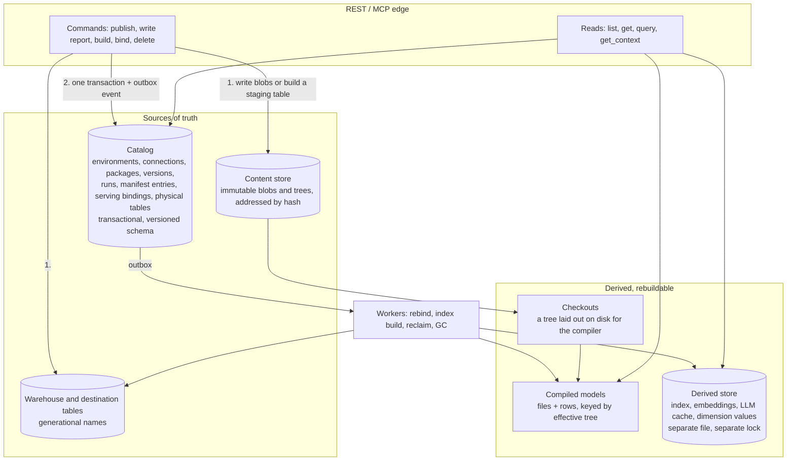

<!--
Copyright (c) Credible Data Inc.
SPDX-License-Identifier: MIT
-->

# Publisher v1: the first major release

**Status: plan of record, proposed.** Publisher v1 is the first major release, version 1.0.0. It ships a new API at `/api/v1`, rebuilds the storage underneath it, moves every client we own to the new API, and removes `/api/v0` and every deprecated feature. The work lands over a series of 0.x releases and finishes with the 1.0.0 release, after a 90-day window announced in advance. This document is the plan, consolidated from six issues and the configuration design: [#1562](https://github.com/malloydata/publisher/issues/1562) (the API review and the decisions behind the new API), [#1560](https://github.com/malloydata/publisher/issues/1560) (the storage redesign), [#1540](https://github.com/malloydata/publisher/issues/1540) (shipping the new API, moving every client, and retiring v0 and every deprecated feature), [#1539](https://github.com/malloydata/publisher/issues/1539) (which reads may load a package), [#1538](https://github.com/malloydata/publisher/issues/1538) (one implementation for queryability and gates), [ms2data/service#7479](https://github.com/ms2data/service/issues/7479) (the Publisher half of cutting load time for draft checkpoints), and the configuration design (merged into `docs/` earlier and retired into this document), whose text is [Appendix C](#appendix-c-the-configuration-registry-and-mapping) and whose remaining steps are sequenced here. The issues are closed; everything they held is here, and they remain as history. Tracking happens against this document's steps. The new API's spec is [`api-doc.v1.yaml`](../api-doc.v1.yaml), drafted in [#1563](https://github.com/malloydata/publisher/pull/1563); its reference is [api-overview.md](api-overview.md).

"Today" means `main` as of 2026-11-08, after the architecture review's bug fixes merged; line numbers are into that branch's last commit, `ccd659a64`. Every claim about today in the storage sections carries a `path:line` under `packages/server/src/`, collected in [Appendix D](#appendix-d-storage-evidence); the API review's findings, with their evidence, are [Appendix A](#appendix-a-the-api-reviews-findings), and the route-by-consumer usage matrix is [Appendix B](#appendix-b-the-usage-matrix).

**How to read it.** [The goal](#1-the-goal) says what v1 is for and what 1.0 promises. [Today](#2-today) says what exists and where it falls short. [The target](#3-the-target) is the design, surface by surface: one resource model, then the API, the package, the configuration and the storage. [The order of work](#4-the-order-of-work) is the single sequence everything is built in, with each step's scope and acceptance; it is the part to come back to. [What 1.0 removes](#5-what-10-removes) is the inventory of everything deprecated, by surface. [Decisions](#6-decisions) and [Open questions](#7-open-questions) are the record.

## 1. The goal

Publisher has three user-facing surfaces: the **API** that clients, agents and Credible's service call; the **package**, the `publisher.json` manifest and the model annotations an author writes; and the **configuration** an operator starts the server with. Each took shape over the 0.x releases one addition at a time, and each carries the debt of that: three naming conventions in one spec and four homes for one status; two spellings of the same manifest key and annotations that are read but never documented; sixty environment variables that follow no rule and booleans read five ways. Under all three sits the **storage**, which was never designed as one thing: a database that is a copy of memory, mutable package copies that mix three roles, and derived state in the same file as the records.

v1 is the release that settles all four and promises them. Each surface is held to its own expectations below, its accumulated debt is removed in this pass, and the storage is rebuilt so the surfaces can be kept. Publisher's internal domain model and software architecture are also being improved, in their own work (the architecture refactor already on `main`, which made the domain model explicit, gave governance one policy and enforced the dependency direction, and what follows it); that is out of scope for this document except where a surface depends on it.

**The API** (#1562) is held to three expectations:

1. **Consistent.** One structure and one naming convention across paths, parameters, bodies, responses, status codes and errors, the same on REST, MCP and the admin API.
2. **A well-defined, simple domain model.** Each concept has one name and one representation; identity, content and derived state are told apart; nothing internal leaks.
3. **The minimum surface** that the CLI, the Console, Credible's service and the bundled agent skills need, with every deprecated route having a replacement its callers can move to.

**The package** (the manifest and the annotations; #1540 and its side track) is held to three:

1. **One documented form for each thing an author can say.** Every `publisher.json` key and every annotation has one spelling and one home, described in the docs; a second spelling is a deprecation, never a feature.
2. **A deprecated form is a warning with its rewrite, then a refusal with its rewrite, then gone.** Every deprecated key and annotation is counted before it goes, and the migration guide maps each old form to its new one.
3. **An invalid form fails loudly, at publish.** A malformed annotation, a name that resolves to nothing, or a tag on the wrong kind of field refuses the publish with a coded message; nothing loads clean with part of its meaning silently dropped, and nothing that would fail open is ever accepted.

**The configuration** ([Appendix C](#appendix-c-the-configuration-registry-and-mapping), and [Settings and resources](#settings-and-resources)) is held to four. The first three are about configuring the server; the fourth separates that from initializing what it serves.

1. **One registry.** Every setting is declared once, with one key, one type, one default and one description, and `--help` and the configuration reference are generated from it.
2. **Three sources, one precedence.** Any setting can be given in the file, as `PUBLISHER_<KEY>` or as `--<key>`, with the variable and flag derived from the key; a flag wins over a variable, which wins over the file.
3. **One parser.** A value is read the same way from every source, `${VAR}` substitution included; a bad value, an unknown key or an unknown flag fails startup with a message naming the setting.
4. **Settings are not resources.** `publisher.config.json` configures the process: ports, limits, retrieval, the admin API. Environments, connections and packages are resources, with the catalog as their one source of truth; they are created through the API, by a person, by an orchestrator, or by an init script that `malloy-pub apply` applies against a running server, and the server never reads a resource declaration from a file. Today's `environments` block is the one place the two are mixed, and it leaves the file. The one bootstrap is `--apply <file>`, which runs the same `apply` against the server's own API when the catalog is empty, so the zero-flag quick start and a single container keep working.

**The storage** (#1560) is held to four:

1. **Storage mirrors the API, but is loosely coupled to it.** Stored entities match the API's resources; the stored formats are the storage layer's own, so either side can change without breaking the other.
2. **A request touches only the storage it needs.** Reading or changing one resource reads or writes that resource. It does not load the environment, rewrite a large blob, or recompile a package.
3. **It follows system-design best practices.** Each piece of state has one owner and one source of truth. Invariants hold inside transactions. Crashes recover. Growth is bounded, and the schema is versioned.
4. **Its state lives in the server's own DuckDB or in a remote Postgres.** The catalog of record has two shipped backends behind one interface, the embedded `publisher.db` and a Postgres server the operator points it at, with the same records, the same migrations and the same tests on both; which one is a setting, and nothing above the storage layer knows the difference.

**The rollout** (#1540) is one rule: ship the new API, move everything we own to it, warn on everything users own that is deprecated, give the community 90 days, then remove v0 and every deprecated feature on every surface in one release. That release is 1.0.0.

### What 1.0 promises

From 1.0.0 on, every 1.x release keeps these contracts, and anything that breaks one is a 2.0:

- **The API.** `/api/v1` changes additively: new optional fields, new routes, new enum members where clients are told to tolerate unknowns. Nothing is removed or retyped. The MCP tools' arguments and results follow the same schemas.
- **The package format.** Every `publisher.json` key and model annotation the 1.0 docs describe is read by every 1.x release. A key or annotation deprecated in 1.x warns, with its rewrite, for the rest of 1.x; its reader goes in 2.0.
- **The store.** Every 1.x release opens a store a 1.0 release wrote, on either backend, through recorded migrations, and a 1.x release opens the store the next 1.x release wrote until a migration says otherwise. Rollback is running the previous release.
- **Configuration.** Every setting's key, derived variable and derived flag are the names ([Appendix C](#appendix-c-the-configuration-registry-and-mapping)), and `publisher.config.json` holds settings only; resources are created through the API and an init script, never read from the file. Today's variable and flag names are aliases that warn through 0.x and are removed in 1.0.0.

The 0.x releases before 1.0.0 are where the contracts are built; they carry the usual release notes and may still change what they ship.

Two decisions shape everything below. **The new API is greenfield**: a new spec at `/api/v1`, designed from the review, with `/api/v0` frozen and deprecated as a whole; nothing in v0 is renamed or reshaped to meet the new one halfway. **The new API is built over today's storage**: it needs only the first storage step (the catalog of record, with `revision` and the version columns), so the 90-day clock does not wait for the rest of the storage work, which then replaces the storage under both APIs without changing a route.

A note on names. "v1" below means Publisher v1, the program and the 1.0 release; `/api/v1` is its API and `/api/v0` the one it retires; the storage design's own phases and the rollout's stages are folded into the one order of work in section 4.

## 2. Today

### 2.1 The API

The REST API at `/api/v0` has 57 paths, 76 operations and 132 schemas (`api-doc.yaml`), plus 42 legacy `/projects` aliases in no spec (`server-old.ts`), a 13-route admin API on its own port (`admin-api-doc.yaml`) and ten MCP tools. Of the 76 operations, the CLI calls 27, the Console 38, the skills and `docs/ai-agents.md` 24 (ten of them used by nothing else), Credible's control plane 17 and its router 34 as customer passthrough; **21 have no first-party caller**, and six of those exist only for Credible. The CLI's generated client is stale and the Python client is a stub. The full route-by-consumer matrix is [Appendix B](#appendix-b-the-usage-matrix).

Measured against the three expectations, the findings group as follows (the tables with line references are [Appendix A](#appendix-a-the-api-reviews-findings)):

- **Consistency.** Three casings coexist in paths and parameters (`build-plan` beside `sqlSource` and `storageDestinations`; `filter_params` beside `versionId`), and again on MCP. Path parameters name a file four ways. GETs change state (`?reload=true`, the notebook cell runner). `PATCH` means four different things on four resources. Create answers 200 or 201 by route; connection writes return anonymous objects; `QueryResult.result` is a JSON string whose shape a flag toggles; only one list pages; nothing carries an `ETag`; `reason` is an open string documented centrally; the deprecated report routes set no `Deprecation` header.
- **The domain model.** Package status lives in four places, including 14 inline `Package` fields behind a flag. `Package` echoes the version's fields under different names. Reports exist as three schema sets. Five things are "a database". A persisted table has three names across four lifecycle schemas, with `sourceEntityId` the only stable identity. The run exposes the store's row id as `environmentId` and a `metadata` blob the server queries by JSON path. Givens and filters, schedule, "manifest", "artifact", "index" and "stale" each mean two things. Skill, classification, embedding index and watch mode have no Console label.
- **Surface against need.** Package `PATCH` is deprecated and #1572 removes it, yet it is the Console's and the CLI's only way to edit a package's description, schedule and scope. The notebooks route is the only runner for `.malloynb` cells. The Console composes N+1 reads for a source catalog, polls for build completion, re-parses JSON strings and detects server versions by 404. Credible's control plane tolerates extra response fields but breaks on enum additions, new required fields or type narrowing, parses the `resource` path positionally, gates one feature on a semver check, and proxies most reads to customers, so their shapes are customer-facing for Credible.

### 2.2 The package

A package is a directory with a `publisher.json` manifest and Malloy models whose annotations declare reports, access gates, runtime parameters, classification, indexing and persistence. Both the manifest and the annotations grew by addition, and both carry forms that are read but no longer the documented one.

- **Two homes for one key.** `scope` is read from the manifest root and from `materialization.scope`, `queryMetadata` from the root and from `materialization.queryMetadata`, and the server writes both homes on every package `PATCH` so an older Publisher still finds one. `manifestLocation`, a server-side binding, lives inside the author's `publisher.json` because `PATCH` writes it there.
- **Keys with a replacement that still work.** `explores` and `queryableSources` are superseded by a root `index.malloy`; the retired `retrieval` keys (`engine`, `representation`, `keyphrases`, `refine`, `rerank`, `sourceMatch` and their prompts) are accepted, ignored and named in the package's warnings.
- **Annotations with a replacement that still work.** `#(filter)` for `given:`, the model-level `##(filters)`, `#(index_values …)` for `#(index)`, the query-level `# artifact` for a model-level `## artifact { layout=grid }`, `dashboard_columns=` in the artifact tag, a `"` note below the tag, `#(description=…)` on a given, `## materialization.queryMetadata.*`, and the `.malloynb` notebook format for `.malloy` with `## artifact { layout=linear }`. Two are counted (`filter_annotation`, `malloynb`); the rest warn nowhere.
- **Invalid annotations that load anyway.** A malformed `#(filter)` drops every filter on its source, required ones included, with no log line; a block-form `#|(filter)` is ignored without a word; a render tag malformed for its field, an `## artifact` that does not parse (the file silently stops being a report), a tile that does not resolve, a `#@ persist` key misspelled so merge becomes range-replace, a `#@ persist` tag that fails to parse, a given control that does not parse: each is a warning, a log line, or nothing, and the package loads. Malloy's own tag-parse warnings reach `POST …/compile` and are dropped at load.
- **Guards that must stay.** Four refusals exist because Malloy still parses the form and the package would otherwise load clean with its access control missing: file-level `##(authorize)` and `##(access_filter)`, the string-form gates, `#(partition)`, and `#(authorize)` misplaced on a query or a field.

The full inventory, with each form's replacement and what counts it today, is [section 5](#5-what-10-removes); the invalid forms and the plan for each are [track C](#track-c-invalid-annotations-that-warn-today-should-fail-loudly).

### 2.3 The configuration

Publisher reads its settings from three places, and which place a setting lives in follows no rule:

- **`publisher.config.json`** began as the list of what to serve, and grew server-wide settings one at a
  time: `frozenConfig`, `theme`, `mcp.includeHiddenFilesAndSources` and the `retrieval` block. With the
  admin API, `servingApiEnabled` and `adminApiEnabled` arrive already following this design: each is a
  key in the file, a derived variable and a derived flag, read with the precedence section 3.4 describes.
- **Environment variables** carry everything else, about 60 of them, most added for container
  deployments.
- **Command-line flags** exist for about a dozen of those variables, the ones a local user reaches for:
  ports, hosts, the server root, the config path, shutdown timing, watch mode and `--init`.

Every string in the config file may reference a variable as `${VAR}`, which is how a file names a
credential without holding it.

#### What that costs

| Problem | Example |
|---|---|
| The same kind of setting lives in different places | MCP's port and host are variables, but what MCP exposes (`mcp.includeHiddenFilesAndSources`) is in the file |
| A setting can be given in two places with no general rule for which wins | the `retrieval.embedding` keys override the `EMBEDDING_*` variables; nothing else overlaps |
| Booleans are read five ways | most variables accept `1/true/yes/on` and `0/false/no/off` and refuse anything else; `INITIALIZE_STORAGE`, `PUBLISHER_USE_BUNDLED_DEFAULT` and `PUBLISHER_ALLOW_PROXY_CONNECTIONS` are on only for exactly `true`; `DISABLE_RESPONSE_LOGGING` for `true` or `1`; `PUBLISHER_ALLOW_UNVERIFIED_SSH_HOST_KEY` reads an unrecognised value as off where it is used, because one reader runs inside ssh2's synchronous host-key callback, where a throw would escape; and `frozenConfig` is read with `Boolean()`, so `"frozenConfig": "false"` freezes the server |
| A typo is silent | an unknown key in the file is ignored (only `retrieval.llm`, `retrieval.embedding` and `retrieval.egress` refuse one), so a misspelled `adminApiEnable` runs the API it meant to turn off; an unknown flag, and a flag given without its value, are ignored too |
| A `${VAR}` cannot supply a number or a boolean | substitution always yields a string |
| Names do not follow a pattern | about 20 Publisher settings lack the `PUBLISHER_` prefix (`MCP_PORT`, `SERVER_ROOT`, `LOG_LEVEL`, `EMBEDDING_MODEL`, …); flags mix `--mcp_port` with `--watch-env`; a flag and its variable can differ (`--watch-env` is `PUBLISHER_WATCH`, `--init` is `INITIALIZE_STORAGE`); two switches are negative (`--no-mcp-config`, `DISABLE_RESPONSE_LOGGING`) |
| The reference drifts from the code | `--config` and `PERSIST_COLLISION_ENFORCE` are not in the configuration table |

### 2.4 The storage

#### One file, fifteen tables, one lock

`publisher.db` is one DuckDB file opened once per process (`storage/StorageManager.ts:76-78`); every statement from any caller takes the same `async-mutex` (`storage/duckdb/DuckDBConnection.ts:72-76, 145-162`). It holds two unrelated groups of tables (`storage/duckdb/schema.ts`):

| Group | Tables | Keyed by | Notes |
|---|---|---|---|
| Registry | `environments` (:57), `packages` (:77), `versions` (:118), `connections` (:140), `storage_destinations` (:157), `materializations` (:180), `incremental_ledger` (:220), `themes` (:267) | surrogate ids (`${Date.now()}-${base36}`, `rows.ts:9-11`), except `versions`, keyed by name | `connections.config` and `storage_destinations.config` hold the full API wire object, credentials in plain text (`environment_store.ts:1225-1229`). `materializations.metadata` holds trigger, mode, scope, versionId, writesTables, supersededTables and more, read with `json_extract_string` (`MaterializationRepository.ts:119`); `materializations.manifest` holds the whole build manifest, schema per entry included. |
| Derived (retrieval) | `catalog_nodes`, `catalog_edges`, `doc_parts`, `node_questions`, `source_summaries`, `catalog_embeddings`, `dimension_values`, `value_embeddings`; dead: `entity_embeddings`, `entity_keyphrases` (:687-870) | `(environment_name, package_name, …)` | Content hashes are reuse checks on a row already found by name, never the key, so two loaded versions of one package overwrite each other's rows (`retrieval/model/package_embedding.ts:91-98`). `catalog_nodes/edges` are written and never read (`retrieval/index/catalog_store.ts:6-8`). |

No schema version is recorded. DDL is `CREATE TABLE IF NOT EXISTS`, then a column reconcile that builds the declared schema in a scratch in-memory DuckDB, diffs `duckdb_columns()`, adds unconstrained missing columns and swallows the rest (`schema.ts:372-441`); re-keyed tables are dropped by three hand-written pre-pass checks (`:601-660, 662-685`); `--init` drops a hand-maintained list (`:899-932`). Transactions exist only in `VersionRepository` (`commitPublish`, `setLatest`, `setArchiveStatus`, `delete`, `deletePackageIfNoVersions`); the seven-DELETE environment delete (`DuckDBRepository.ts:38-46`), the package delete (`:54-62`), the destination upsert and the connection prune run as separate statements behind the mutex.

#### On disk

```
<serverRoot>/
  publisher.db
  publisher_data/<env>/
    .temp_<sha16(location)>/     boot-time shared download, removed after copy
    <pkg>/                       unversioned: a COPY of the source, or a SYMLINK under --watch-env
      publisher.json             rewritten in place by PATCH
    <pkg>/<versionDir>/          versioned: one full tree per version; dir = semver with '+' -> '_'
    .staging/<pkg>-<uuid>/       downloads in progress
    .retired/<pkg>-<uuid>/       the old tree during an install swap; swept at startup
    .legacy/<pkg>-<uuid>/        the unversioned tree a first versioned publish held aside
    .install-records/<pkg>.json  {"location"}: written on install, read by nothing
```

(`environment_store.ts:2050-2059, 2149-2158, 2206-2213`; `environment.ts:112-121, 1052-1058, 3252-3290`; `versions/version_store.ts:19-26, 55-61`.) `latest` is not on disk: it is `packages.latest_version`, moved by compare-and-swap inside the publish transaction (`VersionRepository.ts:94-160`).

#### Where it holds

- Published versions are immutable, content-hashed over the whole tree (`versions/package_content_hash.ts:8-33`), and the row commits last: stage and hash with no lock, place by one rename, load and validate, then `commitPublish`; a failure before the commit removes the folder and restores what it moved aside (`version_service.ts:572-711, 669-692`).
- Runtime installs stage and swap under the package lock, old tree retired rather than deleted, rolled back on any throw (`environment.ts:2692-2949`).
- The version registry's invariants run in transactions (`VersionRepository.ts:94-331`).
- Path confinement is sound (`path_safety.ts`; the report write refuses a symlink that leaves the package or enters `public/`, `environment.ts:1240-1312`).
- The query path reads no storage for a resident package: `getEnvironment` and `getPackage` are map hits and `Model.runQuery` touches no DuckDB (`environment.ts:2340-2345`, `usecases/run_model_query.ts:61-84`).

#### Where it falls short

| Gap | Today |
|---|---|
| No single source of truth | Environments, connections and packages live in memory and are **bulk-synced** to the database by `addEnvironmentToDatabase` on every environment PATCH and package POST/PATCH (`environment_store.ts:958-989, 1762, 1823, 1847`). At boot, **if the database has any environment row the config is ignored**; config is a one-time seed re-read only under `--init` or when a stored environment's directory is missing (`:737-759, 607-640`). A config edit after first boot does nothing, silently. |
| Mutable content that mixes three roles | `publisher_data/<env>/<pkg>/` is a cache of a remote source, a copy of a local one (delete-then-`fs.cp`, no staging, `environment_store.ts:2198-2213`), the only home of API-written reports, and the author's `publisher.json`, which PATCH rewrites in place (`environment.ts:3273-3277`). A reload of a location-installed package re-fetches and discards the API writes (`controller/package.controller.ts:457-484`). The interim 409 guard (`4825697b1`) reads `location` from process memory; the install record that would make it durable is written and never read (`environment.ts:3278-3290`, deletes at `:3640, 3675`), so after a restart or a watch-mode in-place reload the guard stops firing. |
| Requests touch far more than they need | Package POST/PATCH call `environment.listPackages()` to find the one row to sync (`environment_store.ts:1289`), and `listPackages` **loads every registered package that is not resident** (`environment.ts:1003`), the latest of each versioned package included (`:1897-1903`). A report write recompiles the whole package (`environment.ts:1416-1419`). A build commit recompiles every model to substitute colocated table names (`:2983-3019`). The serving manifest is a **fold over the whole run history**: `newestServingEntries` walks every run minus `supersededTables` (`versions/materialization_scope.ts:159-180`), fed by `listMaterializations` with no limit (`:206-214`) and JSON-parsing both blobs per row (`MaterializationRepository.ts:308-343`), on every package load, build, rebind and reclaim scan. With a 40-source manifest, 20k runs is about 190 MB of manifest text and 200–380 ms per read behind the one mutex (`bench.ts` in the review scratchpad; `bun bench.ts 20000 40`). |
| Wire formats used as storage formats | Manifests, connection configs and destination configs are stored as the API objects. Run bookkeeping lives in the API-visible `metadata` blob, queried through unindexed JSON. `Materialization.environmentId` **is public** (`api-doc.yaml:9864`; `controller/materialization.controller.ts:26-29` strips only `version`). The `connections.type` TypeScript union omits dialects the column holds (`DatabaseInterface.ts:307`). |
| Derived and authoritative state mixed | Retrieval tables share the file and the mutex (`StorageManager.ts:76-78`, `schema.ts:275-278`). A **reload rewrites** `catalog_*` and `dimension_values` wholesale and diffs the rest (`catalog_store.ts:45-83`, `retrieval/search/values_index.ts:690-717`), re-querying the warehouse for every `#(index)` dimension. `get_context` kicks a build on every call (`retrieval/search/engine.ts:331-342`), so a read can start writes. `sourceContentSha` and `hashPackageTree` exist but retrieval consults neither, so an unchanged package cannot skip the build. |
| Weak crash consistency, no GC | Interrupted runs are now failed at store open (`c1634ea92`, `StorageManager.ts:31-50`) and the colocated swap renames aside instead of dropping first (`ccd659a64`), but there is no lease: a hung process holds its slot indefinitely, and a second process on the store would fail the first's live run. Status transitions are plain UPDATEs validated in memory (`run/run_lifecycle.ts:49-76`). Multi-row deletes and `publisher.json` writes are not atomic. Run history under `scope: package`, stranded staging and backup tables, orphaned tables, DuckLake files (expiry is on demand only, `run/materialization_build_session.ts:1429-1473`), crashed builds' temp directories and derived rows are never collected. `version_cache` is not an LRU (`versions/version_cache.ts:30-39`). The watcher has no debounce (`controller/watch-mode.controller.ts:103-169`). A colocated persist into the package's `:memory:` DuckDB is reused after a restart dropped the table ([#1419](https://github.com/malloydata/publisher/issues/1419)). |

#### What is already moving

- **Merged on 2026-11-08**, the architecture review's bug fixes: interrupted runs settled at open; colocated swap renames aside; connection rows pruned on environment PATCH; `frozenConfig` enforced from the first store; a never-loaded configured package can be deleted; the interim 409 on report writes and content PATCH for location-installed packages.
- **#1570 → #1571 → #1572** (open, stacked; they replace #1552, closed unmerged): every package is a published version, in three steps. #1570 runs every test suite with versioning on; #1571 makes `PUBLISHER_PACKAGE_VERSIONING` default to on; #1572 removes the setting and everything that existed only while versions were optional: the in-place install with its stage-and-swap and rollback, the install records, `addPackageToDatabase`, package PATCH (a manifest rebind moves to `PUT …/versions/{versionId}/manifest`) and the `<pkg>___<version>` split. Configured packages, and the packages a `POST /environments` body lists, are published as versions; a remote location is mounted once under the environment's `.staging` and each package published from there. Watch mode becomes the one in-place path and the only place a report write or a reload does anything; elsewhere a reload answers the version unchanged and a write answers 409 `PACKAGE_IS_VERSIONED`. B2 lifts that refusal.
- **The configuration design** ([Appendix C](#appendix-c-the-configuration-registry-and-mapping)): one registry for the process's settings, one half of today's `publisher.config.json`. This design takes the other half (the `environments` block) out of the file; see [Settings and resources](#settings-and-resources).
- **Credible's M0a numbers** (service #5514, 2,506 loads): mean load 3.4 s, of which schema fetch 55% and compile 19%; p95 19.9 s. A persisted compiled model skips both, because the schema is baked into the `ModelDef`. Credible's workers have no disk today, so nothing a worker persists survives a pod restart until the service work under [Deployments](#deployments).

## 3. The target

### 3.1 One resource model

The API and the storage share one vocabulary. Each row is a record in the catalog and a v1 resource or a field of one; the Console and the docs use the same nouns.

| Noun | What it is | Identity | Storage record |
|---|---|---|---|
| **environment** | a namespace for packages and connections; the unit of tenancy | `name` | `environments` |
| **connection** | a warehouse handle the models read | `(environment, name)` | `connections`, with secrets in `secrets` |
| **destination** | where `#@ persist storage=` builds write; not a connection, and never named by a model | `(environment, name)`, independent of connections' names | `destinations`, with secrets in `secrets` |
| **package** | a record with pointers (`source`, `description`, `latestVersionId`); it holds no content | `(environment, name)` | `packages` |
| **version** | an immutable snapshot of a package's content; `latest` is the package's pointer to one; a live (watched) package has the one pseudo-version `live` | `(environment, package, versionId)`, ordered by `seq` | `versions`, trees and blobs in the content store |
| **model** | a `.malloy` file in a version; compiled, it yields sources, views, named queries and givens | `path` | a blob in the version's tree |
| **report** | a model carrying an `## artifact` tag, `layout` grid or linear | `path` | the same blob |
| **data app**, **data file** | an HTML page under `public/`, served outside the API at its `url`; a CSV, Parquet, JSON or Excel file | `path` | blobs |
| **agent**, **skill** | what a package declares for agents in `publisher.json`; the guides in force for a version | `name` | blobs and `publisher.json` |
| **run** | one attempt to build a slot's persisted sources ("materialization" is the feature's name) | `runId` | `materialization_runs` |
| **manifest entry** | what a run produced for one source | `(runId, sourceEntityId)` | `manifest_entries` |
| **binding** | what a version serves for one source right now; read on the version's `status` | `(version, sourceEntityId)` | `serving_bindings` |
| **table** | a physical table the server created or serves in a connection, with `state` and `generation`; in v1 named on its manifest entry, with no routes of its own until a client needs them | `tableId` | `physical_tables` |
| **version status** | how this server holds one version now: `loading`, `serving`, `unloaded` or `failed`; its bindings; stale | per version | derived from the catalog and memory |
| **given** | a runtime parameter a model declares; reports render the ones their tiles read as filter controls | `name` within a model | compiled from content |
| **index** | the discovery index `get_context` ranks against | per version | the derived store |

Two things that exist today are not in the model: the **theme** (the Console keeps a viewer's theme in browser storage), the **`.malloynb` notebook** (a deprecated format; its users rewrite to `.malloy` with `## artifact { layout=linear }` during the 90-day window).

### 3.2 The API: `/api/v1`

The spec is [`api-doc.v1.yaml`](../api-doc.v1.yaml); the reference, with every route, is [api-overview.md](api-overview.md). The 51 decisions it was drafted from are the register in [Decisions](#6-decisions), A1 to A51; this is what they add up to.

**Structure.**

```
/status                               the server, and every version it holds with its version status
/environments/{environmentName}      its `connections` and `destinations` lists are fields of the environment
  /connections/{connectionName}       the warehouses models read
    /schemas, /schemas/{schemaName}/tables
                                      what the connection can read
    :run-sql                          run, or describe a statement's columns
  /packages/{packageName}             the record: source, description, latestVersionId
    /runs, /runs/{runId}, /runs/{runId}/manifest
    /versions, /versions/{versionId}  `latest` and `live` are reserved segments; POST /versions publishes a version,
                                      from the recorded source when sent no body
      /status                         how this server holds the version now, with its bindings
      :load, :unload                  load the version on this server, or drain and unload it; no record changes
      :reload                         recompile from the version's files against current schemas, and wait
      /models, /models/{path}, …:query, …:compile
      /reports, /reports/{path}                        the report write is PUT on a report path
      /data-apps, /data-files
      /agents, /agents/{agentName}, /skills, /skills/{skillName}       (a skill's files come with ?include=)
      /entities, /classification, /index
      /build-plan
      /connections, /connections/duckdb/…            the version's own sandbox
```

Every content read is of exactly one version, named in the path. A publish, a report write and a re-fetch of the source that finds changed content each make a version; nothing edits one in place; undo is pointing `latestVersionId` back at the parent.

**Grammar.**

- **Names.** Kebab-case paths, camelCase parameters and fields. `{path}` is a file's version-relative path, spanning segments; `{xName}` a named resource; `{versionId}` and `{runId}` are ids. `versionId` is the one spelling of a version.
- **Reads never change state.** "Reload" did three jobs in v0, and each is its own operation: recompiling a version, from its files against the warehouse's current schemas, is `POST …/versions/{versionId}:reload` (on a live package it re-reads the author's files first; on a published one it is a schema refresh); publishing from the source is `POST …/packages/{packageName}/versions`; loading a version on this server is `POST …/versions/{versionId}:load`, and `:unload` drops it. Memory state is `VersionStatus.status`, never a field of `Version`. The build plan is a read with a `status`.
- **Which reads load.** `/status`, a version's `status`, the versions list, the version record, `:unload` and `…/index` never load a version that is not in memory. Every other content read loads it on demand (a hydrate when the compiled-model store has it), as the `versionId` parameter says on each; `VersionStatus.status` tells a client what a read will cost.
- **A light load profile.** `POST …/packages/{packageName}/versions?profile=light` compiles and validates access only and defers the rest (build plan, render-tag prepares, report lint, the index, data-file row counts) to first read, for draft checkpoints whose every edit is a version; a deferred part reads `deferred` (`BuildPlan.status`, `DiscoveryIndex.status`, `DataFile.rowCountStatus`).
- **State changes are fields.** `PATCH …/versions/{versionId}` with `archived`, `pinned` or `manifestLocation`; `PATCH …/packages/{packageName}` with `latestVersionId`; `PATCH …/runs/{runId}` with `status: "cancelled"`. Actions are `POST` with a `:verb` suffix on the resource they act on (`:load`, `:unload`, `:reload`, `:query`, `:compile`, `:run-sql`), so an action can never collide with a child's name; an unsaved connection is tested with `?dryRun=true` on create or update.
- **One mutation shape.** `PATCH` is JSON merge-patch; an orchestrator's push is a `PATCH` whose `connections` list replaces the stored one, and `PUT` is used only by the report write; `POST` on a collection answers 201 with the resource and a `Location`; `DELETE` answers 204. Every mutable resource but a report carries a `revision`, returned as `ETag`; every `PATCH` and `DELETE` accepts `If-Match` and answers 412 when the resource has moved on. A report is revisioned by its `contentHash`, the report write's precondition, sent back as read. A create or a write takes its resource itself, its `readOnly` fields ignored and a `PATCH` a merge-patch of it, so no resource has a second write schema; an action (`:query`, `:compile`, `:run-sql`, `:reload`) takes an `…Request` body, since it creates no resource.
- **Field behavior.** `required` describes a read. What only the server sets is `readOnly` (`resource`, `revision`, timestamps, and every run field but `versionId`, `trigger`, `callerRunId`, `options`, `buildInstructions` and `status`), and a write that sends it back as read ignores it, so a client can `PATCH` a resource it just read. A `name`, a package's `source` and the run fields just named are set on create and never change; a write that changes a name or `source` answers 400.
- **Idempotent creates.** Every `POST` that creates or starts something (an environment, a connection, a package, a version, a run), and the report write, accepts an `Idempotency-Key` header: a retry with the same key and body within 24 hours answers with the first response and does nothing again, and the same key with a different body answers 409 `IDEMPOTENCY_KEY_REUSED`.
- **Guarded deletes.** A delete that would delete other resources with it (an environment's packages and connections, a package's versions) requires `?force=true`, and answers 409 `RESOURCE_NOT_EMPTY` without it.
- **Timestamps.** Every timestamp is an RFC 3339 `date-time` in UTC, read-only, and absent until it has a value, never `null`. An event's time ends in `At` (`createdAt`, `startedAt`, `failedAt`); the moment some data reflects ends in `AsOf` (`dataAsOf`, `schemaAsOf`). Every stored resource, one with a `revision`, carries `createdAt` and `updatedAt`. Durations are integers whose name carries the unit (`elapsedMs`, `windowSeconds`).
- **Resource paths.** Every object a `GET` can read carries `resource`, its canonical path relative to the API's base: no leading slash, and the resolved version id in place of `latest` (`environments/acme/packages/sales/versions/1.4.0/models/orders.malloy`). `/status` and list envelopes carry none, and a list item carries it when its item has a `GET` of its own. Relative, so it stays right behind a gateway that serves the API under another prefix; a link and a stable key, never parsed.
- **Names.** A resource read two ways is `X` from its own `GET` and `XSummary` in its list, and its list is `XList` (`Model` and `ModelSummary`, `Report` and `ReportSummary`, `Table` and `TableSummary`); nothing else is named `…Summary`.
- **Field names.** camelCase; a reference is `xName` or `xPath`; a file's path is `path` and its text `content`; a hash is `…Hash` of what it hashes (`contentHash`); a count ends in `Count`, a size in `Bytes`, a duration in its unit; no `is` prefix on a boolean. One word, one meaning: `origin` is provenance, `kind` what a thing is, `live` only the pseudo-version (serving from the source warehouse is `warehouse`), `manifest` only a run's. A connection's own settings keep their warehouse's words, in a block named by its `type`.
- **Conditional reads.** Every read but `/status` answers with an `ETag` and takes `If-None-Match`, answering 304 with no body when nothing changed. `Cache-Control` is `no-store` on `/status` and, on every other read, `private, no-cache`, because a compiled model under a concrete version can still change with `:reload`, and a read through `latest` or `live` can resolve differently next time.
- **Back-pressure.** Every operation but `/status` may answer 429 `RATE_LIMITED`; 429 and 503 carry `Retry-After` in seconds. `/status` is never rate-limited and never answers 503, because it is the orchestrator's heartbeat.
- **Request ids.** The server takes the caller's `X-Request-Id`, else the trace id of a W3C `traceparent`, else makes one; every response carries it as `X-Request-Id`, and every error body repeats it as `requestId`.
- **Enum values.** Lowercase snake_case, except a `reason`, which is always a code from a closed list in UPPER_SNAKE (an error's, an index's, a refused source's; free text is a `message`), a warning's or problem's kebab-case `code`, a value that echoes a setting's own value (`versionPromotion: on-publish`), values that name a response field (`include: ["malloyResult"]`), and values that echo another vocabulary (a setting's value, Postgres's `sslmode`).
- **Typed responses.** A query answers `{rows, metadata}`, `metadata.versionId` naming the version that answered, plus the full Malloy result on request; nothing is a JSON string inside JSON. Every list is `{items, nextCursor}`, cursor-paged; `/status` is the one unpaged snapshot.
- **Errors.** One `Error {status, reason, message, requestId, details?}`, `reason` from one closed enum and `details` typed per reason a client acts on; each operation lists the reasons it answers. Clients branch on `status` and `reason`, never on `message`. An error inside a successful response is an `EmbeddedError`, and every diagnostic a `Problem`.
- **Dry runs.** `?dryRun=true` stores nothing and answers 200 with no `Location`: a connection's test result, or the `Version` a publish would make, without `resource`, `revision` or timestamps.
- **MCP** is a second surface over the same model: snake_case tool names, v1 schemas for arguments and results, switched by the `mcp.api` setting together with the skills.
- **The admin API** is a sibling spec at `/admin/v1` with the same grammar, owning DuckLake catalogs, watch mode and GC, and taking the resource writes the serving API refuses under `resources.readOnly`.

**What v1 leaves out.** Everything in today's spec with no load-bearing caller, and everything deprecated: `events`, the serving-API watch mode, the `storageDestinations` routes, `sqlTemporaryTable`, the inline package fields, dashboards and notebooks, `/projects`, `includeLoading`, `Materialization.environmentId` and its `metadata` blob, `filterParams` and `bypassFilters`, `configEtag`, `compactJson`, the theme, `.malloynb`. A request for one of them reopens the decision; it does not reach v1 by default.

**Two things v1 carries that the spec draft had to settle.** A live (watched) package has no stored versions, so it exposes one reserved pseudo-version, `live`, which `latest` resolves to; it is accepted by every content route, never listed, and refuses `PATCH` and `DELETE` with 409 `PACKAGE_IS_LIVE`. And v0's `GET /status` keeps its own shape and gains only additive fields (`hostname`, the warm-start telemetry): the v1 shape nests versions under packages and drops the per-version `resource` string Credible's control plane parses by position, so it is not a superset, and this is the one exception to the v0 freeze.

### 3.3 The package

The package format is the author's surface and the one the server never writes. v1 settles it to one documented form per thing an author can say, read the same way by every 1.x release.

**The manifest, `publisher.json`.** One home per key: `version` (a semantic version; every package is a published version), `description`, `materialization` (`scope`, and either `schedule` or `freshness`), root `queryMetadata`, `agents`, `retrieval`. Curation is a root `index.malloy`, which imports the files the package publishes and exports what they expose; `explores` and `queryableSources` are gone, with no like-for-like replacement for `queryableSources: "all"` (curation is `index.malloy`, access is `#(authorize)`). Server-owned state is never in the file: a version's manifest binding is a field of the version (`manifestLocation`, set with `PATCH`), a package's description set over the API lives on the package record, and nothing the server does rewrites `publisher.json` ([Settings and resources](#settings-and-resources), [Package content](#package-content)).

**The annotations.** One spelling per family, each documented in its own reference: `## artifact { layout=grid|linear … }` makes a model a report, with `tiles=[…]`, `dashboard { columns=N }`, `# label`, `# drill` and the `##|(markdown)` blocks ([reports.md](reports.md)); `given:` declares a runtime parameter, `#(secure)` marks one a host sets ([givens.md](givens.md)); `#(authorize)` and `#(access_filter)` gate a source ([authorize.md](authorize.md), [row-level-access.md](row-level-access.md)); `#(classification)` and `#(carries)` say what a field is and what a source may expose ([classification.md](classification.md)); `#(index)` and `#(doc)` feed discovery ([discovery-and-access.md](discovery-and-access.md)); `#@ persist` and `#@ preaggregate` declare materialization ([materialization.md](materialization.md), [preaggregation.md](preaggregation.md)). Every deprecated spelling in [section 5](#5-what-10-removes) is removed in 1.0.0; `.malloynb` is not a document kind in v1.

**The rules the format is held to.** A deprecated form warns with a stable `code` and its rewrite, is counted, and is listed in the migration guide; at 1.0.0 it is refused with the same rewrite for one release and its reader is deleted in 1.1. An invalid form (malformed, naming nothing, on the wrong kind of field) is refused at publish with a coded message through the `publish_checks.ts` pattern, and then at load once its counter reads zero; packages already published keep loading in between. Every finding a load reports is also reported by `POST …:compile` at `package` scope, so an author sees it before publishing. Nothing that would fail open is ever accepted: the four guards in [section 5](#kept-refused-permanently) are permanent, and a test asserts each survives. `malloy-pub migrate` rewrites a package's manifest and models where the rewrite is mechanical, so the 90-day window is spent on the forms that are not (`#(filter)` to `given:`).

**How the format reaches the server.** A publish fetches a package's source and makes an immutable version of it; the only server-made changes to content are the versions the report write and a re-fetch of the source make, each a new version with the author's files untouched beneath an overlay. A live (watched) package is the exception: the author's directory is read in place and the report write writes through to it.

### 3.4 The configuration

The design, merged into `docs/` earlier, is retired into this document: its full text, the registry rules and the setting-by-setting mapping, is [Appendix C](#appendix-c-the-configuration-registry-and-mapping). This is its shape and where it stands.

- **One registry** declares every setting once: key, type, default, description, whether it is secret, and the deprecated names it still answers to. Parsing, validation, `--help`, the configuration reference and the startup log are generated from it; code reads a setting through one typed accessor, never from `process.env`, and a lint rule enforces that.
- **Three sources, one precedence.** A setting may be given in the file by its key, as `PUBLISHER_<KEY>` in upper snake case, or as `--<key>` in kebab case; the variable and flag are derived, never chosen by hand. Precedence is flag, then variable, then file, then default, for every setting. Three exceptions, marked in the registry: structured settings (`retrieval.llm`, `retrieval.embedding`) are file-only as a whole though their scalar leaves still get a variable and a flag; launch settings (`root`, `config`, `initializeStorage`, `watchEnvironments`) cannot be in the file; secrets never take a flag and never log.
- **One parser and validator.** Each type is read the same way from every source, `${VAR}` substitution included. A value that does not parse, an unknown key, an unknown flag, or an old and a new name given different values fails startup with one message naming the setting, the source and what was expected.
- **Where it stands.** Step 1 of its migration (the registry, behaviour unchanged, the reference generated from it) is built. Step 2 (the derived names, today's names as aliases that warn and count) is in [#1481](https://github.com/malloydata/publisher/pull/1481) and [#1556](https://github.com/malloydata/publisher/pull/1556). In [the order of work](#4-the-order-of-work) step 2 is D1, step 3 (strict: the step-1 warnings become refusals) is D2, and the aliases are removed in 1.0.0.
- **Its boundary with this plan.** The design covers the process's settings, one half of today's `publisher.config.json`. The other half, the `environments` block, leaves the file under [Settings and resources](#settings-and-resources): resources are created through the API and `malloy-pub apply`. The config split is step 5, because `apply` needs v1; the registry's own migration is track D, which waits on nothing here.

### 3.5 The storage

#### In one picture



#### Principles

1. **One catalog is the system of record**, written one resource at a time at the point of change, inside a transaction. In-memory objects (`Environment`, `Package`, compiled models) are caches of it, loaded on demand and invalidated by key, never ahead of it. The catalog has one writer, the API: a person, the CLI or an orchestrator creates resources through it, and the server reads no resource declaration from a file. `addEnvironmentToDatabase` and the bulk sync go away.
2. **Every content change produces a new version.** Content is immutable and content-addressed: a *blob* is a file by SHA-256, a *tree* is a sorted `path → (blob, mode)` list by its own hash. A version names a source tree, an optional overlay tree and the effective tree they compose to. A publish, an API report write and a re-fetch of a `location` that finds it changed each make a version; nothing edits one in place; `latest` moves. Unchanged files are shared as blobs, so a version costs only what changed, which replaces the one-full-tree-per-version growth [package-versions.md](package-versions.md#disk-growth) tabulates.
3. **`publisher.json` is the author's input.** The server reads it and never writes it. Server-owned metadata (a description set over the API, a pin) lives on the package or version record and is not content.
4. **Storage records are storage-owned types** under `storage/records/`, each with a `schemaVersion`, mapped to and from the wire types at the controller edge, once for v1 and once for v0 while v0 is served ("v0 mappers", step 3, B1 and B2). Control fields are real, indexed columns; secrets are rows of their own so they can be encrypted; no surrogate key is minted for the API, and `Materialization.environmentId` is deprecated and then dropped.
5. **Reads are keyed and narrow.** A request resolves `env → package → version` by key and reads the one record or blob it needs. Listing never loads a package. "What table serves source X in version V" is one indexed row, never a fold.
6. **Commits make changes visible**, always in the same order: (1) write the content, blobs or a staging table, and make it durable; (2) commit the catalog transaction that references it and enqueue an outbox event in the same transaction; (3) update caches and start background work from the event. A crash before (2) leaves unreferenced content, which GC collects; a crash after (2) replays the outbox.
7. **Concurrency control lives in storage.** Every mutable resource carries a `revision`; writes are conditional (`If-Match`/`expectedRevision`, generalizing the report write's `contentHash`) and so are state transitions (`UPDATE … WHERE status IN (…) RETURNING`). Runs hold a lease. In-process mutexes stay only as an optimization.
8. **Derived state is separate and rebuildable.** The index, embeddings, LLM cache, dimension values, checkouts and compiled models live outside the catalog, in their own store and lock, owned by the effective tree or the source definition they derive from, never by a package name. Losing that store costs rebuild time, never correctness. A cache entry that cannot be validated does not exist.
9. **Everything has a lifecycle**: retention rules, GC by reachability from the catalog, and one startup reconciler that compares the catalog with each store and repairs or collects what does not match.
10. **The schema evolves explicitly**, through recorded, forward-only migrations, data migrations included.
11. **Backends are pluggable behind narrow interfaces**, and the catalog ships with two: the embedded DuckDB file and a remote Postgres server, chosen by the `catalog.url` setting, with one set of records, one migration ledger and one test suite run against both. The open-source server and Credible's worker pool run one design. The publisher never reads a control plane's database, a peer's memory or a peer's filesystem. Local state is durable authority standalone and a reconstructible projection on a managed worker: a deployment distinction, not two implementations.
12. **Additive and flag-gated.** Every PR sits inert behind defaults that reproduce the previous release's behaviour unless this design says a default flips, and every migration is additive until a step says otherwise, so rollback is running the previous release.

#### Stores and interfaces

```ts
// storage/catalog.ts — the system of record; one implementation per backend.
interface Catalog {
  environments: EnvironmentRepo; connections: ConnectionRepo; secrets: SecretRepo;
  packages: PackageRepo; versions: VersionRepo;
  runs: RunRepo; manifests: ManifestRepo; bindings: BindingRepo; tables: PhysicalTableRepo;
  outbox: Outbox; settings: SettingsRepo;
  transaction<T>(fn: (tx: Catalog) => Promise<T>): Promise<T>;   // every repo method is usable on `tx`
  migrate(): Promise<void>;                                        // applies schema_migrations
}
// Every repo has one shape. `expectedRevision` makes the write conditional (409 on mismatch).
interface Repo<K, R extends { revision: number }> {
  get(key: K): Promise<R | undefined>;
  list(filter: Partial<K>, page?: { limit: number; after?: string }): Promise<Page<R>>;
  create(record: Omit<R, "revision">): Promise<R>;
  update(key: K, patch: Partial<R>, expectedRevision?: number): Promise<R>;
  delete(key: K, expectedRevision?: number): Promise<void>;
}

// storage/content_store.ts — immutable, content-addressed blobs and trees.
interface ContentStore {
  putBlob(bytes: Uint8Array | ReadableStream): Promise<BlobHash>;      // idempotent
  hasBlob(hash: BlobHash): Promise<boolean>;
  openBlob(hash: BlobHash): Promise<ReadableStream>;
  putTree(entries: TreeEntry[]): Promise<TreeHash>;                    // sorted by path; hash over the canonical encoding
  getTree(hash: TreeHash): Promise<TreeEntry[]>;
  importDirectory(dir: string): Promise<TreeHash>;                     // the publish path
  checkout(tree: TreeHash, dir: string): Promise<void>;                // hardlinks when possible
  sweep(reachable: AsyncIterable<TreeHash>): Promise<SweepReport>;     // GC
}
type TreeEntry = { path: string; blob: BlobHash; mode: "file" | "exec" | "symlink" };

// storage/derived_store.ts — rebuildable; its own file and connection.
interface DerivedStore {
  connection(): DuckDBConnection;                                        // retrieval's tables
  compiledModels: CompiledModelStore;                                    // lookup, deposit, remove, sweep
  sweep(liveTrees: Set<TreeHash>, liveSources: Set<SourceEntityId>): Promise<SweepReport>;
}
```

| Interface | Embedded default (OSS) | Remote catalog (OSS, `catalog.url` set) | Credible worker pool | Later |
|---|---|---|---|---|
| `Catalog` | `publisher.db` (DuckDB) | Postgres: the same records and migrations; one process per catalog still, until open question 4 is settled | `publisher.db`, replica-local, rebuildable from the control plane | more than one process on the Postgres catalog |
| `ContentStore` | `publisher_data/objects/` | same, local | local directory; a shared bucket is the natural follow-up so a version fetched by one replica is reused by the others | object storage |
| `DerivedStore` | `publisher_derived.db` + `publisher_data/compiled/` | same, local | same | separate database or cache |

`catalog.url` (`PUBLISHER_CATALOG_URL`; a secret, so no flag) is empty by default, which means the embedded file; a `postgres://` URL selects the Postgres backend. The content and derived stores stay on the server's disk in either mode: what the requirement moves is the state of record, not the blobs and caches that are rebuilt or refetched from it.

The compiler and DuckDB read files, so a **checkout** is a derived artefact: `publisher_data/checkouts/<effectiveTree>/`, built from the content store by hardlink on the same filesystem (a copy otherwise), used by the compile worker, the `public/` static route and the per-package DuckDB sandbox. Never written to; removed by GC when no catalog row names its tree.

#### Catalog records

DDL that runs on DuckDB and Postgres alike (the portable subset: no DuckDB-only types, no Postgres-only constraints), checked by running every storage test on both. Natural keys everywhere; `revision` on every mutable record.

```sql
CREATE TABLE schema_migrations (
  version INTEGER PRIMARY KEY, name VARCHAR NOT NULL, checksum VARCHAR NOT NULL,
  compatible_with_prior BOOLEAN NOT NULL, applied_at TIMESTAMP NOT NULL);

CREATE TABLE environments (
  name VARCHAR PRIMARY KEY, description VARCHAR, readme VARCHAR,
  revision BIGINT NOT NULL DEFAULT 1, created_at TIMESTAMP NOT NULL, updated_at TIMESTAMP NOT NULL);

-- A connection is a warehouse the models read.
CREATE TABLE connections (
  environment VARCHAR NOT NULL REFERENCES environments(name), name VARCHAR NOT NULL,
  type VARCHAR NOT NULL,                    -- dialect: duckdb, postgres, bigquery, snowflake, ducklake, …
  settings JSON NOT NULL,                   -- storage-owned shape with its own schema_version; no secret inside
  secret_ref VARCHAR,                       -- -> secrets.ref
  revision BIGINT NOT NULL DEFAULT 1, created_at TIMESTAMP NOT NULL, updated_at TIMESTAMP NOT NULL,
  PRIMARY KEY (environment, name));

-- A destination is where builds write (`#@ persist storage=<name>`). Its own table, not a kind of connection: no model
-- resolves against it, and its names are independent of the connections', so a connection and a destination may share
-- a name and mean two configurations of one catalog (Credible distributes every database as a read-only connection and
-- a writer destination under one name; decision A37).
CREATE TABLE destinations (
  environment VARCHAR NOT NULL REFERENCES environments(name), name VARCHAR NOT NULL,
  type VARCHAR NOT NULL,                    -- 'ducklake'
  settings JSON NOT NULL,                   -- storage-owned shape with its own schema_version; no secret inside
  secret_ref VARCHAR,                       -- -> secrets.ref
  revision BIGINT NOT NULL DEFAULT 1, created_at TIMESTAMP NOT NULL, updated_at TIMESTAMP NOT NULL,
  PRIMARY KEY (environment, name));

CREATE TABLE secrets (
  ref VARCHAR PRIMARY KEY, ciphertext BLOB NOT NULL,
  key_id VARCHAR,                           -- NULL: stored unencrypted because no key is configured (warned at startup)
  created_at TIMESTAMP NOT NULL, updated_at TIMESTAMP NOT NULL);

CREATE TABLE packages (
  environment VARCHAR NOT NULL REFERENCES environments(name), name VARCHAR NOT NULL,
  latest_version VARCHAR,                   -- NULL under explicit promotion until PATCH …/packages/{p} sets latestVersionId
  source_kind VARCHAR NOT NULL,             -- 'local' | 'git' | 'gcs' | 's3' | 'zip' | 'live' (watch mode)
  source_location VARCHAR,                  -- what a reload fetches again; for 'live', the author's directory
  source_credentials_ref VARCHAR,           -- -> secrets.ref, for a private location
  description VARCHAR,                      -- server-owned; NULL reads as latest's publisher.json description
  revision BIGINT NOT NULL DEFAULT 1, created_at TIMESTAMP NOT NULL, updated_at TIMESTAMP NOT NULL,
  PRIMARY KEY (environment, name));

CREATE TABLE versions (
  environment VARCHAR NOT NULL, package VARCHAR NOT NULL, version_id VARCHAR NOT NULL,
  seq BIGINT NOT NULL,                      -- server-assigned order within the package
  source_tree VARCHAR NOT NULL,             -- tree hash of what was fetched or published
  overlay_tree VARCHAR,                     -- tree hash of API-written files, NULL when none
  effective_tree VARCHAR NOT NULL,          -- source ⊕ overlay: what loads, and what derived state is owned by
  parent_version VARCHAR,                   -- the version this was made from (edit, reload); NULL for a publish
  origin VARCHAR NOT NULL,                  -- 'publish' | 'refetch' | 'edit' | 'migration'
  source_fingerprint VARCHAR,               -- git commit sha, object etag/md5, or the source tree hash: what a reload compares
  archive_status VARCHAR NOT NULL DEFAULT 'active',
  pinned BOOLEAN NOT NULL DEFAULT false,    -- exempt from retention
  loaded_at TIMESTAMP,                      -- set on load, cleared on unload and delete; warm start reloads rows that carry one
  restore_status VARCHAR,                   -- NULL, or 'hash_mismatch': a refetched tree failed its hash; terminal until the next publish
  description VARCHAR,                      -- from publisher.json at publish, denormalized for listing
  created_at TIMESTAMP NOT NULL, promoted_at TIMESTAMP, demoted_at TIMESTAMP, archived_at TIMESTAMP,
  PRIMARY KEY (environment, package, version_id),
  UNIQUE (environment, package, seq));
CREATE INDEX versions_by_tree ON versions(effective_tree);

-- One attempt to build a slot's persisted sources. A SLOT owns tables and holds one active run:
-- the version under scope 'version', the package under scope 'package'.
CREATE TABLE materialization_runs (
  id VARCHAR PRIMARY KEY,
  environment VARCHAR NOT NULL, package VARCHAR NOT NULL, version_id VARCHAR NOT NULL,
  slot VARCHAR NOT NULL,                    -- '<package>' or '<package>@<version>'
  status VARCHAR NOT NULL,                  -- 'pending' | 'running' | 'committed' | 'failed' | 'cancelled'
  trigger VARCHAR NOT NULL,                 -- 'on_demand' | 'scheduler' | 'orchestrated'
  mode VARCHAR NOT NULL,                    -- 'auto' | 'orchestrated'
  scope VARCHAR NOT NULL,                   -- 'package' | 'version'
  options JSON,                             -- forceRefresh, reseed, sourceNames, buildInstructions (storage-owned)
  lease_owner VARCHAR, lease_expires_at TIMESTAMP,
  boot_id VARCHAR NOT NULL,                 -- one UUID per process start (service/boot_id.ts)
  active_key VARCHAR,                       -- = slot while pending/running, NULL once settled
  started_at TIMESTAMP, completed_at TIMESTAMP, duration_ms BIGINT, error VARCHAR,
  summary JSON,                             -- sourcesBuilt/Reused/Refused, refusedSources, failures: read only by GET one run
  created_at TIMESTAMP NOT NULL, updated_at TIMESTAMP NOT NULL,
  UNIQUE (active_key));
CREATE INDEX runs_by_slot ON materialization_runs(environment, package, slot, created_at);

-- What a run, or an imported external manifest, produced: one row per source.
CREATE TABLE manifest_entries (
  id VARCHAR PRIMARY KEY,
  run_id VARCHAR REFERENCES materialization_runs(id),           -- NULL for an external manifest
  external_manifest_id VARCHAR,
  environment VARCHAR NOT NULL, package VARCHAR NOT NULL,
  source_entity_id VARCHAR NOT NULL,        -- content address of the source definition
  source_name VARCHAR NOT NULL, model_path VARCHAR NOT NULL,
  table_id VARCHAR REFERENCES physical_tables(id),
  realization VARCHAR NOT NULL,             -- TABLE, VIEW, …
  row_count BIGINT, build_duration_ms BIGINT, query_cost_bytes BIGINT,
  data_as_of TIMESTAMP, freshness_window_seconds INTEGER, freshness_fallback VARCHAR,
  upstream_reuse VARCHAR, upstream_recompute_reason VARCHAR,
  columns JSON,                             -- the entry's schema[]; read only by GET one run and the Console
  refresh JSON);
CREATE INDEX entries_by_run ON manifest_entries(run_id);

-- PATCH …/versions/{v} {manifestLocation}: a manifest a control plane computed, imported into manifest_entries on bind.
CREATE TABLE external_manifests (
  id VARCHAR PRIMARY KEY, environment VARCHAR NOT NULL, package VARCHAR NOT NULL, version_id VARCHAR NOT NULL,
  location VARCHAR NOT NULL, fingerprint VARCHAR, imported_at TIMESTAMP NOT NULL,
  UNIQUE (environment, package, version_id));

-- For each loaded version and each source, the entry serving it now. One row, no fold.
CREATE TABLE serving_bindings (
  environment VARCHAR NOT NULL, package VARCHAR NOT NULL, version_id VARCHAR NOT NULL,
  source_entity_id VARCHAR NOT NULL,
  entry_id VARCHAR NOT NULL REFERENCES manifest_entries(id),
  origin VARCHAR NOT NULL,                  -- 'run' | 'external'
  bound_at TIMESTAMP NOT NULL,
  PRIMARY KEY (environment, package, version_id, source_entity_id));

-- Every table the server creates or serves, with its life cycle.
CREATE TABLE physical_tables (
  id VARCHAR PRIMARY KEY,
  environment VARCHAR NOT NULL, connection VARCHAR NOT NULL,    -- the destination, or the source's own connection for colocated
  schema_name VARCHAR, base_name VARCHAR NOT NULL, generation BIGINT NOT NULL,
  table_name VARCHAR NOT NULL,              -- in the warehouse: base__g<generation> for server-owned, verbatim for caller-owned
  ownership VARCHAR NOT NULL,               -- 'server' | 'caller' (buildInstructions: never reclaimed)
  owner_package VARCHAR, owner_slot VARCHAR,
  state VARCHAR NOT NULL,                   -- 'staging' | 'serving' | 'superseded' | 'reclaimable' | 'dropped'
  created_by_run VARCHAR, state_changed_at TIMESTAMP NOT NULL,
  boot_id VARCHAR,                          -- set when the connection is a package-local :memory: DuckDB: the table exists only in that boot
  incremental JSON,                         -- {coveredThrough:{value,type}, watermarkDimension, mergeKeyDimensions[], strategy, sourceEntityId, advancedByRun, advancedAt}
  UNIQUE (environment, connection, schema_name, table_name));
CREATE INDEX tables_by_state ON physical_tables(state, state_changed_at);
CREATE INDEX tables_by_owner ON physical_tables(environment, owner_package, owner_slot);

CREATE TABLE outbox (
  id BIGINT PRIMARY KEY, kind VARCHAR NOT NULL, payload JSON NOT NULL, created_at TIMESTAMP NOT NULL,
  claimed_by VARCHAR, claimed_at TIMESTAMP, done_at TIMESTAMP, attempts INTEGER NOT NULL DEFAULT 0);

CREATE TABLE settings (key VARCHAR PRIMARY KEY, value JSON NOT NULL, updated_at TIMESTAMP NOT NULL);   -- server-owned settings written at runtime
```

| Today | Becomes |
|---|---|
| `storage_destinations` | `destinations`, with storage-owned settings and secrets split out as for connections |
| `connections.config` (wire object, secrets inline) | `connections.settings` (storage-owned) + `secrets` |
| `materializations.metadata.{trigger,mode,scope,versionId}` | columns on `materialization_runs` |
| `materializations.metadata.{writesTables,writesTargets,supersededTables}` and the in-process `TableClaims` | `physical_tables` rows in `staging`/`serving`/`superseded`, written in the claim and commit transactions |
| `materializations.manifest` (JSON blob, folded over history) | `manifest_entries` rows pointed at by `serving_bindings` |
| `versions.manifest_path` | `external_manifests` + bindings with `origin = 'external'` |
| `incremental_ledger` | `physical_tables.incremental`; the ledger was already keyed by table (`schema.ts:256-258`), and the lineage fields that gate `lineage_changed`/`table_renamed` (`run/incremental_build.ts:350-351`) are kept inside |
| `themes` | dropped: the theme moves to browser storage (decision A22); nothing is migrated |
| one tree directory per version | `versions.{source,overlay,effective}_tree` + the content store |

**Version naming (decided).** A publish names its version with the author's semver. Every version also has a server-assigned `seq`. A server-made version is named after its parent with a counter, `1.4.0+edit.3` for a report write, `1.4.0+refetch.2` for a publish from the recorded source. Ordering and `latest` follow `seq`, not semver precedence, since semver ignores build metadata. The `+` → `_` directory mapping (`semver.ts:127-132`) disappears with the directories.

**Identical re-fetches (decided).** A re-fetch whose source tree hashes the same as the current version's creates no version.

**Undo (decided).** Undo is pointing the package's `latestVersionId` back at the parent version with `PATCH …/packages/{packageName}` under `If-Match`. Nothing is rewritten; the undone version stays until retention collects it.

**Slot (decided).** The unit that owns tables and holds one active run: the version under `scope: version`, the package under `scope: package`. It is what `active_key` already encodes (`MaterializationRepository.ts:33-41`); it gets a name and a column.

#### Package content

**Publish.** Fetch to a staging directory (`version_store.ts:87-113`), `importDirectory` it (every file a blob, the tree its hash), check out the tree, compile and validate, then one transaction: insert the version (`seq` = max+1, `origin = 'publish'`, `source_tree = effective_tree`), create the package row if absent (closing [#1410](https://github.com/malloydata/publisher/issues/1410)), move `latest` by the promotion rule, enqueue `version.published`. The staging directory is deleted after the import. Identical content under an existing id is a placement; different content is 409 `VERSION_CONFLICT`. Publish commit and version delete take one per-package lock, so a delete cannot interleave ([#1411](https://github.com/malloydata/publisher/issues/1411)).

**Content hashing.** `hashPackageTree` (`package_content_hash.ts`) already frames `kind\0path\0size\0bytes` sorted by path and hashes a symlink's target text. The tree hash is that function over `(path, mode, blob)` entries, so a published version's `content_hash` today equals its `source_tree` tomorrow and migration is a rename, not a rehash.

**Data files.** CSV, Parquet and Excel files are blobs like any other, deduplicated across versions (a 200 MB file published five times a day costs 200 MB, not 1 GB a day) and hardlinked into the checkout so DuckDB reads a real file.

**Report write.** `PUT …/versions/{versionId}/reports/{path}` on a published version, where v0's write answers 409 `PACKAGE_IS_VERSIONED`. From v1's first release it is a copy-on-write over today's storage: the parent's directory is copied, the file written, and the copy published as `<parent>+edit.N` through today's version store, with items 1, 2, 4 and 5 below. B2 replaces the copy with item 3:

1. Read the target version (`versionId`, else `latest`) and its effective tree; check the sent `contentHash` against the blob at `path`.
2. Compile the new text at `file` scope against a checkout of the current tree, as today (`controller/report.controller.ts:301-315`); refuse on errors.
3. `putBlob(text)`; `overlay' = overlay ∪ {path → blob}`; `effective' = source ⊕ overlay'`; `putTree` both; check out `effective'`; load and verify the report (today's `verify`, `:364-382`).
4. One transaction: insert version `<parent>+edit.N` (`parent_version = current`, `origin = 'edit'`, `seq` next); `UPDATE packages SET latest_version = new WHERE latest_version = parent` (zero rows: 409, and the version row rolls back with it); enqueue `version.published`.
5. Swap the resident `latest` to the new loaded version; the old one is released to the LRU.

Nothing was mutated, so `WriteRolledBackError` disappears. The write path's refusals (untagged file, `.malloynb`, root `index.malloy`, `public/`, `package.ts:3086-3096`) stay. A write is refused with 409 while another edit of the same package is between steps 3 and 4; the package-level lock stays as the optimization, the CAS is the guarantee. A report file is a leaf of the import graph, so with incremental compile ([Compiled models](#compiled-models)) a report write compiles one file.

**Overlay.** The files the API wrote, layered on the source. A re-fetch of the source takes a new source tree and re-applies the overlay, so API writes survive it. If the new source changed a path the overlay holds, the overlay wins and the conflict is recorded on the version and surfaced as a package warning; the author resolves it by publishing. The overlay is carried forward on every server-made version and dropped on a publish. There is no API to delete a file, so no tombstones; add them if a `DELETE …/versions/{versionId}/models/{path}` arrives.

**Reload (`POST …/versions/{versionId}:reload`, `reload_package`).** Recompiles a version from its files against the warehouse's current schemas, with the schema cache bypassed, replaces its compiled-model store entry, and waits for the result. On a live package it first re-reads the author's files, settling any recompile the watcher already started, so the caller knows its next query sees its edit or gets the compile errors: the handshake watch mode alone lacks, since it recompiles in the background and skips a save that does not compile without saying so. On a published version the files cannot change, so a reload is a schema refresh (D2). No version is made either way.

**Re-fetch (`POST …/packages/{packageName}/versions`).** Publish from the package's recorded `source_location`: if `source_fingerprint` (git commit sha, object etag or md5, or the imported tree hash) equals the current version's, answer 200 with the version unchanged (step 1's behaviour); otherwise import the new tree, compose the overlay, load, and commit `<parent>+refetch.N` (or the semver the new `publisher.json` declares, if it is new), answering 201. Under `explicit` promotion the new version does not become `latest`; the response says which version it made. This is v0's `?reload=true` on a package installed from a location.

**Load (`POST …/versions/{versionId}:load`).** Makes a version resident without reading it, which is what Credible's control plane uses v0's `?reload=true` for today (`DataplaneMaterializationClient.reloadPackage`, for a version the reconciler unloaded); it then reads `build-plan`. Starting a run (`POST …/runs`) also loads the version if it is not resident, since a run is already a write; so the control plane's re-run of a failed version, which the reconciler unloaded, is one call. Reads still never load: on a single server a version loads on its first read and stays loaded until it is archived, its package is deleted, or a rebind it cannot take evicts it, so only an orchestrator placing versions on workers needs the explicit verbs.

**Missing content.** A version whose tree is absent from the content store is fetched again from `source_location` and kept only if it hashes to `source_tree`. A refetch that fails its hash is terminal: `restore_status = 'hash_mismatch'`, 424, no retry until the next publish ([#1414](https://github.com/malloydata/publisher/issues/1414)); the GCS and S3 downloaders delete their archive after extraction and on failure ([#1390](https://github.com/malloydata/publisher/issues/1390)).

**Watch mode.** A watched environment's packages have a **live** source: the author's directory, read in place, `source_kind = 'live'`, no version rows. It is the one exception to "every change is a version": a save recompiles in memory and produces no stored version. In v1 a live package exposes one reserved pseudo-version, `live`, which `latest` resolves to and which every content read under `…/versions/{versionId}/…` accepts; it is not listed by `GET …/versions`, it carries no `seq`, and `PATCH` and `DELETE` on it answer 409 `PACKAGE_IS_LIVE` (decision A23). Derived state for a live package keys on the tree hash computed at each save (cheap for model-only trees; data files hash by `(size, mtime)` with a per-path cache). **API writes on a live package keep writing through (decided)**: today the write goes through the symlink into the author's checkout (`environment.ts:1275-1312`) and #1552 makes that the only place the Console's report builder and the report write work; the author's directory is the source of truth and under their own version control. The watcher debounces (one recompile per package per ~200 ms quiet window), never deletes a symlinked directory, and ignores the server's own directories ([#1467](https://github.com/malloydata/publisher/issues/1467)). Nothing is deposited in the compiled-model store for a live package.

#### Settings and resources

Today `publisher.config.json` mixes settings for the process (`frozenConfig`, `theme`, `mcp.*`, `retrieval.*`, the admin flags) with a declaration of resources (`environments`, each with `packages`, `connections`, `storageDestinations`). The settings half is [Appendix C](#appendix-c-the-configuration-registry-and-mapping)'s and stays in the file. The resources half leaves it.

**Resources are created through the API, by whoever owns them.** The server reads no resource declaration at boot. The catalog is populated the way Credible's control plane already populates a worker: `POST /environments` (or `PUT` for an orchestrator's whole push), `POST …/connections`, `POST …/packages`, `PATCH …/packages/{packageName}` with `latestVersionId`, each idempotent (the same content again is a placement). Three drivers:

- a person, through the Console or `malloy-pub create …`;
- an orchestrator, such as the control plane;
- an **init script**: a file listing resources in today's `environments` shape, kept apart from the settings file (`publisher.resources.json`, say), that `malloy-pub apply <file>` applies against a running server. `apply` reads each named resource, creates what is missing, updates what differs (with `If-Match`), and reports what it changed; `--prune` also removes, inside the environments the file names, what the file does not. A `${VAR}` in the file is substituted by the CLI from its own environment, so the server never sees the variable name and the file never holds the credential.

Consequences:

- **No reconcile, no drift, no `config_managed`.** The catalog's rows are the resources.
- **`--init` and `INITIALIZE_STORAGE` mean "delete the stores"**, and they drop files, not a hand-kept list of tables. Seeding is `apply`.
- **`frozenConfig` becomes `resources.readOnly`**: every resource write on the serving API (environments, connections, packages, `latest`, archive, manifests) answers 403, as `frozenConfig` does today (`environment_store.ts:1745-1853`); the admin API, when enabled, still accepts them, so `apply` and an orchestrator work against a read-only server. `frozenConfig` stays as a deprecated alias until step 8.
- **Watch mode is unchanged in shape.** `--watch-env <env>` names an environment; a package published into it from a local directory is mounted live rather than imported; `apply` is how that environment comes to exist.
- **The zero-flag quick start needs a bootstrap.** `npx @malloy-publisher/server` serves the bundled samples today by reading the bundled config. To keep that, the server gets `--apply <file>` (`PUBLISHER_APPLY`): once `serving`, and only when the catalog is empty, it runs the code `malloy-pub apply` runs against its own API. The zero-flag start sets it to the bundled resources file; Docker and Compose set it when no CLI runs beside the server. It is still the API path, with a different driver (open question 1 in [Open questions](#7-open-questions)).
- **The hammer harness and the Playwright authoring pools** move from "a config naming only its own packages" to `apply` after boot.

**Migration (step 5).** Until step 8, the server keeps reading an `environments` block: at boot, if the catalog is empty and the settings file carries the block, it applies it through the API path, logs a deprecation and counts `publisher_deprecated_usage_total{feature="config:environments"}`. `malloy-pub config split <file>` writes the two files. The 1.0.0 release refuses the block. This slots into the configuration design's own migration steps.

#### The materialization commit protocol

Builds today name a stable table, build a `_<hex>` staging copy and swap by rename (`run/materialization_run_support.ts:382-406`; `run/colocated_build_strategy.ts:172-280`), which leaves a window with no table and recompiles every model to point at the stable name again. With generational names there is no swap and no window:

1. **Claim**, one transaction: insert the run (`status = 'running'`, `active_key = slot`, lease set, `boot_id`); for each table the run will write, insert a `physical_tables` row with `generation = previous + 1`, `table_name = base__g<generation>`, `state = 'staging'`. The unique `active_key` refuses a second run on the slot (409, as today). A claim on a `base_name` another package or slot owns in `staging` or `serving` is refused (409 `TABLE_OWNED_ELSEWHERE`), closing the cross-package overwrite in shared destinations that today's check, which looks only at runs of the same package (`run/reclaimer.ts:310-332`), leaves open.
2. **Build** into the staging names, heartbeating the lease every 30 s (`UPDATE … SET lease_expires_at = now + 2 min WHERE id = ? AND lease_owner = ?`); a run that cannot renew aborts itself.
3. **Commit**, one transaction: insert `manifest_entries`; set each built table `serving` and the previous generation of the same `(connection, schema, base_name)` `superseded`; upsert `serving_bindings` for the built version and, under `scope: package`, for every other active version whose source has the same `source_entity_id` (today's "a version binds only what its own definition built", `package_materialization.ts:500-512`, becomes a join); the run `committed`, `active_key = NULL`, conditional on `status = 'running'`; enqueue `bindings.changed {env, pkg, versions}` and `tables.superseded {table ids}`.
4. **After commit**, from the outbox: update the loaded versions' binding maps (no recompile, see [Compiled models](#compiled-models)); after the grace period, move `superseded` tables to `reclaimable` and drop them (`dropped`), skipping any table a binding still references.

A crash before step 3 leaves `staging` rows and a run whose lease expires; the reconciler fails the run and marks its tables `reclaimable`. A crash after step 3 replays the outbox. An incremental build advances `physical_tables.incremental` in the same transaction as its DML, as the ledger does today (`run/incremental_build.ts:371-401`); a caller-supplied `buildInstructions.ledger` still bypasses the stored boundary. The scheduler runs one in-flight tick per server; a tick that finds one running is skipped and counted ([#1415](https://github.com/malloydata/publisher/issues/1415)).

**External manifests.** `PATCH …/versions/{versionId}` with `manifestLocation` fetches the file, imports its entries as `manifest_entries` with `origin = 'external'`, replaces that version's `serving_bindings` in one transaction, and records location and fingerprint; `null` clears the bindings and the version serves live. v0's `PUT …/versions/{v}/manifest`, which the control plane calls today (`WorkerCalls.updatePackageManifestOnWorker`), runs the same code until the control plane adopts v1.

**Caller-owned tables** (`buildInstructions`) are recorded with `ownership = 'caller'`, never renamed and never reclaimed, as today.

**Process-scoped tables (#1419, D5).** Every package has its own `duckdb` connection at `:memory:` (`Package.buildPackageMalloyConfig`), and a `#@ persist` with no `storage=` on a `duckdb.table('data/x.csv')` source builds into it: the tutorial's first step. The run and its entry are durable; the table is not, so today a restart binds a table that is gone and the next query fails. The table's `physical_tables` row carries the run's `boot_id`; at startup the reconciler marks every such row from another boot `dropped` and clears its bindings, so the next build rebuilds. Before any colocated bind, one `information_schema.tables` probe treats a missing table as absent, which also covers a warehouse table someone dropped by hand. A file-backed package-local DuckDB (under the version's checkout) would let such tables survive a restart and is queued as its own brief after the compiled-model store: it changes a contract rather than fixing a bug (the sandbox is memory-only by design; the instance-pooling rules `duckdb_instance_isolation.spec.ts` pins must be re-proven for a file; a DuckDB file never shrinks; memory accounting flips from RSS to disk; Windows keeps the handle after `close()`).

**Generational names (decided).** Server-owned tables get them; caller-owned tables keep theirs. Orchestrated hosts already mint generations; auto-runs today use a stable name, so this changes what a human sees in the warehouse. The stable `base_name` is what the API, the Console and `#@ persist name=` speak; for anyone reading a server-owned table by its stable name from outside Publisher, `#@ persist name=` maintains a view under that name (`CREATE OR REPLACE VIEW`, comment-marked) on dialects that support it, repointed after the commit (item 4 of the protocol). Under generational names a physical table never equals its `name=`, so `name=` always yields the view, and the reclaimer owns the view beside the tables. Materialization v2 specifies the view (its P13, #5655); an earlier draft of this plan spelled it `alias=true`, which is dropped so the view has one key (decided 2026-11-10).

#### The derived store

`publisher_derived.db`: its own DuckDB file, connection and mutex, handed to retrieval through the existing `CatalogDatabase` port (`service/environment_ports.ts:139-141`).

| Table | Key | Owner (what GC walks) | Freshness |
|---|---|---|---|
| `doc_parts`, `node_questions` | `item_key` = sha256 of the input, plus model and prompt hash (already so, `retrieval/llm/llm_cache.ts:112-117`) | `derived_refs(effective_tree, kind, key)` | content-addressed, never stale |
| `source_summaries` | `input_hash` (already so, `retrieval/search/source_summaries.ts:479-510`) | `derived_refs` | never stale |
| `catalog_embeddings`, `value_embeddings` | `content_hash` + `embedding_model` (already so, `retrieval/index/vectors.ts:140-171`) | `derived_refs` | never stale |
| `dimension_values` | `(connection_fingerprint, source_entity_id, dimension_key)` | `derived_refs` by `source_entity_id` | **warehouse data**: carries `fetched_at`; refreshed when older than `retrieval.values.ttl` or on an explicit rebuild, instead of on every reload |
| `compiled_models` | see [Compiled models](#compiled-models) | `derived_refs` by `effective_tree` | validated on read |
| `catalog_nodes`, `catalog_edges` | dropped: nothing reads them; an operator who needs the graph gets a debug export rendered from memory, outside v1's day-one surface | | |
| `entity_embeddings`, `entity_keyphrases` | dropped (dead since the facet rewrite) | | |

`derived_refs` is the one new table: `(effective_tree | source_entity_id, kind, key)`. A build upserts the refs for the tree it indexed; GC deletes rows no live tree or source refers to. Package name stops being a key, so two loaded versions no longer overwrite each other, and a version whose files did not change skips the LLM, embedding and summary steps entirely because every ref already exists. The in-memory `FcjIndex` is still built per loaded version; what this removes is the warehouse re-read, the wholesale DELETE/INSERT and the shared lock. `get_context` stops kicking a build per call (`engine.ts:331-342`); builds start from `version.published`, and a read of an index that is not ready answers as it does today for a package still indexing. Dimension values are data; they sit under the same trust boundary as the catalog today, and nothing here changes who can read them through `get_context`, which is the row-level-access question tracked separately.

#### Compiled models

Today each loaded version compiles every model file with its own `Runtime`, imports re-parsed per importer (`package_load/package_load_worker.ts:843-903, 1211-1250`); a restart compiles everything again; a build commit recompiles every model to substitute colocated table names (`environment.ts:2983-3019, 3074-3076`). Three changes, in this order.

**1. A compiled-model store** (D1–D3). One wrapper, `loadPackageCached`, around the load pool, used by both of its callers: `Package.loadViaWorker` (the first load) and `Package.reloadAllModels` (the recompile a manifest bind triggers). Until change 2 below lands, a bound compile and an unbound compile are different entries and the manifest is a key term.

- *What is persisted.* The worker's `LoadPackageResult` for a successful load, minus timings: every `SerializedModel` (with `renderTagResults` and `preaggregateCompanion`), the `buildPlan` when asked for, `packageMetadata`. It already crosses the worker boundary as structured-clone data (`package.ts:885-990`): JSON plus `BigInt`, `Map`, `undefined`, encoded with a small tagged-JSON codec and a round-trip test, **not** `v8.serialize`, which on Bun is JavaScriptCore's wire format, not stable across Bun releases, so a Bun bump would be a fleet-wide miss. SHA-256 over the bytes.
- *What a hit does.* Returns the stored result in place of the pool's; the caller continues as today. Only the `worker` phase is skipped; the main-thread phases, already moved into the load worker and timed per phase, keep a hydrated package identical to a compiled one. Admission still runs through the memory governor, since the hydrated model costs the same heap.
- *Key and validation.* Lookup key `(environment, package, effective_tree, manifest hash or "unbound", MALLOY_VERSION, COMPILED_MODEL_FORMAT)`. The compiler term is `@malloydata/malloy`'s version, read from its `package.json` the way `model.ts` derives `MALLOY_VERSION`; a `ModelDef` has no cross-version guarantee. The format term is a constant bumped by hand when `LoadPackageResult` or `SerializedModel` change shape, pinned by a unit test holding a SHA-256 of `package_load/protocol.ts`; keying on the server version would make every upgrade, and on Credible every rolling deploy, a full miss. Which connections a package resolves is known only after a compile, so connections are validation, not key: the entry records `{name → digest}` as resolved, and a hit requires every recorded digest to equal that connection's current `getDigest()`, the bytes to hash to the stored SHA-256, and a build plan to be present if the request wants one (an entry with a plan serves a request without). Digest, not generation: the control plane re-pushes connections freely and a generation never survives a restart. The pool accumulates digests per job (`handleConnectionMetadata`); a connection with no digest makes the result not depositable (`skipped{reason=no_digest}`); the package-local `duckdb` is not recorded. Validation is lazy, there is no invalidation hook: a stale entry never hits again and is superseded or evicted.
- *Store rules.* Bytes as one file per entry, `publisher_data/compiled/<sha256>.bin`, outside every checkout the static route serves; one row per entry in the derived store (`compiled_models`: environment, package, effective_tree, manifest hash, has_build_plan, compiler, format, connections JSON, sha256, bytes, deposited_at, last_hit_at), so a lookup is a row read and the file opens only on a hit. At most two entries per version, the unbound and the newest bound, until change 2. Delete or archive of a version, delete of a package or environment, and `--init` remove entries and files; the sweep removes files with no row and rows with no file. `PUBLISHER_COMPILED_MODEL_CACHE_MAX_BYTES` (default 2 GiB) evicts by `last_hit_at` through an indexed query. Writes are atomic (temp, fsync, rename, then the row) and failure is not fatal: a read-only root or a full disk logs once per package and the load succeeds without a deposit. Nothing secret: a deposit holds `ModelDef`s, source text, render-tag results and the build plan, never connection configs or credentials. Compression is decided by the size measurement (`Bun.zstdCompressSync` on the pinned Bun, else `node:zlib` gzip).
- *Flag.* `PUBLISHER_COMPILED_MODEL_CACHE=on|off`, default on everywhere, workers included (D3): local, verified on read, falls back to compile; the flag is the kill switch and takes effect on the next load.
- *Freshness (D2).* A `ModelDef` carries the schema of every table it reads, so a persisted compiled model is a schema snapshot. No TTL and no drift detection in the publisher: a TTL turns a restart into a recompile storm at a moment nobody chose, and the publisher cannot tell additive drift from breaking drift without compiling. **A restart stops being a schema refresh**, and `POST …/versions/{versionId}:reload` becomes the one guaranteed refresh verb (it sets `refreshTimestamp`, so the worker's schema cache is bypassed too). A connection-config change invalidates every entry recording that connection. Drift detection belongs with whoever holds a schema of record: on Credible the connection-schema indexing pipeline, which could answer drift with `POST …/versions/{versionId}:reload` (service S5); standalone, the operator and the same verb. `/status` reports per version `compiledFrom`, `compiledAt` and `schemaAsOf`.

| Event | Compiled-model store | In-memory model |
|---|---|---|
| Publish, new version, tree change | miss (tree term), compile, deposit | replaced |
| `POST …/versions/{v}:reload` | compile with the schema cache bypassed; redeposit (a live package deposits nothing) | replaced |
| Connection config change (digest) | every entry recording that connection invalidated | untouched, as today |
| Compiler or format change | miss | n/a (new process) |
| Restart | hit when valid: serves the schema as of the deposit | hydrated from the hit |
| Warehouse schema drifts, nothing else changes | no change | no change, as today |

**2. Bindings leave the compile.** Colocated table substitution moves to the serve-time transform storage bindings already use (`bindStorageServeBindings` rebinds without a recompile, `environment.ts:3026-3067`). A `bindings.changed` event then updates a per-version binding map and recompiles nothing; the manifest stops being a key term and one entry serves bound and unbound alike. This is what makes "a commit never recompiles" true.

**3. Incremental recompile.** On a new version, compile only the files whose import closure changed, from `ModelDef.imports[].importURL`, which `Package` already walks (`package.ts:3005-3015`). Malloy already exposes the hook: `CacheManager` with an `InMemoryModelCache` (and `refreshSchemaCache`), which nothing in the server uses ([ms2data/service#7479](https://github.com/ms2data/service/issues/7479), item 7). The spike is reduced to confirming that a cache entry can be seeded from the compiled-model store across load jobs, and to the warnings caveat (a cache hit returns `problems: []`, so root models compile uncached and only imports are served from the cache). One hazard shapes the cache key: compiled output embeds URLs. Today they carry `file://…/<pkg>___<ver>/…` (`modelSourceText`, `DocumentLocation`s, Malloy's own cache keys); with B2 they carry the checkout path, which differs per effective tree. Cross-version reuse of an unchanged file therefore needs a version-independent URL root (a virtual `package://<env>/<pkg>/` URL reader) or a rewrite on reuse, and the key is the file's import-closure hash, not its URL. Cross-version reuse on a Credible worker also relies on the control plane placing version N+1 on the worker that holds N, which is the control-plane half of [ms2data/service#7479](https://github.com/ms2data/service/issues/7479) and not this plan's.

#### Lifecycle

**Retention** (settings, with defaults):

- Runs: keep the last `materialization.retention.runs` (50) per slot, plus any run a binding references or that owns a table not yet `dropped`.
- Server-made versions (`origin` in `edit`, `refetch`): keep the last `versions.retention.serverMade` (20) per package, plus `latest`, pinned and any version with a serving binding. Published versions are kept until someone archives or deletes them.
- Tables: `superseded → reclaimable` after `materialization.reclaimGraceSeconds` (by default twice the longest query timeout, with a one-hour floor: materialization v2's C1c, decided 2026-11-13, replacing an earlier 300); `reclaimable → dropped` by the reclaim worker, one attempt per sweep with the failure recorded, never dropping a table a binding references.
- DuckLake: `ducklake_expire_snapshots` and `ducklake_cleanup_old_files` on the scheduler cadence per destination connection, behind `ducklake.expiry.enabled` (on when the scheduler is on).
- Loaded versions: an LRU by `lastReadAt` over loaded non-`latest`, non-building versions, bounded by `packageLoad.maxLoadedVersions` and the memory governor; `latest` of every package stays resident. This closes [#1396](https://github.com/malloydata/publisher/issues/1396).

**Unload, telemetry, warm start (D4).** `POST …/versions/{versionId}:unload` is an unload request and `:load` loads a version without a read, for an orchestrator placing versions on workers; a read also loads. Neither changes the version's record (decision A46). Unload is `VersionCache.evict`: non-destructive, drains in-flight queries, leaves catalog rows and content alone; the next read reloads, from the compiled-model store when it has an entry; 409 while a run holds the version. `/status` gains, per version, its `status`, `lastReadAt`, `inFlightQueryCount`, `compiledFrom`, `compiledAt`, `schemaAsOf`, `compiledModelBytes` (the entry's serialized size, the cheapest honest memory proxy), and on its root `hostname` (`os.hostname()`, the pod name on Kubernetes); all optional. **Warm start**: `versions.loaded_at` is set on load and cleared on unload and delete; at boot, after the reconciler, every row carrying one is reloaded, most recently read first, through the governor's admission and the compiled-model store, so `/status` reports them `loading` from the first heartbeat and `serving` as each hydrates. `PUBLISHER_WARM_START=on|off`, default on; `--init` clears the column. This is what turns a restored catalog into a returning replica for the control plane.

**GC by reachability**, one sweep from the catalog outward: live trees = `effective_tree`, `source_tree`, `overlay_tree` of every version; live blobs = their entries; live checkouts = live effective trees; live derived refs = live trees and the `source_entity_id`s of live bindings; live tables = rows not `dropped`. Everything else in each store is deleted. The sweep runs at startup and on a cadence, reports counts as metrics, and is `GET`/`POST /admin/v1/gc` on the admin API.

**The recovery contract**, written as `docs/local-state.md` and asserted by the crash matrix:

| State | Lives in | Authority | On restart |
|---|---|---|---|
| Environments, connections, secrets, packages, versions, `latest`, runs, manifest entries, bindings, physical tables | Catalog | **Durable truth.** The API is the only writer. | Read back; nothing rebuilds it. A version whose tree is missing is refetched and must hash to `source_tree`; a refetch that fails its hash is terminal until the next publish. |
| Blobs and trees | Content store | Content the catalog addresses; an unreferenced object is garbage | Swept by reachability |
| Checkouts | `publisher_data/checkouts/` | Derived | Rebuilt on demand; swept |
| Compiled models, index, embeddings, LLM cache, dimension values | Derived store and `publisher_data/compiled/` | **Cache, never truth.** An entry that cannot be validated does not exist. | Hydrate on a valid entry, else recompute; corrupt or mismatched: delete, recompute, log once |
| Loaded `Model`s, live connections, package-local DuckDB instances, in-flight loads and queries | Process memory | Reloadable | Gone. Warm start reloads what carried `loaded_at`. |
| Tables in a package-local `:memory:` DuckDB | Process memory, recorded in `physical_tables` with `boot_id` | **Process-scoped** | Another boot's rows are marked `dropped` and their bindings cleared; the existence probe guards every colocated bind |
| Tables in warehouses and destinations | The warehouse | Durable; catalog rows point at them | Bindings read from `serving_bindings`; `staging` tables of failed runs reclaimed |
| Staging downloads, build temp directories, DuckDB spill | Disk, transient | None | Swept |

Three rules the table implies, each with a violation today: a catalog write and the content it describes commit together or not at all (#1410); a fetch that cannot be verified is terminal until the next publish (#1414, #1390: a hash mismatch is retried every minute, downloading each time and leaving an archive per attempt); nothing on disk is chosen by mtime ([#1412](https://github.com/malloydata/publisher/issues/1412): a rename keeps a directory's mtime on APFS and ext4). Content addressing removes the held-tree case; any remaining time-ordered name uses UUIDv7 (`Bun.randomUUIDv7()`, lexically ordered, and the previous release's slicer still parses it).

**The startup reconciler**, before the first environment loads: apply migrations; fail runs whose lease has expired, and immediately those whose lease owner is this host with a dead pid; mark `staging` tables of failed runs `reclaimable`; mark process-scoped tables of other boots `dropped`; replay undone outbox rows; remove staging directories; run the content, checkout and derived sweeps; then warm start. It generalizes today's `.staging`/`.retired` sweep, orphan-version-folder removal and `.legacy` restore (`environment.ts:1493-1519`, `version_store.ts:290-342`).

**The crash matrix**, `tests/integration/crash_matrix.integration.spec.ts`: a real server on a scratch root; a publish interrupted at each phase (after download, after import, mid-compile, after commit) by `SIGKILL`, plus one `SIGTERM` mid-compile, which is how Kubernetes stops a worker (drain, then close), so a publish must either commit inside the drain or leave a state the sweep cleans. Phases are reached with the compile hold the `first_publish_reads` suite uses, never with sleeps. After restart: every catalog row has its content or is cleaned; nothing unreferenced survives the sweep; staging is empty; a retried publish of the same content is a 200 no-op; a query answers from exactly the committed content. B1 adds the build-to-commit point and B2 the edit-to-commit point.

#### Concurrency and leases

- `revision` on environments, connections, packages, versions. `GET` returns it as an `ETag`; `PUT`/`PATCH`/`DELETE` honour `If-Match`; a mismatch is 412. The report write's check is the report's `contentHash` (a file-level check is natural for a file), not `If-Match`.
- State transitions are conditional: `UPDATE … WHERE status IN (…) RETURNING`; zero rows is a 409 with the current state.
- Run leases: `lease_owner = <hostname>:<pid>:<bootId>`, renewed every 30 s, valid for 2 min; the reconciler, in any process, fails an expired run; a stop request sets `status = 'cancelled'` conditionally and the owner notices at its next heartbeat.
- `latest` moves by CAS on `packages.latest_version`, as today.
- In-process locks (`withPackageLock`, `TableClaims`' mutex, the version write lock) stay as optimizations and lose their correctness role; a test asserts every invariant holds with them disabled.

#### Schema evolution

`storage/migrations/NNNN_name.ts`, each `{ id, name, statements[] }` and, only when data must move, `run(tx)`; the checksum is the SHA-256 of the statements (or of `run.toString()`). `migrate()` runs at open, applies in id order, one `transaction()` per migration (DDL is transactional on both backends, so it rolls back with the row), and records each. Forward-only: recovery is a compensating migration or the previous release, never a blind reversal. Expand/contract for anything that is not a plain `ADD COLUMN` (DuckDB refuses constraints on `ADD COLUMN`): add the new structure, backfill or dual-write, switch readers, drop the old structure a release later.

**Baseline.** There is no "record without running". Every migration in the baseline set is idempotent (`CREATE TABLE IF NOT EXISTS`, `ADD COLUMN IF NOT EXISTS`, shape-guarded `DROP TABLE IF EXISTS`), which is what `createDeclaredTables` and the three pre-pass drops do on every boot today, so a store with no ledger is treated like a fresh one: apply everything, record everything. The three pre-pass drops become `0001`–`0003`, today's declared schema `0004`; from `0005` on, migrations are ordinary. `reconcileDeclaredColumns` stays one release as a safety net that logs, then becomes a boot-time check that fails loudly when the migrated store and the declared DDL disagree. Fixtures under `tests/fixtures/stores/`: a `publisher.db` from the release before native versions and one from the release that carried them, each populated by the hammer; a two-process test upgrades each and reads every row back unchanged.

**Compatibility.** Each migration says whether an older binary can still open the store (`compatible_with_prior`). While every newer migration is compatible, an older release opens the store and ignores what it does not know, which is what makes "rollback is the previous release" true; the first incompatible migration makes older binaries refuse with `PUBLISHER_STORE_TOO_NEW`. Data migrations are migrations: destinations into connections, secrets split out, run columns promoted, history folded once into entries and bindings, version directories imported into the content store. A DuckDB upgrade that changes the file format ships with a migration that rewrites the file through a parallel copy, so the catalog pins its DuckDB major. `docs/migrations.md` documents how to write one.

#### Deployments

- **OSS, one process.** Everything above, embedded; resources arrive through the Console, `malloy-pub apply` or the `--apply` bootstrap. One process per store stays the documented requirement; leases and conditional writes make a second process safe rather than supported.
- **Credible's worker pool.** Workers are a shared, autoscaled pool, each hosting many organizations' environments, with a replica-local `publisher.db`. The control plane is upstream of truth: it owns versions (`VersionDao`) and, against v0 today, publishes with `POST …/packages {location: gs://…, manifestLocation}`, rebinds with `PUT …/versions/{v}/manifest`, asks for build plans with `?reload=true`, and keys workers by pod IP, evicting after six failed heartbeats, demoting rows after two absent passes and re-replicating, and adopting a returning copy as surplus to unload; one eviction on 2026-08-25 cost 744 unloads, 626 loads and a killed peer (service #6135). So the worker's catalog is a **rebuildable cache of the orchestrator's placements**, and every placement call is idempotent: a publish of the same content is a placement, a rebind replaces bindings, `latestVersionId` moves by CAS. It adopts v1 inside the 90-day window. No Postgres catalog is needed here. The service side of KR4, Sagar's (D6), gives the worker a disk and lets it restart in place:
  - **S1**: bump the pin after step 5 `/status` fields ship; mirror `hostname`, `VersionStatus.status`, `lastReadAt`, `inFlightQueryCount`, `compiledFrom`, `compiledModelBytes` and the `:load` and `:unload` verbs into the dataplane spec; split the M0 dashboard's load panels by `source`.
  - **S2**: the worker becomes a `StatefulSet` with one PVC per pod (50 GiB, the cloud's default class, `--server_root /data`, `fsGroup: 1000`, spill stays at `/tmp`), both clouds. **D7**: a per-pod persistent disk over a node-local cache, because it follows the pod through a reschedule, a drain and a node upgrade. **D8**: `whenScaled: Delete, whenDeleted: Retain`, so a pod the HPA brings back hours later does not warm-start packages that have since moved.
  - **S3**: the control plane keys a worker by `hostname` when reported; a `RESTARTING` row status holds a restarting worker's rows for a bounded window (**D9**: 5 minutes) with no replacement placed and the router not handed them; `INITIALIZING` workers are not pickable; shipped as two releases, expand (read an unknown status as `UNHEALTHY`) then contract. A replication-1 version waits rather than migrates.
  - **S4**: the restart and rolling-deploy drills on staging and the first production deploy, measured against the 2026-08-25 ledger (`controlplane_worker_evictions`, `package_load`, `project_unload`, status transitions, plus `controlplane_worker_restart_window_total{outcome}`).
  - **S5**, optional and gated: warehouse schema drift as a `POST …/versions/{v}:reload` trigger from the connection-schema indexing pipeline, only if a customer reports a stale schema after D2.

  With S2 in place the replica-local catalog, content store and derived store persist across a restart, and warm start makes the worker return as the same replica. After S4, not in it: lazy placement and idle unload on the control-plane side (#5523), CP-HA (#6507), a publisher-side error state for a version that cannot load once warm start has no caller to hand the error to.
- **OSS with a remote catalog.** The same single process, with `catalog.url` naming a Postgres server: the state of record survives the host, and an operator backs up a database rather than a file. Content and derived stores stay local.
- **Self-hosted HA** (not in scope to build): more than one process on the Postgres catalog, an object-store `ContentStore`. Leases, conditional writes and the outbox are designed so that this needs a hammer scenario and a backend, not a redesign.

## 4. The order of work

One sequence, numbered 1 to 8, with three tracks beside it, one per surface that has work the sequence does not gate: storage (B), the package (C) and the configuration (D). Steps 1 to 7 ship as 0.x releases; step 8 is the 1.0.0 release. The storage design's phases and the rollout's stages are folded into these steps; [Appendix E](#appendix-e-where-things-came-from) maps the old labels.

| Step | Work | Surface | Needs | Unblocks |
|---|---|---|---|---|
| **1** | The versioning stack merges (#1570, #1571, #1572): every package is a published version. | storage, package | | everything |
| **2** | Storage and load-time quick wins; the eight open durability bugs and the crash matrix; track C's H0, the silent `#(filter)` drop. | storage, package | 1 | |
| **3** | The catalog becomes the system of record: migration runner, storage-owned records, `revision`, the version columns, v0 mappers; the Postgres backend beside the embedded DuckDB. | storage | 1 | 4, B1, B2 |
| **4** | `/api/v1`, built over today's storage, served beside v0; the admin v1 spec; v0 frozen with `Deprecation` headers and counted; the migration guide. | API | 3 | 5, 6 |
| **5** | Resources through the API: the config split and `malloy-pub apply`, `resources.readOnly`; unload and warm start. | configuration, API, storage | 4 | Credible's S1 |
| **6** | Everything we own moves to `/api/v1`: Console and SDK, CLI, MCP tools with the skills, docs and scripts, generated clients. Every deprecated manifest key and annotation warns and is counted; `malloy-pub migrate`. Credible's dated plan to switch. | API, package | 4 | 7 |
| **7** | Release R, the last 0.x minor before 1.0, announces the 1.0.0 date; the 90-day window. | all | 5, 6, D2, Credible's plan | 8 |
| **8** | The 1.0.0 release, no earlier than R + 90 days: v0, every deprecated feature and every deprecated setting name removed, the 1.0 contracts in force. | all | 7 | |
| **B1** | The materialization commit protocol: generational tables, manifest entries, bindings, leases, reclaim; materialization v2's consistency work on them. | storage | 3 | B3, materialization v2's C1a, C1c and C2 to C4 |
| **B2** | Content-addressed package storage: blobs, trees, overlays, server-made versions as versions, retention, the loaded-version LRU. | storage | 3 | B3 |
| **B3** | The derived store split out; the compiled-model store; bindings leave the compile; incremental recompile. | storage | B1, B2 | B4 |
| **B4** | One reconciler and GC service. | storage | B1, B2 | |
| **C** | Invalid annotations that warn today fail loudly. | package | | |
| **D1** | The configuration registry's new names: derived variables and flags, today's names as aliases that warn and count (#1481, #1556). | configuration | | D2 |
| **D2** | Strict validation: the values D1 only warns about are refused at startup; no later than R. | configuration | D1 | 7 |

**The critical path to the window** is 1 → 3 → 4 → 6 → 7: v1 waits only on step 3, because it is built over today's storage. Step 5 depends on v1 (`apply` uses `If-Match`) and is needed before R because Credible's warm-start work reads its fields. **Track B** is the rest of the storage design; it changes no route shape in either API, so it can land at any point after step 3, in a 0.x release or a 1.x release. Landing B1 and B2 before 1.0.0 means extending the v0 mappers to their records; landing them in 1.x spares that work at the cost of their benefits arriving later, and the 1.0 store promise then covers their migrations. **Track C** is independent and can start now, with its first item (the `#(filter)` fix) in step 2. **Track D** is the configuration registry's own migration; it touches neither the storage nor the API, so D1 lands when its PRs are ready, which starts the alias counters early, and D2 must be out no later than R so that 1.0.0 removes aliases that have already been strict for a while.

Every performance claim is measured on the k6 load harness already on `main` (`packages/server/k6-tests/perf/`, a `perf:smoke` run-to-completion job in CI, the baseline in `docs/performance.md`). Test tiers are the publisher's (`test:unit`, `test:component`, `test:integration`, the hammer scenarios); "standalone check" means the Docker image on an empty root with the example packages plus an upgrade of a root the previous release created; "Credible check" means the image on gcp dev with the pin bumped, read through the M0 dashboard and worker logs. Each step's hammer scenarios are written before its code, from its acceptance list.

### Step 1: the versioning stack merges

#1552 was closed unmerged and replaced by three stacked PRs, which land in order: #1570 runs every test suite with versioning on, #1571 makes versioning the default, and #1572 removes the setting and the unversioned path. When #1572 merges, every package is a version; in-place installs, PATCH, `.install-records`, the combined name and the flag are gone; watch mode is the one in-place path. Whether v0's package `PATCH` keeps answering for `description` and the `manifestLocation` rebind until step 8 is open question 2.

### Step 2: quick wins on today's layout, and the open durability bugs

Already on `main` (the architecture review's bug fixes, merged 2026-11-08): interrupted runs failed at open; colocated swap renames aside; connection rows pruned; `frozenConfig` from the first store. Remaining, each its own small PR:

- Sync one package's row instead of calling `listPackages()` (`environment_store.ts:1289, 1055`), and make `listPackages` a metadata read that never loads (`environment.ts:1003`); the boot callers that relied on it loading (`environment_store.ts:636, 708`) load explicitly.
- Transactional cascades: `deleteEnvironment`, `deletePackage`, `syncStorageDestinations`, `addConnections`' prune, retrieval's `saveCatalog` and `deleteEngineRows`.
- `GET …/materializations` default page size and manifest-free list rows; internal callers that fold history read one in-memory `ServingManifest` per slot, computed once and invalidated on commit (`materialization_scope.ts:206-214`, `run/manifest_committer.ts:160-165`, `run/table_claims.ts:63, 173`, `run/reclaimer.ts:197, 317, 685`).
- Delete retrieval rows only when a package is deleted, not on reload (`retrieval/index/engine_state.ts:203-224` stays; the wholesale rewrite of `catalog_*` and `dimension_values` becomes a diff).
- Debounce and coalesce watch-mode reloads (`watch-mode.controller.ts:103-169`).
- Run leases on today's `materializations` table (`lease_owner`, `lease_expires_at`, heartbeat, expiry-based `failInterrupted`), so a hung or second process is handled before B1.
- The open durability bugs, each closed by a test that fails with its fix reverted: #1410 (package row inside the publish transaction), #1411 (one per-package lock for delete and publish), #1412 (UUIDv7 names, restore by name), #1414 and #1390 (`restore_status`, 424, archives deleted), #1415 (one in-flight scheduler tick), #1419 (`boot_id`, process-scoped tables, the existence probe), #1467 (watch mode ignores the server's directories).
- Track C's H0: a malformed `#(filter)` no longer drops the well-formed filters beside it; it is refused at publish, or the bad note alone is dropped with a coded warning.
- `docs/local-state.md` and the crash matrix.
- Load-time quick wins, from [ms2data/service#7479](https://github.com/ms2data/service/issues/7479) (items 7 and 8), none of them storage: one Malloy `CacheManager` and `InMemoryModelCache` shared across the models of one load job, so a file imported by N models is translated once rather than N+1 times (`package_load_worker.ts:926-958, 1574`; root models compile uncached because a cache hit returns `problems: []` and would lose their warnings); bounded concurrency around `fetchSchemaForTables`, which Malloy's `BaseConnection` awaits one table at a time, wrapped in `handleSchemaForTables` on the main thread until Malloy takes it; and one `isDatabaseAttached` check per load instead of one per schema RPC on DuckLake connections (`connection.ts:~3040`). Measured first on the load-phase fields (`compileDurationMs`, `schemaFetchDurationMs`, `schemaCacheHits`, `modelCount`) against the harness baseline; in production, schema fetch averaged 1.9 s of a 1.3 s p50 and 19.9 s p95 load (service #5514), and on a local stack 21 draft loads were compile-dominated at a 142 ms p50.

Acceptance: a package POST reads one row and loads one package (spec on the repository call count); every DELETE in `storage/` runs inside `transaction()` (a lint spec in the style of `import_cycles.spec.ts`); `listMaterializations` is never called without a limit outside the one fold (lint spec); the bench reads a 20k-run history once per commit, not once per load; the crash matrix is green; the tutorial's colocated persist survives a restart as a rebuild, not an error; `.staging/` on a long-lived pod stays empty.

### Step 3: the catalog becomes the system of record

- `storage/records/*` and `storage/mappers/*`, at the controller edge only (lint spec: nothing under `service/` imports from `api.ts` for persistence).
- Per-resource repositories with `revision` and conditional writes; `addEnvironmentToDatabase`, `addPackages`, `syncStorageDestinations` deleted; every POST/PATCH/DELETE writes its one row inside the service method that changes memory.
- The migration runner, migration 0001 baseline, the column reconcile and the drop list removed; destinations get storage-owned settings beside connections (0002), secrets split out (0003), run control fields promoted (0004).
- `revision` on every mutable record, for v1's `ETag`/`If-Match`.
- The `Catalog` interface with two implementations, embedded DuckDB and Postgres (`catalog.url`); one migration ledger and one record set for both; every storage test, the hammer scenarios and the crash matrix run against both backends in CI (Postgres as a service container). The embedded file stays the default and the zero-flag quick start is unchanged.
- The version columns v1 needs over today's storage: `seq`, `origin`, `parent_version`, `pinned` (migration 0005). Server-made versions (`+edit.N`, `+refetch.N`) are full directory copies published through today's version store until B2 makes them content-addressed.
- v0 mappers: v0's routes are served from the new records, keeping their shapes, until the 1.0.0 release; each later track B step that replaces a record v0 reads (runs and manifests in B1, version trees in B2) extends them.
- A lint spec that nothing under `controller/` or `routes/` imports from `storage/`. (`server-old.ts` and the `/projects` aliases are removed at step 8, not here.)

Acceptance: a connection write never reads or writes another resource (repository call log); the store from the previous release migrates in place with no row lost and a store too new is refused; the previous release still opens this release's store (downgrade test); `environments`, `connections`, `packages` rows carry no wire-shaped JSON; every v0 route answers as before over the new records (the existing contract and hammer suites, unchanged); the whole storage suite is green on the embedded DuckDB and on Postgres, and a server started with `catalog.url` against an empty Postgres serves the example packages end to end.

### Step 4: ship `/api/v1`

Built over today's storage through v1 mappers, once step 3 has landed. The v1 changes below name the storage each one needs; everything not marked arrives with step 4.

Everything below lands on `/api/v1`, never on v0; the one exception to the v0 freeze, v0's `GET /status`, is in the checklist. Because v1 is built over today's storage it needs only step 3, and track B later replaces the storage under both APIs through the mappers without changing a route; the rows marked B1, B3 and B4 are additive v1 changes that arrive with those steps.

| Change (on `/api/v1`) | Storage it needs |
|---|---|
| `GET …/runs` (paged, without manifests), `GET …/runs/{id}/manifest`, the bindings on `GET …/versions/{versionId}/status`, `GET …/versions/{versionId}/build-plan`, served from today's `materializations` rows through v1 mappers; step 2 fixes the internal fold they share with v0 | today's, plus step 2 |
| `revision` on environments, connections, packages, versions and runs, exposed as `ETag`/`If-Match` | step 3 |
| `Version.origin`, `parentVersionId`, `pinned`; `PATCH …/versions/{versionId}` with `{"pinned": true}` | step 3 |
| `PUT …/versions/{versionId}/reports/{path}` makes version `<parent>+edit.N` as a copy of the parent's directory with the file written, published through today's version store, and answers with it; B2 makes the same write content-addressed | step 3 (copy-on-write); B2 (content-addressed) |
| `POST …/versions/{versionId}:reload` recompiles a version and waits; `POST …/packages/{packageName}/versions` publishes a version (with no body, from the recorded source), answering the current version when nothing changed or the version it made; `POST …/versions/{versionId}:load` loads and waits, answering the `VersionStatus`; `POST …/runs` loads the version it runs | step 3 |
| `POST …/versions/{versionId}:unload` drains and unloads (409 `VERSION_BUILDING` while a run builds it); `/status` (both base paths) gains `hostname` and per-version telemetry (on v1, `VersionStatus.status`, `lastReadAt`, `inFlightQueryCount`); `PUBLISHER_WARM_START` | step 5 |
| `/status` gains `storage: {schemaVersion, gc: {...}}` | step 3, B4 |
| `malloy-pub apply <file>` (and `--prune`), `malloy-pub config split <file>`; the server's `--apply <file>` / `PUBLISHER_APPLY` bootstrap | step 5 |
| `resources.readOnly` replaces `frozenConfig` (alias until the 1.0.0 release); the `environments` block of `publisher.config.json` deprecated, refused at the 1.0.0 release | step 5 |
| `ManifestEntry.tableName` read from `physical_tables`; `GET …/connections/{connectionName}/tables` and `…/tables/{tableId}`, the table registry with state and generation, return as additive v1 routes only when a client needs them (decision A27) | B1 |
| `compiledFrom`, `compiledAt`, `schemaAsOf`, `compiledModelBytes` on `VersionStatus` (optional fields, absent until then); `PUBLISHER_COMPILED_MODEL_CACHE` and `PUBLISHER_COMPILED_MODEL_CACHE_MAX_BYTES`; `POST …/versions/{versionId}:reload` is the guaranteed schema-refresh verb | B3 |
| `GET`/`POST /admin/v1/gc` on the admin API | B4 |

- [ ] #1563 merged: `api-doc.v1.yaml`, the rewritten `docs/api-overview.md`, and this document.
- [ ] The admin API's sibling spec, `admin-api-doc.v1.yaml` at `/admin/v1` (decision A21), owning catalogs, watch mode and GC.
- [ ] v1 implemented over today's storage, through v1 mappers, once step 3 has landed: decision A20's whole day-one surface, as trimmed by decision A27, runs, manifests and the build plan included. The report write on a version is a copy-on-write over today's version store (the parent's directory copied, the file written, the copy published as `<parent>+edit.N`); B2 later makes it content-addressed without changing the route. The compiled-model fields on `VersionStatus` arrive with B3 as an additive v1 change. Slices can ship as they complete.
- [ ] Reads follow decision A24: `/status`, a version's `status`, the versions list, the version record, `:unload` and `…/index` never load a version; every other content read loads on demand and says so, and `VersionStatus.status` is the cost signal ([#1539](https://github.com/malloydata/publisher/issues/1539)).
- [ ] A live (watched) package exposes the reserved pseudo-version `live`, which `latest` resolves to; it is not listed and not patchable (decision A23).
- [ ] The v1 entities read is built on the server's own gate resolution and one public queryability predicate; `access_gates.ts`, `query_surface.ts` and their parity fixtures go, behind a before/after diff of the full response (decision A25; [#1538](https://github.com/malloydata/publisher/issues/1538)).
- [ ] `POST …/packages/{packageName}/versions?profile=light` for draft checkpoints: compile and authorize validation only, the rest derived on first read (decision A26; [ms2data/service#7479](https://github.com/ms2data/service/issues/7479) item 6). Credible's control plane sets it for drafts.
- [ ] The server answers in the names and shapes decisions A45 and A46 settled, not v0's, each held by a contract test: `PACKAGE_VERSION_MISSING`, `PACKAGE_VERSION_INVALID` (v0's `MANIFEST_VERSION_*`) and `VERSION_CONFLICT` on a publish; 409 `FILE_NOT_WRITABLE` from the report write; 413 `RESULT_TOO_LARGE` with `details.capType` for a result over a cap, `PAYLOAD_TOO_LARGE` for the request body only; `details` typed per reason; every diagnostic a `Problem`, every embedded error an `EmbeddedError`; `SourceFailure.reason`; `Skill.origin: agent`; `deferred` on `BuildPlan.status`, `DiscoveryIndex.status` and `DataFile.rowCountStatus` after a light publish; `versionId` on every query and compile result; `…/index` answering `lexical` when no version is loaded, never 410 `INDEX_UNAVAILABLE`.
- [ ] Write bodies validate against the resource's own schema under the stated rules (`readOnly` ignored and never required, a `PATCH` any subset, `null` clearing) (decision A50). A connection's settings are a block named by its `type`, closed to fields it does not define (400 `INVALID_REQUEST` with `details.field`), and a destination's DuckLake settings are `Destination.ducklake`. `/status` lists connections and destinations as handles (`name`, `type`, `fingerprint`, `configStamp`), never their configuration.
- [ ] A report finding with no code of its own carries `report-lint` in v1 (`report_metrics.ts:52` emits `dashboard-lint`, which v0 keeps), and `docs/ai-agents.md` moves with it (decision A47).
- [ ] The package format drops an agent budget's `job_minutes`, which nothing enforces: `package_skills.ts` stops accepting it, and `docs/packages.md` and the `malloy-define-agent` skill drop it (decision A47).
- [ ] Data-app pages leave the API: the server serves `public/` at `/environments/{environmentName}/packages/{packageName}/versions/{versionId}/public/{path}` outside the API base, immutable under a concrete version id, keeps v0's short form for the latest version, and lists `DataApp.url`; the Console opens a data app by its `url`, and the `malloy-html-data-apps` skill and `docs/html-data-apps.md` document the versioned URL (decision A49).
- [ ] A version that cannot load answers 424 `VERSION_LOAD_FAILED` with `details.problems` on every operation that loads it, `:load` included; `:reload` answers the `VersionStatus` (no `ReloadResult`), which carries the load's `warnings`, a `stale` flag and an `error` with `failedAt`; `/status` names its state `status`, not `operationalState`, and the control plane reads it there (decision A51).
- [ ] The fourth end-to-end review's open API questions ([section 7, The API](#the-api-1)) are settled as the routes they touch are built, before step 4 ships.
- [ ] `/api-doc.yaml` serves v1 and `/api-doc.v0.yaml` serves v0; the route-parity test asserts every route is in exactly one spec. v1's `GET /status` has the v1 shape. v0's keeps its shape and gains only additive fields (`hostname`, the warm-start telemetry), the single exception to the v0 freeze, because the v1 shape is not a superset of v0's and Credible's control plane parses v0's.
- [ ] Every v0 operation answers with `Deprecation: true` and a `Link` to the migration guide, and counts in `v0_route`. Today the dashboards and notebooks routes, among others, set no header.
- [ ] `docs/api-migration.md`: every v0 operation, field and query parameter mapped to its v1 form, or to "removed, use …". Built from #1562's usage matrix.
- [ ] Materialization v2's requests, below: the path report on `/api/v1` before step 4 ships, and the agent tools' routes once its phase 6 has built the tools.

#### Requested by materialization v2: the path report and the agent tools' routes

_Moved here from the materialization v2 plan (`docs/materialization-v2-plan.md`) on 2026-11-13, at that plan's request._ Both are `/api/v1` work, so they need step 4, and so step 3 under it, and nothing from track B. Materialization v2 keeps the behaviour on v0 and on MCP, so its phases 1 and 6 finish without waiting for v1.

- **The path report on `/api/v1`** (materialization v2's D1). `QueryResultMetadata.path`, a `QueryPath` carrying `servedBy` (decision A52), goes into `api-doc.v1.yaml` before step 4 ships. `servedFrom` stays on the frozen v0 until the 1.0.0 release. On v0, D1 already works today: `servedFrom`, with the path report beside it on the query result (materialization v2's phase 1). Its fields must be settled here before v1 ships, since after 1.0 the API changes only additively (materialization v2's decision 7: camelCase fields, `servedBy` and `notConsidered`, and the `SkipReason` values in SCREAMING_CASE with `RUN_FAILED`).
- **The agent tools' REST routes** (materialization v2's T7). `workload`, `table_stats`, `explain`, `what_if` and `compare` become `/api/v1` routes in the materialization cluster (decision A12); v0 gets none. Materialization v2 builds the tools on the MCP endpoint in its phase 6, and the routes land here once those tools exist, over the same use cases (from the composition root, never a controller). Credible serves the same tools over its own store.

### Step 5: resources through the API, and restart in place

- The config split: `malloy-pub apply`, `--apply`, `resources.readOnly`, the deprecated `environments` block applied once through the API path until the 1.0.0 release; hammer and Playwright pools switched to `apply`.
- The unload verb, per-version telemetry and `hostname` on `/status` (v0 additively, v1 in its shape), warm start (`loaded_at`): what the control plane needs for a worker to restart in place.

Acceptance: hammer scenarios: `apply` of a resources file creates, re-applies as a no-op, updates a changed connection and prunes only with `--prune`; a server under `resources.readOnly` refuses the write on the serving API and takes it on the admin API; a settings file with an `environments` block seeds an empty catalog once, with a deprecation, and is ignored on the next boot; a loaded version unloads and a following read reloads it, unload during a run is 409, and after a restart the loaded version reports `loading` then `serving` without a read while the unloaded one stays unloaded; time from container start to `serving` on gcp dev within ±10% of the previous release.

### Step 6: move everything we own, and warn on everything users own

The deprecated manifest keys and annotations that get a warning, a label and a migration-guide row in this step are listed in [section 5](#5-what-10-removes); the work here is the clients and the warnings.

#### Clients

- [ ] **Console and SDK** on the v1 client. This retires the SDK's `components/legacy/` (`Dashboard`, `Notebook`, `DocumentKind`, `documentRoute`, `locateDocument`, `locateReportByName`, `legacyAliasOf`, `DashboardEditor`/`DashboardBuilder` and their props, `ReportEditor`'s `kind`/name props), the Console's `LegacyAliasRoute` (`console_alias`), the SDK aliases (`controlTokens.ts` constants, the `builderNames.ts` aliases), the inline-field fallbacks (`Materializations.tsx:117-123`), and the package `PATCH` callers (`Materializations.tsx`, `EditPackageDialog.tsx`), whose scope and schedule edits are not carried (decision A15). The theme moves to browser storage (decision A22). Both take decisions A45's and A46's names: a query is `query-model` (`…:query`), whose `metadata.versionId` names the version that answered; the report write sends a `Report` with the `contentHash` it read (v0's `sourceHash`); a package's run scope is the version's `materialization.scope`; every create and `PATCH` sends the resource itself, typed with openapi-typescript's `--read-write-markers --default-non-nullable false`.
- [ ] **CLI** on a regenerated v1 client. Drops `notebooks list/get`, `update package`, `schedule set` and `schedule clear`; `databases` becomes `data-files`; gains `apply` (step 5).
- [ ] **MCP tools** on v1 schemas, behind `mcp.api: v0|v1`, flipped to `v1` in the same release that updates the skills (decision A14). Drops `execute_query`'s `filterParams` and `get_context`'s filter values; `execute_query` takes `versionId`.
- [ ] **Skills and docs.** Every `/api/v0` call in `skills/**`, `docs/**`, `AGENTS.md` and the scaffolder's templates moves to v1. The eval scripts move their liveness probe from `/projects` to `/status` (`skills/eval-loop/scripts/run_baseline.py:836`, `serve.py:109`). The eval-loop README stops teaching `…/notebooks`. The legacy section of `skills/malloy-model` goes.
- [ ] **Generated clients.** The Python client and the TypeScript client generate from `api-doc.v1.yaml`.
- [ ] **The `publisher` connection type.** Its remote client (`db_utils.ts:890,931`) appends v0 sub-paths to the other Publisher's URL and parses v0 shapes (`/schemas` as a bare array). It moves to v1's paths and `{items, nextCursor}` lists, and `PublisherConnection.connectionUrl`'s description names a v1 URL once it has.

#### Known hosts

These are not ours to move, but they are known, so they are tracked here and coordinated before the clock starts where possible.

- [ ] **Credible's control plane and router** adopt v1 with a new mirror spec and a regenerated client. Today the control plane still reads `buildPlan` inline and the router projects several moved fields; the router proxies the dashboards, notebooks and both connection scopes to customers; the control plane parses `resource` positionally (`WorkerCalls.java:141-155`) and gates on `supportsDryRun`. Decisions A45 and A46 add to its move: it translates the connection configurations it stores in v0's shape to v1's blocks, named by `type` and closed to unknown fields, under a round-trip test over every stored configuration; it reads `/status`'s connection and destination handles (`fingerprint`, `configStamp`) instead of their configuration; it sets `trigger` and `callerRunId` when it creates a run (v0's `RunContext`); it reads the typed `PersistSourcePlan` fields (`tableName`, `realization`, `destinationName`, `watermark`, `mergeKeys`) instead of `annotationFields`; and it loads and unloads versions with `:load` and `:unload`. Its customers' passthrough calls are what the router's own deprecation plan covers.
- [ ] **`@malloydata/db-publisher`** calls `/projects/...` through the router's facade, not Publisher's. Publisher's aliases can go at the 1.0.0 release regardless; the facade is the router's to retire.

#### Users' files

- [ ] One PR gives every row in the first table a coded warning and a usage label; `##(filters)` and `#(index_values)` first, since they have neither.
- [ ] `docs/migration.md` (or a section of `docs/api-migration.md`) maps each old manifest key and annotation to its new form, linked from each warning's message.
- [ ] A `malloy-pub migrate` command, or a skill, that rewrites a package's `publisher.json` and models mechanically where the rewrite is mechanical (`#(filter)` to `given:` is not; the rest mostly are), so the window is spent on the hard cases.

### Step 7: release R, and the 90-day window

R is the last 0.x minor before 1.0.0, the first release in which steps 4, 5 and 6 and track D are complete and Credible has a dated plan to switch.

- [ ] Release R's notes carry a **BREAKING (announced)** section: the removal date, what goes, the migration guide, and how to read your own `publisher_deprecated_usage_total` counters.
- [ ] The date also appears in every `Deprecation`/`Link` header's target, in the load warnings' messages, and at the top of `docs/api-overview.md`.
- [ ] Midway (day 45) and two weeks before the date, a reminder in the release notes with the counters we can see.
- [ ] Every v0 response carries an RFC 8594 `Sunset` header with the 1.0.0 date, beside its `Deprecation` and `Link` headers (decision A31), so clients and proxies can warn on their own.
- [ ] No deprecated surface is removed during the window. Bug fixes to v0 continue.

### Step 8: the 1.0.0 release (no earlier than R + 90 days)

The first major release, which removes `/api/v0` and every deprecated feature: one release, one **BREAKING** section in `RELEASE_NOTES.md`, the spec, clients and docs updated in the same PRs. What it removes is [section 5](#5-what-10-removes); 1.1 deletes the readers of the manifest keys and annotations 1.0 refused. From 1.0.0 the contracts in [What 1.0 promises](#what-10-promises) are in force.

### Track B: the rest of the storage design

Four steps that change no route shape in either API; each can land any time after step 3. Landing B1 and B2 before 1.0.0 also extends the v0 mappers to their records.

#### B1: the materialization commit protocol

- `physical_tables`, `manifest_entries`, `serving_bindings`, `external_manifests` (0006 folds today's history once with `newestServingEntries` and imports every version's `manifest_path`); `incremental_ledger` folded into `physical_tables.incremental`.
- Generational names, the claim transaction and ownership check, the commit transaction, `bindings.changed` and `tables.superseded` on the outbox, the reclaim worker and grace period, scheduled DuckLake expiry, the `name=` view.
- Materialization v2's consistency work (generations: its C1a, C1c, C2, C3 and C4, and the control plane's promote and cleanup) builds on these records, not on a manifest of its own (decided 2026-11-10). It is scheduled here, below, as that plan requested on 2026-11-13.
- `TableClaims`, `supersededTables`, `writesTables`, the fold, the rename swap and the staging/backup name derivations deleted.
- v0 mappers for the materialization routes: `Materialization` (`status` in v0's `PENDING`…`MANIFEST_FILE_READY` vocabulary, `metadata` rebuilt from the run's columns, `environmentId`), its `manifest` (`BuildManifest`, with `physicalTableName`, `materializedTableId` and `storageDestinationName` derived from `physical_tables`), `?action=stop`, the inline `buildPlan`, `manifestBindingStatus`/`boundManifestUri`/`storageServeBindings` from `serving_bindings`, v0's `PUT …/versions/{v}/manifest`, and the `storageDestinations` view over `destinations`. They exist only until step 8.

Acceptance: the v0 materialization contract tests and hammer scenarios pass unchanged over the new records; hammer scenarios: a `SIGKILL` between build and commit leaves the serving table untouched and a `staging` row the reconciler reclaims; a crash after commit replays the outbox and the other loaded versions rebind; two packages in one destination cannot claim one base name; a `scope: package` commit rebinds another version only for a matching `source_entity_id`; an external manifest replaces bindings and `null` clears them; a table a binding references is never dropped (fault injection on the drop); a 20k-run history costs one indexed read to answer "what serves source X".

##### Requested by materialization v2: consistency on the commit protocol

_Moved here from the materialization v2 plan (`docs/materialization-v2-plan.md`, Phase 5 design, section 2) on 2026-11-13, at that plan's request._ This work needs B1's records, and so B1 and step 3 under it; v1 is a while off, so materialization v2 now completes without it. Its designs, options and decisions are kept as that plan decided them. C1b, per-query snapshot pinning, needs no B1 and stays in materialization v2 (its phase 5, with its step 2g); C1c's pinned-snapshot count assumes it. Requirement numbers (C1 to C4, D1, T1) and "decision N" refer to the materialization v2 plan and its phase 5 decisions.

**The problem on main.** A run commits one manifest per package (`ManifestCommitter`), but serving folds history per source (`newestServingEntries`), schedules fire per source, and `Model.setServeBindings` swaps a model's bindings in place. So two tables a query reads can come from different runs. A rollup builds from raw rows independently of its base (materialization v2's known limitation 3), so a rollup and its base can be different snapshots. All of this builds on B1's records (`materialization_runs`, `manifest_entries`, `serving_bindings`, `physical_tables` with `base__g<N>`, claim and commit transactions, the reclaimer), not on a manifest of Publisher's own.

**Terms.** A _generation_ is one committed run of a slot: its `manifest_entries` and the `serving_bindings` its commit writes. _Current_ is the generation a loaded version serves. On OSS that is the last commit; on Credible it is the one the control plane promoted.

**C1a. Publish the run manifest whole.** A partial run (`sourceNames`, one schedule's sources, a retry) still has to produce a whole generation.

- _Option A (decided 2026-11-13): carry forward._ The commit writes a complete binding set: rebuilt sources point at new entries, and untouched sources get entries that reference the same `physical_tables` rows as before, with no copy. A partial run also expands to the _dependents_ of what it rebuilds (rollups, extension tables, pair tables, persisted views over a rebuilt source), read off the plan's chain edges. Those are rebuilt in the same run, or the run fails before commit. It keeps B1's commit transaction as written and adds one join.
- _Option B: per-source generations_, with consistency only inside each dependency closure. That means fewer rebuilds, but a query across two unrelated stored sources still mixes runs, and the router would have to check closures per query.

**C1c. Keep superseded tables while a query may read them.**

- _Option A (decided 2026-11-13): a time-based grace._ The reclaim grace period (`materialization.reclaimGraceSeconds`, [Lifecycle](#lifecycle)), set to twice the longest query timeout with a one-hour floor, and configurable (decided 2026-11-13), plus an in-process count of pinned snapshots. The OSS reclaimer skips a table any live snapshot references.
- _Option B: a cross-worker reference count_ that workers report to the control plane. It is exact, but it adds a heartbeat protocol. Hold it until a measured miss under option A.

**C2. Pin derived tables to their upstream.**

- _Option A: fold the upstream's build id into the content address_ (the requirement's wording). Every upstream rebuild then re-addresses every derived table: new table names, reuse misses, and incremental ledger and anchor churn (the #6145 class).
- _Option B (decided 2026-11-13): keep the address definition-only, and pin through the entry._ Add `upstream_entry_ids` to `manifest_entries`. Fold the upstream build ids into the reuse fingerprint (skip-if-unchanged) but not into the table's address. Bind refuses a derived entry whose upstream entry is not in the same generation, so it is rebuilt by the next run's dependent expansion (C1a) and answers live until then. Reference manifests carry the storage upstream's destination (#6734). It needs the control plane's #5967 fix first, as materialization v2's plan already says.

**C2 lifts materialization v2's known limitation 3 (rollups over the stored base).** Once generations are whole and pinned, a `#(preaggregate)` rollup's build source reads its base's staging table in the same run: the rollup becomes a chained build that Malloy's planner orders, just as an extension table builds over its parent's build source (#1661). It applies when the rollup and its base share a tier, both colocated or one `storage=` destination. Across tiers the rollup keeps building from raw rows, pinned with C3's as-of. A rollup then equals its base's snapshot and scans the base table, not the warehouse. The interim `preaggregate-over-stored-base` refusal (#6293) and the raw-chain rollup text in `rollup_compile.ts` retire. Proof: an R4 suite (materialization v2's served-equals-live harness) that builds base and rollup at two warehouse states and asserts the rollup equals the rollup computed from the stored base at every read, never the warehouse's newer rows.

**C3. Read each warehouse as of one instant.** A run picks one instant `T` (the run's claim time). Each build reads its root tables as of `T` where the warehouse supports it, so every table in a generation reflects one moment per warehouse.

| Warehouse                                       | As-of form                                      | Method recorded                             |
| ----------------------------------------------- | ----------------------------------------------- | ------------------------------------------- |
| BigQuery                                        | `FOR SYSTEM_TIME AS OF TIMESTAMP '…'`           | `time_travel`                               |
| Snowflake                                       | `AT(TIMESTAMP => '…'::timestamp_tz)`            | `time_travel`                               |
| Databricks                                      | `TIMESTAMP AS OF '…'`                           | `time_travel`                               |
| Trino (Iceberg), DuckLake                       | `FOR TIMESTAMP AS OF …` / `AT (TIMESTAMP => …)` | `time_travel`                               |
| Postgres, MySQL, SQL Server, DuckDB, MotherDuck | none                                            | `build_window` (start and end of the build) |

- _Option A: rewrite table references in the generated build SQL._ It works for any root, but it is a SQL rewriter, which materialization v2's text-only rule rules out.
- _Option B (decided 2026-11-13): re-root in Malloy text._ In the build copy (the #1644 mechanism), re-root each `conn.table('t')` root on `conn.sql("SELECT * FROM t <as-of>")`, dialect-gated and behind its own switch, off by default (opt-in, decided 2026-11-13). A `conn.sql()` root records `build_window`. **Probe answered (2026-11-13): the as-of clause enters the content address.** Built through the build copy on DuckLake, for a `#(materialize)` source and a `#@ persist` one, every as-of literal gave a distinct `sourceEntityId`: `AT (VERSION => 1)`, `AT (VERSION => 2)` and two `AT (TIMESTAMP => …)` instants ten milliseconds apart each addressed a different table. In every case the compiler's `BuildID` equalled `sourceEntityId`, and both equalled `makeDigest(digest, address SQL)`, with the as-of clause in that SQL. The re-root moves the address on its own, too: an as-of-free `conn.sql("SELECT * FROM t")` root addressed differently from `conn.table('t')`. So C3 computes the address from the author's untouched `conn.table` text, never from the re-rooted build copy (`plan/addressing.ts` already computes the address apart from the compiler), or every run re-addresses every table. The compiler then files the built table under the re-rooted copy's `BuildID`, which differs from that address, so the manifest handed to the compiler carries the entry under both keys, as `manifestForCompiler` already does for a partitioned source. A retention window shorter than the run (BigQuery's 7 days, a Snowflake retention setting) fails the build with a deterministic failure class.

**C4. Record as-of on every table.** Write `manifest_entries.data_as_of` (already in B1's schema) with a new `as_of_method` and the window bounds. The path report (A52, `QueryPath`) gains `generationId` and, per table served, `asOf: { method, at | from, to }`. The access record (T1) gains `asOfSpread`, the largest gap between the as-of values of the tables one answer read. All fields are additive. `method` is a new wire enum, so it ships in the same pull request as the spec sync (the generated Java clients have no unknown-enum default).

**Control-plane promote and cleanup.**

- _Promote._ For an orchestrated version, commit stops making a generation current. The control plane makes it current with `PATCH …/versions/{v}` `{ generationId }`, beside B1's `manifestLocation` import, in one transaction that replaces that version's `serving_bindings`. `name=` views repoint after promote (item 4 of [the commit protocol](#the-materialization-commit-protocol)). On OSS auto-runs, commit promotes, as it does today.
- _Cleanup._ A `physical_tables` row becomes `reclaimable` only when no `serving_bindings` row in any version references it, no pinned snapshot does (C1c), and the grace has passed. The reclaimer owns `name=` views beside the tables.
- _Credible-side changes,_ owned by the Credible control plane (scheduled by the plan's owner; decided 2026-11-13): the #5967 fix (reuse reporting fresh), which C2 needs; #5706 (a shared refresh advances every binder), which becomes "binders advance only at promote"; orchestrated runs that emit whole generations, or rely on carry-forward; the promote call and its retry semantics; a spec sync for `generationId`, `asOf` and C4's `method` enum; #5705 (lineage after a `name=` change) and #7153 (a build verdict per version) read generations; #5704, #6308 and #5683 are to be re-read against this design when its tracker issues are written.
- _Order._ C1b (snapshot pinning) needs no B1 and stays in materialization v2, where it ships first, single-node. C1a, C1c and C2 land with B1. C3 needs the address computed from the author's text and the second manifest key (the probe's answer, under C3). C4 lands with C1a.

**Telemetry it adds** (materialization v2's step 4 specification lists the rest; the same rules apply: closed label unions, no tenant labels, nothing logged that carries a value).

| Signal                                                                                   | Type                                                            | Labels or fields                                                                                     | Emitted at                                                                                                                                                                                          |
| ---------------------------------------------------------------------------------------- | --------------------------------------------------------------- | ---------------------------------------------------------------------------------------------------- | --------------------------------------------------------------------------------------------------------------------------------------------------------------------------------------------------- |
| `publisher_materialization_generation_commit_total`                                      | counter                                                         | `outcome`: `committed`, `failed`, `superseded` (3 series)                                            | `ManifestCommitter`, once per commit attempt (lands with C1a)                                                                                                                                       |
| `publisher_query_as_of_spread_seconds`                                                   | histogram, buckets as `publisher_query_served_data_age_seconds` | none                                                                                                 | at the answer, when it read two or more tables: the access record's `asOfSpread` (lands with C4); `publisher_query_served_data_age_seconds` then measures from the as-of rather than the build time |
| `retention_exceeded`, a sixth `failure_class` on `publisher_materialization_build_total` | label value                                                     | the as-of instant is older than the warehouse keeps (C3); a `warn` on `materialization.build.failed` | the build that failed                                                                                                                                                                               |
| `upstream_other_generation`, a bind `reason` on `publisher_served_copy_bind_total`       | label value                                                     | a derived entry whose upstream entry is in another generation (C2)                                   | the bind that declined it                                                                                                                                                                           |
| `materialization.generation.committed`                                                   | info event                                                      | `runId`, `generationId`, `entries`, `carriedForward` (C1a), `asOfMethod`                             | `ManifestCommitter`                                                                                                                                                                                 |
| `materialization.generation.promoted`                                                    | info event                                                      | `generationId`, `version`                                                                            | the promote call (orchestrated) or commit (auto)                                                                                                                                                    |
| `asOfMethod` (C3) on `materialization.run.started`                                       | event field                                                     | the run's as-of method                                                                               | `runBuild`, after the claim                                                                                                                                                                         |

**Scenarios it must pass** (materialization v2's requirements, S22 to S24; none is covered by C1b alone, since S22 needs C1a's whole-manifest publish):

- **S22.** `#(materialize)` on flights plus a rollup on `ops.flight_count`. New rows land, and the flights rebuild completes while the rollup rebuild is still running. `flight_count` by `carrier_name` and by `route`, back to back: both read the previous generation until both tables are published, so totals reconcile at every moment (C1, C2).
- **S23.** Flights and `carriers_base` both materialized (a reference join) on BigQuery. A carrier is renamed between the two table builds. `flight_count` by `carrier_name`: both tables read their sources as of the generation's timestamp, so the rename isn't visible until the next generation, and the path report shows one as-of for both (C3, C4).
- **S24.** S23 on DuckDB. The path report shows two as-of times, and the workload log records the spread (C4).

**Tests it adds.** Consistency: a partial run's carry-forward and dependent expansion; bind refusing a derived entry pinned to another generation; rollup-over-stored-base snapshot equality in R4. Failure mode: a retention window exceeded (C3).

**Risk.** Generations against today's per-source refresh (C1 to C3): a large change to build and serve, and the hosted half needs control-plane work. Mitigation: the single-node manifest pinning (C1b) ships first in materialization v2; promote and cleanup follow in Credible. Warehouses without as-of reads fall back to the build-window bound and say so.

**Decided 2026-11-13** (materialization v2's phase 5 decisions, numbered as there):

- **6.** C2 pins the upstream through the manifest entry (`upstream_entry_ids`); addresses stay definition-only.
- **7.** C3's as-of reads are opt-in per deployment; `build_window` is the recorded guarantee where a warehouse has no time travel.
- **8.** C1c keeps superseded tables for a time-based grace: twice the longest query timeout, with a one-hour floor, configurable. A cross-worker reference count waits for a measured miss.
- **13.** The Credible-side work (#5967, #5706's rework, the promote call and its retries, the spec sync for `generationId`, `asOf` and C4's `method` enum) is owned by the Credible control plane, scheduled by the plan's owner.

The issues it answers, all in Credible's tracker (ms2data/service): #6734 (reference manifests omit a storage upstream's destination; C2), and the control-plane issues #5967, #5706, #5704, #6308, #5683, #5705 and #7153.

#### B2: content-addressed package storage

- `ContentStore` (local), trees and blobs, `importDirectory`, `checkout`; 0007 imports every version directory (`content_hash` becomes `source_tree`) and removes the directories once every version's checkout is in place.
- `versions.{source_tree, overlay_tree, effective_tree, source_fingerprint}` (the other version columns arrived in step 3).
- Server-made versions for report writes and reloads become content-addressed (they were directory copies since step 3); the overlay; `latest` by CAS; v0's write keeps step 1's 409; the `WriteRolledBackError` path deleted.
- Version retention and pins; the loaded-version LRU.
- The server stops writing into any package tree except a live package's, through the author's directory.
- v0 mappers for the package routes: v0's package and version reads (`PackageVersion` with `id`, `latest`, `archiveStatus`, `contentHash` from `source_tree`), the inline package fields while `PUBLISHER_PACKAGE_INLINE_FIELDS` is on, v0's reads of a version's files served from its checkout, and v0's `?reload=true`, which keeps step 1's behaviour. A server-made version (`+edit.N`, `+refetch.N`) is visible to v0 as an ordinary version. They exist only until step 8.

Acceptance: the v0 package and version contract tests pass unchanged over the content store; hammer scenarios: a report write on a published version makes `1.4.0+edit.1`, `latest` moves, undo is `PATCH …/packages/{packageName} {"latestVersionId": "1.4.0"}`; a re-fetch after an edit keeps the edit; an identical re-fetch makes nothing; two concurrent edits of one package yield one 201 and one 409; five publishes of a package with a 200 MB data file use about 200 MB of blobs (disk assertion); a version whose blobs were deleted by hand is re-fetched and verified; retention keeps `latest`, pinned and bound versions and nothing older than N edits; the crash matrix gains the edit-to-commit point.

#### B3: derived state split out, compiled models cached

- `publisher_derived.db`, `DerivedStore`, `derived_refs`; retrieval tables re-keyed; `catalog_nodes/edges` and the dead tables dropped; `dimension_values` with `fetched_at` and a TTL; `get_context` no longer kicks builds.
- The compiled-model store behind `PUBLISHER_COMPILED_MODEL_CACHE`, measured first (encoded size of the example packages, the `gen` presets and the largest staging package; compression when over ~50 MiB); then bindings leave the compile and the manifest key term is dropped; incremental recompile after the spike.
- Harness extensions on the k6 harness: a `loads` op `hydrate` (unload then read: a hit, reported beside `reload`, a compile by design); a `restart` scenario (cold `--init` boot vs warm boot, time to first successful query per package and preset, phase histograms for both: KR4's number); a `mixed` loader `hydrate_same`; a `churn` scenario past the byte cap; scraped per run: `publisher_compiled_model_cache_total{result=hit|miss|invalid|evicted|write_failed|skipped}`, store bytes, `publisher_package_load_phase_duration_ms` by `source=compile|cache`, event-loop max stall. Each bar below that is missed is fixed in its own PR with before/after numbers; "noise" is ±10% of the phase-0 baseline on the same machine.

| Pathology | Bar | Fix if missed |
|---|---|---|
| Serialization on the main thread (encode and hash at deposit, decode and hash at hydrate) | no event-loop stall over 50 ms, cache off vs on | the load worker produces the bytes and the hash; hash in chunks at hydrate |
| Hydrate of a large entry | hit `total` at most 30% of compile `total` on the medium and large presets; `worker ≈ 0` | cache the dominant main-thread phase's output, measured |
| The store on the hot path (one row read plus one `getDigest()` per connection) | `queries` throughput and p99 at 32 VUs within noise | an in-memory index of entries kept in step by the writers |
| Deposit cost on first load | `register` p50 and p95 within noise at every concurrency | write after the response where the route allows |
| Eviction | `register` p50 in the last quarter of `churn` within 10% of its first | indexed query on `last_hit_at`, never a per-deposit scan |
| Concurrent loads of one package | one row and one file, no error logged | atomic rename, idempotent on the same hash |
| Memory | RSS after a warm boot within 10% of RSS after a cold one, per preset | never keep the encoded buffer alive beside the hydrated model |

Acceptance: a re-fetch of an unchanged source runs zero LLM calls, zero embedding calls and zero warehouse value reads (call counters); two loaded versions of one package keep their own index; deleting `publisher_derived.db` under a running server degrades `get_context` to "indexing" and recovers; a build commit recompiles zero models; a restart with N versions hydrates every model from the cache and compiles none; a report write compiles one file; the hit path never touches the load pool (`PACKAGE_LOAD_WORKERS` observed idle); a compiler bump, a format bump, a connection-config change, a manifest change and a tree change each miss, a connection re-pushed with the same config still hits, a rebind to the same manifest hits and to a new manifest misses, an entry with a build plan serves a request without one and not the reverse; a corrupted file is `invalid`, compiled and redeposited; `POST …/versions/{versionId}:reload` after a warehouse column is added compiles against it while a plain restart does not; the cap evicts the least recently hit entry; a read-only root loads and logs once; a live package deposits nothing; a connection without `getDigest` is `skipped`; the round-trip test `normalize(hydrate(deposit(load(pkg)))) ≡ normalize(load(pkg))` passes on the example packages, unbound and bound; cold-vs-warm first-query time recorded in the PR; on gcp dev over 24 h, `source=cache` loads appear after a rebind, a drift rebind and an unload/reload on the same pod, store bytes stay under the cap, and compile p50/p95 are within ±10% of the 24 h before the pin. Rollback: the flag first, the previous release second.

#### B4: one reconciler and GC service

The startup reconciler as one module; the periodic sweep across content, checkouts, tables, derived refs and temp directories; the admin GC route; `/status.storage`.

Acceptance: plant an orphan blob, an orphan checkout, a `reclaimable` table, a stale derived ref and a stale temp directory; one sweep removes all five and nothing live; metrics report the counts.

### Track C: invalid annotations that warn today should fail loudly

Steps 6 and 8 retire annotations that are *valid but deprecated*. This track is about annotations that are *invalid*: malformed, naming something that does not exist, or on the wrong kind of field. Today the Publisher answers each with a warning, a log line, or nothing, and loads the package. It is not tied to the 90-day clock: each row moves as soon as it is ready, and any refusal can ride the 1.0.0 release.

**Invalid is not the same as unservable** (decided 2026-11-10; materialization v2's outcome tiers are the same rule). This track covers *malformed* annotations, which can't be read as written: they don't parse, carry an unknown key, name nothing, or sit on the wrong kind of field. Those are refused. An annotation that is well-formed but can't be honored in this deployment is *unservable*: a connection that can't hold a table, a missing destination, an access filter another author added later, a source that can't be materialized. It gets a coded, counted publish warning and the source serves live, never a refusal, because the cause is often another author or the deployment. A query that can't use a table it otherwise could is *skipped*, with a reason in the path report.

Each row moves the same way:
1. **A coded `Package.warnings` entry and a metric.** Several rows have neither.
2. **Refuse at publish.** The `publish_checks.ts` pattern; packages already published keep loading.
3. **Refuse at load**, once its metric reads zero for a release, or at the 1.0.0 release.

Two facts shape it:
- **Compiler warnings are dropped at load.** Malloy's own tag-parse warnings (`malformed-route` and the like) reach only `POST …/compile`; a load drops them (`compile_source.ts:1094`, `package_load_worker.ts:1129`).
- **`severity: "error"` is not a refusal.** It is still only a `Package.warnings` entry, and the package loads.

#### H0: fix now, because it silently drops a declared filter
- [ ] **A malformed `#(filter)` drops every filter on its source, required ones included.** `parseFilters` throws on the first bad note, `source_extraction.ts:420` catches it, and the source gets no entry in `filterMap` (`model.ts:767`), so the well-formed `required` filters beside the bad one stop applying. On the worker load path nothing is logged (`model_projection.ts:43`); the only signal is the generic `deprecated-filter-annotation`. `#(filter)` is documented as not a security boundary, but this silently changes results. Interim fix: refuse a malformed `#(filter)` at publish, or drop only the bad annotation and keep the rest, with a coded warning.
- [ ] **Block-form `#|(filter) … required` is ignored without a word**, because only `blockNotes` are read (`source_extraction.ts:208`). Same handling.

#### H1: access and gates
| Input | Today | Plan |
|---|---|---|
| An inherited `#(access_filter)` that cannot be expressed at a deriving entry point (`except:`/`rename:` drops the column the gate reads) | Logged only (`model.ts:3669`, `package_load_worker.ts:886`); the entry point fails closed (403) at request time | A coded warning on that entry point, then refuse at publish. Deliberate today so the locked-base pattern keeps working (`authorize.ts:971`). |

`docs/authorize.md:676` still describes a W2 gate warning that the grammar now refuses; drop the stale line.

#### H2: render and report tags
| Input | Today | Plan |
|---|---|---|
| Render tag malformed for its field (renderer `error`) | Package warning, compile code `render-tag` (`model.ts:5052-5106`); no metric | Add a metric, then refuse at publish |
| Render tag inert where it sits (`warn`, e.g. `# colspan` outside columns mode) | Package warning | Keep as a warning (valid, just inert) |
| `## artifact` that does not parse, `kind=`, unknown `layout=`, a tileless linear tag | `error` findings (`notebook_lint.ts:602-620`, `report_manifest.ts:1516`), and the file silently stops being a report | Refuse at publish |
| Unknown artifact property, unread tile-entry property, non-integer `row`/`col`/`colspan`/`columns`, overlapping tiles, refused artifact-tag line, duplicate or unreferenced `##\|(markdown)` | `warn`, no code (`report_manifest.ts:1136-1330`); counted only as `dashboard-lint` | Give each a code, then refuse at publish |
| A tile `source -> view` that does not resolve; a `# drill` with no `to=`, an unknown or escaping target, or a missing given | `error` findings (`report_manifest.ts:1360, 1667-1760`) | Refuse at publish |
| Report-text lints `notebook-*` (unterminated block, markdown attached nowhere, …) | Run only at load and reload, not at `compile` | Run them at `compile` too, then refuse |
| A tag on `index.malloy` (`index-is-not-a-report`) | `error` finding; the tag is ignored | Refuse at publish |

#### H3: materialization and persist
| Input | Today | Plan |
|---|---|---|
| Retired per-source `#@ persist sharing=`/`schedule=`, invalid cron, `schedule` without `scope: version`, `schedule` together with freshness | Logged only at load (`package_load_gates.ts:92`), not in `Package.warnings`; refused at publish; the scheduler stays disarmed | Put it in `Package.warnings` with a code now |
| `#@ persist` on a source that cannot be materialized | `droppedPersistWarnings` (`package.ts:2148`); no metric | Unservable: code and metric, a publish warning, and the source serves live; never refused |
| `partition=` without `storage=`, or naming an unknown or non-public column | `persistRefusalWarnings` (`package.ts:2167`); counted by `publisher_materialization_eligibility_refused_total` | Refuse at publish (the message already reads like a publish error, `persist_partition.ts:43`) |
| Unknown `#@ persist` key (e.g. a misspelled `merge_key`) | Advisory (`incremental_policy.ts:389`); no metric; silently changes merge to range replace | Code and metric now, so the change of merge is no longer silent. On the legacy `#@ persist` it then follows the deprecation rule: a warning until the 1.0.0 release, refused from it. On materialization v2's new routes an unknown key is refused from the start |
| A `#@ persist` tag that fails to parse; an invalid `freshness.fallback` | Silently treated as `{}` or dropped (`build_plan.ts:302,320`, `package_manifest.ts:228`) | Coded warning, then refuse |
| `#@ preaggregate` on a private or internal measure or grain dimension | Warning (`package.ts:2381`); no metric | Unservable: code and metric, a publish warning, and the rollup serves live, because the annotation can be inherited and the author may not be able to fix it (`package.ts:2369`). `#@ preaggregate` itself is deprecated ([section 5](#5-what-10-removes)) |
| Persist targets that collide (two sources on one table) | Warns at load; refused at publish only under `PERSIST_COLLISION_ENFORCE` | Make enforcement the default (#1560's `TABLE_OWNED_ELSEWHERE` makes it a storage invariant) |

`queryMetadata` bad names, values or budgets stay advisory: metadata never blocks a publish (`materialization_config_validation.ts:14-18`).

#### H4: givens and controls
| Input | Today | Plan |
|---|---|---|
| A given annotation that does not parse | `error` finding (`report_manifest.ts:1593`); label, control, range and suggest are lost | Refuse at publish |
| Unknown `control=`, non-numeric `range_*`, a `suggest` that cannot run | Dropped silently (`given.ts:122-167`); checked only in report files | Lint every model and give each a code, then refuse |
| A given in an artifact or tile that is not imported | Warning (`report_manifest.ts:1370,1384`) | Refuse at publish |

#### H5: index and entities
All `warn`, with codes `entities-…`, counted by `publisher_package_entities_findings_total{reason}`, and left out of `/entities`: `not-a-dimension`, `parameterized-source`, `multiple-required-filters`, `sharing-`/`schedule-not-allowed-on-dimension`, `required-filter-missing-dimension`/`required-filter-non-public-dimension`. Credible's control plane already refuses a publish on these codes; for a server that does not index, they stay warnings. Refuse at the Publisher's own publish once `#(index)` is a documented Publisher annotation rather than a hosted one. An optional `#(filter)` on an unknown dimension is logged only (`entities/source_extraction.ts:426`); give it a code.

#### H6: classification and manifest
- [ ] `classification-malformed` is `warn` with no metric (`classification.ts:519`). Add a metric, then refuse at publish (a `#(carries)` leak is already refused).
- [ ] An invalid `explores` entry is logged at load and rejected at publish. Put it in `Package.warnings` too.
- [ ] A root `index.MALLOY` with the wrong case is ignored with a warning (`package_manifest.ts:415`). Refuse at publish.
- [ ] Unknown keys in `materialization` are dropped silently (inferred, `package_manifest.ts:270`). Warn with a code, then refuse.

#### Already loud (not in this track)
Misplaced, near-miss and legacy-string `#(authorize)`, and grammar failures; an own gate's probe compile failing; a gate on a defaulted or non-`#(secure)` given; `#(carries)` leaks; an author join that bypasses a gate; invalid incremental persist; an invalid `#@ preaggregate` (except the access-modifier pair in H3); an unsafe `#@ persist name=`; malformed `explores`; a conflicting `scope`; unknown `retrieval` keys.

#### Tasks
- [ ] H0 first.
- [ ] Add metrics where there are none: render tags, dropped persist, unknown persist keys, preaggregate access, the persistence-policy findings, `classification-malformed`.
- [ ] Put the persistence-policy findings into `Package.warnings` (log-only today).
- [ ] Give every invalid-annotation finding a stable `code`, and list the codes in `LoadWarning.code` (v1) / `PackageWarning.code` (v0).
- [ ] Have `POST …:compile` at scope `package` report every finding a load reports (report-text lints included), so authors see them before publishing.
- [ ] For each row: refuse at publish, then at load.

### Track D: the configuration registry's migration

The configuration design's own steps ([Appendix C](#appendix-c-the-configuration-registry-and-mapping)); its step 1, the registry with behaviour unchanged, is built. The track touches neither the storage nor the API, so the sequence does not gate it: D1 lands when its PRs are ready and starts the alias counters early; D2 must be out no later than release R. The config split, which needs `apply` and so v1, stays in step 5, and the aliases go in 1.0.0 with everything else deprecated.

#### D1: the new names

Every setting takes its derived variable and flag, today's names become aliases that log one deprecation warning at startup and count in `publisher_deprecated_usage_total{feature="config:<old name>"}`, precedence becomes flag, variable, file for every setting, and an old and a new name given different values fail startup ([#1481](https://github.com/malloydata/publisher/pull/1481), [#1556](https://github.com/malloydata/publisher/pull/1556)). Acceptance: the generated configuration reference matches the registry; every alias in the mapping table warns once and counts; `--mcp-port` and `MCP_PORT` given different values fail startup with a message naming both.

#### D2: strict

The values step 1 only warned about (a boolean the common reader and today's reader read differently, such as `INITIALIZE_STORAGE=1`; an unknown file key; an unknown flag; a flag without its value; an invalid `LOG_LEVEL`) are refused at startup. The aliases keep working until 1.0.0.

## 5. What 1.0 removes

The 1.0.0 release (step 8) is one release with one **BREAKING** section in `RELEASE_NOTES.md`; the spec, clients and docs are updated in the same PRs. Everything below is counted by then (section 4, step 4 adds the counters), so the release notes can say what the community still used.

### How usage is measured

`publisher_deprecated_usage_total{feature}` counts these labels today:
- `dashboards_list`, `dashboard_get`
- `notebooks_list`, `notebook_get`, `notebook_cell`
- `console_alias`
- `malloynb`
- `explores`, `queryable_sources`
- `filter_annotation`, `filter_params`, `bypass_filters`
- `package_patch`

Steps 4 and 6 add what is missing, so that every deprecated thing is counted before the clock starts:
- [ ] `v0_route{operation}`: every v0 operation, including the 42 `/projects` aliases, the admin routes on the public API (`watch-mode/*`, `storageDestinations/*`), and the responses served with inline package fields on.
- [ ] One label per deprecated manifest key and annotation in the inventory below that has none (`manifest_location`, `retrieval_ignored_keys`, `index_values`, `filters_model_annotation`, `query_artifact`, …).
- [ ] `legacy_package_name`, for the combined-name reading; #1572 removes it.

**Fix the `bypass_filters` count first.** The SDK sends `bypassFilters: true` on every range query (`useDimensionalFilterRangeData.ts:688`) and `filter_deprecation.ts` counts any `bypassFilters !== undefined`, so the label is inflated by our own client. step 6's move of the SDK to v1 removes the source; until then, read the label as an upper bound. Also check whether a proxy's generated client defaults `bypassFilters` to `false` and forwards it, which would count every routed query.

The counters are the evidence for the community's progress, not a gate: the 1.0.0 release ships on the announced date. If a known host reports a blocker during the window, the date moves by release-notes announcement, never silently.

### The API

**The v0 API, whole:**
- [ ] Every `/api/v0` route and `api-doc.v0.yaml`; `/status` answers at `/api/v1` only.
- [ ] `server-old.ts` and the 42 `/projects` aliases.
- [ ] The routes that had a replacement inside v0, which therefore go without a separate wave: `GET …/dashboards`, `…/dashboards/{name}`, `GET …/notebooks`, `…/notebooks/{path}`, `…/notebooks/{path}/cells/{i}` (with their `filter_params`/`bypass_filters` query parameters); `watch-mode/status|start|stop`; the three `storageDestinations` routes; the six package-scoped connection routes; `sqlTemporaryTable`; `/theme`; `/connections/test`; `…/events`.
- [ ] The server code behind them: `routes/deprecated.ts`, `legacy_report.controller.ts`, `legacy_report_views.ts`, `routes/storage_destinations.ts`, the watch-mode routes in `routes/api.ts`, the `report-name-ambiguous` lint.

**Deprecated fields, flags and schemas** (none of them is in v1, so each goes with v0):
- [ ] `PUBLISHER_PACKAGE_INLINE_FIELDS` and the 14 inline `Package` fields (`buildPlan`, `embeddingIndex`, `classification`, `agents`, `secureGivens`, `status`, `loaded`, `archiveStatus`, `servedRevision`, `sourceContentSha`, `manifestBindingStatus`, `manifestEntryCount`, `boundManifestUri`, `storageServeBindings`), the full `/status` entries and `PackageStatusEntryFields`, with the inline paths in `package.controller.ts` and `environment.ts`.
- [ ] `QueryRequest.filterParams`, `bypassFilters`, `compactJson`; `QueryResult.result` as a string.
- [ ] The `Filter` schema and the `filters[]` arrays on `Source` and entities.
- [ ] `ManifestEntry.error` and its mirror in `entries` (replaced by `BuildManifest.failures` since v0.0.247).
- [ ] The `embeddingIndex.status` values `cooldown` and `too-many-entities` (never sent since v0.9.4).
- [ ] `CompiledDocument.kind` and `DashboardManifest.kind` (replaced by `layout` in v0.9.8).
- [ ] The schemas `Notebook`, `RawNotebook`, `Dashboard`, `DashboardManifest`, `DashboardTile`, `StorageServeBinding`, `PackageVersionManifest`, `PackageLatestVersion`, `Materialization` with its `environmentId` and `metadata`, and the other v0-only shapes.
- [ ] `frozenConfig` as an alias of `resources.readOnly` (step 5), and the `environments` block of `publisher.config.json` if the configuration split has not already refused it.
- [ ] Anything left of the `<pkg>___<version>` combined name and `PUBLISHER_PACKAGE_VERSIONING` after #1572.

**Users' files:**
- [ ] Every manifest key and annotation in [The package](#the-package) is refused at load, with its rewrite in the message.
- [ ] In 1.1: their readers are deleted, the already-refused artifact-tag forms drop to plain parse errors, and the migration rows stay in the docs for reference.

### The package
#### Package manifest keys

Each key below gets, in step 6: a load warning with a stable `code` and the rewrite, a usage label, and a row in the migration guide. At the 1.0.0 release each is refused at load for one release with the same rewrite, then its reader is deleted.

| Key | Replace with | Today | step 6 work |
|---|---|---|---|
| Root `scope` | `materialization.scope` (v0.0.234) | Read from both homes; `mergePackageManifest` dual-writes both | Stop the dual write (it goes with package `PATCH`, #1572); warn on the root key |
| `materialization.queryMetadata` | Root `queryMetadata` (v0.0.247) | Read from both homes; dual-written | Stop the dual write; warn on the envelope key |
| `explores` | A root `index.malloy` (v0.7.0) | Warned, counted (`explores`) | Deprecated, removed at the 1.0.0 release like every other key; the migration guide shows the `index.malloy` that replaces each use |
| `queryableSources: "declared"` | Delete the key (it is the default) (v0.8.1) | Warned, counted (`queryable_sources`) | None |
| `queryableSources: "all"` | Curate with `index.malloy` and gate with `#(authorize)` | Supported, no warning | Deprecated with the rest of the key: add the warning and label (`queryable_sources` covers `"declared"` only today); removed at the 1.0.0 release |
| `manifestLocation` | `PATCH …/versions/{versionId} {"manifestLocation": …}` in v1 | Written by package `PATCH`, read back at load (`package_load_worker.ts`) | Stops being written with `PATCH` (#1572); warn and count (`manifest_location`) when a package still carries it |
| Retired `retrieval` keys: `retrieval.engine`, `representation`, `keyphrases`, `refine`, `rerank`, `sourceMatch`, and `retrieval.prompts.keyphrase`, `refine`, `rerank`, `sourceMatch` | Delete them | Accepted, ignored, named in `warnings` (`ignoredRetrievalWarnings`); every other unknown `retrieval` key already fails the load | Count them (`retrieval_ignored_keys`); at removal they fail the load like any other unknown key and leave `docs/configuration.md` |

#### Model annotations

Annotations live in users' model files, so each gets the same treatment: in step 6, a load warning with a stable `code` and the rewrite, a usage label, and a row in the migration guide; at the 1.0.0 release, a refusal at load with the rewrite for one release, then the reader is deleted.

**Deprecated, still read today:**

| Annotation | Replace with | Today |
|---|---|---|
| `#(filter)` (source) | `given:` | Warned (`deprecated-filter-annotation`), counted (`filter_annotation`) |
| `##(filters)` (model; configured a notebook's filter panel) | givens | The panel is gone (`docs/givens.md`). Reader in `annotations.ts`. No warning. |
| `#(index_values …)` | `#(index)` | Undocumented legacy spelling, accepted by entities extraction only. No warning. Settle with #1541 (one `#(index)` matcher). |
| `# artifact` on a `query:` (the original dashboard form) | `## artifact { layout=grid tiles=["<query>"] }` | Read as a grid report; the spec calls it deprecated. No warning or metric. |
| `dashboard_columns=N` in the artifact tag | `## artifact { … } dashboard { columns=N }` | Read with a hint. Goes with the query-level form. |
| A `"` note below the `## artifact` tag | Move it above the tag | Read as a fallback; the lint flags it. |
| `#(description="…")` on a given (the app-route spelling) | `# description=…` | Works in the client but warns `malformed-route` on every compile. Drop the client fallback. |
| `## materialization.queryMetadata.*` (model) | `## queryMetadata.*` | The model-level home does not warn yet; only the manifest home does. |
| `#@ preaggregate` (on a measure) | `#(preaggregate) grain=[…]` (materialization v2) | Read and built (`docs/preaggregation.md`). No warning yet; it starts, with the rewrite, in the release that ships v2's annotations. |
| `#@ -persist` (on a reader of a persisted source) | Persist only the sources that should read the table; under `#(materialize)` a materialized source serves every use of its definition | Shipped in 0.5.1 (#1192), documented in `docs/materialization.md`, read in `materialization_serve_transform.ts`. No warning yet; it starts with `#@ preaggregate`'s. |
| `.malloynb` notebook format | `.malloy` with `## artifact { layout=linear … }` | Warned (`deprecated-malloynb-notebook`), counted (`malloynb`). Not carried into v1 (decision A4), so v0 is its only API until the 1.0.0 release. |

**Already refused; only the migration message remains.** These never fail open (Malloy ignores an unknown tag; the error only adds a better message), so each refusal drops to a plain parse error at the 1.0.0 release:

| Annotation | Refusal today |
|---|---|
| `kind=` in the artifact tag | `report-kind-removed` (error), naming the `layout=` to write |
| A linear tag with no `tiles` (the retired cell format) | `report-cells-removed` |

#### Kept refused permanently

Malloy still parses each of these, and without the refusal the package would load clean with its access control missing. They are not deprecated features; they are guards, and the 1.0.0 release does not touch them.

| Annotation | Why it stays |
|---|---|
| File-level `##(authorize)` / `##(access_filter)` | Never enforced. Dropping the refusal would serve every row unfiltered (`authorize.ts`). |
| String-form gate `#(access_filter) "<expr>"` / `#(authorize) "<expr>"` | `legacy-quoted-gate` gives the unquoted rewrite. Without it the gate would read as a no-op. |
| `#(partition)` (`RETIRED_ROUTES`) | A leftover marker would load clean and serve every row (`authorize_grammar.ts`). |
| `#(authorize)` misplaced on a `query:` or a field | Fails open if accepted. |

- [ ] A test asserts every one of these refusals survives, so the removal PR cannot take one out by accident.

### The configuration

Every deprecated variable and flag name the registry lists as an alias (the mapping in [Appendix C](#appendix-c-the-configuration-registry-and-mapping): `MCP_PORT`, `SERVER_ROOT`, `LOG_LEVEL`, the `EMBEDDING_*` and `LLM_*` variables, `--mcp_port`, `--watch-env` for `PUBLISHER_WATCH`, `INITIALIZE_STORAGE`, `DISABLE_RESPONSE_LOGGING`, `--no-mcp-config`, and the rest), `frozenConfig` for `resources.readOnly`, and the `environments` block of `publisher.config.json`. From 1.0.0 a setting has exactly one key, one variable and one flag, and the release notes carry the mapping table once more.

## 6. Decisions

The register, by surface and then the rollout. **A** numbers the API decisions (#1562); the package, configuration and rollout decisions are from #1540 and the configuration design; **S** and **D** are the storage design's own and the durability program folded into it (D settled with Kyle on 2026-10-24, from ms2data/service PR 7237). Dates are when Kyle decided.

### The API (A1 to A52, 2026-11-10)

Each on the recommended option except A22, which Kyle called directly, A4, which Kyle revised to leave `.malloynb` out, and A2 and A6, revised when the spec was drafted. They are the rules the v1 spec is drafted from.

1. **A1. Naming.** Kebab-case path segments, camelCase parameters and fields, everywhere, REST and MCP alike. `{path}` is the parameter for any file inside a package; `{name}` for any named resource.
2. **A2. Version identity.** `versionId` is the one spelling: on the version resource, in the path, on every content resource (which version a read resolved to), on `Package.latestVersionId`, and in MCP scopes. Since decision A19 puts the version in the path, a package read resolves no version, so `Package` carries `latestVersionId` and nothing else version- or status-shaped. (Revised when the spec was drafted: the first text also gave `Package` a `versionId`.)
3. **A3. Serving state.** One `VersionStatus` schema in two reads: `GET /status` for the fleet (server state plus, per package version, what a reconcile needs: `status`, manifest binding, the telemetry #1560 adds) and `GET …/versions/{v}/status` for one version with the extras `/status` leaves out (`servedRevision`, `contentHash`, bindings; moved from the package by decision A36). No inline status on `Package`, no `PackageStatusEntryFields`, no `?reload=true` carve-out. `loadErrors` stays on `/status` and names the package it belongs to.
4. **A4. Documents.** One resource, `reports`: a `.malloy` file carrying an `## artifact` tag, `layout` grid or linear, listed and read by `path`. **`.malloynb` is not carried into v1** (revised by Kyle, 2026-11-08, from a read-only legacy kind): it is a deprecated format, and #1540 removes every deprecated feature after the 90-day window, so carrying it into v1 would have made its removal a breaking change to v1. Its users have v0 and the window to rewrite to `.malloy` with `## artifact { layout=linear }`. v1 has one document resource, one shape and one runner (the query route); nothing called dashboard, notebook or cell exists in v1, and basename lookup stays client-side.
5. **A5. Warehouse handles.** Two lists on the environment, as in v0: `connections`, the warehouses models read, and `destinations`, where `#@ persist storage=` builds write. A destination is not a connection: no model can name it, no connection route reaches it, its configuration is never returned on `/status`, and its name is independent of the connections'. (Revised by decision A37: this first merged the two into one `connections` resource with a `role`, which cannot hold Credible's databases, each distributed as a read-only connection and a writer destination under one name.) The package's embedded files are `data-files` under the version. DuckLake catalog management stays on the admin API only. `AttachedDatabase` is a field inside a DuckDB connection's settings, not a resource.
6. **A6. State changes are fields.** A run is cancelled by `PATCH …/runs/{id} {"status": "cancelled"}`, the only client-requestable transition (others 409). A version is archived or pinned by `PATCH …/versions/{v}` with `archived`, `pinned`, each independent (loading and unloading are `:load` and `:unload`, since memory state is not a field of the record: revised by 46); its external manifest binding is the field `manifestLocation`, `null` to clear. `latest` moves by `PATCH …/packages/{pkg} {"latestVersionId": …}` with `If-Match`. A connection is tested before it is saved, with `?dryRun=true` on create or update. There is no environment-free test: an orchestrator that tests a connection before placing an environment tests it with `?dryRun=true` in the environment it is about to push (Kyle, 2026-11-08; v0's `POST /connections/test`, which the control plane calls on any worker, has no v1 form). (Revised twice: when the spec was drafted, a root `POST …/connections/test` would have collided with a connection named `test`; then decision A27 dropped the saved-connection `POST …/connections/{name}/test`, which no consumer calls.) No action routes: no `?action=`, no `/start`, no `/stop`.
7. **A7. No side-effecting GETs, and one reload.** v0's `?reload=true` did three jobs; each is now its own operation (see [Package content](#package-content)). `POST …/versions/{v}:reload` recompiles a version from its files against the warehouse's current schemas and waits for the result: on a live package it first re-reads the author's files (an agent's edit loop), and on a published version, whose files cannot change, it is a schema refresh; no version is made. `POST …/packages/{pkg}/versions` publishes a version, from the recorded source when sent no source (201 made, 200 when nothing changed; synchronous). `POST …/versions/{v}:load` loads and `:unload` unloads (revised by 46; this first was `PATCH {"loaded": true}`). There is no environment-level reload: v0's `GET /environments/{env}?reload=true` re-read the config file's environment block and is deprecated with no caller (#1540); in v1 the catalog is written through the API and `malloy-pub apply`, not re-read from a file. `build-plan` is a read of what the last load derived, with `status: "unavailable"` rather than a 409. Connection schema reads stay GETs. `events` is not in v1 (decision A20).
8. **A8. One mutation shape.** `PATCH` is JSON merge-patch (RFC 7396) on every resource: present fields set, `null` unsets, absent untouched, nested objects merge recursively as RFC 7396 says, lists replace (revised by 46; this first said one level). `PUT` is used only by the report write, which replaces a file; an orchestrator pushes an environment's desired state as a `PATCH` whose `connections` list replaces the stored one (revised by decision A27, which dropped `PUT` on environments). `POST` on a collection answers 201 with the resource and a `Location`; `DELETE` answers 204. Every read carries an `ETag` from `revision`; every `PATCH` and `DELETE` accepts `If-Match`, 412 on mismatch; it is optional, and a write without it is unconditional (decision A44). Writes return the resource in its own schema. The report write's precondition is the report's `contentHash` (named `sourceHash` until decision A45), sent back as read (decision A40); `configEtag` does not exist.
9. **A9. Typed responses.** `POST …:query` returns `{rows, schema, metadata, result?}`: plain row objects always, column schema, run metadata (`rowLimitHit`, `elapsedMs`, …), and the full Malloy result as an object only when requested with `include: ["malloyResult"]`. No JSON strings, no `compactJson`. `Model`'s `modelInfo` and `sourceInfos` are typed where Publisher owns the type and objects where Malloy does. Every list is `{items, nextCursor?}`; MCP's `execute_query` result is a projection of the same envelope.
10. **A10. Pagination on every list.** Cursor-based: `limit` (default 100, cap 1000) and an opaque `after`; `nextCursor` in the envelope. `/status` is the one unpaged snapshot, bounded by decision A3 and narrowable with `?environmentName=`. A run's manifest (`GET …/runs/{runId}/manifest`) is a document of the run, not a collection, and is not paged; it is bounded by the version's sources.
11. **A11. Errors.** One `Error {status, reason, message, details?}`; `reason` a closed enum in the spec, each operation listing the reasons it can answer; every operation declares 400, 429, 500 and 503 and the codes its shape produces (decision A43). `message` is for people and never load-bearing; a message that could name a host or a user is fixed text. `details` is typed per reason where a client acts on it (`problems[]`, `matches[]`). Request validation is uniform: booleans are JSON `true`/`false` in bodies and `true`/`false` in query strings, anything else 400 `INVALID_REQUEST` naming the field.
12. **A12. The materialization cluster.** Five resources mirroring #1560's records, one table identity. Under a package: `runs` (fields `versionId`, `status`, `trigger`, `mode`, `scope`, `startedAt`, `completedAt`, `error`, `summary`; no `environmentId`, no `metadata`), `runs/{id}/manifest` (one entry per `sourceEntityId` with `tableId`, `realization`, `rowCount`, `columns`, freshness, cost); under a version: `build-plan` (intent, keyed by `sourceEntityId`) and `bindings` (what the version serves per `sourceEntityId`, replacing `StorageServeBinding` and the external manifest's shape); under a connection: `tables` (the physical tables with `state` and `generation`, the one place a table has a name). Everything else refers to a table by `tableId`; `physicalTableName`, `materializedTableId` and `tablePath` are gone. `buildInstructions` is a write-only field of `Run`, set on `POST runs` (decision A42). "Materialization" remains the feature's name in prose; `runs` is the resource.
13. **A13. The package-local DuckDB is a connection of the version.** `…/versions/{v}/connections` lists exactly one, `duckdb`, read-only, `scope: version`, with the same sub-routes (schemas, tables, SQL) as an environment connection, generated from one path template at two scopes. No fall-through to environment connections from the package scope.
14. **A14. MCP.** Tool names stay snake_case (the ecosystem's convention and the skills' vocabulary); arguments and results use the v1 schemas: camelCase fields, `versionId` everywhere including `execute_query`, `resourceId {environmentName, packageName, versionId, modelPath, sourceName}` from `get_context` accepted verbatim by `execute_query`, `givens` only, results as projections of v1 envelopes, `reload_package` calling the v1 `:reload`, which recompiles the version and waits (an agent's edit loop on a live package). MCP cannot run two surfaces side by side, so the switch is a setting (`mcp.api: v0|v1`, default v0 until the skills are updated, then flipped in one release with the skills updated in the same PR).
15. **A15. Editing a package.** `PATCH …/packages/{pkg}` takes the record's own fields only: `description`, `latestVersionId`, `source` (location and credentials reference), under `If-Match`. Scope and schedule are read from the version's `publisher.json` and exposed read-only on the version; changing them is a new version. The Console's scope and schedule dialogs and the CLI's `schedule` subcommand retire with v0.
16. **A16. Terminology.** The spec's nouns are the vocabulary and the Console and docs follow them: environment, connection, destination, package, version, model, source, view, query, report (layout: grid, linear), data app, data file, agent, skill, run, manifest entry, binding, table, given, classification, index (the discovery index only). Collisions settled: "Pin as latest" becomes "Make latest" (`pinned` keeps its retention meaning); "Apps" becomes "Data apps" and "Data" becomes "Data files"; "givens" in the model viewer, "filters" only for the rendered controls a given drives; "manifest" alone means a run's manifest, `publisher.json` is called by its file name, a report's manifest is its "layout"; "stale" means a failed reload, aged data is "past its freshness window"; Skill, classification, index status and watch mode get Console labels or are deliberately not surfaced.
17. **A17. Legacy routes.** `/projects` is not in v1; it retires with v0 (decision A18).
18. **A18. Base path and lifecycle.** `/api/v1`; `api-doc.v1.yaml` beside `api-doc.v0.yaml`; the parity test asserts every route is in exactly one spec; `/api-doc.yaml` serves v1 and `/api-doc.v0.yaml` the old one. On the day v1 is published, every v0 operation is deprecated, answers with `Deprecation` and `Link` headers, is counted in `publisher_deprecated_usage_total`, and takes bug fixes only. v0's `/status` keeps its shape and gains only additive fields, the single exception to the freeze; v1's `/status` has the v1 shape (the v1 shape is not a superset of v0's: it nests versions under packages and drops the per-version `resource` Credible parses). Retirement of v0 (its routes, `/projects`, `server-old.ts`, the admin `/watch-mode` duplicate) follows the rollout: removed on the announced date, 90 days after release R. The eval scripts move their liveness probe to `/status` now. After v1, additive changes stay in v1 and clients tolerate unknown fields and enum members; anything that removes or retypes is v2.
19. **A19. The version is in the path.** `…/packages/{pkg}/versions/{versionId}/…` for every content read (models, reports, data apps, data files, agents, skills, entities, build plan, bindings, classification, index, the `duckdb` connection, `public/**`), with `latest` as a reserved segment; `…/versions/{versionId}` is the version resource. Package-level routes stay at the package: the record and its `PATCH`, `runs` and `versions` (decision A38 moved `reload`, and decision A36 `status`, to the version). A write that makes a version (`PUT …/versions/latest/reports/{path}`) answers with a `Location` in the version it made. Every content read carries `versionId`. A live (watched) package is decision A23.
20. **A20. Day-one surface.** The union of the first-party and Credible load-bearing sets, in v1 shapes: `status`; environments CRUD; connections CRUD, schemas, tables, and the SQL operations as `POST …/connections/{name}:run-sql` with `mode` (`describe`, `run`) and `queryClass`; packages (record, `PATCH`, `versions` including `POST`, which publishes a version); versions (resource, `PATCH`, delete, `status`, `:reload`, `:load` and `:unload` (decision A46), `build-plan`, `entities`, `classification`, `index`, `models`, report write, `query`, `compile`, `reports`, `data-apps`, `data-files`, `agents`, `skills` (each skill with its files, decision A41), the `duckdb` connection, `public/**`); `runs` (create with `buildInstructions`, list, get, `PATCH status`, delete, `manifest`). Left out until someone asks: an environment-level reload (v0's `GET /environments/{env}?reload=true`, deprecated), `events`, the serving-API watch mode, `storageDestinations`, `sqlTemporaryTable`, the inline package fields, dashboards and notebooks, `/projects`, `includeLoading` (v1 `/status` always lists loading versions with their state).
21. **A21. The admin API.** A sibling spec, `admin-api-doc.v1.yaml` at `/admin/v1`, following decisions A1, A6, A8, A9, A10 and A11 exactly. It owns what only an operator should do: DuckLake catalogs, tables and snapshots; watch mode (`GET/PUT/DELETE /watch-mode`, the one copy); `GET`/`POST /gc` (#1560); and, under `resources.readOnly`, the v1 resource writes the serving API refuses, mounted as the same routes under the admin port. `/metrics` is declared in the admin spec and served there; serving it on the main port too is a deployment setting, default on. Nothing in the admin spec duplicates a serving-API route.
22. **A22. Theme.** Not in v1. A viewer's theme is the Console's to keep, in browser storage; the server has no `/theme` routes, no `Theme` schema and no `theme` on `/status`. v0's `/theme` retires with v0. An operator who wants one look for every viewer sets it where the Console is deployed, not through the API. (Decided 2026-11-08.)
23. **A23. Live packages.** A watched environment's package has no version rows ([#1560](https://github.com/malloydata/publisher/issues/1560)), but every v1 content read sits under `…/versions/{versionId}`. A live package exposes one reserved pseudo-version, `live`, which `latest` resolves to and which every content route accepts; it is not listed by `GET …/versions`, and `PATCH` and `DELETE` on it answer 409 `PACKAGE_IS_LIVE`. Its reads carry `versionId: "live"`, and the report write on it writes through to the author's directory. (Decided 2026-11-08.)
24. **A24. Which reads load.** Today `GET …/embedding-index`, `…/classification`, `…/entities` and `…/build-plan` load a package or version that is not in memory, so a poll against an evicted version compiles it, while `…/status` never loads ([#1539](https://github.com/malloydata/publisher/issues/1539)). In v1 the rule is by resource. **Never load:** `GET /status`, `GET …/versions/{versionId}/status`, `GET …/versions`, `GET …/versions/{versionId}` (the record), and `GET …/versions/{versionId}/index`, whose state is derived data keyed by the version's content, not by the compiled model. **Load on demand, as a hydrate when the compiled-model store has an entry:** every other content read (models, query, compile, reports, data apps, data files, agents, skills, entities, classification, build plan, bindings, the `duckdb` connection), and each says so in its description. A client that wants to know what a read will cost reads `VersionStatus.loaded` first; a client that wants an unloaded version to stay unloaded does not read its content. Until the derived store is keyed by content (B3), `…/index` answers for the package's latest loaded version whatever `versionId` names, which the route says. (Decided 2026-11-08.)
25. **A25. One implementation for queryability and gates.** The entities resource reports what the query route enforces, from the same code: the server's gate resolution (`gate_classification.ts`, `authorize_grammar.ts`) and one public queryability predicate on `Model` or `Package`. The entities extraction's own copies (`access_gates.ts`, `query_surface.ts`) and the parity fixtures that kept them in agreement are deleted. The one rule that differs on purpose stays explicit: a source a served report declares is reported `queryable: false` with `servedFrom`, although the query route runs it inside that report. Landed behind a before/after diff of the full entities response over the existing fixtures (`to_api.snapshot.spec.ts`). ([#1538](https://github.com/malloydata/publisher/issues/1538); decided 2026-11-08.)
26. **A26. A lighter load profile for drafts.** `POST …/packages/{pkg}/versions` takes `?profile=full|light` (default `full`; it moved there with publishing, decision A38). `light` compiles and runs the authorize validation, so a broken model still answers 4xx, and defers everything a draft checkpoint does not need to serve: the build plan and preaggregation companions, render-tag prepares, report lint, the discovery-index build, and the per-file row counts of `data-files`. A deferred part is derived on its first read (each says `deferred` until then: `BuildPlan.status`, `DiscoveryIndex.status` and `DataFile.rowCountStatus`; revised by 46), so the profile changes when work happens, never what the API can answer. Credible's control plane sets it for draft checkpoints, whose every edit publishes a new version. ([ms2data/service#7479](https://github.com/ms2data/service/issues/7479), item 6; decided 2026-11-08.)

27. **A27. Trimmed by the usage map.** A survey of every consumer (the Console and SDK, the CLI, the MCP tools, the skills and scripts, Credible's control plane, the Credible app, and Credible's service CLI and MCP) traced who reads or sends each v1 operation, parameter and field through its v0 equivalent; what nothing uses and nothing planned needs is out of the day-one spec. **Removed:** `POST …/environments/{env}/reload`; `POST …/connections/{name}/test`; `PUT …/environments/{env}` (the push is a `PATCH`, whose `connections` list replaces, and a named connection with no configuration keeps its stored credentials); `GET …/versions/{v}/bindings` (bindings are read on the version's `status`, decision A36); `GET …/connections/{name}/tables` and `…/tables/{tableId}` (their one use was naming a manifest entry's table, so `ManifestEntry` gains `tableName`; the routes can return additively with B1 when a client needs the table registry); `QueryResult.schema` (every caller that needs column types asks for the Malloy result); `environmentName` and `packageName` echoed on resources the path already names (they stay on `/status` load errors and an agent's source); `Version.seq`, `contentHash`, `sourceFingerprint`, `gitRef`, `promotedAt`, `demotedAt` (storage detail; `origin` and `parentVersionId` stay for undo); `RunSummary.failures` (refused sources are in `refusedSources` and the manifest's `failures`); the build plan's `sql`, `partition`, `strippedTerms`, `joinedTerms`, `queryMetadata` and `BuildGraph.connectionName`; `ConnectionAttributes`. **Kept although little used**, because they are patterns or planned work: paging and filters on every list, `revision` and timestamps, the version-scoped connection routes (one template with the environment's, decision A13), `pinned`, `VersionStatus.loaded` (later dropped by decision A46: `status` is the one state), `?profile=light`, the compile `files` overlay and diagnostic positions. (Connection `role`, open here, was settled by decision A37.) (Decided 2026-11-08.)

28. **A28. Patterns adopted from Google's API design guide.** Reviewed against Google's API Improvement Proposals (AIP-121 to AIP-216, read 2026-11-08); v1 already matched them on resources and standard methods, `PATCH` over `PUT`, ETags, cursor paging, dry runs, one major version in the path and the compatibility rules. Five gaps are closed. **Actions take a `:verb` suffix** (AIP-136): `…/versions/{v}:reload` (one reload, decision A38, which removed `…/packages/{pkg}:reload` and `…/versions/{v}:refresh-schema`), `…/versions/{v}:load` and `:unload` (decision A46), `…/models/{path}:query`, `…/models/{path}:compile`, `…/connections/{name}:run-sql`, all `POST`, so an action can never collide with a child's name as `connections/test` once did; names, paths and versions cannot contain a colon, and the Express routes must escape the colon. **Field behavior** (AIP-203): what only the server sets is `readOnly` and ignored on a write, a run's fields are set on create or read-only, all but `status` (decisions A42 and A46), and a `name` is immutable after create (`x-immutable`); a build check enforces it. **Idempotent creates** (AIP-155): `Idempotency-Key` on every `POST` that creates or starts something, replaying the first response for 24 hours, 409 `IDEMPOTENCY_KEY_REUSED` on a different body. **Guarded deletes** (AIP-135): deleting an environment that holds anything, or a package with a version, requires `?force=true`, else 409 `RESOURCE_NOT_EMPTY`. **No background mode without a handle** (AIP-151): publishing a version is synchronous, and Publisher's long work stays modelled as resources with a state (runs, the index, version status), so v1 has no generic operations resource. Not adopted: action methods for state changes (decision A6 keeps state as fields, which AIP-128's declarative-friendly resources also prefer), AIP-160's filter language and `order_by`, and renaming `status` to `state`. (Decided 2026-11-08.)

29. **A29. One rule for timestamps.** Every timestamp is an RFC 3339 `date-time` in UTC, read-only, and absent until set, never `null`; an event's time ends in `At`, the moment data reflects ends in `AsOf`; every stored resource (one with a `revision`) carries required `createdAt` and `updatedAt`. Applying it renamed `ServerStatus.timestamp` to `generatedAt`, `VersionStatus.status.loadingSince` to `loadingStartedAt` and `VersionStatus.stale.since` to `failedAt` (matching `loadErrors[].failedAt`), gave `Version` an `updatedAt` for its state changes, made `createdAt` and `updatedAt` required on environments, connections, packages, versions and runs, and dropped `null` from `Run.startedAt`, `completedAt`, `durationMs` and `Version.archivedAt`. The spec composer enforces it. (Decided 2026-11-08.)

30. **A30. Every addressable object says where it lives.** Every object a `GET` can read, and every list item whose item has a `GET` of its own, carries a required `resource`: one `ResourcePath` schema, the canonical path relative to the API's base, with no leading slash and the resolved version id in place of `latest`. Relative because Credible's router serves Publisher under its own prefix, so an absolute path would be wrong for every customer behind it, and because it stays valid across a future major version. Added to agents, skills and an agent's skill files, the run manifest, the build plan, the index and the classification summary; the report manifest inherits it from `Report`; removed from `DataFile`, which no route reads. Results of actions (query, compile, SQL, reload), envelopes and nested values carry none; `/status`, the server's snapshot, has none of its own, but the environments, packages and versions it embeds carry theirs, as they do anywhere else (revised by decision A38). Clients use it as a link and a key and never parse it; the control plane's positional parse of v0's `resource` does not carry over. The spec composer applies and enforces it. (Decided 2026-11-08.)

31. **A31. HTTP practice: caching, back-pressure, request ids, enum casing, and `Sunset` at release R.** Every read but `/status` answers with an `ETag` and takes `If-None-Match` (304 with no body); `Cache-Control` is `private, max-age=31536000, immutable` only on raw file reads under a concrete version id, because `:reload` can change a compiled model without making a version, and `private, no-cache` everywhere else, `private` because the gateway authenticates. Every operation but `/status` declares 429 `RATE_LIMITED`; 429 and 503 carry `Retry-After`. `/status` is never rate-limited: it is the orchestrator's heartbeat, and the control plane evicts a worker after six missed ones, so the v1 limiter exempts it, which today's (`rate_limit.ts`, exempting only `/metrics` and `/health`) does not. Every response carries `X-Request-Id` (the caller's, else the trace id of its `traceparent`, else the server's own) and every error body repeats it as `requestId`. Enum values are lowercase snake_case, with three named exceptions (error reasons, values that name a field, values that echo another vocabulary); `Realization` became `snapshot` and `copy`. The composer applies the headers and enforces the casing. v0 responses gain an RFC 8594 `Sunset` header carrying the 1.0.0 date from release R (step 7). (Decided 2026-11-08.)

32. **A32. What the usage map's consumers still need, in v1's own shapes.** From the gaps the consumer survey reported, each added in a form the rest of v1 already uses: `?include=columns` on a schema's table list (the MCP schema search, the Console and the Credible app read columns from the list), the `include` pattern of `get-model`; `Model.imports`, version-relative paths; `ReloadResult.servingState`, the receipt that a live edit is served; `CompileProblem.replacement`, the text that replaces the range in `at`; `Report.readOnly`, the word v1 already uses for refused writes; `CompiledDocument.preamble`, the document's definitions a tile's `run:` is appended to, with the full `Report` now `ReportSummary` plus `CompiledDocument` so the document is defined once; and `DiscoveryIndex.error` as `{reason, message, retryAt}`. The external manifest a `manifestLocation` names is a JSON array of `ManifestEntry` without its read-only fields (`entryId`, `tableId`), so it has no schema of its own. A field named `reason` is always a closed UPPER_SNAKE code and free text is a `message`, which uppercased `RefusedSource.reason` and renamed `SourceFailure.reason` to `message`. Not added, because v1 already says it or it belongs to the Console: `ServerStatus.emptyReason` (`environments: []` and `initError`) and `ServerStatus.modelPage` (a Console display choice, like the theme, decision A22). Also fixed: `Report.description` was the string `"{ type: string }"`, and the composer now fails on any property that is not a schema. Open: the control plane's credential-rotation stamp (v0's `configEtag`) cannot be `fingerprint`, which excludes credentials and feeds every build id. (Decided 2026-11-08.)

33. **A33. One name per resource, and `Summary` for its list item.** A resource read two ways is `X` from its own `GET` and `XSummary` in its list (or `X` when the list carries it whole), and its list is `XList`. `CompiledModel` became `Model` and the model list item `ModelSummary`; `ReportManifest` became `Report` and the report list item `ReportSummary`, which also takes "manifest" back to meaning only a run's manifest (decision A16); `TableDetail` became `Table` and `TableSummaryList` became `TableList`. Agents and skills already followed it. `CompiledDocument` keeps its name: it is the document inside a compile result, not a resource. The composer enforces the rule. (Decided 2026-11-08.)

34. **A34. The report write is a write of a report.** It moved from `PUT …/models/{path}` to `PUT …/versions/{v}/reports/{path}`, since it writes only reports (decision A4), and it answers with the `Report` in its own schema (decision A8): 201 when it creates the file, 200 when it replaces it, with `Location` and `resource` naming the report in the version the write made. `ModelWriteResult` is gone; its `created`, `path` and `version` repeated the status, the header and the resource, and only `contentHash` was read. That hash is now `Report.sourceHash`, returned by every report read too, so a client sends it back as `expectedHash` and never computes one (finding 4.7). The body is `ReportWriteRequest`, after `RunCreateRequest`. `expectedHash` stays a body field rather than `If-Match`, because a read's ETag covers the compiled representation, which `:reload` changes without changing the text. (Decided 2026-11-08.)

35. **A35. One way to make a version.** The re-fetch (`refetch-package-source`) was a custom verb on the versions collection's `POST`, a second way to publish, and returned a result wrapper. It became the standard create: `POST …/packages/{pkg}/versions` (`publish-version`) publishes a version, from a `source` in the body (`VersionPublishRequest`, which may also bind a `manifestLocation`) or, with no body, from the package's recorded source, and answers the `Version` (201 made; 200 with the current version when the fetched tree matches it). `POST …/packages` creates a package and publishes its first version only; an existing name answers 409 and points at `POST …/versions`. `ReloadResult` now describes only the live-package reload: `{version, servingState}`, with no `outcome`. (Decided 2026-11-08.)

36. **A36. No v0 shapes left in v1.** An end-to-end pass over every operation, parameter, schema and field, the 71 carried from v0 above all. **v0 internals:** `sourceID` (`sourceName@modelURL`, an absolute `file://` path to the model on the server) is gone; the build plan keys `sources` by `sourceEntityId`, `BuildNode` names `sourceEntityId`, and `refusedSources` is a list identified by `modelPath` and `name`, since a refused source has no entity id. An agent's skill file is one schema, `AgentSkillFile`, inside `Agent` and from its own `GET` (`AgentSkillRead` is gone); `DataFile` carries `rowCount` and `columns` itself (`TableDescription` is gone); `get-model?givens` is a typed map (`givens[region]=west`), not URL-encoded JSON. **Naming:** fields are camelCase (the agents API's snake_case keys renamed); a reference is `xName` or `xPath` (`connectionName`, `schemaName`, `sourceName`, `modelPath`); a file's path is `path`, its text `content`; a hash is `…Hash` (`contentHash`, `definitionHash`, `hash`), `gitCommitSha` excepted as git's own word; durations end in `Ms`, `Seconds` or `Minutes`; booleans take no `is` prefix; a type is `type`. A connection's own settings keep their warehouse's words (`schema`, `database`, `warehouse`). **Shapes:** every embedded error is an object with a `message`, and a `reason` code where the resource has codes (`ModelEntities.error` replaces `errorKind`; `Run.error`, a model's, a report's and a data file's error, and `initError` are objects); only a field a request can write may be `null` (merge-patch clears it), and a read-only value is absent when unset. **Operations:** `create-package`, `refresh-schema`; `{agentName}` and `{skillName}`; `get-agent?include=skills`; the version's connections page; `list-tables?name=` is an array; every summary starts with a verb. **Status:** a version's version status is read at `GET …/versions/{versionId}/status` (`get-version-status`), with no `?versionId=` and no `archived`, which lives on `Version`. The composer enforces every naming and shape rule here, and found five cases the hand list missed. (Decided 2026-11-08.)

37. **A37. Destinations are not connections.** Decision 5 is revised: `role` is gone, and an environment carries `destinations` beside `connections`, as v0 did. The control plane's distribution showed why. Every ready Credible database goes to a worker twice under one name: as a destination with the database's writer role, building into its `materialized` schema, and as a managed, read-only connection with its reader role, reading `main`, with a fingerprint of its own (service `DatabaseDistribution.java`, `docs/database-design.md` §5.2; the connection half is on in dev and off in staging and prod until its read-only controls ship). Two credentials, two schemas and two access modes under one name cannot be one connection with a `role`, and a second name would break `storage=sales` beside `sales.table('t')`. So a destination is set on the environment (`Destination`: `name`, `type: ducklake`, its configuration, credentials withheld), named on `/status` by name and type only, reached by no route of its own, and never resolvable from a model; its name is independent of the connections'. A table names where it lives by `connectionName` (colocated) or `destinationName` (storage), exactly one. The catalog keeps destinations in their own table. (Decided 2026-11-08.)

38. **A38. A second end-to-end pass, and an independent one.** An independent reviewer, reading the spec against its own rules and A1 to A37 only, found 39 inconsistencies; with the session's own check and three agreed changes, they were applied together. **Reload:** one action, `POST …/versions/{versionId}:reload`, recompiles any version from its files against the warehouse's current schemas and waits (a live package's edit loop, or a published version's schema refresh); `:refresh-schema` and the package-level `:reload` are gone, as is `PACKAGE_NOT_LIVE`, and `ReloadResult` is `{version, status}`. A version made from the recorded source is `origin: refetch`, `<parent>+refetch.N`. **Publishing:** `POST …/packages` creates the record only (and answers it); every version is published by `POST …/packages/{pkg}/versions`, whose body is a `Version` with its writable fields (`source`, new and set once, `manifestLocation`, `pinned`); `VersionPublishRequest` and `Package.manifestLocation` are gone. **Names:** `ServingState` is `VersionStatus` and `PackageStatusEntry` `PackageStatus` (`/status` nests `ServerStatus`, `EnvironmentStatus`, `PackageStatus`, `VersionStatus`); `BuildPlanResult` became a flattened `BuildPlan` with a `status`; `ClassificationSummary` is `Classification` and `EntitiesList` `ModelEntitiesList`; `list-`/`get-connection-in-version`. **Shapes:** `VersionStatus.status` is `loading | serving`; a run's `trigger` is `on_demand | scheduler | publish` in both `Run` and `RunContext`; the plan's `refresh` is `full | incremental` and the manifest entry's `refreshed` is `full | delta | none`; `RefusedSource` splits `tier` and `origin`; the index fails as `failed`; one `SourceLocation`; `Freshness.windowSeconds` (an integer; `publisher.json` keeps `"24h"`), and the manifest entry carries a `freshness` object; `SqlResult` carries `metadata`; compile asks for SQL with `include`; `callerTableId` on instructions and entries; `Model.content` and `ReportWriteRequest.content` (a file's text), with `hidden` and `report` on `Model`. **Rules applied evenly:** a write that answers a revisioned resource sends its `ETag`; every `If-Match` operation may answer 428; credentials are `writeOnly`; every version-scoped read carries `versionId`; `Version.loaded` and the agent and skill names are required; one 424, `DependencyFailed`, names `CONNECTION_AUTH_FAILED`, `CONNECTION_NOT_FOUND` and `MANIFEST_UNAVAILABLE`; deleting a package's last version is 409 `VERSION_IS_LAST_ACTIVE`; `VERSION_NOT_LATEST` is a 409; clients treat an unknown reason as its status's generic case (decision A18). **Kept as named exceptions:** a problem's `code` is a kebab-case family from `docs/packages.md` (`dashboard-lint` became `report-lint`); the version's `duckdb` sandbox connection reports the version's own times and revision. Stale descriptions (routes, fields and v0 words that no longer exist) were corrected throughout. Earlier decisions are revised where they name what this one changed. (Decided 2026-11-08.)

39. **A39. A second independent review.** A fresh reviewer, reading only the spec and A1 to A38, found 32 inconsistencies. Sixteen were the spec not yet matching decisions already taken, and were fixed without a new decision (among them A38's `RefusedSource` split, which had not applied). The other sixteen are decided here. **Status:** `VersionStatus.status` is `loading | serving | unloaded | failed`. An archived version's content reads answer 410, but its record, its status and `PATCH` stay available, so `{"archived": false}` restores it. A manifest binding that could not be fetched or bound is `bind_failed`, not `live_fallback`, which keeps its one meaning on query metadata. **Requests:** `Version.required` no longer lists the writable fields that have defaults (`archived`, `pinned`, `loaded`), and `Connection.type` is required on create only, so a publish body with only a `source` and an environment push naming a stored connection both validate. A dry-run publish answers 201 or 200 exactly as the real publish would (revised by 46: every dry run answers 200). **Names:** `SourceEntities.gates` (both kinds of access gate, told apart by `route`); `RunContext.callerRunId`, matching `callerTableId` (now `Run.callerRunId`, decision A46); `Freshness.fallback: serve_expired`, since "stale" means a failed reload (decision A16), with `publisher.json` keeping `stale_ok`; Postgres's `database` and `user`, the warehouse's words (decision A36). One `Severity` enum (`error | warn | info | debug`) for problems, warnings and log messages. **Routes:** `{skillName}` is a plain name, and a skill's reference files are read at `…/skills/{skillName}/{path}` (listed on `Skill.files`), served as `SkillFile`, the shape an agent's skill files already had. The report read takes `?include=content`; compile takes `includeHidden`, as query does. **Errors applied evenly:** every operation that may load or compile a version declares 424 and 502. **Exceptions named in the rules:** `versionPromotion: on-publish` echoes its setting's value; a compile check's and a query's Malloy text is `source` or `query`, not a file's `content`. (Decided 2026-11-08.)

40. **A40. The report write takes a `Report`.** `PUT …/versions/{v}/reports/{path}` takes the resource it writes, as every create and the version publish do (decisions A8 and A38): its one writable field is `content`, the file's text, and everything else on a `Report` is read-only and ignored. Its precondition is `Report.sourceHash`, sent back as read: replace when it matches, 409 `CONFLICT` when the file no longer hashes to it, create when it is absent (409 `FILE_EXISTS` if a file is there). `sourceHash` is the one field the server sets that a client also sends, the role Google's `etag` field plays; it stays separate from the HTTP `ETag`, which covers the compiled report and changes on a reload while the text does not (decision A34). `ReportWriteRequest` and `expectedHash` are gone. (Decided 2026-11-08.)

41. **A41. A skill is one shape everywhere, with its files on it.** A version's skills were `Skill` objects while an agent's were a flat list of files, and each had its own per-file route of a different shape. Now `Agent.skills` is a list of `Skill`, and `Skill.files` lists the files a skill ships beside its `SKILL.md` (`SkillFile`: `path`, `kind` `reference | asset`, `bytes`, and `content` when asked for). `?include=files` on a skill and `?include=skills` on an agent bring the text, the same include pattern as the rest of v1. Both per-file routes go (`…/skills/{skillName}/{path}`, from decision A39, and `…/agents/{agentName}/skills/{path}`): no REST consumer reads one file alone, skill files are small text, and MCP's `get_skill` keeps fetching a single reference file through the server's own code. `Agent.assets`, `assetRoots`, `assetCounts` and `AgentAsset` go, an asset now being a file of its skill. The `malloy-run-agent` skill's instructions, which read an agent's skill file by path, move to `?include=skills`. (Decided 2026-11-08.)

42. **A42. A create or write takes its resource; only an action has a request body.** `POST …/runs` takes a `Run`, as every other create and write now does (decisions A38 and A40): `versionId` and `options` are set on create and then immutable, `buildInstructions` is a write-only field set on create (an orchestrator's orders, never returned, since the run's manifest records what was built), `mode` is derived (`orchestrated` when instructions were sent), and `status` is ignored on create. `RunCreateRequest` is gone. What remains of `…Request` is the body of an action (`QueryRequest`, `CompileRequest`, `SqlRequest`), which creates no resource. The spec composer checks both halves. (Decided 2026-11-08.)
43. **A43. Each operation declares only the response codes its shape can produce** (revises 11). Every operation but `/status` declares 400, 429, 500 and 503 (`/status` declares neither 429 nor 503: it is the heartbeat, never rate-limited or refused); the composer derives the rest and a build check holds 412 and 413 to their rule. `404` when the path (or `/status`'s `environmentName`) names a resource, so not on `list-environments`. `409` on writes, creates and `:reload`, never on reads, query, compile or SQL. `412` exactly where `If-Match` is accepted. `413` exactly where there is a body. `403` only on a resource write under `resources.readOnly` (environments, connections, packages, versions, report write) and on the `#(authorize)` gate of query and compile; a managed connection's refused SQL is a `400`. `410` when the operation uses an archived version's content: a content read, an action on it, the report write, a run (`create-run`), or `latestVersionId`'s target (`update-package`); never on that version's record, its status, its `PATCH`, `DELETE` or `:unload`, or the index. `424`, `502` and `504` together wherever an operation loads a version or reaches a warehouse (`delete-run` with `dropTables` does; `get-public-file` and the discovery index do not). No `401` anywhere: Publisher authenticates nobody, and a gateway may answer `401` or `403` itself. (Amended 2026-11-09: the `/status` exemption and the `410` wording.)
44. **A44. Headers and parameters say what they take, and one rule covers each.** `If-Match` is optional and a write without it is unconditional, so `428 REVISION_REQUIRED` is gone: no setting ever required it, and the orchestrator's desired-state `PATCH` is a blind write (revises 38). `/status` narrows with `environmentName`, the reference rule. A write that answers with a resource sends its `ETag`, so the report write and `:reload` now do; the report write's `Location` stays on 200 as well as 201, because on a published version it names the report in the version the write made, not the URL written to. `/status` answers `Cache-Control: no-store`. Every operation accepts `X-Request-Id`, declared once. A list filter on an enum or a name takes one or more values, comma-separated, any of which matches (`status`, `layout`, `versionId`, `name`); a boolean filter takes one, and absent means both. Every parameter has a description, and the warehouse names and the run id say what they are. (Decided 2026-11-08.)
45. **A45. One rule per concern across schemas.** Ten rules, each applied everywhere and checked by the composer where it is mechanical. (R1) `required` describes a read; a write body is a view the composer derives from the resource, `XInput` for a create or the report write (writable fields, `required` naming only what a create must send) and `XPatch` for a merge-patch (no `required`; a nested object is a patch, a list's items are whole), so every create, `PATCH` and report write validates under OpenAPI 3.1; a write-only field is never `required` ("Required on create." in prose); checked: nothing a write body reaches requires a `readOnly` field, and nothing a `PATCH` reaches requires anything (revises 42's "takes its resource" to "takes its resource's writable view"). (R2) A schema no request can carry is `readOnly` as a whole; a report's fields are `readOnly` but `contentHash` and `content`. (R3) One table address, `TableAddress` (`tableName` and exactly one of `connectionName`, `destinationName`), composed into `ManifestEntry`, `UpstreamTable`, `SourceFailure`, `IncrementalBoundaryInput` and `Binding`; `tier` drops where the address is present. (R4) One diagnostic, `Problem` (`severity`, `message`, `code?`, `modelPath?`, `sourceName?`, a 0-based `range?`, `replacement?`), replacing `CompileProblem`, `LoadWarning`, `LogMessage` and `Agent.warnings`; one `EmbeddedError` (`message`, and a `reason` each use enumerates); `VersionStatus.error` says why a load failed; `ConnectionTestResult.error` replaces `message`. (R5) One word, one meaning: `origin` is provenance and a persisted source's `persist | preaggregate` is `kind`; `live` is only the pseudo-version and serving from the source warehouse is `warehouse` (`servedFrom`, `Freshness.fallback`); a publish over a taken id is `republish`; a stored version, an exposed source; paths are version-relative; a slot is defined; `contentHash` replaces `sourceHash`; `RunOutcome` and `ClassificationSource` leave the `…Summary` name to list items; `serverVersion`, `llmModel`, `definition`, `queryName`, `upstreamTables`, `incrementalBoundaries`, `sourceName`, `modelPath`, `sizeBytes`, `scannedBytes`, `queryTimeoutMs`, `connectionUrl`, `dataPath`, a shared `FieldKind` with `hidden` beside it. (R6) References end in `Name`/`Path`/`Id` and counts in `Count` (checked for integers); always-present fields are `required`; closed vocabularies are enums with server defaults as `default:`; a writable optional field accepts `null` in the `XPatch` view a merge-patch body names and nowhere else, so a resource and every read are non-null (checked: `null` appears only in patch views); fields that repeat the path, a key or the parent, are derived (beyond the ones decided separately), or are unread are dropped; copies compose with `allOf`. (R7) Each operation's error responses list the reasons it answers (11), and every reason is answered somewhere (checked); `UNAUTHORIZED` and `VERSION_ID_INVALID` are dropped; `MANIFEST_VERSION_*` is `PACKAGE_VERSION_*` on `publish-version`, with `VERSION_CONFLICT` for an id that differs only by case or leading zeros; `write-report` answers `FILE_NOT_WRITABLE`; `QUERY_REJECTED` is the database refusing a statement and `TABLE_NOT_FOUND` a table it lacks; `Error.details` has one schema per reason a client acts on. (R8) The rules name their exceptions: `/status` carries no `resource`, a report is revisioned by `contentHash` instead of `revision`, and a data app, which has no `GET` of its own, carries no `resource`. (R9) `SourceLocation.url`, a server path, is replaced by the version-relative `modelPath`. (R10) `{path}` spans segments, sent with `/` unencoded and a `:verb` after its last segment (`x-multi-segment`); `PathPattern` refuses empty, `.` and `..` segments, a leading `/`, `\`, `:` and control characters, and admits any other character, spaces included. (Decided 2026-11-08.)

46. **A46. The third review's calls.** An end-to-end review of the spec against A1 to A45 left 28 calls, each decided with its recommended option. (D1) Memory state is off the record: `Version.loaded` and `VersionStatus.loaded` go, `VersionStatus.status` is the one state, and loading and unloading are `POST …/versions/{v}:load` and `:unload`, answering the `VersionStatus` (409 `VERSION_BUILDING` on an unload while a run builds it, 409 `PACKAGE_IS_LIVE` on `live`), so a content read no longer moves a version's `revision` (revises 6, 7, 20, 27 and 28). (D2) Results say which version answered: `versionId` on `QueryResultMetadata`, required on a query's result and present on SQL under a version, and required on `CompileResult` (revises 38). (D3) The report write is retry-safe: identical `content` answers 200 and makes no version, it takes `Idempotency-Key`, and a target other than the latest version answers 409 `VERSION_NOT_LATEST` (revises 34 and 40). (D4) Every dry run answers 200 with no `Location` and ignores `Idempotency-Key`; a publish's returns a `VersionPreview`, the `Version` it would make without `resource`, `revision` or timestamps, generated from `Version`; a connection test failure of any kind is a 200 with `ok: false` (revises 39). (D5) `get-discovery-index` names the version whose state it returns, `lexical` with no `versionId` when none is loaded, and drops its 410 (revises 24). (D6) `live` names content, not a record: `GET …/versions/live` is 404 and `ReloadResult.version` is absent for a live package (revises 23 and 38). (D7) `Run.versionId` takes a `VersionRef` on create and reads back resolved. (D8) A package's `source` is set on create and moves only with a publish from a new source; `update-package` no longer takes it, and a create sending `latestVersionId` is 400 (revises 15). (D9) Any change to an environment's connections or destinations advances its `revision` and `updatedAt`. (D10) Read-only mode covers environment, connection, package, version and report writes (43); runs, `:reload`, `:load` and `:unload` stay available. (D11) A skill reads the same through both routes: `content` always, files' content with `?include=files` on a skill or an agent (`include=skills` goes; revises 41). (D12) `includeHidden` stays a query flag on `:query` and `:compile`, described as resolving rather than returning (44). (D13) Deferred work under `profile=light` is one word, `deferred`, on `BuildPlan.status`, `DiscoveryIndex.status` and the new `DataFile.rowCountStatus` (revises 26). (D14) A result over a cap is 413 `RESULT_TOO_LARGE` with `details.capType` (`rows`, `bytes`, `unserializable`); `PAYLOAD_TOO_LARGE` is the request body only (11). (D15) Dialect blocks reject fields they do not define (`additionalProperties: false`), so a v0 field name is a 400 naming it, not a silent drop; the control plane translates stored v0 configurations, guarded by a round-trip test. (D16) `Run.trigger` is set on create (`on_demand` by default, `scheduler`, `publish`) and never changes, and `RunContext` goes, its `callerRunId` now a run field (revises 39's name and 28's field behaviour). (D17) `VersionStatus.servedRevision` is `loadId`, since a revision is the integer ETag counter (revises 3). (D18) A connection's dialect block is named by its `type` (`postgres`, …, `publisher`) in `Connection` and `AttachedDatabase`; DuckLake's `storage` (with `type: s3 | gcs` and blocks `s3`, `gcs`) and `catalog` (block `postgres`) are named schemas; and a destination has its own block, `Destination.ducklake` (`DucklakeDestination`: `storage`, `catalog`, `destinationSchema`), so neither user carries a field it ignores (revises 37). (D19) `/status` lists connections and destinations by one shape, `WarehouseHandleStatus` (`name`, `type`, `fingerprint`, `configStamp`), never their configuration (revises 37 and settles 32's open stamp). (D20) Derived fields go: `Version.latest`, `Run.durationMs`, `CompileResult.status`, `Given.required`, `RunManifest.builtAt`, `IncrementalBoundary.strategy`, `ReportSummary.name` and `RunOutcome.refusedSources`, each said in prose where it is derived (revises 45's R6 exceptions). (D21) `AgentSource` goes; `Agent` carries `definitionHash` and `contentHash` (revises 27's kept agent source). (D22) `Source.authorize` and `accessFilter` become `Source.gates`, the `EntityGate` list `SourceEntities.gates` already uses (25, 39). (D23) `EntityField.table` moves to an optional `SourceEntities.table`. (D24) A materialized table keeps one schema-qualified `tableName`, as `TableAddress` now says. (D25) `PersistSourcePlan` types what an orchestrator acts on (`tableName`, `realization`, `destinationName`, `watermark`, `mergeKeys`), and `annotationFields` keeps only keys the server does not recognize. (D26) `RunOptions.sourceNames` is `sourceEntityIds`. (D27) Azure reads back one `fileUrl` for both auth types, with a write-only `sasToken` replacing `sasUrl`. (D28) The register is corrected where it disagreed with the spec: 8 merges recursively per RFC 7396 and names `PATCH` and `DELETE` for `If-Match`, 20 keeps `GET …/versions/{v}`, 26 puts `?profile=` on the publish, 27 reads bindings on the version's status, 28 names the one `:reload`, each amended in place. One correction to 45, made while applying C10 correctly: `null` lives only in the generated `XPatch` views, so a read type, `Connection.type` and every dialect block among them, is never nullable; `Connection.type` stays writable, since a connection's update can change it, but is never cleared. (Decided 2026-11-08.)
47. **A47. Two loose ends.** A report finding with no code of its own carries `report-lint` in v1, the name A38 chose when dashboards became reports; v0 keeps `dashboard-lint`, which it emits today. An agent budget drops `jobMinutes` (`job_minutes` in `publisher.json`): nothing defines or enforces it, so the API and the package format both lose it. (Decided 2026-11-09.)
48. **A48. Write views are named for their method, and a stale report save has its own reason.** A full write view is `XCreate` for a `POST` create and `XReplace` for the `PUT` report write; a merge-patch view stays `XPatch` (revises 45's `XInput`). A report write whose `contentHash` no longer matches answers 409 `CONTENT_CHANGED` with `details.currentContentHash`, not the generic `CONFLICT`: 409, not 412, because the precondition travels in the body, as Google's body `etag` answers `ABORTED`. (Decided 2026-11-09.)
49. **A49. Data-app pages are served outside the API.** `GET …/versions/{versionId}/data-apps` stays the catalog, and each `DataApp` carries a required `url`: root-relative, outside the API base, pinned to the version that answered. Publisher's static route, `/environments/{environmentName}/packages/{packageName}/versions/{versionId}/public/{path}`, serves a version's `public/` files with their own media types, immutable under a stored version id and `private, no-cache` through `latest` or `live`, whose files change; v0's `/environments/{environmentName}/packages/{packageName}/{path}` stays as the latest version's short form. `get-public-file` leaves the API: the API is all JSON, an author's JavaScript does not run on the API's path, a gateway can route and cache the static files apart, and a data app no longer needs a `resource` pointing into another collection (revises 30's exception). Every API read is now `private, no-cache` but `/status`. Closes open question 11. (Decided 2026-11-09; amended 2026-11-09: `live` is not cached as immutable.)
50. **A50. One schema per resource, read and written.** A create, a write and a `PATCH` take the resource's own schema, as 40 and 42 meant; the generated `XCreate`, `XReplace` and `XPatch` views and `VersionPreview` go (revises 45's R1 and 48's names). `required` describes a read. In a request a `readOnly` field is ignored and never required, OpenAPI 3.0's rule adopted because 3.1 dropped it; a field with a `default` is never `required`; a field naming a server-set schema is itself `readOnly`, and `revision` is required on every stored resource; a write-only field is never `required`, and "Required on create." says when a create needs it. A `PATCH` body is a JSON merge-patch, any subset of the writable fields with `null` clearing an optional one, and no schema spells `null`. A publish dry run answers a `Version` with no `resource`, `revision` or timestamps. Generated clients take request and response types from the one schema with openapi-typescript 7's `--read-write-markers --default-non-nullable false`. (Decided 2026-11-09.)
51. **A51. The fourth review's first-slice calls.** A fourth end-to-end review of the spec against A1 to A50 left 35 calls; these eight are decided on their recommended option, and the rest are open questions settled as their routes are built. (C1, C2, C3) A50 stands, and its edges are stated outright: a merge-patch body, nested objects included, is not checked against `required`, and its `null` clears an optional field although no schema spells `null`; a publish dry run's `Version` omits `resource`, `revision` and the timestamps although `Version` requires them, and its 200 carries no `ETag`; a field with a `default` is never `required`, yet every read carries it (amends 50 and 45's R6). (C4) A version that cannot load answers 424 `VERSION_LOAD_FAILED`, with `details.problems` (`VersionLoadFailedDetails`), on every operation that loads it, `:load` and `create-run` included; `VersionStatus.status: failed` means the last load failed and nothing answers, and the next loading operation tries again; `:reload` keeps 400 `COMPILE_ERROR`, since compiling is what it is asked to do (amends 24, 43 and 45's R7). (C5) `warnings` move from `Version` to `VersionStatus`, beside `loadId`, `contentHash` and `bindings`, since every load computes them again; `:reload` answers the `VersionStatus`, as `:load` and `:unload` do, and `ReloadResult` goes; a reload changes no record and sends no `ETag`, so a `PATCH` after it uses the version's own read's (revises 32, 35, 38 and 46's D6). (C6) "The last compile failed" has one shape: `VersionStatus.error` is an `EmbeddedError` with `failedAt`, and the `stale` object becomes a boolean beside it, as `LoadError.stale` is, with `status` staying `serving`, since a stale version answers and `status` is what a read costs (amends 29 and 46's D1). (C8) v1 always versions: a `publisher.json` with no `version` is always 400 `PACKAGE_VERSION_MISSING`, and no v1 text describes an install in place (amends 35). (C21) `ServerStatus.operationalState` is `status`, the word every other state uses (amends 28). (C22) `Connection.type` is required, set on create and carried on every read, as `Destination.type` is; an environment push may still name a stored connection without it (amends 39 and 46's D28). Also fixed, with no change on the wire: `QueryResult.metadata`'s required part names `versionId` in its own `properties`, since a part without them types every metadata field as `never`, and the composer now refuses any such part. (Decided 2026-11-09.)
52. **A52. The path report** (2026-11-10). `QueryResultMetadata.path`, a `QueryPath`, replaces v0's `servedFrom` in v1: `query` (the shape as routing reads it: `sourceName`, `viewName`, `groupedBy`, `filteredBy`, `measures`, `timeZone`), `servedBy` (`kind` `view` | `rollup` | `materialized` | `live`, `tableId`, `dataAsOf`), `considered[]` (each tried table, `used` or `skipped` with a `SkipReason`), `notConsidered[]` (a sibling's or a source extending it, nearest first, at most ten), `joins[]` (`inline` | `table` | `live`) and `warnings[]` (`Problem`). The skip reasons are UPPER_SNAKE like every `reason` in v1 (A45), superseding materialization v2's earlier snake_case choice: `NOT_BUILT`, `WARNED`, `MISSING_FIELD`, `CONTRACT`, `GRAIN_TOO_COARSE`, `TIME_ZONE`, `CROSS_CONNECTION`, `COUNT_SEMANTICS`, `STALE`, and `RUN_FAILED` (a table chosen whose read failed at run time, under `fallback=live`; added 2026-11-11 for materialization v2's phase 1). No `generation` field: each generation of a table is its own `tableId`. Fixed now because after 1.0 the API only grows; materialization v2's phase 1 fills it. *Reconciled with v0 (2026-11-11):* `QueryPathCandidate` gains an optional `code` (on a `WARNED` skip, the serve verdict's reason, an open string), and `warnings[]` items are `QueryPathWarning` (`code`, `tableId`, `sourceName`, `message`) rather than `Problem`, the shape v0 already serves; `joins` stays required in v1, and phase 3 fills it.

### The package (2026-11-08)

- **`.malloynb` is not carried into v1** (decision A4, as revised). Its users have v0 and the 90-day window; the `malloy-pub migrate` rewrite to `.malloy` with `## artifact { layout=linear }` is a step 6 task.
- **`explores` and `queryableSources` are deprecated, both values included,** and go at the 1.0.0 release with no exception. `queryableSources: "all"`, the one way today to hide an `#(authorize)`-gated source from listings while authorized callers query it by name, has no like-for-like replacement and does not get one: curation is `index.malloy`, access is `#(authorize)`, and the migration guide says so.
- **One documented form per key and annotation; a deprecated form warns, then refuses, then goes; an invalid form fails at publish; nothing fails open.** The rules in [section 3.3](#33-the-package), applied to every row of [section 5](#5-what-10-removes) and [track C](#track-c-invalid-annotations-that-warn-today-should-fail-loudly).
- **Malformed is refused; unservable warns and serves live** (2026-11-10). One rule for track C and materialization v2's outcomes: an annotation that can't be read as written is refused; one that is well-formed but can't be honored in this deployment is a coded publish warning, and the source serves live.
- **`#@ preaggregate` and `#@ -persist` are deprecated under this plan's rule** (2026-11-10): a warning with the rewrite from the release that ships materialization v2's annotations, refused at the 1.0.0 release, readers deleted in 1.1.

### The configuration (from the configuration design; [Appendix C](#appendix-c-the-configuration-registry-and-mapping))

- **The file and the environment are equals, not layers with different jobs.** With every setting available everywhere, the only rule is precedence.
- **The file's top level is the server's own section**, so `port`, `host` and the most-used names do not change.
- **One precedence, flag over variable over file**, for every setting; the one case it reverses (`retrieval.embedding` keys winning over `EMBEDDING_*`) fails startup from D1 on when both are set differently.
- **Positive booleans.** `--no-mcp-config` and `DISABLE_RESPONSE_LOGGING` become `Enabled` settings that default to on.
- **Secrets never take a flag**, and are never logged, reported or echoed in an error.
- **The aliases are removed in 1.0.0** (this plan, 2026-11-08), not "a release after step 3" as the design first said: they are deprecated features and go with the rest.

### The storage (S) and the durability program (D)

From the original storage sketch: version naming by parent plus counter, ordered by `seq`; identical re-fetches make no version; undo is pointing `latestVersionId` back at the parent; `publisher.json` is never written by the server; storage destinations become connections with a role (reversed by decision A37: they stay their own list); the derived store is separate.

Taken in this design:

- **The catalog runs on the embedded DuckDB or a remote Postgres, both shipped** (Kyle, 2026-11-08). One `Catalog` interface, one record set, one migration ledger; `catalog.url` chooses. The content and derived stores stay local in both modes; more than one process per catalog is still open question 4.

- **A slot is a version under `scope: version` and the package under `scope: package`.** It is what `active_key` already encodes; naming it lets runs, tables and locks share one key.
- **Serving bindings are per source, not per slot.** The serving manifest today is the newest entries minus superseded tables, filtered per version to the sources its own definition built; a single pointer per slot cannot express that, one row per `(version, source_entity_id)` can, and it makes the external manifest a binding origin instead of a third source of truth.
- **Per-entry build results live in `manifest_entries`**, so the hot path reads a row and the Console still gets the schema, row count and cost it shows.
- **Server-owned tables get generational names; caller-owned tables keep theirs**, with a `name=` view for readers outside Publisher (2026-11-10; replaces the earlier `alias=true`).
- **Live packages keep API write-through.**
- **The worker catalog in Credible's pool is replica-local and rebuildable**, not a shared Postgres; the control plane already owns versions, so every placement is made idempotent instead of moving truth into the worker.
- **Resources are not configuration.** `publisher.config.json` keeps the process's settings; environments, connections and packages are created through the API, and an init script is applied by `malloy-pub apply`, never read by the server. The sketch's "desired state" reconcile is dropped: the catalog has one writer, so there is nothing to reconcile.
- **Dimension values are refreshed by TTL and explicit rebuild**, not on every reload; they are warehouse data owned by the source definition, not by the package.
- **`catalog_nodes` and `catalog_edges` are dropped.** Nothing reads them.

From the durability program, settled with Kyle on 2026-10-24, with two revisions because the storage underneath changed:

- **D1**: compiled-model bytes in files on local disk with a metadata row in the store (revised: the row is in the derived store, not `publisher.db`; the registry still never shrinks and the bytes still live in files).
- **D2**: no schema TTL and no drift detection in the publisher; `POST …/versions/{versionId}:reload` is the refresh verb, a connection-config change invalidates, a restart hydrates.
- **D3**: the cache is on everywhere, workers included; the flag is the kill switch; rollout is staged by the ordinary release path watching `source=cache` and `invalid`.
- **D4**: unload is `PATCH {"loaded": false}`, no new verb path. Revised by decision A46: `:load` and `:unload`, since memory state is not on the record.
- **D5**: process-scoped colocated runs plus an existence probe now; a file-backed package-local DuckDB queued as its own brief.
- **D6**: the service side is Sagar's. D7–D9 (the worker disk, its retention, the restart budget) are under [Deployments](#deployments).
- Revised: the manifest stops being a key term once bindings leave the compile (until then it is one, as 7237 says).

### The rollout (2026-11-08)

- **v1 is built over today's storage** (Kyle, 2026-11-08), so the window waits only on step 3. Track B changes no route shape.
- **The catalog work is split** into step 3 (records, migrations, `revision`, the version columns, v0 mappers), which v1 needs, and step 5 (the config split and `apply`, unload and warm start), which needs v1. That breaks the loop between them.
- **The clock waits for Credible's dated plan.** Release R is the first release in which steps 4, 5 and 6 are complete and Credible has a dated plan to switch its control plane and router inside the window, because its router's passthrough makes the switch customer-facing for Credible.

## 7. Open questions

Each with a recommendation. Numbering is continuous so the steps can cite one; the two Kyle still has to call come first.

### Calls for Kyle

1. **The server-side `--apply` bootstrap.** It keeps the zero-flag `npx` quick start and single-container Docker working without a CLI beside the server, at the cost of the server carrying a driver for its own API. Recommendation: keep it, restricted to an empty catalog.
2. **Package `PATCH` and #1572.** #1572 removes package `PATCH` now, but the plan removes nothing deprecated before the window, and the Console and CLI call `PATCH` until step 6. Recommendation: #1572 keeps v0's `PATCH …/packages/{pkg}` for what still works on a versioned package (the `description` and the `manifestLocation` rebind) until step 8, and removes the rest as planned.

### The storage

3. **How many server-made versions are retained, and can an author pin one?** Recommendation: 20 per package, a setting; `pinned` on the version record, set with `PATCH …/versions/{versionId} {"pinned": true}`; `latest`, pinned and bound versions are always kept.
4. **Is more than one process per catalog in scope?** The Postgres backend makes it possible but not yet supported. Recommendation: not to build, yes to not preclude. Leases, conditional writes, CAS on `latest` and the outbox are what single-process crash recovery needs anyway; the one-process-per-store rule stays in the docs until a hammer scenario runs two processes against one Postgres catalog and passes.
5. **Does secret encryption belong in the open-source catalog?** Recommendation: yes, optional. `PUBLISHER_SECRETS_KEY` (a 32-byte key through the settings registry, never a flag) enables AES-GCM envelope encryption of `secrets.ciphertext`; without it rows are stored as today and startup logs one warning. Rotation is a migration-shaped admin command.
6. **Should a re-fetch diff against the previous source and fetch only what changed?** Recommendation: compare `source_fingerprint` first (a git commit sha, an object etag or md5, a local tree hash) and skip the fetch when equal; when it differs, fetch the whole tree. `importDirectory` stores only new blobs, so a partial fetch would save network only, and git already gives it for free.
7. **Can the compiled-model store seed Malloy's `InMemoryModelCache` across load jobs?** Malloy's `CacheManager` is the hook ([ms2data/service#7479](https://github.com/ms2data/service/issues/7479)); the spike under [Compiled models](#compiled-models) confirms it, settles the warnings caveat, and picks the version-independent URL root. Until it does, incremental recompile is per changed import closure rather than per changed file.

### The configuration

8. **Should `GET /status` report the effective non-secret settings and their sources?** It would make a misconfigured deployment visible from outside, but the serving API is unauthenticated and it would publish ports, hosts and limits. Recommendation: no on the serving API; the startup log line covers the operator, and the admin API may carry it if a deployment asks.
9. **Should the config file accept JSON with comments?** Every reader of the file is ours. Recommendation: yes, in step 5, when the file changes anyway.
10. **Should the registry emit a JSON Schema for `publisher.config.json`?** For editor completion and CI validation of a deployment's file. Recommendation: yes, generated beside the configuration reference, since both come from the registry.

### The API

Raised by the fourth end-to-end review of the spec, after decision A51 settled its first calls; each is settled as the routes it touches are built in step 4, and before step 4 ships.

11. **Under `versionPromotion: explicit`, which version may the report builder write?** Only the latest version can be written, and an explicit server never moves `latestVersionId` on a report write, so the builder's second save answers 409 either way. Recommendation: the writable target is the tip of the edit chain from `latest` (`latest`, or the newest report-write version descending from it with no child), so under `on-publish` nothing changes. Raised by the fourth end-to-end review.
12. **What does a generic 409 `CONFLICT` mean on `update-environment`, `update-connection`, `delete-connection` and `update-package`?** None of them says what conflicts. Recommendation: drop the 409 where nothing conflicts; where a connection in use blocks a delete or a push, name the reason `CONNECTION_IN_USE`. Raised by the fourth end-to-end review.
13. **What does deleting a package or an environment do while a run is active?** Both delete the package's runs with it, and neither says what happens to one that is `pending` or `running`. Recommendation: `?force=true` cancels active runs first; without `force` the existing 409 `RESOURCE_NOT_EMPTY` already applies. Raised by the fourth end-to-end review.
14. **What does a compile against a model that does not exist answer?** `CompileRequest.scope` says a 400 that names nothing, while the operation declares 404 as decision A43 requires. Recommendation: 404 `NOT_FOUND`, as everywhere else, and the 400 sentence goes. Raised by the fourth end-to-end review.
15. **What is the discovery index's `resource` when no version of the package is loaded?** `resource` is required, and nothing says what it is when `versionId` is absent. Recommendation: `resource` is always the path as requested, with `latest` resolved; `versionId` alone names the version the state came from, absent when none. Raised by the fourth end-to-end review.
16. **Which reason does a managed DuckLake connection give for SQL it refuses?** `QUERY_REJECTED` is the database's refusal; here Publisher refuses before the database sees it. Recommendation: its own reason, `READ_ONLY_CONNECTION`. Raised by the fourth end-to-end review.
17. **What does a report replace answer when the file is gone from the latest version?** `CONTENT_CHANGED` requires `currentContentHash`, which does not exist then. Recommendation: 409 `CONTENT_CHANGED`, with `currentContentHash` made optional and absent when the file no longer exists. Raised by the fourth end-to-end review.
18. **Should `/status` and `…/versions/{versionId}/status` cache alike?** One is `no-store`; the other carries the same volatile fields with an `ETag` and `private, no-cache`. Recommendation: keep both as they are, and say why: one is a server snapshot, the other a resource. Raised by the fourth end-to-end review.
19. **Which words with two meanings are renamed?** `hidden` (a file not exposed, a field's `# hidden`, a warehouse-hidden schema), `scope` (compile scope, a connection's level, a run's slot), `compiledFrom: cache` beside the schema cache, three spellings of a run with `mode: auto`, and the further list (`index`, refresh, `readOnly`). Recommendation: apply each rename the reviewer proposed, and state the kept double uses in the one-word-one-meaning rule. Raised by the fourth end-to-end review.
20. **Is `Run.summary` renamed `outcome`?** It holds a `RunOutcome`, and `Summary` is reserved for list items. Recommendation: yes, `outcome`. Raised by the fourth end-to-end review.
21. **How is an optional boolean whose absence means false spelled?** Some carry `default: false`, others none. Recommendation: `default: false` on every one, never `required`. Raised by the fourth end-to-end review.
22. **Does the overview say MCP already shares v1's vocabulary?** It says both surfaces read and write the same resources in the same vocabulary, while decision A14 keeps MCP on v0 shapes until the skills move. Recommendation: say MCP moves to v1's vocabulary with the skills (decision A14), not that both share it now. Raised by the fourth end-to-end review.
23. **What does `PublisherConnection.connectionUrl` name once v0 retires?** It names a connection on another Publisher's v0 API, which breaks when v0 is removed. Recommendation: a v1 URL; the remote client's move to v1 is the step 6 item, before v0 retires. Raised by the fourth end-to-end review.
24. **Is `ConnectionTestResult.ok` dropped?** It is the absence of `error`, a derived field. Recommendation: drop it; `error` absent means the test passed. Raised by the fourth end-to-end review.
25. **Which fields are renamed or dropped for consistency?** Ten small calls, each to apply as listed or leave: `EntityGate.route` becomes `kind`; `watermark` becomes `watermarkDimensionName` and `mergeKeys` `mergeKeyNames`; SQL text is `sql` in the request too (`statement` becomes `sql`); `PackageStatus.latestVersionId` goes (the package record has it); `dialect` goes (the connection's `type` says it); `BuildPlan.status: empty` goes (`ready` with no sources); `annotationFields` becomes `unrecognizedAnnotations`; `buildDurationMs` becomes `buildElapsedMs`; `realization` is required in both schemas that carry it, as the server always sets it; `DucklakeDestination.destinationSchema` becomes `schemaName`. Recommendation: apply each as listed. Raised by the fourth end-to-end review.
26. **Are `advancedByRunId` and `advancedAt` kept?** They have no reader yet, and nothing marks them as server-set. Recommendation: keep both, marked `readOnly`. Raised by the fourth end-to-end review.
27. **Do SQL results get their own metadata schema?** `SqlResult.metadata` is `QueryResultMetadata`, whose `path`, `renderLogs` and row-cap source never apply to SQL. Recommendation: a metadata schema of their own, without the fields that never apply. Raised by the fourth end-to-end review.

## 8. Not in scope

- Publisher's internal domain model and software architecture (the explicit domain model, one governance policy and the enforced dependency direction already on `main`, and the work that follows it). It continues in its own PRs; this document names it only where a surface depends on it.
- Authentication, tenancy and the gateway ([security-posture.md](security-posture.md)); nothing here changes who may call what.
- The query engine, result caching and the materialization *planner*; only where runs and tables are recorded changes.
- Row-level access to dimension values through `get_context`.
- An object-store content store or a remote derived store as shipped backends, and more than one process per catalog; only the interfaces are designed so they can be. (The Postgres catalog is in scope: section 3.5.)
- A separate schema cache or schema snapshot artifact (schema rides inside the compiled model); any fleet-facing artifact endpoint or coordinator (the compiled-model store is the seam); a runtime OpenAPI validator; decomposing `model.ts`, `connection.ts` or the materialization planner.
- Credible's service-side work (S1 to S5), CP-HA and lazy placement, which live in the service repo and are summarized under [Deployments](#deployments) so the publisher side knows what it is for.

## Appendix A: the API review's findings

The review that produced decisions A1 to A26 (from #1562; A27 came after, from the usage map), as written on 2026-11-08 against `fix/server-bugs` at `ccd659a64`. Line numbers are into `api-doc.yaml` (v0) and the client sources at that commit.

### The surface today

| Surface | Size | Where |
|---|---|---|
| REST, `/api/v0` | 57 paths, 76 operations, 132 schemas, 14 shared responses, 8 shared parameters | `api-doc.yaml` (11,194 lines); routes under `routes/`; parity enforced by `api_route_parity.spec.ts` |
| Legacy `/projects` aliases | 42 registered routes (35 statements, 7 in a two-scope loop) | `server-old.ts`; in no spec; excluded from parity (`api_route_parity.spec.ts:14-15, 44-47`); one line in `docs/api-overview.md:43` |
| Admin API, own port | 13 routes: DuckLake catalogs, their tables and snapshots, watch mode, `/metrics` | `admin-api-doc.yaml`; `routes/admin.ts:74-217`; `/metrics` in no spec (`admin.ts:217`, `main_app.ts:122`) |
| MCP, port 4040 | 10 tools | `mcp/tools/*.ts` |

**Who uses what.** Of the 76 REST operations:

| Consumer | Operations it calls | Evidence |
|---|---|---|
| CLI (`packages/cli`) | 27 | `cli/src/api/client.ts`, `commands/*`. Its generated client is stale: it lacks the five `versions`/`latest`/`manifest` routes and `status`, `entities`, `build-plan`, `embedding-index`, `classification`, and carries a `/packages/{pkg}/pages` route the server no longer has (`generated/api/pages-api.ts:45`). |
| Console / SDK (`packages/sdk`, `packages/app`) | 38 | hooks and components; the generated client matches the spec |
| Skills and `docs/ai-agents.md` (agents over REST) | 24, of which 10 are used by nothing else | `skills/**`, `docs/ai-agents.md` |
| Credible control plane (worker calls) | 17 | `controlplane/.../services/WorkerCalls.java`, `WorkerPool.java`, `DataplaneMaterializationClient.java` |
| Credible router (customer passthrough) | 34 of the 46 operations in its mirror spec | `router/.../controllers/EnvironmentsController.java`; `apis/dataplane-public-api-doc.yaml` |
| **Nobody first-party** | **21** | the three environment-level ad-hoc SQL routes; all six package-scoped `connections` routes; `GET versions/{v}`; `PUT versions/{v}/manifest`; `GET events`; `POST /connections/test`; `watch-mode/start`, `/stop`; the three `storageDestinations` routes; `GET dashboards` |

Of those 21, Credible's service calls six (`PUT …/manifest`, `POST /connections/test`, `sqlQuery` and the connection schema reads for its orphan-table sweep) and proxies the ad-hoc SQL and package-scoped connection routes to customers; `@malloydata/db-publisher` reaches the connection routes through the router's `/projects` facade. The rest (`GET versions/{v}`, `GET events` on a worker, `watch-mode/start|stop`, `storageDestinations`, `GET dashboards`) have no caller anywhere.

The Python client (`packages/python-client`) is a stub: only `__init__.py` is checked in, the rest is generated at build time and `.gitignore`d; nothing depends on it.

### Findings

#### 1. Consistency

**Naming.** Three casings coexist in paths and parameters, and the choice follows when a route was added, not a rule.

| Kind | Inconsistency | Where |
|---|---|---|
| Path segments | kebab `build-plan`, `embedding-index`, `data-apps`, `watch-mode` vs camel `sqlSource`, `sqlQuery`, `sqlTemporaryTable`, `storageDestinations`, `fileCleanups` | `api-doc.yaml:2884, 2936, 3660, 3809` vs `:807-947, 4095, 4170` |
| Path parameters | `{path}` for models, reports and notebooks vs `{dashboardName}` vs `{relativeFilepath}` vs `{skillName}`/`{agentName}`; `{tablePath}` on connections vs `{tableName}` on storage; `{version}` in the path vs `versionId` in the query; the shared param component `storageSchemaName` is spelled `schemaName` on the wire and `versionPath` is spelled `version` | `:2135, 2596, 3443` vs `:3307, 3150`; `:748` vs `:4131`; `:11186` vs `:11163`; `:11128` |
| Query parameters | snake `filter_params`, `bypass_filters` vs camel everything else; `bypass_filters` is a string enum `"true"/"false"` while every other boolean is `type: boolean`; their body twins are camel `filterParams`/`bypassFilters` | `:3549-3570` vs `:7985, 7998` |
| Verbs in paths | `/connections/test`, `/watch-mode/start|stop`, `/fileCleanups`, `/latest`; `?action=stop` on a POST to a materialization; `archiveStatus: archive|unarchive` as an imperative inside a PATCH body | `:3774, 3838-3869, 4170, 2029, 4008-4033, 4586-4595` |
| operationIds | mostly `verb-noun`, but `post-sqlsource`, `post-querydata` (for a route named `sqlQuery`), `post-temporarytable`, `execute-query-model`, `compile-model-source`, `update-model-source` (which writes a report), `materialization-action`, `start-watching`, `set-package-latest-version`, `test-connection-configuration` | `:807-948, 2216, 4008` |
| Tags | `connectionsTest` is used but not declared; `events` is tagged `watch-mode` though it lives under packages; `P/status` is `packages` while `/status` is `publisher`; the report write is under `models` | `:3777, 3715, 2769, 2212` |
| MCP | three conventions at once: camelCase tools (`execute_query`, `compile_model`, `search_database_schema`: `environmentName`, `packageName`, `modelPath`), snake_case tools (`get_context`, `get_skill`, `get_agent`: `search_targets`, `scopes[].{environment, package, version, model_path}`), and `scopes[].version` where REST says `versionId`. `get_context` returns `source_info.resource_id {environment, package, model_path, source}` that the agent must re-key to `environmentName/packageName/modelPath/sourceName` for `execute_query` | `mcp/tools/get_context_tool.ts:69`; `execute_query_tool.ts:72-76` |
| Admin API | `GET/PUT/DELETE /watch-mode` mirrors the main API's `GET /watch-mode/status`, `POST /start`, `POST /stop` with a different verb style; its `schemas/{s}/tables/{t}` path is the fourth copy of that shape (connections, package connections, storage destinations, catalogs) | `routes/admin.ts:181-200`; `api-doc.yaml:3809-3869` |

**Structure.**

| Kind | Inconsistency | Where |
|---|---|---|
| Side-effecting GETs | `GET E?reload=true` and `GET P?reload=true` recompile; `GET notebooks/{path}/cells/{i}` runs a query; connection `schemas`/`tables` GETs run live `DESCRIBE` work under admission control; `GET build-plan` is read-only but a 409 `BUILD_PLAN_UNAVAILABLE` is cleared only by a reload | `:299-300, 1618-1630, 3496-3512, 2896-2897`; `routes/api.ts:402-404, 540` |
| PATCH semantics | environment PATCH takes the whole `Environment`; connection PATCH takes a hand-picked subset where omitting `configEtag` drops the stored one; package PATCH has field-level rules (the `materialization` block is replaced, `queryMetadata` null preserves and `{}` clears, two homes for `queryMetadata`) and is deprecated; version PATCH is a state transition `{archiveStatus}` not a field patch | `:328-350, 545-553, 1680-1700, 4586-4597` |
| Create status | 200 for environments and packages (and `dryRun`), 201 for connections, materializations, file cleanups and a model create; `PUT models/{path}` is create-or-replace (201 or 200) in one operation | `:251, 1475-1493` vs `:468, 3895, 4170, 2212-2262` |
| `versionId` | every package sub-read takes it as a query param, including the duplicated connection sub-tree; PATCH/DELETE package, `POST packages`, env-level connection routes and the versions routes (path `{version}`) do not; the query POST accepts it in the body or the URL but declares no query param; `create-materialization` carries it in the body; listings refuse it with 400 | `:2352-2370, 7972-7978, 9767`; `route_params.ts:44-104` |
| Envelopes | every list is a bare array; connection create/update/delete answer anonymous inline objects, not `Connection`; deletes return the deleted entity except materializations and storage tables (204); watch-mode start/stop return an empty 200 with `{error}` on failure; `PUT …/manifest` returns `Package` where every other versions operation returns `PackageVersion`; `QueryResult.result` is a JSON **string** whose shape `compactJson` toggles, and `CompiledModel.modelInfo`/`sourceInfos` are JSON strings beside typed fields | `:468-640, 1977-2000, 8206-8210, 7965, 7148-7156`; `routes/api.ts:135-138` |
| Pagination | only `list-materializations` pages (`limit`, `offset`); packages, models, reports, versions, connections and tables are unbounded arrays | `:3948-3965` |
| Concurrency | no `ETag`/`If-Match` anywhere on the main API; `PUT models/{path}` uses a body field `expectedHash` (SHA-256 of the text) and connections use a client-owned opaque `configEtag`; the admin API's `PUT tables/{t}` honours `If-None-Match: *` | `:2247-2262, 8555-8570`; `admin.ts:121` |
| Errors | body `Error {code: int, message, details, reason}` with `reason` an open string; the 18 reason strings in `errors.ts:102-154` are documented centrally, not per route; three operations use an inline `Error` for 409 instead of the `Conflict` component; status-code sets are uneven (materializations omit 401/500/503, storage omits 401/503, `get-model` and `get-notebook` omit 503, `compile` omits 401); `bypassFilters === true` in a body silently ignores `"true"` while its query twin answers 400 | `:9361-9404`; `routes/api.ts:812-813`; `route_params.ts:21-41` |
| Deprecation signalling | the deprecated `dashboards` and `notebooks` routes set **no** `Deprecation` header, while package PATCH, watch-mode and storageDestinations do; the 13 `publisher_deprecated_usage_total` features are the only consistent signal | `deprecated.ts:131-189` vs `json_route.ts:141-144`, `routes/api.ts:141-153`, `storage_destinations.ts:23`; `deprecated_usage_metrics.ts:32-48` |

#### 2. The domain model

**Twelve concepts have more than one name or representation.**

| Concept | Representations today |
|---|---|
| Package and version | `Package` carries `versionId`, `latestVersion`, `archiveStatus`, `loaded`, `status` that echo `PackageVersion.id`, `latest`, `archiveStatus` and `PackageServingState` under different names (`:4494-4560` vs `:5406-5450`); one concept is spelled `latest`/`latestVersion` and `id`/`versionId`/`{version}`/`versionId=` |
| Package status | four places: `GET /status` → `environments[].packages[]`, `GET P/status` (`PackageServingState`), the deprecated inline `Package` fields behind `PUBLISHER_PACKAGE_INLINE_FIELDS` (14 of 28 fields, `:5431-5975`), and `PackageStatusEntryFields`, an `allOf` that re-declares nine `Package` fields with `deprecated: false` to override the parent (`:5295`); `loadErrors[].stale` appears nowhere else |
| Reports | three listing schemas (`Report`, `Dashboard`, `Notebook`), three manifests (`ReportManifest`, `DashboardManifest`, `RawNotebook`); the path is `path` on `Report` and `modelPath` on `ReportCells`; `ReportCells.type` is the literal `"notebook"` (`:6784`); `compile_model` still documents the deprecated `kind=` (`compile_tool.ts:21`) |
| Warehouse handles | `Connection` (22 fields, 13 optional dialect blocks), a storage destination that is typed as `Connection` with credentials stripped (`:5002`) though the docs say it "is not a connection" (`connections.md:186`), `Database` (an embedded data file, `:8410`), `AttachedDatabase`, and the admin API's catalog: five "database" things |
| A persisted table | `BuildPlan` (intent), `BuildInstructions` (orders), `BuildManifest`/`ManifestEntry` (outcome) and `StorageServeBinding` (what is served) describe one table at four lifecycle stages with three names for it: `physicalTableName`, `tablePath`, `materializedTableId`; `sourceEntityId` is the only stable identity (20 schemas in the materialization cluster) |
| Run | `Materialization` carries `environmentId` (the store's row id, not the environment's name: `resolve_environment.ts:11-17`), a free-form `metadata` blob whose keys the schema says not to promote (`:9918-9924`) yet the repository queries by JSON path (`MaterializationRepository.ts:119`); `trigger` is spelled `ON_DEMAND|SCHEDULER` in `metadata` and `publish|on_demand|scheduler` in `RunContext` (`:9868`); `versionId` lives only in `metadata` |
| Givens and filters | `Given{secure}`, `SecureGivenSummary`, the deprecated `Filter`, `QueryRequest.givens` vs deprecated `filterParams`, MCP `givens` and `filter_params` both accepted; `Filter` is still wired into `Source`, `SourceEntities`, `QueryRequest`, `execute_query` and `get_context` |
| Schedule | `PackageMaterializationConfig.schedule` (runs) and `AgentSchedule` (declared, never run, `:6010-6013`) share a name with opposite semantics |
| Model | three views of one file: `Model` (listing), `CompiledModel` (sources, views, givens, JSON-string `modelInfo`/`sourceInfos`), `ModelEntities` (retrieval); `path` vs `modelPath` |
| View and query | `Query{sourceName}`: a view and a model-level named query are one shape told apart by whether `sourceName` is set (`api-overview.md:83-84`) |
| Optionality with meaning | `Package.materialization` null means unknown, not removal (`:5867`); `queryMetadata` null keeps and `{}` clears (`:5852`); `explores` may be author-written or server-derived with no marker (`:5486`); `versionId` absent and null mean different things (`:5413-5416`); `Package.warnings` is 350 lines of prose enumerating codes rather than an enum (`:5531-5780`) |
| Terminology across surfaces | environment vs legacy "project"; data app vs the Console's "Apps"; `/databases` vs the Console's "Data"; "Pin as latest" in the Console vs promote in the docs; "Givens" (model viewer) vs "Filters" (reports) vs "parameters" (home) for one thing; "manifest" means `publisher.json`, a build manifest and a report manifest; "artifact" means a report tag and a persisted table; "index" means `index.malloy`, `#(index)` and the embedding index; "stale" means a failed reload and aged data; "cell" has four meanings; skill, classification, embedding index and watch mode have no Console label at all |

**Internal detail that leaks.** `Materialization.environmentId`; the `metadata` blob; `Package.manifestLocation` as a `file://` or absolute server path (`:5822`); `servedRevision` and `sourceContentSha` kept on a `?reload=true` response permanently (`:5949-5963`); the `Environment.theme` field "reserved, not populated" (`:5015`).

**Docs and API disagree.** `api-overview.md`'s hierarchy omits `/status`, `/entities`, `/build-plan`, `/embedding-index`, `/classification`, `/versions`, `/latest` (`:24-41` vs `:53-57`); `packages.md:71` says a configured package ignores `version` while `package-versions.md:12` says it is published as that version; `CompiledModel.modelInfo` and `sourceInfos` are opaque strings the docs never describe.

#### 3. Surface against need

**Load-bearing for first-party clients.** `GET /status`; `/theme` (Console); environments CRUD; `GET connections`, `DELETE connections/{c}` and, CLI only, `GET/POST/PATCH connections/{c}`; the three environment-level schema reads (Console explorer); packages list/POST/GET/PATCH/DELETE; `GET versions`, `PATCH/DELETE versions/{v}`, `PUT latest`; `GET models`, `GET/PUT models/{path}`, `POST query`, `POST compile`; `GET reports`, `GET reports/{path}`; `GET agents`; `GET databases`; `GET data-apps`; `GET build-plan`; materializations POST/list/get/stop/DELETE. Agent-only but taught: `skills`, `agents/{a}` and its skill files, `P/status`, `entities`, `embedding-index`, `classification`, `?reload=true`, `watch-mode/status`.

**Load-bearing for Credible.** The control plane needs `GET /status?includeLoading=true` with `operationalState`, `version`, `environments[].resource` (parsed positionally: `split("/")[4]` is the environment and `[6]` the package, `WorkerCalls.java:141-155`), `connections[]` echoed whole plus `withheldFields` and `configEtag`, `storageDestinations[].name`, `packages[].{resource|name, versionId, status{loading, serving, loadingSince}, manifestBindingStatus, boundManifestUri}`; `POST/PUT/DELETE /environments` taking `name`, `readme`, `connections[]` (with `fingerprint`, `queryMetadataEnforced`, `configEtag`) and `storageDestinations[]` (always sent, even empty); `POST …/packages` with `name`, `location`, `manifestLocation`, `?dryRun` (gated on `/status.version ≥ 0.12.3`), returning `warnings`, `secureGivens`, `buildPlan`, `versionId` and `{reason, message}` errors; `GET …/packages/{pkg}?versionId&reload`; `GET …/entities?includeHiddenFilesAndSources` (404 read as "older worker"); `GET …/build-plan` (409 `BUILD_PLAN_UNAVAILABLE`); `PUT …/versions/{v}/manifest` (synchronous; a non-404 failure fails the finalize); `DELETE …/versions/{v}` (409 semantics); materializations POST/get/stop with `versionId`, `buildInstructions`, `runContext`, returning `id`, `status`, `error`, `manifest[].{sourceEntityId, physicalTableName, error}`; connection `GET`, `schemas`, `tables`, `sqlQuery` with `queryClass=ops`; `POST /connections/test`. The router passes through to customers: environments and packages reads, models, query, compile, reports and the deprecated dashboards/notebooks, databases, data-apps, agents, the connection schema and ad-hoc SQL routes in both scopes, `/connections/test`, a synthesized `/status`, static files, and the `/projects` facade; it deliberately does not expose any create, update or delete, materializations, watch mode, `/theme`, `/skills`, `/embedding-index`, `/classification`, `/storageDestinations` or `PUT models/{path}`.

**What exists for nothing first-party.** All six package-scoped connection routes (they exist because `duckdb` is a per-package `:memory:` connection, `:1009-1017`; the router proxies them); the three environment-level ad-hoc SQL routes (the control plane uses `sqlQuery` for drops; the router proxies all three; `db-publisher` uses them via `/projects`); `/connections/test` (control plane and router); `GET events` on a worker (the router stubs the stream and never hits a worker, `EnvironmentService.java:752-755`); `watch-mode/start|stop`; the three `storageDestinations` routes (deprecated for the admin API); `GET versions/{v}`; `GET dashboards` (list). On the read side, nothing first-party renders Package `latestVersion`, `loaded`, `explores`, `exploresWarnings`, `queryableSources`, `manifestBindingStatus`, `manifestEntryCount`, `boundManifestUri`, `status`, `storageServeBindings`, `embeddingIndex`, `classification`, `servedRevision`, `sourceContentSha`, `agents`, `secureGivens`; Environment `location`, `storageDestinations`, `theme`; Connection `managed`, `fingerprint`, `configEtag`, `queryMetadata*`, `attributes`, `proxy`; PackageVersion `archivedAt`, `promotedAt`, `demotedAt`, `location`, `contentHash`, `manifestLocation`, `gitRef`, `updatedAt`; Materialization `environmentId`, `createdAt`, `updatedAt`. Several of those are Credible's (`secureGivens`, `manifestBindingStatus`, `boundManifestUri`, `fingerprint`, `configEtag`, `withheldFields`).

**Deprecated with live callers and no replacement.**

| Deprecated | Still called by | Replacement |
|---|---|---|
| `PATCH …/packages/{pkg}` | CLI `update package` and the whole `schedule` subcommand (`commands/schedule.ts:68, 110`); Console description edit (`EditPackageDialog.tsx:42`) and schedule/scope edits (`Materializations.tsx:220, 249`) | none for "edit an installed package's description, schedule or scope"; #1572 removes the route and says these come from `publisher.json`, which removes the Console and CLI affordances with it |
| `GET …/notebooks*` | CLI `list/get notebook` (`commands/notebooks.ts:13, 37`); Console legacy `.malloynb` reader (`MalloynbCells.tsx:28, 57`); an eval-loop README | `reports` has no cell runner for `.malloynb`; the cells route is the only one (`:3503-3507`) |
| `GET …/dashboards/{name}` | Console `legacy/Dashboard.tsx:126`, still a public SDK export (`components/index.ts:29`) | `reports/{path}`, but by path, not by unique basename |
| `/projects/*` | `@malloydata/db-publisher@0.0.437` (generated against `/projects`, `dbp/package/src/client/api.ts:2022-5404`), but through the **router's** facade, not Publisher's; two eval scripts probe `/projects` for liveness | Publisher could drop its aliases once the router owns the facade and the scripts probe `/status` |
| `manifestLocation` on `Package` | CLI `schedule.ts:23` and Console `Materializations.tsx:294`, both to detect "control-plane managed" | `GET P/status.manifestBindingStatus` |
| inline `Package` fields | the Console's `buildPlan` 404 fallback (`Materializations.tsx:117-123`); eval and compliance scripts fall back to inline `embeddingIndex`/`classification` on 404 | the dedicated routes; the fallbacks exist for older servers |

#### 4. Client-side workarounds that reveal gaps

1. **Two write paths for one resource.** The Console adds or edits a connection by re-sending the whole `connections` array on `PATCH /environments/{e}` (`Connections.tsx:71-75, 89-94`), while delete uses the per-connection route because the PATCH "upserts and never drops the row" (`:107-111`); the CLI uses the per-connection POST/PATCH; the control plane sends connections inside the environment body only.
2. **Whole-object resend on package PATCH.** Both clients must carry `description` and `materialization.queryMetadata` through every schedule or scope edit or they are dropped, because the `materialization` block is replaced (`schedule.ts:68-82, 110-121`; `Materializations.tsx:220-227`).
3. **Polling for completion.** CLI `--wait` loops on `GET materializations/{id}` every 2 s (`commands/materializations.ts:117-120`); the Console refetches while any row is active (`Materializations.tsx:79-86`); the control plane polls on a 5 s tick. `/events` exists and is unused for this.
4. **Double-encoded results.** Every query consumer re-parses `data.result` as JSON (`useRawQueryData.ts:62`, `useDimensionalFilterRangeData.ts:275`, `useSuggestOptions.ts:563`, `SourcesExplorer.tsx:218`, `DownloadRowsCsv.tsx:98`, `RenderedResult.tsx:610`; `docs/ai-agents.md:184-192`), and `modelInfo` and each `sourceInfos[]` entry likewise (`useModelSources.ts:78, 110-112`).
5. **N+1 catalog assembly.** The report builder lists models then GETs every one to build a source catalog (`useEditorCatalog.ts:52, 87`); the new-document dialog does the same (`useDocumentChoices.ts:70`); the package page fires six parallel reads (`Package.tsx:203-270`); the theme editor reads `/theme` and `/status` for one page.
6. **Feature detection by status code.** 404 means "older server, use the inline field or an empty list" in four Console places and three scripts; 404/501 on `versions` means "no versions" (`usePackageVersions.ts:56`); a 409 with no `reason` is read as `FILE_EXISTS` (`createDocument.ts:244-247`); the compliance script matches refusal text by regex (`compliance.py:293, 300`). The control plane does the same on `entities`, `build-plan` and a null `status`, plus the one semver gate (`supportsDryRun`).
7. **Client-computed concurrency tokens.** `expectedHash` is a SHA-256 the client computes over text it read (`documentSession.ts:189-193`); `configEtag` is a client-owned opaque string; neither is an HTTP `ETag`.
8. **Positional parsing of `resource`.** The control plane derives environment and package from the `resource` path's segments (`WorkerCalls.java:141-155`), so the path shape is a contract.

#### 5. What Credible's integration constrains

- The control plane tolerates **undeclared response fields** (`disallowAdditionalPropertiesIfNotPresent=false`, `controlplane/pom.xml:678-688`) but **not** enum additions, new required fields or type narrowing on `/status`, `Package`, `Connection`, `ModelEntities`, `BuildPlan` or `Materialization`: those break every heartbeat or load.
- Any new field on the connection read projection must also appear in `withheldFields` or be echoed back, or reconcile re-pushes the connection forever (`WorkerPool.java:1880-1890, 1985-1996`).
- The router's passthrough makes every passthrough response schema a **customer-facing** shape for Credible; `scripts/check_publisher_spec_drift.py` fails CI on removed paths, renamed operationIds and field renames against the pinned release (`0.12.5`).
- `pkg___<version>` combined names are still accepted on the read side (`reportedWorkerPackageName`, `WorkerCalls.java:105-129`) though the wire sends plain name plus `versionId`; `org___env` environment names are permanent.
- Older-worker fallbacks (404 on `entities` and `build-plan`, null `status`) mean a route rename must keep answering on the old path for one pin cycle.
- Direct e2e coverage of worker routes is thin: `/status`, `/environments` and a `?reload=true` rejection (`e2e/src/security/f8-unauth-reload.spec.ts:10-44`).

## Appendix B: the usage matrix

U = used (one representative call site), – = unused. Credible column: CP = control plane calls it on a worker, R = router proxies it to customers.

| Path (method) | CLI | SDK / Console | Skills / docs | Credible |
|---|---|---|---|---|
| `/status` GET | – | U `ServerProvider.tsx:234` | U `docs/ai-agents.md:171` | CP (`WorkerPool.java:1150`); R synthesizes its own |
| `/theme` GET/PUT/DELETE | – | U `ThemeEditorPage.tsx:50, 137, 156` | – | – |
| `/environments` GET | U `client.ts:60` | U `Home.tsx:112` | U | R |
| `/environments` POST | U `client.ts:78` | U `AddEnvironmentDialog.tsx:26` | – | CP (`WorkerCalls.java:434`) |
| `/environments/{e}` GET | U `client.ts:69` | U `About.tsx:27` | – | R |
| `/environments/{e}` PATCH | U `client.ts:90` | U `EditEnvironmentDialog.tsx:43`; connections upsert `Connections.tsx:71, 89` | – | CP (PUT, `WorkerCalls.java:434`) |
| `/environments/{e}` DELETE | U `client.ts:102` | U `DeleteEnvironmentDialog.tsx:33` | – | CP (`:766`) |
| `…/connections` GET | U `client.ts:187` | U `Connections.tsx:66` | – | R |
| `…/connections/{c}` GET | U `client.ts:199` | – | – | CP sweep; R |
| `…/connections/{c}` POST | U `client.ts:220` | – | – | – |
| `…/connections/{c}` PATCH | U `client.ts:237` | – | – | – |
| `…/connections/{c}` DELETE | U `client.ts:253` | U `Connections.tsx:122` | – | – |
| `…/connections/{c}/schemas` GET | – | U `ConnectionExplorer.tsx:84` | – | CP sweep; R |
| `…/schemas/{s}/tables` GET | – | U `ConnectionExplorer.tsx:331` | – | CP sweep; R |
| `…/schemas/{s}/tables/{t}` GET | – | U `ConnectionExplorer.tsx:229` | – | R |
| `…/connections/{c}/sqlSource` POST | – | – | – | R; db-publisher via `/projects` |
| `…/connections/{c}/sqlQuery` POST | – | – | – | CP drops (`DataplaneMaterializationClient.java:284`); R |
| `…/connections/{c}/sqlTemporaryTable` POST | – | – | – | R; db-publisher |
| `…/packages/{p}/connections/{c}/*` (6 ops) | – | – | – | R |
| `…/packages` GET | U `client.ts:111` | U `Environment.tsx:30` | U | R |
| `…/packages` POST | U `client.ts:137` | U `AddPackageDialog.tsx:28` | U `build_run_package.py:613` | CP (`WorkerCalls.java:337`, `dryRun :358`) |
| `…/packages/{p}` GET | U `client.ts:120` | U `Package.tsx:206` | U `?reload=true` `improve.py:85` | CP (`DataplaneMaterializationClient.java:156, 221`); R |
| `…/packages/{p}` PATCH (deprecated) | U `packages.ts:65`, `schedule.ts:68, 110` | U `EditPackageDialog.tsx:42`, `Materializations.tsx:220, 249` | – | – (501 stub in the mirror spec) |
| `…/packages/{p}` DELETE | U `client.ts:177` | U `DeletePackageDialog.tsx:34` | U `build_run_package.py:595` | – |
| `…/versions` GET | – (not in CLI client) | U `usePackageVersions.ts:48` | – | – |
| `…/versions/{v}` GET | – | – | – | – |
| `…/versions/{v}` PATCH | – | U `VersionSwitch.tsx:224` | – | – |
| `…/versions/{v}` DELETE | – | U `VersionSwitch.tsx:252` | – | CP (`WorkerCalls.java:758`) |
| `…/versions/{v}/manifest` PUT | – | – | – | CP (`:427`, finalize and drift rebind) |
| `…/latest` PUT | – | U `VersionSwitch.tsx:204` | – | – |
| `…/models` GET | U `client.ts:359` | U `Package.tsx:231`, `useEditorCatalog.ts:52` | U `check_findable.py:160` | R |
| `…/models/{path}` GET | U `client.ts:375` | U `useModelSources.ts:106` | U `check_findable.py:171` | R |
| `…/models/{path}` PUT | – | U `documentSession.ts:189`, `Package.tsx:340` | U `skills/malloy-reports/SKILL.md:51` | – |
| `…/models/{path}/query` POST | – | U `useQueryResult.ts:86` and five more | U `compliance.py:188`, `publisher_rest.py:63` | R; private bypass route |
| `…/models/{path}/compile` POST | – | U `useCompiledDocument.ts:42` | U | R |
| `…/reports` GET | – | U `useDocumentLocation.ts:34` | U | R |
| `…/reports/{path}` GET | – | U `reportQuery.ts:40` | U `skills/malloy-reports/SKILL.md:26` | R |
| `…/skills` GET, `…/skills/{n}` GET | – | – | U `docs/ai-agents.md:103`, `publisher_rest.py:182` | – |
| `…/packages/{p}/status` GET | – | – | U `improve.py:99`, `publisher_rest.py:227` | – |
| `…/entities` GET | – | – | U `skills/malloy-compliance-review/SKILL.md:61` | CP (`WorkerCalls.java:299`) |
| `…/build-plan` GET | – | U `Materializations.tsx:112` | U `skills/malloy-materialization/SKILL.md:90` | CP (`:322`) |
| `…/embedding-index` GET | – | – | U `check_findable.py:218` | – |
| `…/classification` GET | – | – | U `compliance.py:128` | – |
| `…/agents` GET | – | U `Package.tsx:218` | U | R |
| `…/agents/{a}` GET | – | – | U `skills/malloy-run-agent/SKILL.md:28` | R |
| `…/agents/{a}/skills/{f}` GET | – | – | U `SKILL.md:61` | – |
| `…/dashboards` GET (deprecated) | – | – | – | R |
| `…/dashboards/{n}` GET (deprecated) | – | U `legacy/Dashboard.tsx:126` | – | R |
| `…/notebooks` GET (deprecated) | U `notebooks.ts:13` | – | U eval-loop README | R |
| `…/notebooks/{path}` GET (deprecated) | U `notebooks.ts:37` | U `MalloynbCells.tsx:28` | – | R |
| `…/notebooks/{path}/cells/{i}` GET (deprecated) | – | U `MalloynbCells.tsx:57` | – | R |
| `…/databases` GET | U `databases.ts:13` | U `Package.tsx:237` | – | R |
| `…/data-apps` GET | – | U `Package.tsx:254`, `DataAppViewer.tsx:90` | – | R |
| `…/events` GET (SSE) | – | – | – | R stubs it |
| `/connections/test` POST | – | – | – | CP (`WorkerCalls.java:673`); R |
| `/watch-mode/status` GET (deprecated) | – | – | U `docs/ai-agents.md:236` | – |
| `/watch-mode/start`, `/stop` POST (deprecated) | – | – | – | – |
| `…/materializations` POST | U `materializations.ts:88` | U `Materializations.tsx:141` | – | CP (`DataplaneMaterializationClient.java:240`) |
| `…/materializations` GET | U `materializations.ts:26` | U `Materializations.tsx:72` | – | – |
| `…/materializations/{id}` GET | U `materializations.ts:62, 119` | – | – | CP poll (`:256`) |
| `…/materializations/{id}` POST `?action=stop` | U `materializations.ts:153` | U `Materializations.tsx:165` | – | CP (`:344`) |
| `…/materializations/{id}` DELETE | U `materializations.ts:171` | U `Materializations.tsx:193` | – | – |
| `…/storageDestinations/*` (3 ops, deprecated) | – | – | – | – |

## Appendix C: the configuration registry and mapping

The design text of the configuration design (`docs/configuration-design.md`, retired into this document on 2026-11-08), as it stood with step 1 built; its account of today is [section 2.3](#23-the-configuration). "Today" in this appendix means before step 1. Its decisions are in [section 6](#6-decisions), its open questions in [section 7](#7-open-questions), and its steps are sequenced in [section 4](#4-the-order-of-work): its step 2 is D1, its step 3 is D2 (no later than release R), and the aliases are removed in 1.0.0 (step 8).

### Design

#### One registry

A single module declares every setting:

```ts
setting({
   key: "mcp.port",           // its path in publisher.config.json
   type: integer({ min: 0, max: 65535 }),
   default: 4040,
   description: "MCP HTTP port.",
   aliases: { env: ["MCP_PORT"], flags: ["--mcp_port"] },  // deprecated names, read during migration
});
```

The registry is the only place a setting is defined. Parsing, validation, `--help`, the configuration
reference and the startup log are all produced from it, and a test fails if the checked-in reference
differs from what the registry generates, if two settings derive the same variable or flag, or if one
setting's derived name is another's alias. Code reads a setting through one typed accessor
(`settings.get("mcp.port")`), never from `process.env`.

The module can be one file per section of [the mapping](#the-mapping), exported as one list; what
matters is that one list holds every setting. Settings are read once, at startup, before any module
that uses one is loaded, and a lint rule refuses `process.env` outside the registry module, which also
hands out the variables Publisher does not own (below), unparsed. A worker thread receives the parsed
settings from the thread that started it rather than reading the environment again, and a test builds
its settings with the same loader rather than writing `process.env`.

A default can be another setting rather than a constant, so `default` also takes a function of the
settings already resolved:

- `mcp.host` defaults to `host` when `host` is given and to `127.0.0.1` otherwise, while `admin.host`
  defaults to `127.0.0.1` whatever `host` is.
- `useBundledDefault` is on when neither `root` nor `config` is given. Today only the two flags count,
  so `--server_root /x` with no config at `/x` serves nothing, while `SERVER_ROOT=/x` serves the bundled
  samples. Once a setting has one value whatever its source, the variable counts too, which changes the
  second case in step 2.

#### Three sources, one precedence

Each setting may be given as:

| Source | Form | Example |
|---|---|---|
| Config file | its key | `{ "mcp": { "port": 4041 } }` |
| Environment variable | `PUBLISHER_` + the key in upper snake case, a dot becoming `_` | `PUBLISHER_MCP_PORT=4041` |
| Command-line flag | `--` + the key in kebab case, a dot becoming `-` | `--mcp-port 4041` |

The variable and flag names are derived from the key and are never chosen by hand. Precedence is the
same for every setting: **flag, then variable, then file, then default.** Startup logs one line naming
each setting a flag, a variable or the file gave and where its value came from, with secrets shown as
`(set)`.

Three kinds of setting are exceptions, and the registry marks them:

- **Structured settings** (`environments`, `theme`, and objects such as `retrieval.llm` whose fields
  depend on each other) are file-only as a whole. Their scalar leaves (`retrieval.embedding.model`)
  still get a variable and a flag, so one object's leaves can come from different sources. Where one
  field decides what the others mean (in `retrieval.llm` and `retrieval.embedding`, `provider` decides
  which fields apply and what `baseUrl` defaults to), the object is assembled from every source first
  and validated as one, and an error names the source of each field it cites. A variable that switches
  `provider` is therefore checked against the file's other fields. A mix can still validate (a `model`
  written for the old provider), so the startup line lists that object's leaves with their sources.
- **Launch settings** (`root`, `config`, `useBundledDefault`, `initializeStorage`,
  `watchEnvironments`) have a variable and a flag but cannot be in the file: the first three decide
  which file is read, `initializeStorage` wipes storage and must not happen on every boot because a file
  said so, and `watchEnvironments` describes one development run.
- **Secrets** have no flag, because a flag is visible in a process listing. They come from a variable, or
  from the file through a `${VAR}` reference, and are never logged or reported. A literal secret in the
  file fails startup. Telling a literal from a reference means checking the file's raw value before
  `${VAR}` substitution, because a substituted value looks like a literal. The `retrieval` API keys are
  new file keys: today they come only from `EMBEDDING_API_KEY` and `LLM_API_KEY`, and `retrieval.llm`
  and `retrieval.embedding` refuse an `apiKey`.

Variables Publisher does not own keep their names and stay outside the registry: `NODE_ENV`,
`NODE_OPTIONS`, `NODE_EXTRA_CA_CERTS` (which the Docker image sets to its RDS CA bundle), `OTEL_*`,
`GOOGLE_APPLICATION_CREDENTIALS`, libpq's `PGSSLMODE` and `PGSERVICE` (which Publisher's Postgres
connection setup also reads), and the `ADBC_*` variables the Docker image's driver shim reads.

#### Types, read the same way from every source

| Type | In the file | As a variable or flag |
|---|---|---|
| boolean | `true` or `false` | `true/false`, `1/0`, `yes/no`, `on/off`, any case; a bare `--x` is true and `--no-x` is false |
| integer, number | a JSON number, within the registered range | the same, parsed |
| enum | one of the registered strings | the same, any case |
| list | a JSON array | comma-separated; a flag may repeat |
| string | a JSON string | the same |

An empty variable is unset, as it already is for nearly every variable (`PACKAGE_LOAD_WORKERS=""`
fails startup today), so `-e NAME=` undoes a value an image sets.

Units stay in the name (`timeoutMs`, `maxResponseBytes`, `drainDurationSeconds`) and values are plain
integers in that unit. The one exception is `duckdb.memoryLimit`, which DuckDB parses (`1GB`), so it is
a string and says so.

A `${VAR}` in the file is substituted first and then read as the setting's type, so
`"adminApiEnabled": "${ADMIN_API_ENABLED}"` works.

#### Validation

A value that does not parse as its type, an unknown key at any registered level of the file, an unknown
flag or a flag given without its value, or the same setting given under an old and a new name with
different values fails startup, with one message naming
the setting, the source and what was expected (`mcp.port from PUBLISHER_MCP_PORT: expected an integer
from 0 to 65535, got "40a0"`). An unknown key gets the nearest registered key as a suggestion. An old
and a new name are compared after parsing, so a negated alias agrees with its new name
(`PUBLISHER_NO_MCP_CONFIG=1` and `PUBLISHER_MCP_CONFIG_FILE_ENABLED=false`). A file that cannot be read
or parsed fails startup before any setting is read, so no setting falls back to its default because the
file was unreadable.
Cross-setting rules stay where they are today (the admin API's checks, the memory governor's
high-water above low-water) but run on the parsed settings.

#### Names

The top level of the file holds the server's own settings, so the most used names do not change:
`port` is `PUBLISHER_PORT` and `--port`, and `frozenConfig` gains `PUBLISHER_FROZEN_CONFIG`. Other
settings sit in sections named for the subsystem they configure. A boolean that turns a feature on or
off ends in `Enabled` and defaults to whichever state is safe; the `allow` section holds permissions,
each off by default except `allow.s3CredentialChain`, which keeps today's default `any`. Deployments that
read S3 through the host's own role (an EKS pod's IRSA role) depend on that default, so changing it
would be a breaking change with its own migration step.

### The mapping

Every setting Publisher reads today, with its key. **Unchanged** means today's variable and flag already
match the derived names.

#### Server (top level)

| Today | Key | Variable | Flag | Notes |
|---|---|---|---|---|
| `frozenConfig` (file) | `frozenConfig` | `PUBLISHER_FROZEN_CONFIG` | `--frozen-config` | strict boolean |
| `servingApiEnabled`, `PUBLISHER_SERVING_API_ENABLED`, `--[no-]serving-api-enabled` | `servingApiEnabled` | unchanged | unchanged | already follows this design |
| `adminApiEnabled`, `PUBLISHER_ADMIN_API_ENABLED`, `--[no-]admin-api-enabled` | `adminApiEnabled` | unchanged | unchanged | already follows this design |
| `PUBLISHER_PORT`, `--port` | `port` | unchanged | unchanged | |
| `PUBLISHER_HOST`, `--host` | `host` | unchanged | unchanged | |
| `PUBLISHER_RATE_LIMIT` | `rateLimit` | unchanged | `--rate-limit` | requests per minute |
| `PUBLISHER_FRAME_ANCESTORS` | `frameAncestors` | unchanged | `--frame-ancestors` | |
| `theme` (file) | `theme` | — | — | structured |
| `environments` (file) | `environments` | — | — | structured |

#### Launch settings (no file key)

| Today | Key | Variable | Flag |
|---|---|---|---|
| `SERVER_ROOT`, `--server_root` | `root` | `PUBLISHER_ROOT` | `--root` |
| `PUBLISHER_CONFIG_PATH`, `--config` | `config` | `PUBLISHER_CONFIG` | `--config` |
| `PUBLISHER_USE_BUNDLED_DEFAULT` | `useBundledDefault` | unchanged | `--use-bundled-default` |
| `INITIALIZE_STORAGE`, `--init` | `initializeStorage` | `PUBLISHER_INITIALIZE_STORAGE` | `--initialize-storage` (`--init` kept as a short form) |
| `PUBLISHER_WATCH`, `--watch-env` | `watchEnvironments` | `PUBLISHER_WATCH_ENVIRONMENTS` | `--watch-environments` (`--watch-env` kept as a short form) |

`watchEnvironments` is a list. Today `--watch-env` adds to `PUBLISHER_WATCH` rather than replacing it.
Under one precedence the flag replaces the variable, as it does for every other list.

#### `mcp`

| Today | Key | Variable | Flag |
|---|---|---|---|
| `MCP_PORT`, `--mcp_port` | `mcp.port` | `PUBLISHER_MCP_PORT` | `--mcp-port` |
| `MCP_HOST`, `--mcp_host` | `mcp.host` | `PUBLISHER_MCP_HOST` | `--mcp-host` |
| `MCP_CORS_ORIGINS` | `mcp.corsOrigins` (list) | `PUBLISHER_MCP_CORS_ORIGINS` | `--mcp-cors-origins` |
| `PUBLISHER_NO_MCP_CONFIG`, `--no-mcp-config` | `mcp.configFileEnabled` (default `true`) | `PUBLISHER_MCP_CONFIG_FILE_ENABLED` | `--mcp-config-file-enabled` / `--no-mcp-config-file-enabled` |
| `mcp.includeHiddenFilesAndSources` (file) | unchanged | `PUBLISHER_MCP_INCLUDE_HIDDEN_FILES_AND_SOURCES` | `--mcp-include-hidden-files-and-sources` |
| `PUBLISHER_MCP_TRACE` | `mcp.trace` (enum: `retrieval`) | unchanged | `--mcp-trace` |

#### `admin` (the admin API's settings)

| Today | Key | Variable | Flag |
|---|---|---|---|
| `PUBLISHER_ADMIN_PORT`, `--admin_port` | `admin.port` | unchanged | `--admin-port` |
| `PUBLISHER_ADMIN_HOST`, `--admin_host` | `admin.host` | unchanged | `--admin-host` |
| `PUBLISHER_ADMIN_CATALOG_DATABASE` | `admin.catalogDatabase` | unchanged | — (secret) |
| `PUBLISHER_ADMIN_STORAGE_PROVIDER` | `admin.storage.provider` | unchanged | `--admin-storage-provider` |
| `PUBLISHER_ADMIN_STORAGE_KEY_ID` | `admin.storage.keyId` | unchanged | `--admin-storage-key-id` |
| `PUBLISHER_ADMIN_STORAGE_SECRET` | `admin.storage.secret` | unchanged | — (secret) |
| `PUBLISHER_ADMIN_STORAGE_REGION` | `admin.storage.region` | unchanged | `--admin-storage-region` |
| `PUBLISHER_ADMIN_STORAGE_ENDPOINT` | `admin.storage.endpoint` | unchanged | `--admin-storage-endpoint` |

#### `query`, `postgres`, `memory`, `packageLoad`

| Today | Key | Variable |
|---|---|---|
| `PUBLISHER_MAX_QUERY_ROWS` | `query.maxRows` | `PUBLISHER_QUERY_MAX_ROWS` |
| `PUBLISHER_MAX_RESPONSE_BYTES` | `query.maxResponseBytes` | `PUBLISHER_QUERY_MAX_RESPONSE_BYTES` |
| `PUBLISHER_DEFAULT_QUERY_ROW_LIMIT` | `query.defaultRowLimit` | `PUBLISHER_QUERY_DEFAULT_ROW_LIMIT` |
| `PUBLISHER_QUERY_TIMEOUT_MS` | `query.timeoutMs` | unchanged |
| `PUBLISHER_MAX_CONCURRENT_QUERIES` | `query.maxConcurrent` | `PUBLISHER_QUERY_MAX_CONCURRENT` |
| `PUBLISHER_QUERY_METADATA` | `query.metadataEnabled` (default `false`) | `PUBLISHER_QUERY_METADATA_ENABLED` |
| `PUBLISHER_POSTGRES_POOL_MAX` | `postgres.poolMax` | unchanged |
| `PUBLISHER_MAX_MEMORY_BYTES` | `memory.maxBytes` | `PUBLISHER_MEMORY_MAX_BYTES` |
| `PUBLISHER_MEMORY_HIGH_WATER_FRACTION` | `memory.highWaterFraction` | unchanged |
| `PUBLISHER_MEMORY_LOW_WATER_FRACTION` | `memory.lowWaterFraction` | unchanged |
| `PUBLISHER_MEMORY_CHECK_INTERVAL_MS` | `memory.checkIntervalMs` | unchanged |
| `PUBLISHER_MEMORY_BACKPRESSURE` | `memory.backpressureEnabled` | `PUBLISHER_MEMORY_BACKPRESSURE_ENABLED` |
| `PACKAGE_LOAD_WORKERS` | `packageLoad.workers` | `PUBLISHER_PACKAGE_LOAD_WORKERS` |
| `PACKAGE_LOAD_JOB_TIMEOUT_MS` | `packageLoad.jobTimeoutMs` | `PUBLISHER_PACKAGE_LOAD_JOB_TIMEOUT_MS` |
| `PACKAGE_LOAD_SCHEMA_CACHE_BYTES` | `packageLoad.schemaCacheBytes` | `PUBLISHER_PACKAGE_LOAD_SCHEMA_CACHE_BYTES` |

Every row here also gets the derived flag (`--query-max-rows`, …). `PUBLISHER_QUERY_METADATA` takes only
`on` and `off`, so it is a boolean under the `Enabled` rule, and today's two values are boolean spellings
the alias keeps reading.

#### `duckdb`, `ducklake`, `persist`, `materialization`

| Today | Key | Variable |
|---|---|---|
| `EXTENSION_FETCH_POLICY` | `duckdb.extensionFetchPolicy` | `PUBLISHER_DUCKDB_EXTENSION_FETCH_POLICY` |
| `PUBLISHER_DUCKDB_MEMORY_LIMIT` | `duckdb.memoryLimit` | unchanged |
| `PUBLISHER_DUCKDB_TEMP_DIRECTORY` | `duckdb.tempDirectory` | unchanged |
| `PUBLISHER_PARTITIONED_WRITE_FLUSH_THRESHOLD` | `duckdb.partitionedWriteFlushThreshold` | `PUBLISHER_DUCKDB_PARTITIONED_WRITE_FLUSH_THRESHOLD` |
| `PUBLISHER_DUCKLAKE_ROW_GROUP_SIZE_BYTES` | `ducklake.rowGroupSizeBytes` | unchanged |
| `PUBLISHER_DUCKLAKE_TARGET_FILE_SIZE_BYTES` | `ducklake.targetFileSizeBytes` | unchanged |
| `PERSIST_STORAGE_MODE` | `persist.storageMode` | `PUBLISHER_PERSIST_STORAGE_MODE` |
| `PERSIST_COLLISION_ENFORCE` | `persist.collisionEnforcementEnabled` | `PUBLISHER_PERSIST_COLLISION_ENFORCEMENT_ENABLED` |
| `PUBLISHER_LOCAL_MATERIALIZATION_SCHEDULER` | `materialization.schedulerEnabled` | `PUBLISHER_MATERIALIZATION_SCHEDULER_ENABLED` |
| `PUBLISHER_MATERIALIZATION_SCHEDULER_INTERVAL_MS` | `materialization.schedulerIntervalMs` | unchanged |
| `PUBLISHER_MATERIALIZATION_SCHEDULER_MAX_FIRES_PER_TICK` | `materialization.schedulerMaxFiresPerTick` | unchanged |

#### `allow`, `authorize`, `logging`, `shutdown`

| Today | Key | Variable |
|---|---|---|
| `PUBLISHER_ALLOW_PROXY_CONNECTIONS` | `allow.proxyConnections` | unchanged |
| `PUBLISHER_ALLOW_DUCKDB_SETUP_SQL` | `allow.duckdbSetupSql` | unchanged |
| `PUBLISHER_ALLOW_UNVERIFIED_SSH_HOST_KEY` | `allow.unverifiedSshHostKey` | unchanged |
| `S3_CREDENTIAL_CHAIN_POLICY` | `allow.s3CredentialChain` (enum: `any`, `destinations-only`, `off`) | `PUBLISHER_ALLOW_S3_CREDENTIAL_CHAIN` |
| `PUBLISHER_BYPASS_AUTHORIZE_SECRET` | `authorize.bypassSecret` (secret) | `PUBLISHER_AUTHORIZE_BYPASS_SECRET` |
| `LOG_LEVEL` | `logging.level` | `PUBLISHER_LOGGING_LEVEL` |
| `DISABLE_RESPONSE_LOGGING` | `logging.responseBodiesEnabled` (default `true`) | `PUBLISHER_LOGGING_RESPONSE_BODIES_ENABLED` |
| `SHUTDOWN_DRAIN_DURATION_SECONDS`, `--shutdown_drain_duration_seconds` | `shutdown.drainDurationSeconds` | `PUBLISHER_SHUTDOWN_DRAIN_DURATION_SECONDS` |
| `SHUTDOWN_GRACEFUL_CLOSE_TIMEOUT_SECONDS`, `--shutdown_graceful_close_timeout_seconds` | `shutdown.gracefulCloseTimeoutSeconds` | `PUBLISHER_SHUTDOWN_GRACEFUL_CLOSE_TIMEOUT_SECONDS` |

`authorize.bypassSecret` is a secret and has no flag.

#### `retrieval`

The block keeps its shape. Its scalar leaves gain a variable and a flag, and the `EMBEDDING_*` and
`LLM_API_KEY` variables become aliases of them:

| Today | Key | Variable |
|---|---|---|
| `EMBEDDING_API_KEY` | `retrieval.embedding.apiKey` (secret) | `PUBLISHER_RETRIEVAL_EMBEDDING_API_KEY` |
| `EMBEDDING_MODEL` | `retrieval.embedding.model` | `PUBLISHER_RETRIEVAL_EMBEDDING_MODEL` |
| `EMBEDDING_API_BASE` | `retrieval.embedding.baseUrl` | `PUBLISHER_RETRIEVAL_EMBEDDING_BASE_URL` |
| `EMBEDDING_DIMENSIONS` | `retrieval.embedding.dimensions` | `PUBLISHER_RETRIEVAL_EMBEDDING_DIMENSIONS` |
| `EMBEDDING_MIN_SIMILARITY` | `retrieval.embedding.minSimilarity` | `PUBLISHER_RETRIEVAL_EMBEDDING_MIN_SIMILARITY` |
| `EMBEDDING_INDEX_CONNECTION_SCHEMA` | `retrieval.embedding.connectionSchemaIndexingEnabled` | `PUBLISHER_RETRIEVAL_EMBEDDING_CONNECTION_SCHEMA_INDEXING_ENABLED` |
| `LLM_API_KEY` | `retrieval.llm.apiKey` (secret) | `PUBLISHER_RETRIEVAL_LLM_API_KEY` |

The other `retrieval` keys (`indexing.maxEntities`, `llm.provider`, `llm.model`, …, `egress.preset`)
keep their file paths and gain derived variables and flags.

#### Settings added since the design was written

| Today | Key | Variable | Flag | Notes |
|---|---|---|---|---|
| `versionPromotion` (file), `PUBLISHER_VERSION_PROMOTION` (native versions) | `versionPromotion` (enum: `on-publish`, `explicit`) | unchanged | `--version-promotion` | the key and variable already follow this design; the flag is new |
| `PUBLISHER_PACKAGE_VERSIONING` (native versions) | `packageVersioning` (enum: `on`, `off`) | unchanged | — | a transition setting that [#1381](https://github.com/malloydata/publisher/issues/1381) removes, so it keeps its name and is exempt from the `Enabled` rule |
| `PUBLISHER_MODEL_PAGE` (the model viewer) | `modelPage` (enum: `explorer`, `viewer`) | unchanged | — | a lasting choice between two pages, both kept |

Until step 2 ships, a new setting takes its derived name from the start, as `PUBLISHER_VERSION_PROMOTION`
does, so it never needs an alias.

### Migration

1. **The registry, behavior unchanged.** Every setting is registered under its key, with today's
   variable and flag as its names and today's precedence; code reads through the accessor; the reference
   and `--help` are generated. The boolean readers become one, but no value changes meaning in this
   step: a value that the common reader and today's reader read differently keeps today's meaning and
   is warned about. Those values include `INITIALIZE_STORAGE=1`, which is off today and would wipe
   storage on every boot; `PUBLISHER_ALLOW_PROXY_CONNECTIONS=yes`, which is refused today and would
   allow proxy connections; and `"frozenConfig": "false"`, which freezes the server today. A value no
   reader accepts (`enabled`, say), which some of them read as off today, fails startup. An unknown file
   key, an unknown flag, a flag given without its value and an invalid `LOG_LEVEL` (today it falls back
   to `debug`) are warned about, not yet refused. Each reading this step keeps and a later step ends (an
   exact-`true` boolean, the `retrieval.embedding` keys winning over their variables, `--watch-env`
   adding to `PUBLISHER_WATCH`, only the flags turning `useBundledDefault` off) is recorded in the
   registry next to the alias or default it belongs to, so the later step removes it from one place.
   Some settings are exceptions to "behavior unchanged". Before this step they accepted values of more
   than one type, and the registry gives each setting a single type (a boolean, an integer, an enum), so
   a value of any other type fails startup from this step. For example, `MCP_PORT` took a port number,
   `0` for an ephemeral port, or, under Bun, any non-numeric string, which also bound an ephemeral
   port. Registered as an integer, the non-numeric form now fails startup. The release notes name each
   exception. Ships alone.
2. **The new names.** The derived variables and flags become the names, today's become aliases, and
   each alias in use logs one deprecation warning at startup and counts in
   `publisher_deprecated_usage_total{feature="config:<old name>"}`. Precedence becomes flag, variable,
   file for every setting. An old and new name given different values fails startup.
3. **Strict.** A release later: the warnings from step 1 become refusals, so a boolean value the two
   readers disagree on is refused before it can change meaning. The aliases are removed in the release
   after that, announced in the changelog with the mapping table above.

An orchestrator moves to the new names when it adopts step 2's release. Nothing it sets today stops
working before step 3, which refuses only the values step 1 warned about; the old names keep working
until step 3's second release.

## Appendix D: storage evidence

Every claim about today's storage, with the file and lines it rests on, under `packages/server/src/`. The API review's evidence is inline in [Appendix A](#appendix-a-the-api-reviews-findings) and [Appendix B](#appendix-b-the-usage-matrix).

| Claim | Where |
|---|---|
| One DuckDB file, one connection, one mutex per statement | `storage/StorageManager.ts:76-78`; `storage/duckdb/DuckDBConnection.ts:72-76, 145-162` |
| Retrieval tables share the file | `storage/duckdb/schema.ts:275-278, 687-870` |
| No schema version; additive column reconcile; targeted drops; `--init` drop list | `schema.ts:372-441, 601-660, 662-685, 899-932` |
| Transactions only in the version registry | `storage/duckdb/VersionRepository.ts:99, 168, 201, 256, 301` |
| Un-transacted cascades | `storage/duckdb/DuckDBRepository.ts:38-46, 54-62`; `StorageDestinationRepository.ts:46-78`; `retrieval/index/catalog_store.ts:38-121` |
| Bulk sync and its callers | `service/environment_store.ts:958-989, 1050-1070, 1289, 1762, 1823, 1847` |
| Database wins over config after first boot; `frozenConfig` checks | `environment_store.ts:737-759, 607-640, 1745-1853` |
| `listPackages` loads non-resident packages and latest versions | `service/environment.ts:947-1010, 1883-1905` |
| Connection config stored as the wire object, plaintext | `environment_store.ts:1225-1229`; `storage/duckdb/ConnectionRepository.ts:60`; `storage/DatabaseInterface.ts:307` |
| `environmentId` public on `Materialization` | `api-doc.yaml:9864`; `controller/materialization.controller.ts:26-29` |
| Run metadata keys and `json_extract` queries | `service/materialization/run/materialization_service.ts:411-435, 828-847`; `storage/duckdb/MaterializationRepository.ts:119`; `VersionRepository.ts:25-32` |
| Status transitions as plain UPDATEs; `active_key` unique | `run/run_lifecycle.ts:49-76`; `MaterializationRepository.ts:33-41, 199-248, 295-298` |
| Interrupted runs failed at open | `MaterializationRepository.ts:259-270`; `StorageManager.ts:31-50, 79` |
| Serving manifest is a fold over unbounded history | `service/versions/materialization_scope.ts:135-180, 206-214`; `MaterializationRepository.ts:66-67, 308-343`; callers `environment.ts:1726-1759`, `run/manifest_committer.ts:160-165, 338-353`, `run/table_claims.ts:63, 173`, `run/reclaimer.ts:197, 317, 685` |
| Per-version filtering of shared entries | `service/materialization/package_materialization.ts:500-512` |
| External manifest binding | `controller/version.controller.ts:112-139`; `version_service.ts:1163-1218`; `environment.ts:2283-2314, 3145-3190` |
| Table naming, staging and backup suffixes, version suffix | `run/materialization_run_support.ts:382-406`; `run/run_instructions.ts:161-173`; `materialization_scope.ts:222-275` |
| Colocated swap by rename | `run/colocated_build_strategy.ts:15-23, 172-280` |
| Reclaim checks only runs of the same package | `run/reclaimer.ts:172-178, 310-332` |
| DuckLake expiry on demand only; temp dirs leak on crash | `run/materialization_build_session.ts:551, 600, 1429-1473` |
| Incremental ledger keyed by table; lineage gates | `schema.ts:220-259`; `run/incremental_build.ts:296-300, 350-351, 371-430` |
| Commit recompiles every model | `environment.ts:2983-3019, 3074-3076`; `package.ts:2261-2282` |
| On-disk layout, install swap, startup sweeps | `environment_store.ts:2050-2059, 2149-2158, 2198-2213`; `environment.ts:112-121, 1493-1519, 2692-2949`; `versions/version_store.ts:19-26, 55-61, 290-342` |
| Install record written, never read | `environment.ts:3278-3290` (deletes at `:3640, 3675`) |
| Reload re-fetches and discards API writes; interim 409 | `controller/package.controller.ts:439-493, 815-822, 858-885`; `controller/report.controller.ts:291-299` |
| Report write path and whole-package recompile | `report.controller.ts:228-427`; `environment.ts:1374-1475` |
| PATCH rewrites `publisher.json` in place | `environment.ts:189-290, 3252-3296` |
| Publish ordering and content hash | `version_service.ts:572-711`; `versions/package_content_hash.ts:8-62` |
| Version cache is not an LRU | `versions/version_cache.ts:30-39` |
| Watch mode symlink, write-through, no debounce | `environment_store.ts:2143-2213`; `environment.ts:1275-1312`; `controller/watch-mode.controller.ts:18-36, 103-169` |
| Derived rows keyed by name; versions collide; rewritten on reload | `retrieval/model/package_embedding.ts:91-98`; `catalog_store.ts:45-83`; `retrieval/search/values_index.ts:690-717` |
| `get_context` kicks a build per call | `retrieval/search/engine.ts:331-342` |
| Per-file `Runtime`, imports re-parsed, no on-disk model cache | `package_load/package_load_worker.ts:843-903, 1211-1250` |
| Import graph available | `package.ts:3005-3015, 2444-2452` |
| Query path reads no storage for a resident package | `environment.ts:2340-2345`; `usecases/run_model_query.ts:61-84`; first read of a versioned package `version_service.ts:367-399` |
| Control plane publishes, rebinds, reloads | `~/service/controlplane/.../services/WorkerCalls.java:251-349, 410-431`; `WorkerPool.java:2602-2650, 4432-4452`; `daos/VersionDao.java:98` |
| Load path symbols for the compiled-model store | `service/package.ts` `Package.create` → `loadViaWorker` → `hydrateWorkerModels`; `Environment.bindManifest` → `Package.reloadAllModels`; `package_load/protocol.ts`; `package_load/package_load_pool.ts` (`handleConnectionMetadata`); `service/model.ts` `Model.fromSerialized`, `MALLOY_VERSION`; `connection.ts` `applyConnectionFingerprint`; `package_load/schema_cache.ts`; `service/package_memory_governor.ts`; `health.ts` (drain on SIGTERM) |

## Appendix E: where things came from

**The configuration design** (`docs/configuration-design.md`, now retired) is carried whole: its shape in section 3.4, its steps 2 and 3 as track D and the alias removal in step 8, its decisions and open questions in sections 6 and 7, and its text, the registry rules and the mapping, as [Appendix C](#appendix-c-the-configuration-registry-and-mapping).

**The issues, now closed.** #1562 held the API review's findings (Appendix A), the usage matrix (Appendix B) and decisions A1 to A51; #1539 (per-package reads loading a package not in memory) is decision A24; #1538 (the entities extraction's duplicate gate and queryability rules) is decision A25 and a step 4 item; ms2data/service#7479's Publisher half is decision A26 (the light load profile), the load-time quick wins in step 2, and the cross-version reuse and Malloy cache notes in track B3. #1560 held the storage design, decisions S and D, and the hand-off checklist (Appendix F); its phases are steps 1 to 3, 5 and track B here. #1540 held the rollout and decisions R; its stages are steps 4 and 6 to 8 here, and its side track is track C.

| Old label | Here |
|---|---|
| #1560 phase 0 | step 1 |
| #1560 phase 1 | step 2 |
| #1560 phase 2a | step 3 |
| #1540 stage 1 | step 4 |
| #1560 phase 2b | step 5 |
| #1540 stage 2 | step 6 |
| #1540 stage 3 | step 7 |
| #1540 stage 4 | step 8 |
| #1560 phase 3 | B1 |
| #1560 phase 4 | B2 |
| #1560 phase 5 | B3 |
| #1560 phase 6 | B4 |
| #1540 side track (H0 to H6) | track C |

**The durability program** (ms2data/service PR 7237, closed in favour of #1560) landed as follows: its PR 0 (native versions) and PR 0b (the load harness) are on `main`, and the versioning stack that replaced #1552 (#1570, #1571, #1572) is now the prerequisite (step 1); PR 1, the migration runner, is step 3; PR 2, the recovery contract, crash matrix and the eight bugs, is step 2 with the contract under [Lifecycle](#lifecycle); PR 3, the compiled-model store, is B3; PR 4, unload, telemetry, `hostname` and warm start, is step 5; PR 5, the `/projects` removal and the controller-to-storage audit, is step 8 and step 3; PR 3b, the cache load test, is B3's acceptance; S1 to S5 and D7 to D9 are under [Deployments](#deployments) and stay service work.


## Appendix F: hand-off checklist

- [ ] Kyle decides open questions 1 and 2: the `--apply` bootstrap, and whether #1572 keeps v0's package `PATCH` for `description` and `manifestLocation` until step 8.
- [ ] #1570, #1571 and #1572 merge (step 1).
- [ ] Step 2 ships as small PRs against `main`, H0 among them; the lint specs land with them so later steps cannot regress.
- [ ] D1 (#1481, #1556) merges when ready; it waits on nothing here.
- [ ] Step 3 opens with `storage/records/`, the migration runner and migration 0001 before any record moves, so every later PR is a migration.
- [ ] Step 4 opens with #1563 merged and the admin sibling spec; the route-parity test holds both specs from the first v1 route.
- [ ] Step 5 opens with the config split (`malloy-pub apply`, `--apply`, the deprecated `environments` block).
- [ ] Step 6's first PR gives every row of [section 5](#5-what-10-removes) that has no coded warning and label one, so the counters run before release R.
- [ ] Each step's hammer scenarios are written before its code, from its acceptance list.
- [ ] The compiler spike (open question 7) runs during B1 so B3 is scoped when it starts.
- [ ] Service #5521 points at this document; S1 follows the release that carries step 5's `/status` fields and the unload verb.
- [ ] `docs/local-state.md`, `docs/migrations.md` and `docs/compiled-model-cache.md` exist and match the code when their steps land; `docs/package-versions.md`, `docs/materialization.md`, `docs/configuration.md` and `docs/security-posture.md` are updated in the step that changes what they describe; `RELEASE_NOTES.md` gets a section per step that changes a visible behaviour (generational names, `ETag`, the lifted 409, retention, the schema-refresh rule, the setting names).
