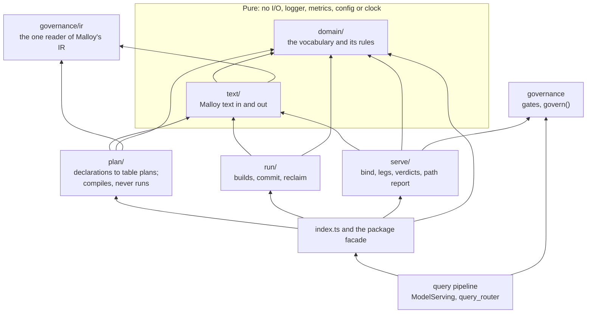

# Materialization

Builds stored tables from a package's declarations (`#@ persist`,
`#(materialize)`, `#(rollup)`, persisted views) and answers queries from
them when, and only when, the answer equals live. The design and its
decisions are in [`docs/materialization-v2-plan.md`](../../../../../docs/materialization-v2-plan.md);
this file is the map.

## Layers

Five layers, one direction. An arrow is "may import", type-only imports
included. `plan/`, `run/` and `serve/` are siblings over the two pure layers
and never import one another; only the facade composes them. Outside this
directory, code imports only `index.ts` and `domain/`.

The rules are checked mechanically: rows R5 to R10 and H5 of the
import-direction lint (`eslint.config.mjs`), the module-header and
history-comment rules H1 and H2, `layer_rules.spec.ts` (H3: each README
lists its directory's modules; H4: every export has an importer; and five
ratchets), and the rule specs beside it (`*_rule.spec.ts`): among them, no
log call carries an error's text (`never_log_rule.spec.ts`), and the facade's
public surface is listed (`facade_surface.spec.ts`). Each starts from the
violations the tree had when it was added, listed with the step that removes
it in `packages/server/materialization_allowlists.mjs`, and only shrinks. The
import rules are enforced, not yet fully true: `run/run_plan.ts` is the one
door from `run/` into `plan/`, and the edges from outside the module that
still bypass `index.ts` are listed there too.

| Directory                     | Holds                                                     |
| ----------------------------- | --------------------------------------------------------- |
| [`domain/`](domain/README.md) | The types and pure rules two layers share                 |
| [`text/`](text/README.md)     | Malloy text: the lexer, readers, edits and the source map |
| [`plan/`](plan/README.md)     | Declarations to table plans, refusals and omissions       |
| [`run/`](run/README.md)       | Builds, the run's commit, reclaim, the scheduler          |
| [`serve/`](serve/README.md)   | Bindings, the serving legs, verdicts, the path report     |

## Modules here

| Module                       | Responsibility                                                                                                                                                                                                                                                          | Read by                                                        |
| ---------------------------- | ----------------------------------------------------------------------------------------------------------------------------------------------------------------------------------------------------------------------------------------------------------------------- | -------------------------------------------------------------- |
| `index.ts`                   | The module's one public entry                                                                                                                                                                                                                                           | callers outside the module, as their edges leave the allowlist |
| `package_materialization.ts` | The package facade: one package version's bindings, snapshot and host ownership, composing the three modules below for `Package` and `Environment`. Its public surface is wide (one accessor or warning list per method, mostly) and listed in `facade_surface.spec.ts` | `package.ts`, `environment.ts`                                 |
| `plan_lifecycle.ts`          | The facade's build plan over its life: load, stale, re-derive, wait until current                                                                                                                                                                                       | the facade                                                     |
| `serve_verdicts.ts`          | The facade's serve verdicts, the preview, and the path report's catalog                                                                                                                                                                                                 | the facade                                                     |
| `package_warnings.ts`        | The package warnings and publish rejections materialization raises, as pure functions                                                                                                                                                                                   | the facade                                                     |
| `host.ts`                    | What the module needs from the rest of the server, as interfaces it owns (the host port)                                                                                                                                                                                | the service, the facade                                        |
| `stored_column_types.ts`     | A stored column's type against the type Malloy declares, both directions                                                                                                                                                                                                | the `storage=` build, the served copy                          |
| `subselect.ts`               | `FROM (<select>) AS <alias>`, safe for any SELECT a build produces                                                                                                                                                                                                      | `stored_column_types.ts`, the build session                    |

## Glossary

| Term               | Meaning                                                                                                                                                                                                                                                                                |
| ------------------ | -------------------------------------------------------------------------------------------------------------------------------------------------------------------------------------------------------------------------------------------------------------------------------------- |
| Declaration        | What an author wrote on one source to ask for a table                                                                                                                                                                                                                                  |
| Tier               | Where a table lives: `database` (the source's own warehouse) or `storage` (a configured storage destination). Nothing else                                                                                                                                                             |
| Kind               | What a table holds: `persist`, `materialize`, `pair`, `rollup`, `view` (a persisted view's or named query's table); `query` names a named query's table where a binding, a metric or the wire needs the two apart                                                                      |
| Address            | A stored table's identity: its content address (`sourceEntityId`, which folds in its destination when `persist.addressIncludesDestination` is on), its tier and its destination; Malloy's own key for it, where that differs, is the compiler key. A physical name is never part of it |
| Refusal            | Plan decided not to build a declaration (wire: `refusedSources`)                                                                                                                                                                                                                       |
| Omission           | Plan could not plan a declaration or file: it did not compile (wire: `omittedSources`, `omittedFiles`)                                                                                                                                                                                 |
| Run manifest       | What a run committed. "Manifest" alone is not used                                                                                                                                                                                                                                     |
| Manifest entry     | What a run committed about one table; the wire type                                                                                                                                                                                                                                    |
| Compiler manifest  | Malloy's `BuildManifest`, what a compile reads stored tables through                                                                                                                                                                                                                   |
| Binding            | One stored table as serving sees it                                                                                                                                                                                                                                                    |
| Leg                | A way to answer from stored tables: `view`, `query`, `rollup` or `served`                                                                                                                                                                                                              |
| Served copy        | The `served` leg: the author's source re-rooted on its stored table, gates and all                                                                                                                                                                                                     |
| Re-root            | The text rewrite that points a source at its stored table                                                                                                                                                                                                                              |
| Leg decline        | A leg that does not answer one query; public form: the path report's `SkipReason`                                                                                                                                                                                                      |
| Source decline     | A planned table not served for a source; public form: a serve verdict and a package warning                                                                                                                                                                                            |
| Keeps gates        | A table, read, still enforces its source's gates, which `govern()` proves                                                                                                                                                                                                              |
| Run store          | The catalog database's run, ledger and claim records                                                                                                                                                                                                                                   |
| Package plan       | A package's plan as plain data (`PackagePlan`), the one shape that crosses the load worker and the one the facade holds                                                                                                                                                                |
| Run plan           | The run's compiled view of the package plan (`RunPlan`): its build data beside each table's live source, the connections and the key-check compilers                                                                                                                                   |
| Placement          | The one tier decision for a table: database, or a named storage destination (`domain/placement.ts`)                                                                                                                                                                                    |
| Physical table     | A name in a place (a connection or a destination), compared by the keys of `domain/physical_table.ts`, each named for what it is safe for                                                                                                                                              |
| Table record       | A built table as a run records it: name as written, connection, destination (`TableRecord`)                                                                                                                                                                                            |
| Table ledger       | Who may drop a table a run built, over time: the rename rule and the drop rule, each keeping on doubt (`domain/table_ledger.ts`)                                                                                                                                                       |
| Kept table         | A table a run replaced and Publisher keeps, with its reason, listed on the run record and as a package warning                                                                                                                                                                         |
| Host-owned version | A version a host has bound or built: it never binds this server's own run store again. Held on the version's facade                                                                                                                                                                    |
| Admission          | Whether an answer read from stored tables is used, one pure decision (`admitRead`, `domain/admission.ts`)                                                                                                                                                                              |
| Read facts         | What admission judges a stored answer by (`ReadFacts`): the row scope, the caller's filters, the result's order, the gates, the collation probes' answers                                                                                                                              |
