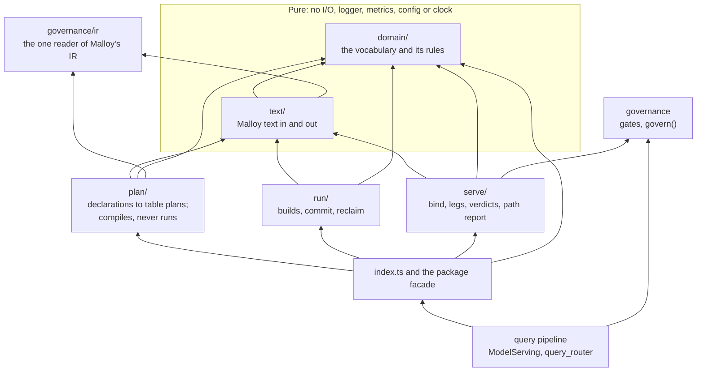

# Materialization

Builds stored tables from a package's declarations (`#@ persist`,
`#(materialize)`, `#(preaggregate)`, persisted views) and answers queries from
them when, and only when, the answer equals live. The design and its
decisions are in [`docs/materialization-v2-plan.md`](../../../../../docs/materialization-v2-plan.md);
this file is the map.

## Layers

Five layers, one direction. An arrow is "may import", type-only imports
included. `plan/`, `run/` and `serve/` are siblings over the two pure layers
and never import one another; only the facade composes them. Outside this
directory, code imports only `index.ts` and `domain/`.

The rules are checked mechanically: rows R5 to R10 and H5 of the
import-direction lint (`eslint.config.mjs`), the module-header and
history-comment rules H1 and H2, and `layer_rules.spec.ts` (H3: each README
lists its directory's modules; H4: every export has an importer; and five
ratchets). Each starts from the violations the tree had when it was added,
listed with the step that removes it in
`packages/server/materialization_allowlists.mjs`, and only shrinks.

| Directory                     | Holds                                                     |
| ----------------------------- | --------------------------------------------------------- |
| [`domain/`](domain/README.md) | The types and pure rules two layers share                 |
| [`text/`](text/README.md)     | Malloy text: the lexer, readers, edits and the source map |
| [`plan/`](plan/README.md)     | Declarations to table plans, refusals and omissions       |
| [`run/`](run/README.md)       | Builds, the run's commit, reclaim, the scheduler          |
| [`serve/`](serve/README.md)   | Bindings, the serving legs, verdicts, the path report     |

## Modules here

| Module                       | Responsibility                                                                           | Read by                                     |
| ---------------------------- | ---------------------------------------------------------------------------------------- | ------------------------------------------- |
| `index.ts`                   | The module's one public entry                                                            | (callers move onto it step by step; R10)    |
| `package_materialization.ts` | The package facade: one package version's plan, bindings, verdicts and warnings          | `package.ts`, `environment.ts`              |
| `host.ts`                    | What the module needs from the rest of the server, as interfaces it owns (the host port) | the service, the facade                     |
| `stored_column_types.ts`     | A stored column's type against the type Malloy declares, both directions                 | the `storage=` build, the served copy       |
| `subselect.ts`               | `FROM (<select>) AS <alias>`, safe for any SELECT a build produces                       | `stored_column_types.ts`, the build session |

## Glossary

| Term              | Meaning                                                                                                                     |
| ----------------- | --------------------------------------------------------------------------------------------------------------------------- |
| Declaration       | What an author wrote on one source to ask for a table                                                                       |
| Tier              | Where a table lives: `colocated` (the source's own warehouse) or `storage` (a configured storage destination). Nothing else |
| Kind              | What a table holds: `persist`, `materialize`, `pair`, `rollup`, `view`                                                      |
| Address           | A stored table's identity: source entity, tier, destination. A physical name is never part of it                            |
| Refusal           | Plan decided not to build a declaration (wire: `refusedSources`)                                                            |
| Omission          | Plan could not plan a declaration or file: it did not compile (wire: `omittedSources`, `omittedFiles`)                      |
| Run manifest      | What a run committed. "Manifest" alone is not used                                                                          |
| Manifest entry    | What a run committed about one table; the wire type                                                                         |
| Compiler manifest | Malloy's `BuildManifest`, what a compile reads stored tables through                                                        |
| Binding           | One stored table as serving sees it                                                                                         |
| Leg               | A way to answer from stored tables: `view`, `rollup` or `served`                                                            |
| Served copy       | The `served` leg: the author's source re-rooted on its stored table, gates and all                                          |
| Re-root           | The text rewrite that points a source at its stored table                                                                   |
| Leg decline       | A leg that does not answer one query; public form: the path report's `SkipReason`                                           |
| Source decline    | A planned table not served for a source; public form: a serve verdict and a package warning                                 |
| Keeps gates       | A table, read, still enforces its source's gates, which `govern()` proves                                                   |
| Run store         | The catalog database's run, ledger and claim records                                                                        |
